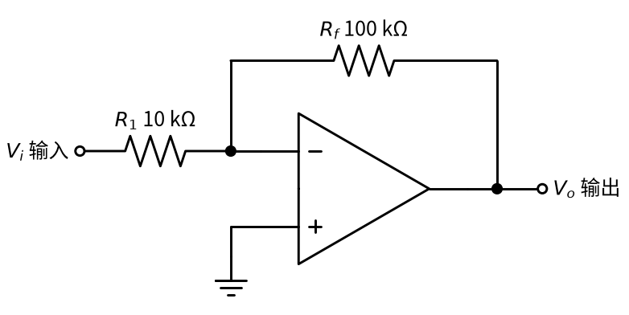
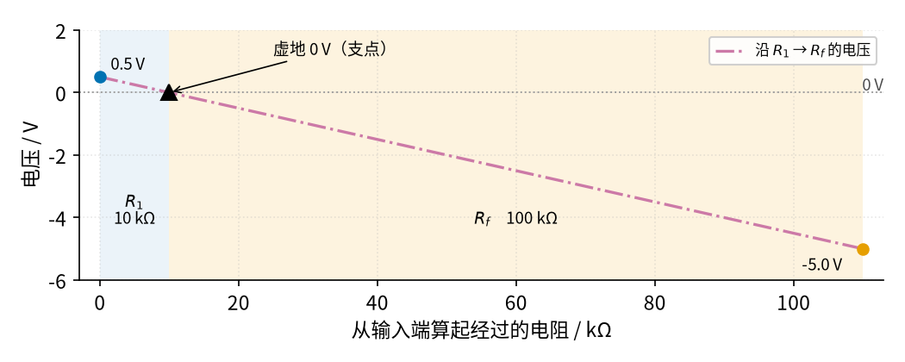
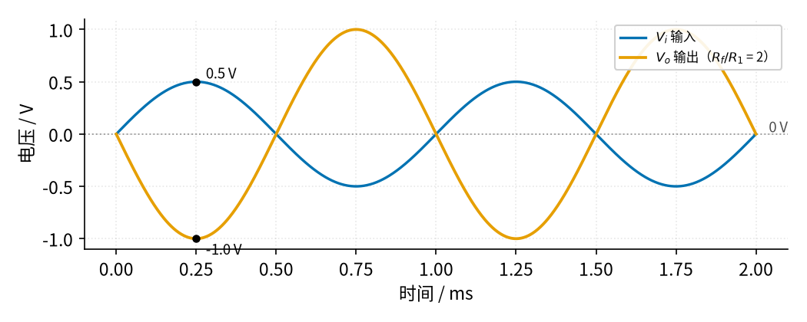

# 01 反相放大 · 直觉篇

[上一页：17 参数与调试篇](../17-self-locking/page3.md) · 本页：直觉篇 · [原理与实现篇](page2.md) · [参数与调试篇](page3.md) · [下一页：原理与实现篇](page2.md) · 前置节点：[P3 运放入门](../P3-opamp-basics/page1.md)

## 为什么需要反相放大

麦克风、光敏传感器、电桥这些"信号源"给出的电压往往只有几十毫伏，而后面的电路（比如单片机的模数转换器、功放）需要几伏的信号。我们要的是一个**倍数准确、可以随意设定**的放大器：想放大 10 倍就是 10 倍，想放大 2.5 倍就是 2.5 倍，而且不能因为换了一颗运放、天气热了一点，倍数就变了。

在 [P3 运放入门](../P3-opamp-basics/page1.md) 里我们知道：运放本身的放大倍数 A 大约是 10 万，大而不准；但只要加上**负反馈**，电路的放大倍数就只由外接电阻决定。这一节的**反相放大器**是负反馈最简单、最常用的一种接法，只用两个电阻。它的名字来自一个特点：**输出和输入方向相反**，输入往上走，输出往下走。

## 一、电路长什么样

先看 图 01-p1-1。它只比一颗运放多了两个电阻。

*图 01-p1-1　反相放大电路（输入电阻 10 kΩ，反馈电阻 100 kΩ）*

图 01-p1-1 中，输入电压 $V_i$ 经过**输入电阻** $R_1$ 接到运放的反相端（标"−"的那个输入端）；**反馈电阻** $R_f$ 从输出端 $V_o$ 接回同一个反相端，这就是负反馈；同相端（标"+"）直接接地。按符号表的约定，下标 f 是英文 feedback（反馈）的首字母。

记住这个电路的结论只需要一句话：**输出等于负的"反馈电阻比输入电阻"乘以输入**。写成公式：

$$V_o = -\frac{R_f}{R_1}\thinspace V_i$$

代一组数：图中 $R_f$ =100 kΩ， $R_1$ =10 kΩ，电阻比是 10。输入 0.5 V，输出就是 −5 V；输入 −0.2 V，输出就是 +2 V。比值 $V_o / V_i$ 叫做**电压放大倍数**，记作 $A_v$ ，这里 $A_v$ = −10，负号就表示"反相"。

## 二、直觉：一块以虚地为支点的跷跷板

为什么会是这个结果？用 P3 的两句口诀：有负反馈时，两个输入端电压几乎相等（**虚短**），而同相端接地，所以反相端也几乎是 0 V。它并没有真的接地，却"像地一样"是 0 V，所以叫**虚地**。另外，运放输入端几乎不取电流（**虚断**），所以从 $R_1$ 流进来的电流，只能全部从 $R_f$ 流走。

把 $R_1$ 和 $R_f$ 想成连在一起的一根长木板， $R_1$ 那一段长 10， $R_f$ 那一段长 100，虚地就是中间的支点。同一股电流流过两段电阻，电压就像木板的高度一样**沿着电阻均匀地变化**。看 图 01-p1-2。

*图 01-p1-2　沿输入电阻和反馈电阻走一遍，电压的变化像一块跷跷板*

图 01-p1-2 的横轴是"从输入端出发，已经经过了多少电阻"，纵轴是那一点的电压。红紫色点划线从左端的 0.5 V（蓝色圆点，输入）开始，在 10 kΩ 处穿过黑色三角形标出的虚地 0 V，一直下降到右端的 −5.0 V（橙色圆点，输出）。整条线是一根直线，因为两段电阻里流的是同一个电流，每经过 1 kΩ 电压就下降同样多。

跷跷板的道理一下子就清楚了：支点钉在 0 V 不动，左边短臂抬高 0.5 V，右边长臂就必须压低 0.5 V 的 10 倍。**两臂长度之比就是放大倍数，左边往上、右边往下，所以是反相**。想放大 2 倍？把右臂（ $R_f$ ）缩短到左臂的 2 倍就行了。

## 三、看看波形：倒过来，再拉长

如果输入是一个正弦信号，输出会是什么样？图 01-p1-3 取电阻比为 2，把输入和输出画在一起。

*图 01-p1-3　电阻比为 2 时的输入与输出波形*

图 01-p1-3 中蓝色是输入 $V_i$ ，橙色是输出 $V_o$ 。在 0.25 ms 这一刻，输入达到最高点 0.5 V，输出恰好在最低点 −1.0 V：形状一模一样，只是**上下颠倒**、**幅度变成 2 倍**。对于声音信号，上下颠倒耳朵听不出来；但对于直流信号，例如温度传感器的电压，"反相"意味着输入为正时输出为负，后面要么再接一级反相放大把它"翻回来"，要么在设计时就考虑进去。

## 四、新手最容易踩的三个坑

1. **忘了负号**。在示波器上看到输出和输入"对不上"，以为电路坏了，其实是反相。
2. **以为放大器"不吃电流"**。反相放大的输入端接的是电阻 $R_1$ ，另一头是虚地，信号源要实实在在地往 $R_1$ 里送电流，所以从输入端看进去的电阻就是 $R_1$ 。信号源本身如果有内阻，倍数就会变小（第三页会算）。
3. **以为可以无限放大**。输出被运放的电源限制住，输入太大时波形会被"削平"，下一页的仿真就会展示这一点。

## 一句话总结

**反相放大器靠负反馈把反相端钉在 0 V（虚地），像一块以虚地为支点的跷跷板：放大倍数 $A_v = -R_f / R_1$ ，输出与输入反相；它的输入电阻就是 $R_1$ ，输出幅度受电源限制。**
