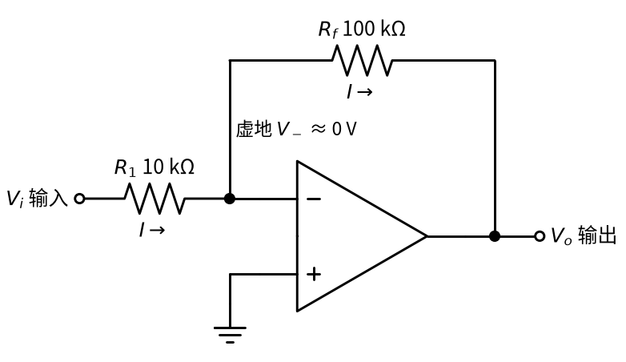
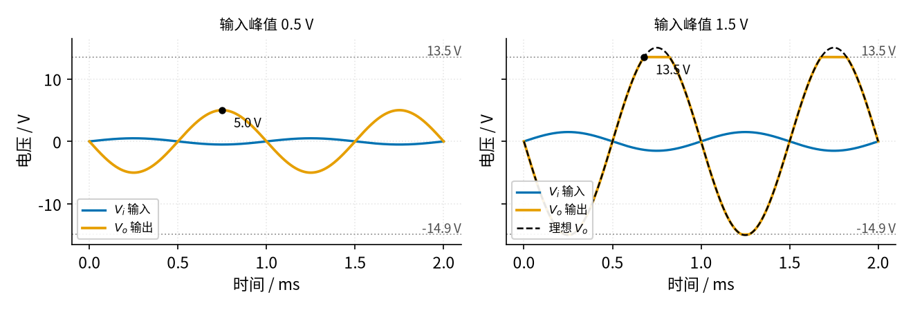
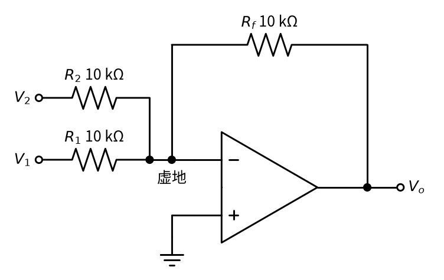
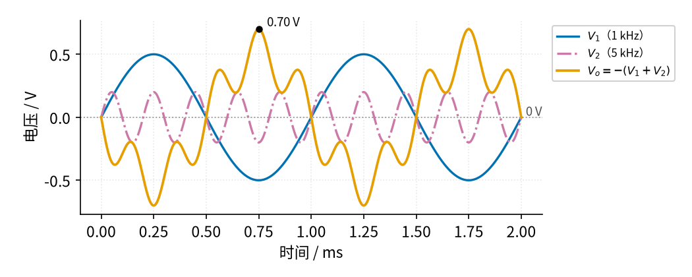

# 01 反相放大 · 原理与实现篇

[上一页：直觉篇](page1.md) · [直觉篇](page1.md) · 本页：原理与实现篇 · [参数与调试篇](page3.md) · [下一页：参数与调试篇](page3.md) · 前置节点：[P3 运放入门 · 直觉篇](../P3-opamp-basics/page1.md)

## 这一页要解决的问题

直觉篇用跷跷板说明了反相放大"倒过来、再拉长"。可是做电路时还会遇到更具体的问题：倍数为什么**正好**是电阻比？信号源要给它多少电流？输入太大时会发生什么？两路信号能不能用它混在一起？这一页用 P3 学过的**虚短**、**虚断**一步一步推出结论，用一段 Python 仿真看清"削顶"，最后做三道例题，其中第三道是把反相放大变成**加法器**。

## 一、用虚短和虚断推导放大倍数

先看 图 01-p2-1，图上把推导要用的电压和电流都标了出来。



*图 01-p2-1　推导用的反相放大电路：虚地和同一个电流*

图 01-p2-1 中，反相端那个黑点标着"虚地，约 0 V"，两个电阻下方都写着同一个电流 I，箭头向右。推导只有三步，每一步都先说意思再写式子。

**第一步：虚短，反相端电压是 0**。同相端接地，是 0 V；有负反馈、输出没有饱和时，反相端电压 $V_-$ （运放反相输入端对地的电压）几乎等于同相端，所以

$$V_- \approx 0$$

**第二步：算流过输入电阻的电流**。输入电阻两端分别是 $V_i$ 和 0 V，按欧姆定律，电流等于两端电压差除以电阻：

$$I = \frac{V_i - 0}{R_1} = \frac{V_i}{R_1}$$

代数：输入 0.5 V、 $R_1$ =10 kΩ，电流 I = 0.05 mA。

**第三步：虚断，这股电流全部流过反馈电阻**。运放输入端不取电流，所以 I 只能继续流过 $R_f$ ，从虚地流向输出端。反馈电阻上的电压降是 $I R_f$ ，左端是 0 V，右端（输出）就比 0 V 低这么多：

$$V_o = 0 - I R_f = -\frac{R_f}{R_1}\thinspace V_i$$

代数：0.05 mA × 100 kΩ = 5 V，所以 $V_o$ = −5 V，和直觉篇的跷跷板一致。放大倍数

$$A_v = \frac{V_o}{V_i} = -\frac{R_f}{R_1}$$

里面没有运放自己的开环增益 A，因为上面三步默认 A 无穷大、把 $V_-$ 当成正好 0 V。真实的 A 是有限的，P3 运放入门的原理与实现篇讲过这会让倍数略小于电阻比；下面用具体数字验算一遍，看差多少、什么时候不能忽略。

**验算：虚地到底有多「地」**？这件事 [P3 运放入门 · 原理与实现篇](../P3-opamp-basics/page2.md) 已经用同一个电路完整推导过，这里不再重复，直接代入那里的结论：

$$V_o = -\frac{R_f}{R_1}\thinspace V_i \times \frac{1}{1 + \dfrac{1 + R_f/R_1}{A}}$$

中文意思：**真实输出 = 理想输出 × 一个略小于 1 的修正系数**，修正量是「1 + 电阻比」除以 A。回顾 P3 的数字：A = 100000、电阻比 10 时输出 −4.99945 V，反相端只有约 50 µV，「虚地」名副其实。

> 💡 **实际芯片会怎样**：50 µV 是只考虑开环增益的理论值。真实的 LM358B 两个输入端之间还有零点几毫伏的失调电压（手册典型 ±0.3 mV、最大 ±3 mV），用 TI 的 LM358B 模型做 SPICE 仿真，反相端约 0.36 mV、输出 −4.99696 V。所以 [01 反相放大 · 直觉篇](page1.md) 第五节用万用表量到的是零点几毫伏，而不是 50 µV；它对 5 V 输出的影响只有千分之一左右。

但 A = 十万只是低频时的值。P3 讲过，运放的增益会随频率下降，LM358B 的增益带宽积约 1.2 MHz，意思是运放**自身**的 A 乘以信号频率大约等于 1.2 MHz，所以到 1.2 kHz 左右 A 就只剩约 1.2 MHz ÷ 1.2 kHz = 1000，反相端的电压也从几十微伏涨到约 5 mV（5 V ÷ 1000）。不过输出幅度并没有小 1.1%：频率升高以后，运放自身的输出比输入落后约四分之一个周期（相位差 90°），这时的 A 不能当普通数字直接代进上面的式子，修正分母里的「1」和「11/1000」要像直角三角形的两条直角边那样合成，结果是 √(1² + 0.011²) ≈ 1.00006，幅度误差只有万分之一左右，输出仍约 −5.00 V，只是比输入多落后了约 0.6°。用 TI 的 LM358B 模型做 SPICE 仿真也是这样：1.2 kHz 时输出幅度 4.999 V，误差只有约 0.02%。真正让倍数明显下降的是更高的频率：按 [01 反相放大 · 参数与调试篇](page3.md) 第一节第 4 小节的带宽公式，这个 10 倍电路的带宽约 109 kHz，到 50 kHz 时倍数约 9.1，降了约 9%。所以**倍数越大、信号频率越接近带宽，「只看电阻比」就越不准**；要在几十 kHz 上放大很多倍，就得换增益带宽积更大的运放，或者把倍数分到两级去做。

**顺便得到输入电阻**。从信号源看进去，它"看到"的是电压 $V_i$ 、电流 $V_i / R_1$ ，所以反相放大的**输入电阻**（信号源看进去的等效电阻，记作 $R_{in}$ ）就是

$$R_{in} = \frac{V_i}{I} = R_1$$

代数： $R_1$ =10 kΩ，输入电阻就是 10 kΩ。这个值不大，第三页会看到它怎样和信号源内阻"抢"电压。

## 二、仿真：正常放大与削顶

推导里有个前提："输出没有饱和"。运放输出不能超过电源，按 P3 运放入门的参数与调试篇用的 LM358B 典型值，±15 V 供电时输出最高约 13.5 V、最低约 −14.9 V。下面这段仿真把"乘以 −10"和"不能超出范围"放在一起：输出先按理想公式算，再用 `np.clip` 把超出范围的部分剪掉。代码和仓库里的 code/01_sim.py 内容一致，存成文件后**在仓库根目录运行**（开头两行会找到 code/figs 里的画图样式文件）。

```python
import sys, pathlib
sys.path.insert(0, str(pathlib.Path("code/figs").resolve()))  # 在仓库根目录运行
# 01 反相放大最小仿真：V_o = −(R_f/R_1)·V_i，再加上「输出不能超出电源」这条限制，看正常放大和削顶。
import numpy as np                                 # 数组运算
import matplotlib.pyplot as plt                    # 画图
import figstyle as fs                              # 全书统一的颜色、轴标签、保存函数

R1, Rf = 10e3, 100e3                               # 输入电阻 R1 = 10 kΩ，反馈电阻 Rf = 100 kΩ
A_v = -Rf / R1                                     # 放大倍数 A_v = −Rf/R1 = −10（负号表示反相）
V_CC, V_EE = 15.0, -15.0                           # 正负电源 ±15 V
V_HI, V_LO = V_CC - 1.5, V_EE + 0.1                # 输出能到的最高 / 最低电压（LM358B 典型值，见 P3 page3）
t = np.linspace(0, 2e-3, 2001)                     # 时间：0 到 2 ms，取 2001 个点

fig, axes = plt.subplots(1, 2, figsize=fs.SIZE["pair"], sharey=True)  # 左右两张小图，共用纵轴
for ax, amp in zip(axes, (0.5, 1.5)):              # 左图输入峰值 0.5 V，右图 1.5 V
    V_i = fs.sine(t, 1e3, amp=amp)                 # 1 kHz 正弦输入
    V_o = np.clip(A_v * V_i, V_LO, V_HI)           # 理想输出乘 −10，再被限制在输出范围内
    print(f"输入峰值 {amp} V：理想输出峰值 {abs(A_v)*amp:.1f} V，"   # 打印图上的数字
          f"实际最高 {V_o.max():.2f} V、最低 {V_o.min():.2f} V")
    ax.plot(t * 1e3, V_i, **fs.LS["vin"], label="$V_i$ 输入")            # 蓝色：输入
    ax.plot(t * 1e3, V_o, **fs.LS["vout"], label="$V_o$ 输出")           # 橙色：输出
    if amp > 1:                                                           # 右图再画理想输出作对照
        ax.plot(t * 1e3, A_v * V_i, **fs.LS["good"], label="理想 $V_o$")  # 黑色虚线：不受电源限制时
        ax.legend(loc="lower left", fontsize=8)                           # 右图图例
    fs.ref_h(ax, V_HI, f"{V_HI} V"); fs.ref_h(ax, V_LO, f"{V_LO} V")      # 灰色点线：输出上下限
    k = np.argmax(V_o)                                                    # 输出最高点
    fs.mark(ax, t[k] * 1e3, V_o[k], fmt="{:.1f}", unit=" V", dx=8, dy=-12)  # 标出最高点数值
    ax.set_title(f"输入峰值 {amp} V", fontsize=10)                          # 小图标题
    fs.axlabels(ax, "时间", "ms", "电压", "V")                              # 轴标签：量（单位）
axes[0].legend(loc="lower left", fontsize=8)                              # 左图图例
V_o_small = A_v * fs.sine(t, 1e3, amp=0.5)                               # 小输入时的理想输出
assert abs(V_o_small.max() - 5.0) < 1e-3 and V_o_small.max() < V_HI   # 0.5 V × 10 = 5 V，没有削顶
assert np.clip(A_v * fs.sine(t, 1e3, amp=1.5), V_LO, V_HI).max() == V_HI  # 1.5 V × 10 = 15 V，被削在 13.5 V
fs.save(fig, "01", "01_p2_2_sine_clip.png")       # 保存到 01-inverting-amp/img/
```

运行后除了几行以 [数值]、[图] 开头的提示，还会打印两行结论：

```text
输入峰值 0.5 V：理想输出峰值 5.0 V，实际最高 5.00 V、最低 -5.00 V
输入峰值 1.5 V：理想输出峰值 15.0 V，实际最高 13.50 V、最低 -14.90 V
```

并生成 图 01-p2-2。



*图 01-p2-2　放大 10 倍：小输入正常放大，大输入被电源削顶*

图 01-p2-2 左图中，蓝色输入峰值 0.5 V，橙色输出是峰值 5.0 V 的反相正弦，没有碰到两条灰色点线（13.5 V 和 −14.9 V）。右图输入加大到 1.5 V，理想输出应是黑色虚线那样的 15 V 正弦，但橙色实线在 13.5 V 被削平，底部也在 −14.9 V 被削平，波形变成了"平顶"。削顶的这段时间里输出已经饱和，虚短不再成立，公式也就不再适用。这里的 −14.9 V 是输出几乎不带负载时的典型值；本电路里输出要经反馈电阻往里吸电流，LM358B 吸电流时负侧余量会变大，用 TI 模型做 SPICE 仿真，负半周约在 −14.4 V 就被削平（正半周约 13.8 V）。

还要注意上下不对称：LM358B 的输出能贴近负电源，却到不了正电源附近，所以先被削掉的是正半周。设计时要保证"倍数 × 输入峰值"小于输出摆幅，并留出余量。

## 三、例题

### 例 1（完整示例）：设计 −2 倍放大器

**题目**：需要把信号放大 2 倍并反相，参考 TI 电路手册 SBOA270 的设计，取 $R_1$ =10 kΩ，求 $R_f$ ；输入 1 V 直流时输出多少？流过电阻的电流多大？

**解**：

1. 要求 $A_v = -2$ ，即 $R_f / R_1 = 2$ ，所以 $R_f$ = 2 × 10 kΩ = 20 kΩ。
2. 输出 $V_o = -2 \times 1$ V = −2 V。
3. 电流 I = 1 V ÷ 10 kΩ = 0.1 mA，同一股电流流过 20 kΩ，压降 2 V，正好从虚地 0 V 降到 −2 V。
4. 检查：输出 2 V 远小于 13.5 V 的摆幅，不会削顶；输入电阻 10 kΩ。

### 例 2（关键步骤留空）：换一组电阻

**题目**：信号源要求放大器的输入电阻至少 20 kΩ，放大倍数仍为 −5。求 $R_1$ 、 $R_f$ ，以及输入 0.3 V 时的输出。

**解**（请把空白补上）：

```python
# 不运行
R1 = ____          # 输入电阻 = R1，至少 20 kΩ，就取 20e3
Rf = ____ * R1     # |A_v| = Rf / R1 = 5
V_o = -(Rf / R1) * 0.3   # 输出 = ____ V
```

<details><summary>答案</summary>

R1 = 20e3（20 kΩ），Rf = 5 × 20 kΩ = 100 kΩ，输出 $V_o$ = −5 × 0.3 V = −1.5 V。

</details>

### 例 3（变体迁移）：两路信号相加——反相加法器

**题目**：把两路信号 $V_1$ 、 $V_2$ 混在一起输出。反相端是虚地，能不能在它上面再接一个输入电阻？

**思路**：虚地是 0 V，所以**每一路输入都只管自己的电阻**，互不干扰。看 图 01-p2-3。



*图 01-p2-3　反相加法器（三个电阻都是 10 kΩ）*

图 01-p2-3 中， $V_1$ 经 $R_1$ 、 $V_2$ 经 $R_2$ （第二路的输入电阻）都接到反相端。同样三步：

1. 虚短：反相端 0 V。
2. 两路电流分别是 $V_1/R_1$ 、 $V_2/R_2$ ，在虚地点汇合。
3. 虚断：汇合后的总电流全部流过 $R_f$ ，所以

$$V_o = -\left(\frac{R_f}{R_1}V_1 + \frac{R_f}{R_2}V_2\right)$$

三个电阻相等时就是 $V_o = -(V_1 + V_2)$ 。代数： $V_1$ =0.5 V、 $V_2$ =0.2 V，输出 −0.7 V。图 01-p2-4 用两路不同频率的正弦验证。



*图 01-p2-4　加法器的两路输入与输出*

图 01-p2-4 中，蓝色是 $V_1$ （0.5 V、1 kHz），红紫色点划线是 $V_2$ （0.2 V、5 kHz），橙色输出是两者相加再取负：大波浪上叠着小波纹，并且上下颠倒，最高处标出 0.70 V。这就是调音台"混音"的原理。把某一路的输入电阻改小，那一路的权重就变大。

## 本页小结

**推导三步：虚短得虚地 → 欧姆定律算电流 → 虚断让电流全部流过反馈电阻，得到 $V_o = -(R_f/R_1)V_i$ ，输入电阻等于 $R_1$ 。公式只在输出未饱和时成立；在虚地上多接几路输入，就成了加法器**。
