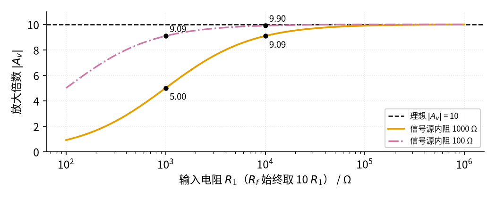
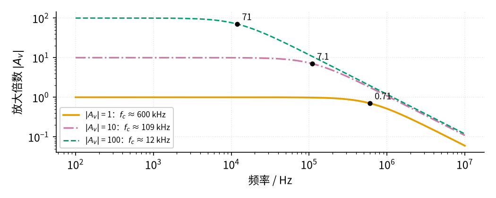

# 01 反相放大 · 参数与调试篇

[上一页：原理与实现篇](page2.md) · [直觉篇](page1.md) · [原理与实现篇](page2.md) · 本页：参数与调试篇 · [下一页：21 MOS 管开关](../21-mosfet-switch/page1.md) · 前置节点：[P3 运放入门](../P3-opamp-basics/page1.md) · 后续：[02 同相放大](../02-noninverting-amp/page1.md)、[04 差分放大](../04-differential-amp/page1.md)

## 痛点：公式明明算对了，实测倍数却不对

按 $A_v = -R_f/R_1$ 搭好电路，实测常常出现三种"意外"：倍数比算的小；高频信号放大不上去；输出波形顶部被削平。原因都不在公式本身，而在公式**没写出来的前提**：信号源是理想的、运放带宽无限、输出不受电源限制。这一页逐个参数讲清楚怎么选，再给出一张排查表和三道练习。

## 一、参数怎么选

| 参数 | 作用 | 常用取值 | 选取要点 |
|---|---|---|---|
| $R_1$ | 决定输入电阻 | 1 kΩ～100 kΩ | 至少是信号源内阻的 100 倍；太大则噪声和漏电影响变大 |
| $R_f$ | 和 $R_1$ 一起决定倍数 | $\lvert A_v\rvert$ × $R_1$ | 一般不超过 1 MΩ |
| 电源电压 | 决定输出能摆多大 | ±5 V～±15 V | 输出峰值要小于摆幅并留余量 |
| 运放增益带宽积 GBW | 决定能放大多高的频率 | LM358B 为 1.2 MHz | 带宽约为 GBW ÷（1+ $\lvert A_v\rvert$ ） |

### 1. 输入电阻和信号源内阻：别让信号源"喂不饱"

真实的信号源都有**内阻**（记作 $R_s$ ，可以想成信号源里面串着的一个电阻）。它和 $R_1$ 串联，流进虚地的电流变成 $V_i/(R_s+R_1)$ ，倍数就变成反馈电阻除以"两个电阻之和"：

$$\lvert A_v\rvert = \frac{R_f}{R_s + R_1}$$

代数：内阻 1 kΩ、 $R_1$ =10 kΩ、 $R_f$ =100 kΩ，倍数是 100 ÷ 11 ≈ 9.09，比设计值 10 小了约 9%。图 01-p3-1 把这种影响画成曲线。

*图 01-p3-1　信号源内阻让放大倍数变小（反馈电阻始终是输入电阻的 10 倍）*

图 01-p3-1 中，黑色虚线是理想倍数 10。橙色线（内阻 1 kΩ）在 $R_1$ =1 kΩ 时只有 5.00，在 10 kΩ 时是 9.09；红紫色点划线（内阻 100 Ω）在 1 kΩ 时是 9.09，在 10 kΩ 时是 9.90。规律是：**$R_1$ 比内阻大 100 倍时，误差约 1%**。如果信号源内阻很大（比如几十千欧的传感器），反相放大就不合适了，应该换成输入电阻极大的 02 同相放大或 03 电压跟随器。TI 的反相放大电路手册 SBOA270 也提醒：输入阻抗由 $R_1$ 决定，应远大于信号源内阻。

### 2. 电阻的取值范围

只要比值对，10 kΩ/100 kΩ 和 1 kΩ/10 kΩ 的倍数一样，但各有代价。电阻太小，信号源和运放输出要提供的电流太大：反馈电阻 1 kΩ、输出 10 V 时，电流就有 10 mA，运放会发热甚至带不动。电阻太大（几兆欧），电路板表面的漏电、运放输入端的微小电流以及电阻自身的噪声都会显现。常用的折中是**几千欧到几百千欧**。

### 3. 输出摆幅：输入 × 倍数要小于摆幅

原理与实现篇已经看到：±15 V 供电的 LM358B，输出最高约 13.5 V、最低约 −14.9 V。允许的最大输入峰值等于摆幅除以倍数：

$$V_{i,\max} = \frac{V_{o,\max}}{\lvert A_v\rvert}$$

代数：倍数 10、正向摆幅 13.5 V，输入峰值不能超过 1.35 V；为了留余量，最好控制在 1 V 左右。

### 4. 带宽：倍数越大，能放大的频率越低

运放的放大能力随频率升高而下降。厂家用**增益带宽积** GBW 描述这件事：大致可以理解为"倍数 × 带宽 ≈ 常数"。反相放大的带宽（倍数下降到低频值 0.707 倍时的频率，记作 $f_c$ ）约为

$$f_c \approx \frac{\mathrm{GBW}}{1 + \lvert A_v\rvert}$$

高于带宽时，倍数按下面的幅值公式下降（这里只用幅值，不需要复数）：

$$\lvert A_v(f)\rvert = \frac{\lvert A_v\rvert}{\sqrt{1 + (f/f_c)^2}}$$

代数：GBW=1.2 MHz、倍数 10，带宽约 1.2 MHz ÷ 11 ≈ 109 kHz。图 01-p3-2 画出三种倍数的频率曲线。

*图 01-p3-2　增益带宽积 1.2 MHz 时，不同倍数的频率响应*

图 01-p3-2 中，每条曲线在低频都是平的，到了带宽附近开始下降，图上的黑点就是降到 0.707 倍的位置：橙色（倍数 1）在约 600 kHz 处为 0.71，红紫色点划线（倍数 10）在约 109 kHz 处为 7.1，蓝绿色虚线（倍数 100）在约 11.9 kHz 处为 71。**倍数每大 10 倍，带宽大约就小 10 倍**。倍数为 1 时带宽是 600 kHz 而不是 1.2 MHz，是因为反相接法的分母是 1+ $\lvert A_v\rvert$ =2。所以要放大 1000 倍的音频信号，用一级 LM358B 是不够的，应该拆成两级各放大约 32 倍。另外，大信号时还要考虑压摆率（LM358B 典型 0.5 V/μs），它限制了输出电压变化的最快速度。

## 二、故障排查表

| 现象 | 原因 | 怎么查 | 怎么改 |
|---|---|---|---|
| 输出和输入"对不上"，看起来颠倒 | 反相放大本来就反相 | 双通道示波器同时看两路，输入最高时输出是否最低 | 这是正常现象；需要同相就再加一级 −1 倍，或改用同相放大 |
| 倍数比计算值小 | 信号源内阻和 $R_1$ 串联 | 断开信号源测开路电压，再接上测 $R_1$ 左端电压，看是否下降 | 加大 $R_1$ （同比例加大 $R_f$ ），或在前面加跟随器 |
| 输出顶部或底部被削平 | 输入 × 倍数超过输出摆幅 | 测输出最高、最低电压，和电源电压比较 | 减小输入或倍数，提高电源电压，或换轨到轨运放 |
| 高频信号倍数明显下降 | 倍数太大，超过 GBW 限制 | 改变信号频率，找出倍数降到 0.707 的频率 | 降低单级倍数、分成两级，或换 GBW 更大的运放 |
| 输出贴在某一电源轨不动 | 反馈电阻开路，或同相端没接地 | 断电测 $R_f$ 阻值；通电测同相端是否 0 V | 重新焊接 $R_f$ ，把同相端可靠接地 |
| 单电源供电时负半周全没了 | 单电源下输出到不了 0 V 以下 | 看输出负半周是否平在约 0.1 V | 同相端接到电源一半的偏置电压（见 P3 运放入门的原理与实现篇例 3） |
| 输出有高频振荡、运放发热 | 直接驱动长电缆等容性负载 | 示波器看输出是否有几百千赫的振铃 | 输出串一个几十欧的小电阻再接负载（见 03 电压跟随器） |

## 三、练习

**练习 1（基础）**： $R_1$ =4.7 kΩ、 $R_f$ =47 kΩ，输入 −0.2 V 直流，输出是多少？输入电阻是多少？

答案

倍数 $A_v = -47/4.7 = -10$ ，输出 $V_o$ = −10 × (−0.2 V) = +2 V，输入电阻等于 $R_1$ =4.7 kΩ。

**练习 2（提高）**：用 ±12 V 供电的 LM358B（输出最高约 10.5 V、最低约 −11.9 V）做一个 −20 倍的放大器，信号源内阻 500 Ω，要求内阻造成的倍数误差不超过 1%。(1) $R_1$ 至少取多少？ $R_f$ 取多少？(2) 输入正弦峰值最大多少才不削顶？(3) 带宽大约多少？

答案

(1) 误差约等于 $R_s / R_1$ ，要不超过 1%， $R_1$ ≥ 100 × 500 Ω = 50 kΩ，取 51 kΩ，则 $R_f$ = 20 × 51 kΩ = 1.02 MΩ（可用 1 MΩ，倍数约 19.6）。

(2) 先被削的是正半周，最大输入峰值 = 10.5 V ÷ 20 ≈ 0.53 V。

(3) 带宽 ≈ 1.2 MHz ÷ (1+20) ≈ 57 kHz。

**练习 3（变体迁移）**：做一个简单的混音器：话筒信号 $V_1$ 要放大 5 倍，伴奏信号 $V_2$ 只要放大 1 倍，混合后反相输出。反馈电阻取 50 kΩ，两路输入电阻各取多少？当 $V_1$ =0.1 V、 $V_2$ =0.3 V 时输出多少？

答案

由加权加法器公式 $V_o = -(R_f/R_1\cdot V_1 + R_f/R_2\cdot V_2)$ ：要求 $R_f/R_1=5$ ，所以 $R_1$ =10 kΩ；要求 $R_f/R_2=1$ ，所以 $R_2$ =50 kΩ。输出 $V_o$ = −(5 × 0.1 + 1 × 0.3) V = −0.8 V。每一路只"看到"自己的电阻接到虚地，所以互不干扰。

## 本页小结

**选 $R_1$ 要远大于信号源内阻（100 倍时误差约 1%），电阻取几千欧到几百千欧；输入峰值 × 倍数要小于输出摆幅；带宽约为 GBW ÷（1+倍数），倍数大了就分级。排查时先想想"公式没写出来的前提"是不是被打破了**。
