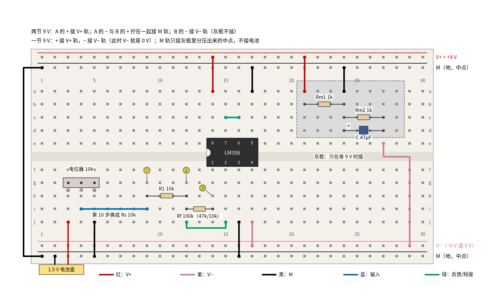
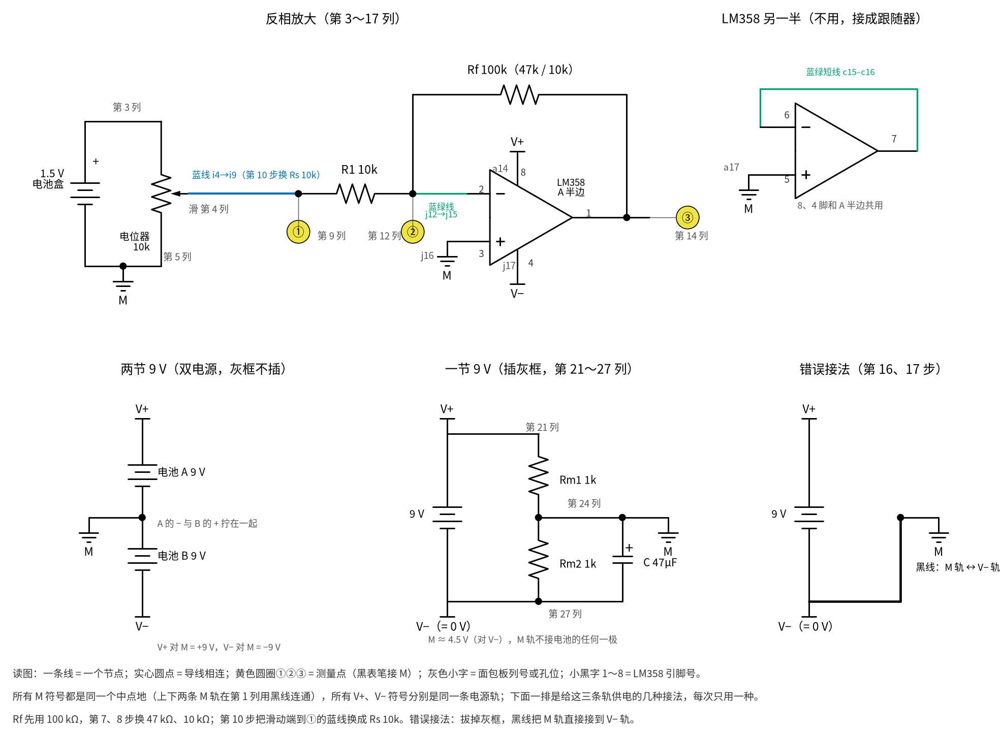
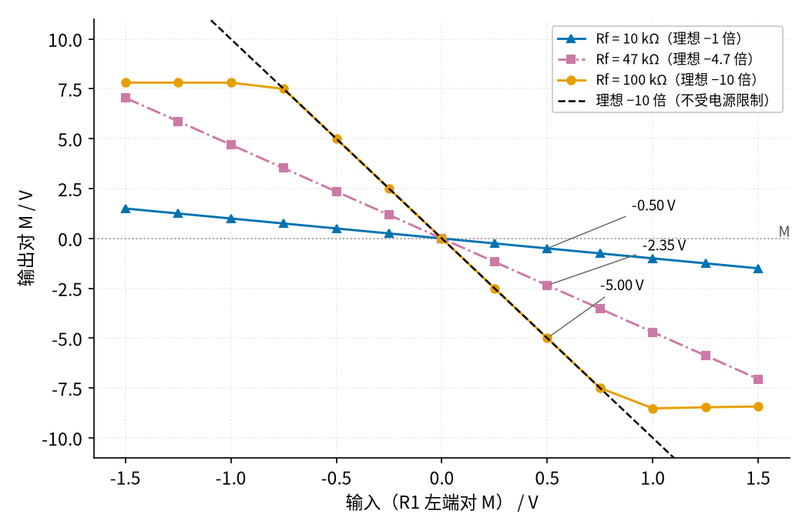

# 01 反相放大 · 动手实验篇

[上一页：参数与调试篇](page3.md) · [直觉篇](page1.md) · [原理与实现篇](page2.md) · [参数与调试篇](page3.md) · 本页：动手实验篇 · [下一页：21 MOS 管开关 · 直觉篇](../21-mosfet-switch/page1.md) · 前置节点：[P3 运放入门 · 直觉篇](../P3-opamp-basics/page1.md) · 后续：[02 同相放大 · 直觉篇](../02-noninverting-amp/page1.md)、[04 差分放大 · 直觉篇](../04-differential-amp/page1.md)

## 这次实验要验证什么

前三页用 ±15 V 电源和信号发生器讲反相放大，这一页换成手边就有的东西：一片 LM358、9 V 电池、一节 5 号电池和一个电位器，只用万用表，把下面四件事量出来：

1. **倍数只由两只电阻决定**：输入电阻 R1 = 10 kΩ 不动，反馈电阻 Rf 依次换成 100 kΩ、47 kΩ、10 kΩ，输入 +0.5 V 时输出分别约 −5.0 V、−2.35 V、−0.50 V，正好是"输出 = −(Rf ÷ R1) × 输入"。对应 [01 反相放大 · 原理与实现篇](page2.md) 第一节的三步推导。
2. **跷跷板上流的是同一个电流**：R1 两端是 0.5 V，Rf 两端是 5 V，按欧姆定律算出来都是 0.05 mA；反相端离中点只有零点几毫伏，这就是虚地。对应 [01 反相放大 · 直觉篇](page1.md) 第二节那张跷跷板图。
3. **输入电阻就是 R1，信号源内阻会吃掉倍数**：在电位器和 R1 之间串一只 10 kΩ 电阻当作"信号源内阻"，倍数从 10 掉到 5。对应 [01 反相放大 · 参数与调试篇](page3.md) 第一节第 1 小节。
4. **单电源一定要造中点**：一节 9 V 电池、用分压造出中点时，正负输入都能正常放大；如果偷懒把中点直接接在电池负极上，正输入时输出贴在 0 V 不动，只剩一半能用。对应 [01 反相放大 · 参数与调试篇](page3.md) 故障排查表里"单电源负半周被削平"那一行。

## ⚠️ 安全须知

- **只用 12 V 及以下的直流电**。本页任何一点对中点 M 都不超过 9 V。两节 9 V 电池串联后 V+ 轨到 V− 轨之间是 18 V，这是本页的上限，不要再串第三节，也不要换成别的电源。
- **9 V 电池的两个扣子不能碰在一起**，短路几秒钟电池就会发烫。电池扣另一头没插进面包板时，用胶带包好。
- **LM358 缺口朝左，8 脚接 V+、4 脚接 V−**，接反时芯片很快发烫，**不要用手去摸**，立即拔掉电池扣。
- **电解电容分正负极**：单电源时那只 47 μF 电容，长脚接 M，短脚（白色条纹一侧）接 0 V。
- **换电阻、改接法之前先断电**。本页要换三次 Rf、插拔一次 Rs、改两次电源接法，每次都先拔电池扣。

## 器材清单

| 元件 | 型号或数值 | 数量 | 说明 |
|---|---|---|---|
| 运放 | LM358（DIP-8 直插） | 1 | 只用 A 半边，B 半边接成跟随器 |
| 9 V 电池 | 6F22 叠层电池 + 电池扣 | 2 | 双电源用两节，单电源用一节 |
| 1.5 V 电池 | 5 号电池 + 单节电池盒 | 1 | 产生输入电压 |
| 电位器 | 10 kΩ，三脚直插 | 1 | 调输入 |
| 电阻 | 10 kΩ | 3 | R1、Rs，以及第 8 步当 Rf 用 |
| 电阻 | 47 kΩ | 1 | 第 7 步的 Rf |
| 电阻 | 100 kΩ | 1 | 默认的 Rf |
| 电阻 | 1 kΩ | 2 | 单电源分压 Rm1、Rm2 |
| 电解电容 | 47 μF / 16 V | 1 | 稳住单电源的中点 |
| 面包板 | 830 孔 | 1 | 上下各两条电源轨 |
| 跳线 | 红、黑、红紫、蓝、蓝绿 | 若干 | 颜色约定见下图 |
| 万用表 | 数字式，有直流 200 mV 挡 | 1 | 量虚地要用 200 mV 挡 |

电阻用普通 5% 碳膜电阻。"应该读到"一栏按 5% 公差给范围，例如 Rf = 47 kΩ 时倍数可能在 4.25～5.19 之间。

## 搭建步骤

**中点（地）怎么接**是本页最要紧的事。所有电压都以中点 M 为参考，面包板上第二条轨（T2）和下面第二条轨（B2）都是 M，最上面的 T1 是 V+，下面的 B1 是 V−，万用表黑表笔几乎一直插在 M 上。

- **两节 9 V（双电源）**：电池 A 的 + 接 V+ 轨；电池 A 的 − 和电池 B 的 + 拧在一起接 M 轨；电池 B 的 − 接 V− 轨。V+ 对 M 是 +9 V，V− 对 M 是 −9 V。右上角灰框里的元件不插。
- **一节 9 V（单电源）**：电池 + 接 V+ 轨，− 接 V− 轨，这时 V− 轨就是 0 V。M 由灰框里两只 1 kΩ 电阻分压造出，约 4.5 V，再并一只 47 μF 电容。**M 轨不接电池的任何一极**。
- **错误接法（只在第 16、17 步做对照）**：一节 9 V，拔掉灰框里的元件和线，用一根黑线把 M 轨直接接到 V− 轨，也就是让 M = 电池负极 = 0 V。

见 图 01-p4-1。电路原理和 [01 反相放大 · 直觉篇](page1.md) 第一节那张反相放大电路图完全一样，只是"地"换成了 M。



*图 01-p4-1　LM358 反相放大的面包板接法（Rf 可换 47 kΩ、10 kΩ；蓝线 i4–i9 在第 10 步换成 Rs）*

认不清哪根线接哪只脚时，对照 图 01-p4-3 的电路原理图：上排是反相放大电路和 LM358 不用的另一半，下排是三种供电接法，每次只用其中一种。



*图 01-p4-3　图 01-p4-1 对应的电路原理图（灰色小字是面包板列号或孔位，小黑字 1～8 是 LM358 引脚号）*

**对照看**：面包板的连通规则见 [P1 元件速成 · 动手实验篇](../P1-components-basics/page4.md)；这块板和 [P3 运放入门 · 动手实验篇](../P3-opamp-basics/page4.md) 是同一种接法，LM358 下排 f14～f17 是 1～4 脚。原理图上 R1 和 Rf 的公共端就是第 12 列（②），它经蓝绿线 j12→j15 接到 2 脚，所以"跷跷板"的支点在面包板上其实是第 12 列和第 15 列这一整个节点。换 Rf 只动 i12–i14 这一只电阻，第 10 步的 Rs 换掉的是滑动端到 ① 那根蓝线，在原理图上正好串在电位器和 R1 之间。下排第三种"错误接法"把 M 和 V− 接成同一点，3 脚于是落在 0 V，这就是第 16 步输出动不了的原因。

图 01-p4-1 里红线是 V+，红紫色线是 V−，黑线是 M，蓝线是输入，蓝绿色线是反馈和短接，黄圈 ①②③ 是测量点。按顺序插：

1. 黑线把上面的 M 轨（T2 第 1 列）和下面的 M 轨（B2 第 1 列）连通。
2. LM358 缺口朝左跨在中间槽上：1～4 脚在 f14～f17，8～5 脚在 e14～e17。
3. 电源：红线 a14 → V+ 轨（8 脚），红紫色线 j17 → V− 轨（4 脚）。
4. 同相端：黑线 j16 → M 轨（3 脚）。
5. B 半边：蓝绿色短线 c15–c16（7 脚接 6 脚），黑线 a17 → M 轨（5 脚）。
6. 电位器插 g3、g4、g5，黑线 j5 → M 轨；电池盒红线插 j3，黑线插 M 轨（B2 第 2 列）。滑动端 g4 可在 0～1.5 V 之间调，对调电池盒两根线就得到负电压。
7. 输入：蓝线 i4 → i9，第 9 列是输入点 ①，也就是 R1 的左端。
8. R1（10 kΩ）插 h9–h12；蓝绿色线 j12 → j15 把第 12 列接到 2 脚，第 12 列是反相端 ②。
9. Rf（先用 100 kΩ）插 i12–i14，第 14 列是输出 ③（1 脚）。
10. 单电源时再插灰框：红线 T1 第 21 列 → a21；Rm1 插 b21–b24；黑线 a24 → M 轨；Rm2 插 c24–c27；电容长脚 d24、短脚 d27；红紫色线 e27 → V− 轨（B1 第 29 列）。
11. 先按双电源接好，做第 0～13 步；断电改成单电源做第 14、15 步；再断电改成错误接法做第 16、17 步。

## 测量表

万用表直流电压挡，黑表笔接 M 轨（第 5、6 步量电阻两端，黑表笔插在电阻的另一端）。"应该读到"里的"仿真"值由 `code/figs/01_figs.py` 用 ngspice 加 TI 的 LM358B 模型现算并打印，电路就是本页这块板子（两节 9 V，或一节 9 V 加 1 kΩ/1 kΩ 分压）；范围是按 5% 电阻算的，反相端的毫伏范围取自 [01 的 SPICE 核对表](../review/spice/01.md) 的面包板读数表。

| 步骤 | 测什么 | 红表笔 | 黑表笔 | 挡位 | 应该读到 | 读不到时先查 |
|---|---|---|---|---|---|---|
| 0 | 双电源 V+ | V+ 轨 | M 轨 | 直流 20 V | +8 V 以上 | 电池 A 的电池扣 |
| 1 | 双电源 V− | V− 轨 | M 轨 | 直流 20 V | −8 V 以下 | 读到正值：电池 B 接反 |
| 2 | ① 调到 +0.50 V | 第 9 列 | M 轨 | 直流 2 V | 0.500 V（边看边转电位器） | 电池盒红线是否在 j3 |
| 3 | ③ 输出（Rf = 100 kΩ） | 第 14 列 | M 轨 | 直流 20 V | −4.52～−5.53 V（仿真 −5.00 V） | 读到约 −8.4 V：Rf 没插好 |
| 4 | ② 反相端（虚地） | 第 12 列 | M 轨 | 直流 200 mV | −3～+3 mV（仿真 +0.36 mV） | 几百毫伏：输出顶到电源了 |
| 5 | R1 两端 | 第 9 列 | 第 12 列 | 直流 2 V | 约 0.50 V（仿真 0.500 V） | 表笔插错列 |
| 6 | Rf 两端 | 第 12 列 | 第 14 列 | 直流 20 V | 约 5.0 V，正值（仿真 5.00 V） | 和第 5 步差 10 倍才对 |
| 7 | ③ 断电把 Rf 换成 47 kΩ，① 仍 +0.50 V | 第 14 列 | M 轨 | 直流 20 V | −2.13～−2.60 V（仿真 −2.35 V） | 47 kΩ 色环：黄紫橙 |
| 8 | ③ Rf 换成 10 kΩ | 第 14 列 | M 轨 | 直流 2 V | −0.45～−0.55 V（仿真 −0.500 V） | 这就是 −1 倍的反相器 |
| 9 | ③ Rf 换回 100 kΩ，电池盒对调，① 调到 −0.20 V | 第 14 列 | M 轨 | 直流 20 V | +1.81～+2.21 V（仿真 +2.00 V） | ① 是否真的是负值 |
| 10 | 电池盒正接，蓝线 i4–i9 换成 Rs 10 kΩ，滑动端（第 4 列）调到 +0.50 V，量 ③ | 第 14 列 | M 轨 | 直流 20 V | −2.26～−2.76 V（仿真 −2.50 V） | 量的是第 4 列，不是第 9 列 |
| 11 | 同一状态下的 ① | 第 9 列 | M 轨 | 直流 2 V | 约 0.25 V（仿真 0.250 V） | 一半的电压被 Rs 吃掉了 |
| 12 | 拆掉 Rs、插回蓝线，电池盒对调，① 调到最大（约 −1.5 V） | 第 14 列 | M 轨 | 直流 20 V | 约 +7.8 V（仿真 +7.81 V，削平） | 比 V+ 低 1.1～1.5 V 是正常的 |
| 13 | 电池盒正接，① 调到最大（约 +1.5 V） | 第 14 列 | M 轨 | 直流 20 V | 约 −8.4 V（仿真 −8.42 V，削平） | 不是 −15 V：电源装不下 |
| 14 | 单电源（灰框插上），① 调到 +0.25 V | 第 14 列 | M 轨 | 直流 20 V | −2.26～−2.76 V（仿真 −2.50 V） | 黑表笔在 M 轨，不在 0 V |
| 15 | 单电源，电池盒对调，① 调到 −0.25 V | 第 14 列 | M 轨 | 直流 20 V | +2.26～+2.76 V（仿真 +2.50 V） | M 对 0 V 是否约 4.5 V |
| 16 | 错误接法，① 调到 +0.25 V | 第 14 列 | M 轨（= 0 V） | 直流 2 V | 0～0.05 V（仿真 0.024 V，贴底） | 这就是要演示的故障 |
| 17 | 错误接法，电池盒对调，① 调到 −0.25 V | 第 14 列 | M 轨（= 0 V） | 直流 20 V | +2.26～+2.76 V（仿真 +2.50 V） | 负输入这一半照样能用 |

一共 18 步。第 5、6 步的两个读数相除正好是 10，说明同一股电流（0.5 V ÷ 10 kΩ = 0.05 mA）流过了两只电阻，在 Rf 上压出 10 倍的电压：这块"跷跷板"的支点就在第 12 列。第 10 步串了 Rs 以后，从第 4 列看进去是 Rs 和 R1 串联的 20 kΩ，倍数变成 100 ÷ 20 = 5；第 11 步说明 Rs 和 R1 就是一个分压器，R1 的另一端是虚地，所以 ① 只剩一半。这正是"反相放大的输入电阻就是 R1"的意思。

第 12、13 步的读数取决于电池的实际电压和输出吸进的电流，所以只给"约"。第 13 步输出要经 R1、Rf 吸进约 0.09 mA，负侧离 V− 轨约 0.6 V，比空载时远一些（[01 反相放大 · 原理与实现篇](page2.md) 第二节说的"−14.4 V 而不是 −14.9 V"是同一个道理）。

第 16 步是这一页最值得记住的故障：同相端接在 0 V 上，输入 +0.25 V，输出本该是 −2.5 V，可是 V− 轨就是 0 V，输出最低只能贴到几十毫伏，于是一动不动。这时虚地也失效了，反相端约 0.23 V（仿真值），不再是 0。

## 没有示波器怎么办

前三页用示波器看的是"输出随输入怎么变"，没有示波器就**用电位器和万用表逐点测**，换三种 Rf 各测一遍：

1. 双电源，Rf = 100 kΩ。电池盒正接，把 ① 依次调到 0、0.25、0.5、0.75、1.0、1.25、1.5 V，每档记下 ① 和 ③。
2. 断电，对调电池盒两根线，再测 −0.25～−1.5 V 六档。
3. 把 Rf 换成 47 kΩ、10 kΩ，各重复一遍。
4. 在方格纸上以输入为横轴、输出为纵轴描点，就得到 图 01-p4-2。



*图 01-p4-2　没有示波器时，逐点测出三种 Rf 的传输特性（两节 9 V）*

图 01-p4-2 里黑色虚线是理想的 −10 倍。蓝色三角（Rf = 10 kΩ）斜率是 −1，输入 1.5 V 时输出 −1.5 V；红紫色方块（47 kΩ）斜率是 −4.7，到 ±1.5 V 输入时输出 ∓7.05 V，仍在电源装得下的范围里；橙色圆点（100 kΩ）只在 −0.75～+0.75 V 这一段贴着虚线，再往外就在 +7.81 V 和约 −8.4 V 处变平。三条线都穿过原点，斜率之比就是 Rf 之比，这就是"倍数只听电阻的话"。

这张图相当于 [01 反相放大 · 直觉篇](page1.md) 第五节第 2、3 步在示波器上看到的东西：换 Rf 改变的是波形的高度，削平对应的是线段变平。示波器一眼能看到的，万用表多花一刻钟也能量出来；而且逐点测出的数字可以直接拿来算倍数。

## 用 Python 核对你的读数

先断电量出两节 9 V 电池和各个电阻的实际值，再把读数填进去。程序按你的实际值算出应该读到的数，偏差超过 10% 并且差值超过 0.05 V 的会给出提示；第 4 步只看是否在 ±3 mV 以内，第 16 步只看是否低于 0.1 V。下面是一组示例读数。

```python
import sys, pathlib
sys.path.insert(0, str(pathlib.Path("code/figs").resolve()))  # 在仓库根目录运行
# ① 实际值：电池电压（正数）和电阻
m = dict(VA=9.41, VB=9.35, R1=9.96e3, Rf100=98.7e3, Rf47=47.6e3, Rf10=10.04e3, Rs=9.89e3)
# ② 你实际调到的输入（伏）
vin = {"2": 0.500, "9": -0.200, "10滑动端": 0.500, "14": 0.251, "15": -0.249, "17": -0.250}
# ③ 各步读数（伏）
r = {"3": -4.95, "4": 0.0004, "5": 0.500, "6": 4.95, "7": -2.39, "8": -0.505, "9": 1.98,
     "10": -2.48, "11": 0.251, "12": 8.18, "13": -8.77, "14": -2.49, "15": 2.47, "16": 0.021, "17": 2.47}

g = m["Rf100"] / m["R1"]
expect = {
    "3": (-g * vin["2"], "Rf、R1 是否插对"),
    "5": (vin["2"], "表笔是否在第 9、12 列"),
    "6": (vin["2"] * g, "表笔是否在第 12、14 列"),
    "7": (-m["Rf47"] / m["R1"] * vin["2"], "47 kΩ 是否插在 i12–i14"),
    "8": (-m["Rf10"] / m["R1"] * vin["2"], "10 kΩ 是否插在 i12–i14"),
    "9": (-g * vin["9"], "① 是否真的是负值"),
    "10": (-m["Rf100"] / (m["Rs"] + m["R1"]) * vin["10滑动端"], "量输入时是否量的第 4 列"),
    "11": (vin["10滑动端"] * m["R1"] / (m["Rs"] + m["R1"]), "Rs 是否插在 i4–i9"),
    "12": (m["VA"] - 1.2, "电池 A 电压"),                # 正侧比 V+ 低约 1.2 V
    "13": (-m["VB"] + 0.6, "电池 B 电压"),               # 吸约 0.09 mA 时比 V− 高约 0.6 V
    "14": (-g * vin["14"], "黑表笔是否在 M 轨"),
    "15": (-g * vin["15"], "中点分压和电容"),
    "17": (-g * vin["17"], "错误接法时负输入应照常放大"),
}
print(f"倍数 Rf/R1 = {g:.2f}；第 5、6 步之比 {r['6'] / r['5']:.2f}（应等于倍数）")
print(f"第 4 步反相端 {r['4'] * 1e3:+.1f} mV" + ("" if abs(r["4"]) <= 3e-3 else "  ← 超过 ±3 mV，先查输出是否顶到电源"))
print(f"第 16 步输出 {r['16']:+.3f} V" + ("（贴底，符合预期）" if r["16"] < 0.1 else "  ← 应贴在 0 V 附近，先查 M 轨是否真的接到 V− 轨"))
for k, (e, hint) in expect.items():
    v = r[k]
    dev = (v - e) / abs(e) * 100
    flag = f"  ← 偏差超过 10%，先查：{hint}" if abs(dev) > 10 and abs(v - e) > 0.05 else ""
    print(f"第 {k:>2} 步  实测 {v:+7.3f} V  计算 {e:+7.3f} V  偏差 {dev:+6.1f}%{flag}")
```

示例读数都没有触发提示。第 12、13 步的"计算值"用的是经验规律（正侧比 V+ 低约 1.2 V，负侧比 V− 高约 0.6 V，来自 SPICE 仿真），只能估到零点几伏；差 0.3 V 不必紧张，差 1 V 以上再查线。

## 实验记录表

| 步骤 | 测什么 | 实测值 | 计算值 | 偏差 |
|---|---|---|---|---|
| 0 | 双电源 V+ |  |  |  |
| 1 | 双电源 V− |  |  |  |
| 2 | 输入 ① |  |  |  |
| 3 | 输出 ③（Rf = 100 kΩ） |  |  |  |
| 4 | 反相端 ②（mV） |  |  |  |
| 5 | R1 两端 |  |  |  |
| 6 | Rf 两端 |  |  |  |
| 7 | 输出 ③（Rf = 47 kΩ） |  |  |  |
| 8 | 输出 ③（Rf = 10 kΩ） |  |  |  |
| 9 | 输出 ③（−0.2 V 输入） |  |  |  |
| 10 | 输出 ③（串 Rs） |  |  |  |
| 11 | ①（串 Rs） |  |  |  |
| 12 | 正向削平 |  |  |  |
| 13 | 负向削平 |  |  |  |
| 14 | 单电源输出（+0.25 V） |  |  |  |
| 15 | 单电源输出（−0.25 V） |  |  |  |
| 16 | 错误接法输出（+0.25 V） |  |  |  |
| 17 | 错误接法输出（−0.25 V） |  |  |  |

逐点测量另记一张表：输入一栏，三种 Rf 的输出各一栏，共 13 行。

## 思考题

**思考题 1**：第 10 步串上 Rs 以后倍数从 10 变成了 5。如果 Rs 不变，想让倍数回到 10，可以怎么改？如果信号源内阻是几十千欧、而且大小不确定，又该怎么办？

<details><summary>答案</summary>

倍数是 Rf ÷ (Rs + R1)。Rs = 10 kΩ 时，把 Rf 换成 200 kΩ 就回到 10 倍；或者把 R1 和 Rf 同时放大，例如 R1 = 100 kΩ、Rf = 1 MΩ，这时倍数是 1000 ÷ 110 ≈ 9.1，Rs 的影响只剩约 9%。但内阻大小不确定时，靠"补偿"是补不准的。正确做法是换一种输入电阻极大的接法：[02 同相放大 · 直觉篇](../02-noninverting-amp/page1.md) 的输入直接接运放的同相端，几乎不取电流，内阻上就几乎没有压降；或者先接一级 [03 电压跟随器 · 直觉篇](../03-voltage-follower/page1.md) 再进反相放大。

</details>

**思考题 2**：第 16 步为什么输出贴在 0 V 不动，而第 17 步却一切正常？如果一定要用单电源、又不想造中点，什么样的信号可以直接放大？

<details><summary>答案</summary>

反相放大的输出和输入符号相反。错误接法里同相端在 0 V，输出相对 0 V 是"−10 × 输入"：输入为正时输出要到负值，可 V− 轨就是 0 V，LM358 的输出最低只能贴到几十毫伏，于是被卡住；输入为负时输出是正值，在 0～7.8 V 之间，电源装得下，所以照常放大。所以不造中点的单电源反相放大只能放大"一直为负"的信号。正负都有的信号（比如音频）必须把参考点抬到电源中间，这就是灰框里分压加电容的作用，也就是 [01 反相放大 · 参数与调试篇](page3.md) 故障排查表那一行给的办法：把同相端接到电源一半的偏置电压。

</details>

**思考题 3**：第 6 步量 Rf 两端时，为什么红表笔放在第 12 列、黑表笔放在第 14 列读到的是正值？输出明明是负的。

<details><summary>答案</summary>

万用表显示的是"红表笔电压减黑表笔电压"。第 12 列是虚地，约 0 V；第 14 列是输出，约 −5 V；0 − (−5) = +5 V，所以是正值。这也说明电流从第 12 列流向第 14 列，即从虚地流进输出脚：输入端把 0.05 mA 电流推进 R1，这股电流不能流进运放的反相端（虚断），只好穿过 Rf 被输出脚"吸走"。输出必须比虚地低 5 V 才吸得动这股电流，这就是输出为 −5 V 的原因，也是 [01 反相放大 · 原理与实现篇](page2.md) 第一节第三步的意思。

</details>

## 自测清单

- 我能说清楚两节 9 V 和一节 9 V 两种接法里中点 M 从哪里来，并说出把 M 直接接电池负极会出什么问题。
- 我能只换反馈电阻就把反相放大的倍数改成 1、4.7、10，并用万用表验证。
- 我能量出 R1 和 Rf 两端的电压，用它们算出同一个电流，解释"跷跷板"和虚地。
- 我能用一只串联电阻演示信号源内阻让倍数变小，并说出反相放大的输入电阻是多少。
- 我能在没有示波器时用电位器和万用表逐点测出传输特性，并从图上读出倍数和削平电平。
