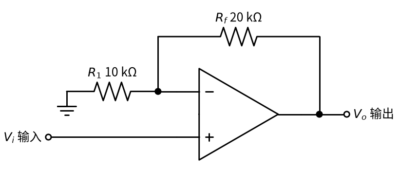
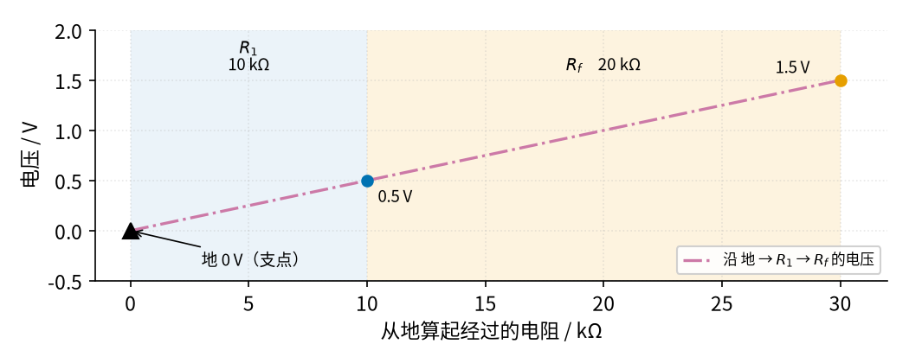
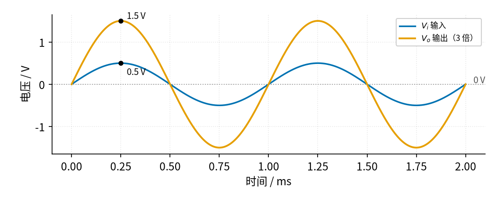

# 02 同相放大 · 直觉篇

[上一页：22 三极管开关与继电器驱动 · 参数与调试篇](../22-bjt-relay-driver/page3.md) · 本页：直觉篇 · [原理与实现篇](page2.md) · [参数与调试篇](page3.md) · [下一页：原理与实现篇](page2.md) · 前置节点：[01 反相放大 · 直觉篇](../01-inverting-amp/page1.md)

## 为什么还要一种放大器

[01 反相放大 · 直觉篇](../01-inverting-amp/page1.md) 很好用，但它有两个让人头疼的地方。第一，输出是反的，传感器电压升高，放大后的电压却下降。第二，它的输入电阻就是 $R_1$ ，只有几千到几十千欧，信号源要往里"灌"电流。如果信号源是一个内阻几十千欧的传感器，倍数会被"吃掉"一大半（01 反相放大的参数与调试篇算过：信号源内阻和 $R_1$ 串联）。

我们想要的是：**输出和输入同方向，而且放大器几乎不从信号源取电流**。只要把信号换一个入口，从运放的**同相端**（标"+"）送进去，两个问题就同时解决了。这就是**同相放大器**。

这种需求非常常见：

- **pH 电极、压电片这类传感器**：它们自身内阻极大，只要往外取一点点电流，输出电压就大打折扣，必须用"几乎不取电流"的放大器。
- **用分压器读出的信号**：比如热敏电阻和固定电阻组成的分压器，它的输出内阻就是几千欧到几十千欧，接一个输入电阻同样只有几千欧的放大器，分压比就被改掉了。
- **送给单片机的直流量**：温度升高，读数也应该变大。反相放大后变成"负的"，单电源的单片机根本读不了，还得再反一次。

打个比方：量体温时，温度计本身不能冷得把人"冰"一下，否则量到的就不是原来的体温了。好的测量工具要"只看不碰"。同相放大器就是一支"只看不碰"的温度计：它的输入端几乎不取电流，信号源原来是多少伏，它看到的就是多少伏。

## 一、电路长什么样

看 图 02-p1-1。元件和反相放大一模一样，还是一颗运放、两个电阻，只是连接方式变了。

*图 02-p1-1　同相放大电路（输入电阻 10 kΩ 接地，反馈电阻 20 kΩ）*

图 02-p1-1 中，输入 $V_i$ 直接接到同相端；**反馈电阻** $R_f$ 仍然从输出 $V_o$ 接回反相端，构成负反馈；原来接输入的电阻 $R_1$ 现在一头接反相端、另一头**接地**。所以 $R_1$ 和 $R_f$ 串起来，正好是一个从输出到地的**分压器**（P1 讲过的分压电路），分压点就是反相端。

结论也只有一句：**输出等于"1 加上反馈电阻比上接地电阻"再乘以输入**：

$$V_o = \left(1 + \frac{R_f}{R_1}\right) V_i$$

代一组数：图中 $R_f$ =20 kΩ、 $R_1$ =10 kΩ，电阻比 2，倍数就是 1 + 2 = 3。输入 0.5 V，输出 1.5 V；输入 −0.2 V，输出 −0.6 V。倍数 $A_v$ = +3，是正的，所以叫"同相"。

## 二、直觉：支点在地的杠杆

还是用 P3 的两句口诀。**虚短**：有负反馈时，反相端电压跟着同相端走，同相端是 $V_i$ ，反相端也就是 $V_i$ 。**虚断**：运放输入端不取电流，所以流过 $R_1$ 的电流全部来自 $R_f$ 。

在 01 里，我们把两个电阻想成一块跷跷板，支点是中间的虚地。现在支点换了位置：**地在最左端，固定是 0 V**，往右经过 $R_1$ 到反相端，再经过 $R_f$ 到输出端。看 图 02-p1-2。

*图 02-p1-2　从地出发沿接地电阻和反馈电阻走一遍，电压像一根撬棍*

图 02-p1-2 的横轴是"从地出发经过了多少电阻"。红紫色点划线从黑色三角形（地，0 V）出发，在 10 kΩ 处经过蓝色圆点，那是反相端，电压被虚短"钉"在输入值 0.5 V；继续沿直线上升，到 30 kΩ 处的橙色圆点就是输出 1.5 V。这像一根**撬棍**：支点在一端，你在离支点 10 的地方把它抬高 0.5 V，离支点 30 的另一端就被抬高 3 倍。**倍数 = 总长度 ÷ 短臂长度 =（ $R_1$ + $R_f$ ）÷ $R_1$ ，所以一定大于等于 1**；两端都在支点同一侧，所以是同相。

## 三、看看波形：方向不变，只是放大

[01 反相放大 · 直觉篇](../01-inverting-amp/page1.md) 里那种上下颠倒的波形在这里不会出现，看 图 02-p1-3。

*图 02-p1-3　倍数为 3 时的输入与输出波形*

图 02-p1-3 中，蓝色输入 $V_i$ 在 0.25 ms 达到最高点 0.5 V，橙色输出 $V_o$ 在同一时刻达到最高点 1.5 V：两者**步调完全一致**，只是输出更"高"。对温度、压力这类直流传感器，这正是我们想要的：输入涨，输出也涨。

## 四、在示波器上会看到什么

按 图 02-p1-1 搭好电路（ $R_1$ = 10 kΩ、 $R_f$ = 20 kΩ），通道 1 接输入、通道 2 接输出，依次做下面几步：

1. **送入峰值 0.5 V、1 kHz 的正弦**。两条波形同时到顶、同时过零，通道 2 的峰值是 1.5 V，就是 图 02-p1-3 的样子。
2. **把 $R_f$ 换成 40 kΩ**。倍数变成 1 + 4 = 5，输出峰值变成 2.5 V，波形仍然同相。再把 $R_f$ 换成一根导线（0 Ω），倍数变成 1，输出和输入完全重合，这就是 [03 电压跟随器 · 直觉篇](../03-voltage-follower/page1.md)。
3. **在信号源和同相端之间串一个 100 kΩ 电阻**，模拟一个内阻很大的传感器。输出几乎**不变**，因为同相端几乎不取电流，100 kΩ 上没有压降。作为对照，01 的反相放大如果 $R_1$ = 10 kΩ，串上 100 kΩ 后倍数会变成原来的 10/110，约 1/11。
4. **改用 5 V 单电源的 LM358，输入换成一个可调的直流电压**。从 0 V 慢慢往上调，输出一直是输入的 3 倍；调到约 1.17 V 时输出到了约 3.5 V，再往上调输出就不动了。这是运放输出的上限，[参数与调试篇](page3.md) 会细讲。
5. **把 $R_f$ 拔掉**。负反馈没了，运放用它巨大的开环倍数去放大，输出一下子贴到电源边上。看到输出"贴轨"，先查反馈电阻有没有焊好。

## 五、和反相放大比一比

| 比较项 | 反相放大（01） | 同相放大（本节） |
|---|---|---|
| 输出方向 | 与输入相反 | 与输入相同 |
| 倍数 | $R_f/R_1$ ，可以小于 1 | 1 + $R_f/R_1$ ，最小是 1 |
| 输入电阻 | 等于 $R_1$ ，几千到几十千欧 | 极大，信号源几乎不用给电流 |
| 反相端电压 | 0 V（虚地） | 等于输入电压 |

最后一行埋着一个以后会用到的细节：同相放大的两个输入端都跟着输入电压一起上下，这叫**共模电压**。运放对共模电压有允许范围，第三页会讲。

## 一句话总结

**同相放大器把信号送进同相端，两个电阻组成从输出到地的分压器：倍数 $A_v = 1 + R_f/R_1$ ，同相、至少 1 倍；输入端几乎不取电流，适合内阻大的信号源**。
