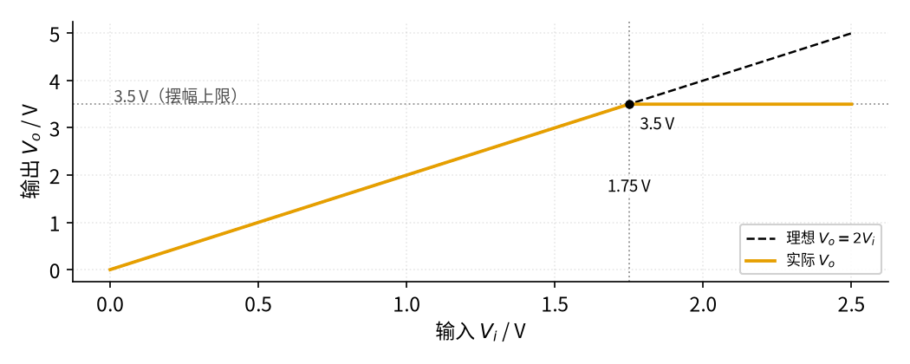

# 02 同相放大 · 参数与调试篇

[上一页：原理与实现篇](page2.md) · [直觉篇](page1.md) · [原理与实现篇](page2.md) · 本页：参数与调试篇 · [下一页：05 精密整流 · 直觉篇](../05-precision-rectifier/page1.md) · 前置节点：[01 反相放大 · 直觉篇](../01-inverting-amp/page1.md) · 后续：[03 电压跟随器 · 直觉篇](../03-voltage-follower/page1.md)、[04 差分放大 · 直觉篇](../04-differential-amp/page1.md)

## 痛点：单电源一接，输出就"顶不上去"

同相放大最常见的用法，是把传感器信号放大后送给单片机。单片机常常只有一个 5 V 或 3.3 V 电源，于是运放也用单电源。这时会遇到 ±15 V 时不曾见过的问题：输出到不了电源电压，输入稍大就削顶；电容耦合的交流信号一放大，输出却慢慢漂到电源轨上不下来。这一页先讲参数怎么选，再给排查表和练习。

## 一、参数怎么选

| 参数 | 作用 | 常用取值 | 选取要点 |
|---|---|---|---|
| $R_1$ | 和 $R_f$ 组成反馈分压器 | 1 kΩ～100 kΩ | 不影响输入电阻；太小会让运放输出电流变大 |
| $R_f$ | 决定倍数 | ( $A_v$ − 1) × $R_1$ | 一般不超过 1 MΩ |
| 电源电压 | 决定输出摆幅和输入允许范围 | 单 5 V 或 ±15 V | 输出、输入都要离正电源至少约 1.5 V（LM358B） |
| GBW | 决定带宽 | LM358B 为 1.2 MHz | 带宽约 GBW ÷ $A_v$ |

### 1. 单电源下的输出摆幅

LM358B 的输出最高只能到正电源减约 1.5 V。5 V 单电源时，输出上限约 3.5 V。要求输出不削顶，输入最大值就是上限除以倍数：

$$V_{i,\max} = \frac{V_{o,\max}}{A_v}$$

代数：2 倍放大、上限 3.5 V，输入不能超过 1.75 V。图 02-p3-1 画出了输入从 0 增大到 2.5 V 时的输出。

*图 02-p3-1　5 V 单电源、2 倍同相放大：输入超过 1.75 V 就削顶*

图 02-p3-1 中，黑色虚线是理想的"输出 = 2 倍输入"，橙色是实际输出。在输入 1.75 V（灰色竖直点线）之前两者重合；之后橙色线被灰色水平点线 3.5 V 挡住，再也上不去。要让 0～5 V 的单片机输入用满量程，就应该选输出能接近电源轨的**轨到轨**运放，或者把倍数降下来。

同相放大还有一个反相放大没有的限制：两个输入端都跟着输入电压走（共模电压等于 $V_i$ ），而 LM358B 允许的输入共模电压上限也是正电源减约 1.5 V。所以 5 V 供电时，即使倍数为 1，输入也不能超过约 3.5 V。

### 2. 带宽：同相放大是 GBW ÷ 倍数

同相放大的带宽（倍数降到低频值 0.707 倍时的频率 $f_c$ ）约为增益带宽积除以倍数：

$$f_c \approx \frac{\mathrm{GBW}}{A_v}$$

频率更高时，倍数按幅值公式下降：

$$\lvert A_v(f)\rvert = \frac{A_v}{\sqrt{1 + (f/f_c)^2}}$$

代数：GBW = 1.2 MHz、倍数 10，带宽约 120 kHz。图 02-p3-2 画出三种倍数。

*图 02-p3-2　增益带宽积 1.2 MHz 时，同相放大的频率响应*

图 02-p3-2 中，橙色（2 倍）在 600 kHz 处降到 1.4，红紫色点划线（10 倍）在 120 kHz 处降到 7.1，蓝绿色虚线（100 倍）在 12 kHz 处降到 71，三处黑点都是 0.707 倍的位置。和 [01 反相放大 · 参数与调试篇](../01-inverting-amp/page3.md) 比较：同样 10 倍，反相放大带宽约 109 kHz（分母是 1 + 10），同相放大是 120 kHz（分母是 10），差别不大；规律相同：**倍数大 10 倍，带宽小 10 倍**。

### 3. 交流耦合时别忘了直流通路

如果信号经过一个隔直电容接到同相端，电容挡住了直流，同相端就"悬空"了。运放输入端那一点点微小的电流无处可去，会给电容慢慢充电，同相端电压一路漂移，输出最终贴到电源轨上。解决办法是在同相端到地（单电源时接到电源一半的偏置点）之间接一个电阻，例如 100 kΩ，给它一条直流通路。此时信号源看到的输入电阻就约等于这个电阻。

## 二、故障排查表

| 现象 | 原因 | 怎么查 | 怎么改 |
|---|---|---|---|
| 输出是反的 | 输入和接地电阻接反，接成了反相放大 | 对照电路图看输入接的是"+"还是"−" | 输入接同相端，接地电阻接反相端 |
| 倍数比设计值大 1 倍左右 | 按反相公式选了电阻，忘了"加 1" | 用 1 + $R_f/R_1$ 重新算 | 把 $R_f$ 改成 ( $A_v$ − 1) × $R_1$ |
| 单电源下输出最高只有约 3.5 V | 输出摆幅限制（LM358B 约 V+ − 1.5 V） | 增大输入，看输出在哪里停止上升 | 降低倍数，或改用轨到轨运放 |
| 输入接近电源时输出异常 | 输入共模电压超出允许范围 | 测同相端电压，和电源减 1.5 V 比较 | 先分压降低输入，或提高电源电压 |
| 输出慢慢漂到电源轨 | 隔直电容后同相端没有直流通路 | 断开信号源，测同相端电压是否在漂 | 同相端加电阻接地或接偏置电压 |
| 输出等于输入，不放大 | $R_1$ 开路（相当于跟随器） | 断电测 $R_1$ 和接地点 | 重新焊接 $R_1$ |
| 输出贴在电源轨 | $R_f$ 开路，没有负反馈 | 断电测 $R_f$ 阻值 | 重新焊接 $R_f$ |

## 三、练习

**练习 1（基础）**： $R_1$ =2 kΩ、 $R_f$ =18 kΩ，输入 0.25 V，输出多少？

答案

倍数 1 + 18/2 = 10，输出 $V_o$ = 10 × 0.25 V = 2.5 V。

**练习 2（提高）**：5 V 单电源 LM358B，热敏电阻电路输出 0～0.8 V，要放大后送给参考电压 3.3 V 的模数转换器，希望 0.8 V 时输出约 3.2 V。(1) 倍数和电阻怎么选？(2) 会不会削顶？(3) 若信号变化最快约 1 kHz，带宽够吗？

答案

(1) 倍数 3.2 ÷ 0.8 = 4，取 $R_1$ =10 kΩ、 $R_f$ =30 kΩ。

(2) 最高输出 3.2 V，小于 5 V − 1.5 V = 3.5 V 的上限，不会削顶，但余量只有 0.3 V；输入 0.8 V 也远低于共模上限 3.5 V。

(3) 带宽约 1.2 MHz ÷ 4 = 300 kHz，远大于 1 kHz，够用。

**练习 3（变体迁移）**：要把一个 −1～+1 V 的信号同相放大 2 倍，但只有 5 V 单电源。提示：先用两个相等电阻把一个 2.5 V 偏置"垫"在信号下面。思路是：同相端经电容接信号、经 100 kΩ 接 2.5 V 偏置点；接地电阻 $R_1$ 的下端也不接地，而是接到 2.5 V 偏置点（再用一个电容对地稳住）。问：输出的中心电压和摆动范围是多少？能否不削顶？

答案

把 2.5 V 偏置点当成新的"地"：同相端电压 = 2.5 V + $V_i$ ，接地电阻也接 2.5 V，所以输出 = 2.5 V + 2 $V_i$ 。中心 2.5 V，摆动范围 2.5 ± 2 V，即 0.5～4.5 V。上限 4.5 V 超过了 LM358B 约 3.5 V 的输出上限（同相端最高 3.5 V 也碰到了共模上限），所以**会削顶**。改法：把倍数降到 1（输出 1.5～3.5 V，同相端最高 3.5 V，正好贴着上限，余量为 0），或者偏置点降到约 2 V 并换轨到轨运放。

## 本页小结

**同相放大的倍数 1 + $R_f/R_1$ ，带宽约 GBW ÷ 倍数；单电源时输出和输入都要离正电源约 1.5 V（LM358B）；交流耦合时同相端一定要有直流通路**。
