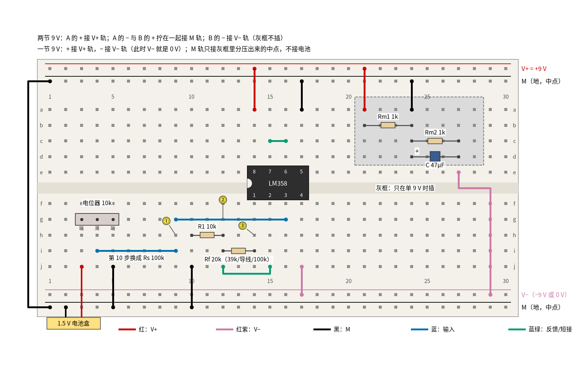
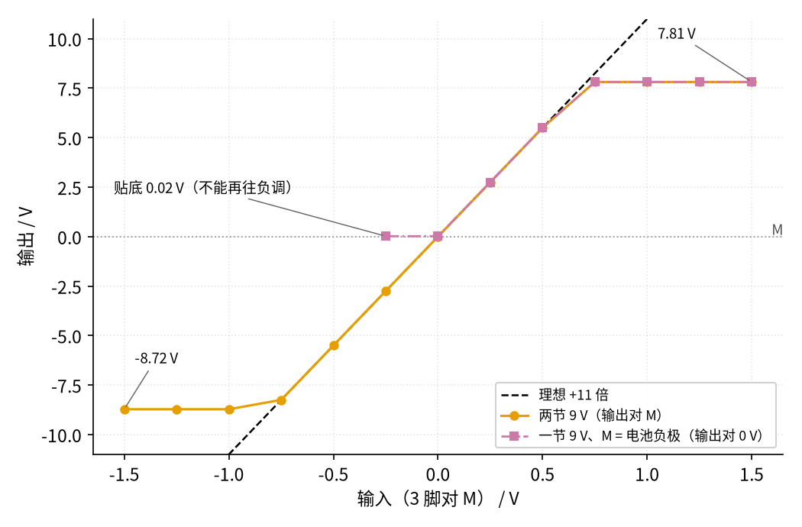

# 02 同相放大 · 动手实验篇

[上一页：参数与调试篇](page3.md) · [直觉篇](page1.md) · [原理与实现篇](page2.md) · [参数与调试篇](page3.md) · 本页：动手实验篇 · [下一页：05 精密整流 · 直觉篇](../05-precision-rectifier/page1.md) · 前置节点：[01 反相放大 · 直觉篇](../01-inverting-amp/page1.md) · 后续：[03 电压跟随器 · 直觉篇](../03-voltage-follower/page1.md)、[04 差分放大 · 直觉篇](../04-differential-amp/page1.md)

## 这次实验要验证什么

这一页用一片 LM358、9 V 电池、一节 5 号电池和一个电位器，把同相放大搭出来，只用万用表验证四件事：

1. **倍数是 1 + Rf ÷ R1，而且是正的**：R1 = 10 kΩ、Rf = 20 kΩ，输入 +0.5 V 时输出 +1.5 V；Rf 换成 39 kΩ 变成 4.9 倍；Rf 换成导线变成 1 倍。对应 [02 同相放大 · 原理与实现篇](page2.md) 第一节的推导和第三节"倍数为什么不能小于 1"。
2. **虚短在这里不是"虚地"**：反相端不再待在 0 V，而是跟着输入一起到 0.5 V；它和同相端只差零点几毫伏。R1 和 Rf 组成一根从 M 出发的"撬棍"，对应 [02 同相放大 · 直觉篇](page1.md) 第二节。
3. **输入几乎不取电流**：在输入前串一只 100 kΩ 电阻，输出几乎不变，电阻两端只有约 1 mV。对照 [01 反相放大 · 动手实验篇](../01-inverting-amp/page4.md) 里串 10 kΩ 就让倍数减半，对应 [02 同相放大 · 原理与实现篇](page2.md) 第二节的仿真。
4. **单电源的两种用法**：一节 9 V 加分压中点时正负输入都能放大；把中点直接接电池负极时，只能放大正输入，输出最高只到约 7.8 V。对应 [02 同相放大 · 参数与调试篇](page3.md) 第一节第 1 小节的单电源摆幅。

## ⚠️ 安全须知

- **只用 12 V 及以下的直流电**。本页任何一点对 M 都不超过 9 V；两节 9 V 串联时 V+ 轨到 V− 轨是 18 V，这是本页上限，不要再加电池。
- **9 V 电池的两个扣子不能碰在一起**，短路几秒钟就发烫。没插进面包板的电池扣用胶带包好。
- **LM358 缺口朝左，8 脚接 V+、4 脚接 V−**。接反会发烫，**不要用手摸**，立即拔掉电池扣。
- **电解电容分正负极**：长脚接 M，短脚（白色条纹一侧）接 0 V。
- **"M = 电池负极"接法时，输入不要调到 −0.2 V 以下**。LM358 的输入脚不能比 4 脚低 0.3 V 以上（手册的绝对最大额定值），再往负调可能损坏芯片，输出还会莫名其妙地跳到正电源。这一段只做正输入和 −0.2 V 一个点。
- **换电阻、改接法前先断电**。

## 器材清单

| 元件 | 型号或数值 | 数量 | 说明 |
|---|---|---|---|
| 运放 | LM358（DIP-8 直插） | 1 | 只用 A 半边，B 半边接成跟随器 |
| 9 V 电池 | 6F22 叠层电池 + 电池扣 | 2 | 双电源两节，单电源一节 |
| 1.5 V 电池 | 5 号电池 + 单节电池盒 | 1 | 产生输入电压 |
| 电位器 | 10 kΩ，三脚直插 | 1 | 调输入 |
| 电阻 | 10 kΩ | 1 | 接地电阻 R1 |
| 电阻 | 20 kΩ | 1 | 默认的 Rf（也可用两只 10 kΩ 串联） |
| 电阻 | 39 kΩ | 1 | 第 8 步的 Rf |
| 电阻 | 100 kΩ | 2 | 一只当 Rs，一只做 11 倍的 Rf |
| 电阻 | 1 kΩ | 2 | 单电源分压 Rm1、Rm2 |
| 电解电容 | 47 μF / 16 V | 1 | 稳住中点 |
| 面包板 | 830 孔 | 1 | 上下各两条电源轨 |
| 跳线 | 红、黑、红紫、蓝、蓝绿 | 若干 | 颜色约定见下图 |
| 万用表 | 数字式，有直流 200 mV 挡 | 1 | 量虚短和 Rs 压降用 |

电阻用 5% 碳膜电阻。"应该读到"的范围按 5% 公差算，例如 3 倍时实际倍数在 2.81～3.21 之间。

## 搭建步骤

**中点（地）怎么接**：所有电压都以 M 为参考。上面第二条轨（T2）和下面第二条轨（B2）都是 M，最上面 T1 是 V+，下面 B1 是 V−，黑表笔几乎一直插在 M 上。

- **两节 9 V（双电源）**：电池 A 的 + 接 V+ 轨；A 的 − 与电池 B 的 + 拧在一起接 M 轨；B 的 − 接 V− 轨。V+ 对 M 是 +9 V，V− 对 M 是 −9 V。灰框不插。
- **一节 9 V、分压造中点**：电池 + 接 V+ 轨，− 接 V− 轨（V− 轨就是 0 V）。灰框里两只 1 kΩ 分压出约 4.5 V 接到 M 轨，再并 47 μF。**M 轨不接电池的任何一极**。正负输入都能放大。
- **一节 9 V、M 直接接电池负极**：拔掉灰框里的元件和线，用黑线把 M 轨和 V− 轨短接（例如 B2 第 28 列接 B1 第 28 列）。这时 M 就是 0 V，只能放大正输入。这正是单片机电路里最常见的接法。

见 图 02-p4-1。电路就是 [02 同相放大 · 直觉篇](page1.md) 第一节那张同相放大电路图，"地"换成了 M。



*图 02-p4-1　LM358 同相放大的面包板接法（Rf 可换 39 kΩ、导线、100 kΩ；蓝线 i4–i9 在第 10 步换成 Rs）*

图 02-p4-1 里红线是 V+，红紫色线是 V−，黑线是 M，蓝线是输入，蓝绿色线是反馈和短接，黄圈 ①②③ 是测量点。按顺序插：

1. 黑线把上下两条 M 轨（T2 第 1 列和 B2 第 1 列）连通。
2. LM358 缺口朝左：1～4 脚在 f14～f17，8～5 脚在 e14～e17。
3. 电源：红线 a14 → V+ 轨（8 脚），红紫色线 j17 → V− 轨（4 脚）。
4. B 半边：蓝绿色短线 c15–c16（7 脚接 6 脚），黑线 a17 → M 轨（5 脚）。
5. 电位器插 g3、g4、g5，黑线 j5 → M 轨；电池盒红线插 j3，黑线插 M 轨（B2 第 2 列）。
6. 输入：蓝线 i4 → i9，第 9 列是输入 ①；再用蓝线 g9 → g16 把它接到 3 脚（同相端）。
7. R1（10 kΩ）插 h10–h12，黑线 j10 → M 轨。注意 R1 下端接的是 M，不是输入。
8. 蓝绿色线 j12 → j15 把第 12 列接到 2 脚（反相端），第 12 列是测量点 ②。
9. Rf（先用 20 kΩ）插 i12–i14，第 14 列是输出 ③（1 脚）。
10. 单电源时再插灰框：红线 T1 第 21 列 → a21；Rm1 b21–b24；黑线 a24 → M 轨；Rm2 c24–c27；电容长脚 d24、短脚 d27；红紫色线 e27 → V− 轨（B1 第 29 列）。
11. 双电源做第 0～12 步，断电改成分压中点做第 13～15 步，再断电改成"M = 电池负极"做第 16～18 步。

## 测量表

万用表直流电压挡，黑表笔接 M 轨（第 5、6、11 步例外，见表）。"仿真"值由 `code/figs/02_figs.py` 用 ngspice 加 TI 的 LM358B 模型、按本页这块板子（两节 9 V，或一节 9 V）现算并打印；范围按 5% 电阻算，毫伏级的范围参考 [02 的 SPICE 核对表](../review/spice/02.md)。

| 步骤 | 测什么 | 红表笔 | 黑表笔 | 挡位 | 应该读到 | 读不到时先查 |
|---|---|---|---|---|---|---|
| 0 | 双电源 V+ | V+ 轨 | M 轨 | 直流 20 V | +8 V 以上 | 电池 A 的电池扣 |
| 1 | 双电源 V− | V− 轨 | M 轨 | 直流 20 V | −8 V 以下 | 读到正值：电池 B 接反 |
| 2 | ① 调到 +0.50 V | 第 9 列 | M 轨 | 直流 2 V | 0.500 V | 电池盒红线是否在 j3 |
| 3 | ③ 输出（Rf = 20 kΩ） | 第 14 列 | M 轨 | 直流 20 V | +1.40～+1.61 V（仿真 +1.50 V） | 读到负值：输入和 R1 接反成了反相放大 |
| 4 | ② 反相端 | 第 12 列 | M 轨 | 直流 2 V | 约 0.50 V（仿真 0.500 V），不是 0 | 读到 0：2 脚没接到第 12 列 |
| 5 | ② 与 ① 之差（虚短） | 第 12 列 | 第 9 列 | 直流 200 mV | −3～+3 mV（仿真 +0.27 mV） | 几百毫伏：输出顶到电源了 |
| 6 | Rf 两端 | 第 14 列 | 第 12 列 | 直流 2 V | 约 1.00 V（仿真 1.000 V） | 应是第 4 步的 2 倍 |
| 7 | ③ 电池盒对调，① 调到 −0.20 V | 第 14 列 | M 轨 | 直流 2 V | −0.56～−0.64 V（仿真 −0.599 V） | 同相：输入负，输出也负 |
| 8 | ③ 电池盒正接，① +0.50 V，Rf 换 39 kΩ | 第 14 列 | M 轨 | 直流 20 V | +2.26～+2.66 V（仿真 +2.45 V） | 39 kΩ 色环：橙白橙 |
| 9 | ③ Rf 换成一根导线 | 第 14 列 | M 轨 | 直流 2 V | 约 0.500 V（仿真 0.500 V） | 这就是电压跟随器 |
| 10 | Rf 换回 20 kΩ，蓝线 i4–i9 换成 Rs 100 kΩ，滑动端（第 4 列）调到 +0.50 V，量 ③ | 第 14 列 | M 轨 | 直流 20 V | 约 +1.50 V（仿真 +1.504 V），几乎不变 | 输入用的是第 4 列 |
| 11 | Rs 两端 | 第 4 列 | 第 9 列 | 直流 200 mV | 绝对值在 5 mV 以内（仿真 −1.0 mV） | 几百毫伏：3 脚没插好 |
| 12 | 拆 Rs 插回蓝线，① +0.50 V，断电拔掉 Rf 再上电 | 第 14 列 | M 轨 | 直流 20 V | 约 +7.8 V（仿真 +7.83 V，贴 V+） | 没有负反馈，输出贴轨 |
| 13 | 分压中点：M 对 0 V | M 轨 | V− 轨（0 V） | 直流 20 V | 4.27～4.73 V（仿真 4.5 V） | Rm1、Rm2 是否都是 1 kΩ |
| 14 | 插回 Rf 20 kΩ，① +0.50 V | 第 14 列 | M 轨 | 直流 20 V | +1.40～+1.61 V（仿真 +1.50 V） | 黑表笔在 M 轨，不在 0 V |
| 15 | 电池盒对调，① −0.50 V | 第 14 列 | M 轨 | 直流 20 V | −1.40～−1.61 V（仿真 −1.50 V） | 和双电源一样 |
| 16 | M = 电池负极，Rf 换 100 kΩ，① +0.50 V | 第 14 列 | M 轨（= 0 V） | 直流 20 V | +5.02～+6.03 V（仿真 +5.50 V） | 11 倍 |
| 17 | ① 调到 +1.00 V | 第 14 列 | M 轨（= 0 V） | 直流 20 V | 约 +7.8 V（仿真 +7.81 V，削平） | 理想 11 V，电源装不下 |
| 18 | 电池盒对调，① 慢慢调到 −0.20 V，不要再往下 | 第 14 列 | M 轨（= 0 V） | 直流 2 V | 0～0.05 V（仿真 0.024 V，贴底） | 正常现象：负输入放大不了 |

一共 19 步。第 4、6 两步正好说明"撬棍"：R1 两端是 0.5 V（第 4 步，R1 下端是 M），Rf 两端是 1.0 V，按欧姆定律两只电阻里都是 0.05 mA，同一股电流从输出经 Rf、R1 流到 M。反相端被虚短"钉"在输入值上，所以从 M 走到输出，电压一路升高，输出是反相端的 (10 + 20) ÷ 10 = 3 倍。

第 10、11 步和 [01 反相放大 · 动手实验篇](../01-inverting-amp/page4.md) 第 10 步对比最有意思：那边串 10 kΩ 倍数就减半，这里串 100 kΩ，Rs 上只有约 1 mV，输出几乎不动。那 1 mV 来自 LM358 输入脚流出的约 10 nA 偏置电流（1 mV ÷ 100 kΩ），只占输入的 0.2%，[02 的 SPICE 核对表](../review/spice/02.md) 里"内阻 1 MΩ 时输出多 2%"也是它造成的。

第 17 步输出停在约 7.8 V，比电池电压低约 1.2 V，这是 LM358 输出的上限；[02 同相放大 · 参数与调试篇](page3.md) 用 5 V 电源讲的"上限约 3.5 V"是同一回事，只是电源换成了 9 V。

## 没有示波器怎么办

前三页用示波器看输入和输出同时到顶，没有示波器就**用电位器和万用表逐点测**。为了让削平看得清楚，这里用 11 倍（Rf = 100 kΩ）：

1. 双电源，电池盒正接，把 ① 依次调到 0、0.25、0.5、0.75、1.0、1.25、1.5 V，记下 ③；对调电池盒，再测 −0.25～−1.5 V。
2. 断电改成"M = 电池负极"，正输入同样测 7 档；负输入只测 −0.25 V 以内（按安全须知，实际调到 −0.2 V 即可）。
3. 以输入为横轴、输出为纵轴描点，就得到 图 02-p4-2。



*图 02-p4-2　没有示波器时，逐点测出 11 倍同相放大的传输特性*

图 02-p4-2 里黑色虚线是理想的 +11 倍，斜率是正的，这就是"同相"在直流上的样子。橙色圆点（两节 9 V）在 −0.75～+0.5 V 之间贴着虚线，再往外就削平，上面停在 +7.81 V，下面停在 −8.72 V。红紫色方块（M = 电池负极）在正输入一侧和橙色完全重合，说明倍数和接法无关；负输入一侧却贴在 0.02 V 不动，因为 V− 轨就是 0 V，输出到不了负值。红紫色线只画到 −0.25 V，不是没测，而是不能再往负调。

这张图对应 [02 同相放大 · 参数与调试篇](page3.md) 第一节那张单电源削顶图：那里是 5 V 电源、2 倍，输入超过 1.75 V 就被挡住；这里是 9 V、11 倍，输入超过约 0.7 V 就被挡住。规律一样：最大输入 = 输出上限 ÷ 倍数。

## 用 Python 核对你的读数

先断电量出电池电压和各电阻的实际值，再填读数。偏差超过 10% 并且差值超过 0.05 V 的会给出提示；第 5、11 步是毫伏级，只看是否在 ±3 mV、±5 mV 以内，第 18 步只看是否低于 0.1 V。下面是一组示例读数。

```python
import sys, pathlib
sys.path.insert(0, str(pathlib.Path("code/figs").resolve()))  # 在仓库根目录运行
# ① 实际值：电池电压（正数）和电阻
m = dict(VA=9.38, VB=9.30, Vsingle=9.36, R1=9.93e3, Rf20=19.8e3, Rf39=38.6e3, Rf100=99.2e3, Rm1=1.002e3, Rm2=0.996e3)
# ② 你实际调到的输入（伏）
vin = {"2": 0.500, "7": -0.200, "10滑动端": 0.500, "14": 0.502, "15": -0.499, "16": 0.500}
# ③ 各步读数（伏）
r = {"3": 1.49, "4": 0.500, "5": 0.0003, "6": 0.995, "7": -0.597, "8": 2.44, "9": 0.500, "10": 1.495,
     "11": -0.0011, "12": 8.21, "13": 4.66, "14": 1.50, "15": -1.49, "16": 5.45, "17": 8.15, "18": 0.022}

g = 1 + m["Rf20"] / m["R1"]
expect = {
    "3": (g * vin["2"], "输入是否接在 3 脚、R1 是否接 M"),
    "4": (vin["2"], "2 脚是否接到第 12 列"),
    "6": (vin["2"] * m["Rf20"] / m["R1"], "表笔是否在第 14、12 列"),
    "7": (g * vin["7"], "① 是否真的是负值"),
    "8": ((1 + m["Rf39"] / m["R1"]) * vin["2"], "39 kΩ 是否插在 i12–i14"),
    "9": (vin["2"], "导线是否插在 i12–i14"),
    "10": (g * vin["10滑动端"], "Rs 是否插在 i4–i9"),
    "12": (m["VA"] - 1.2, "电池 A 电压"),                 # 输出最高比 V+ 低约 1.2 V
    "13": (m["Vsingle"] * m["Rm2"] / (m["Rm1"] + m["Rm2"]), "Rm1、Rm2 阻值；电容极性"),
    "14": (g * vin["14"], "黑表笔是否在 M 轨"),
    "15": (g * vin["15"], "中点是否被拉偏"),
    "16": ((1 + m["Rf100"] / m["R1"]) * vin["16"], "100 kΩ 是否插在 i12–i14"),
    "17": (m["Vsingle"] - 1.2, "电池电压"),               # 削平在比电池低约 1.2 V 处
}
print(f"倍数 1 + Rf/R1 = {g:.3f}；第 6 步 ÷ 第 4 步 = {r['6'] / r['4']:.2f}（应等于 Rf/R1 = {m['Rf20'] / m['R1']:.2f}）")
print(f"第 5 步虚短 {r['5'] * 1e3:+.2f} mV" + ("" if abs(r["5"]) <= 3e-3 else "  ← 超过 ±3 mV，先查输出是否顶到电源"))
print(f"第 11 步 Rs 两端 {r['11'] * 1e3:+.2f} mV" + ("" if abs(r["11"]) <= 5e-3 else "  ← 超过 ±5 mV，先查 3 脚是否插好"))
print(f"第 18 步输出 {r['18']:+.3f} V" + ("（贴底，符合预期）" if r["18"] < 0.1 else "  ← 应贴在 0 V 附近，先查 M 轨是否接到 V− 轨"))
for k, (e, hint) in expect.items():
    v = r[k]
    dev = (v - e) / abs(e) * 100
    flag = f"  ← 偏差超过 10%，先查：{hint}" if abs(dev) > 10 and abs(v - e) > 0.05 else ""
    print(f"第 {k:>2} 步  实测 {v:+7.3f} V  计算 {e:+7.3f} V  偏差 {dev:+6.1f}%{flag}")
```

示例读数都没有触发提示。第 12、17 步的计算值用的是经验规律"输出最高比 V+ 低约 1.2 V"（来自 SPICE 仿真），只能估到零点几伏。

## 实验记录表

| 步骤 | 测什么 | 实测值 | 计算值 | 偏差 |
|---|---|---|---|---|
| 0 | 双电源 V+ |  |  |  |
| 1 | 双电源 V− |  |  |  |
| 2 | 输入 ① |  |  |  |
| 3 | 输出 ③（3 倍） |  |  |  |
| 4 | 反相端 ② |  |  |  |
| 5 | ② − ①（mV） |  |  |  |
| 6 | Rf 两端 |  |  |  |
| 7 | 输出 ③（−0.2 V） |  |  |  |
| 8 | 输出 ③（Rf = 39 kΩ） |  |  |  |
| 9 | 输出 ③（Rf = 导线） |  |  |  |
| 10 | 输出 ③（串 Rs） |  |  |  |
| 11 | Rs 两端（mV） |  |  |  |
| 12 | 开环输出 |  |  |  |
| 13 | 中点 M 对 0 V |  |  |  |
| 14 | 分压中点输出（+0.5 V） |  |  |  |
| 15 | 分压中点输出（−0.5 V） |  |  |  |
| 16 | M = 负极，11 倍（+0.5 V） |  |  |  |
| 17 | M = 负极，11 倍（+1.0 V） |  |  |  |
| 18 | M = 负极，11 倍（−0.2 V） |  |  |  |

逐点测量另记一张表：输入、双电源输出、"M = 电池负极"输出三栏。

## 思考题

**思考题 1**：反相放大里反相端是 0 V（虚地），这里第 4 步却读到 0.5 V。虚短还成立吗？把输入一直往上调，反相端会一直跟着走吗？

<details><summary>答案</summary>

成立。虚短说的是"两个输入端电压相等"，不是"都等于 0"。反相放大的同相端接 M，所以反相端跟着是 0；同相放大的同相端就是输入，反相端也就跟着到输入值，第 5 步量出的差只有零点几毫伏。但两个输入端一起抬高（共模电压升高）是有上限的：LM358 的输入要比 V+ 低约 1.5 V 才能正常工作，[02 同相放大 · 参数与调试篇](page3.md) 第一节第 1 小节讲过，5 V 供电时输入不能超过约 3.5 V。本页 9 V 电池、输入最多 1.5 V，离上限很远；可是在 11 倍时，输出早在输入约 0.7 V 时就先被削平了，那时虚短也就失效了。

</details>

**思考题 2**：如果 R1 的下端没插好（开路），输出会变成多少？如果 Rf 开路呢？分别对应第几步看到的现象？

<details><summary>答案</summary>

R1 开路时，Rf 里没有电流，Rf 两端没有压降，输出等于反相端，也就等于输入，电路变成 1 倍的跟随器，和第 9 步"Rf 换成导线"的读数一样。所以"输出等于输入、不放大"时先查 R1。Rf 开路时没有负反馈，运放用十万倍的开环增益去放大，输出贴到电源轨，就是第 12 步的 +7.8 V。这两条正是 [02 同相放大 · 参数与调试篇](page3.md) 故障排查表的最后两行。

</details>

**思考题 3**："M = 电池负极"的接法为什么在单片机电路里很常见？什么时候必须改成分压中点？

<details><summary>答案</summary>

很多传感器的输出天生就是正的（例如 0～0.5 V 的温度信号），单片机也只认 0～电源之间的电压。这时把运放的同相放大接在单电源上、参考点就是电池负极，最简单，第 16 步就是这样用的。只有一个要求：输出上限装得下，也就是"最大输入 × 倍数"小于"电源 − 约 1.2 V"，第 17 步就超了。如果信号有正有负，例如话筒的音频，或者 [P3 运放入门 · 动手实验篇](../P3-opamp-basics/page4.md) 里对调电池盒得到的负电压，就必须用分压造出中点，让信号围绕中点摆动；交流信号还要像 [02 同相放大 · 参数与调试篇](page3.md) 第一节第 3 小节说的那样，经隔直电容进来，并给同相端一条接到中点的直流通路。

</details>

## 自测清单

- 我能说清楚两节 9 V、一节 9 V 分压、一节 9 V 以负极为 M 三种接法里 M 在哪里，以及各自能放大什么样的信号。
- 我能用 1 + Rf ÷ R1 选电阻，并用万用表验证 3 倍、4.9 倍、1 倍。
- 我能用 200 mV 挡量出两个输入端之差，说明同相放大的虚短不是虚地。
- 我能用一只 100 kΩ 串联电阻演示同相放大的输入几乎不取电流，并和反相放大对比。
- 我能根据电池电压估出输出上限，算出单电源时最大允许输入，并逐点测出传输特性。
