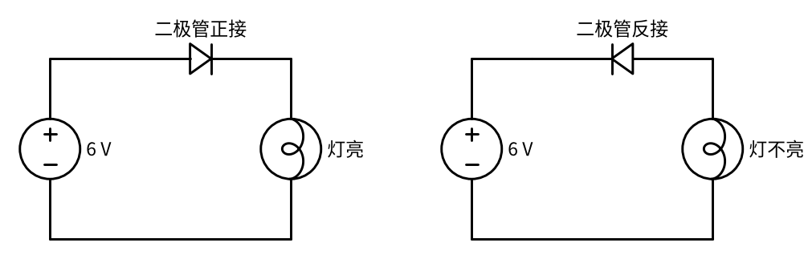
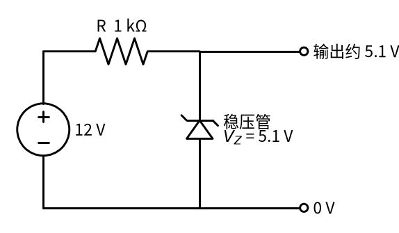
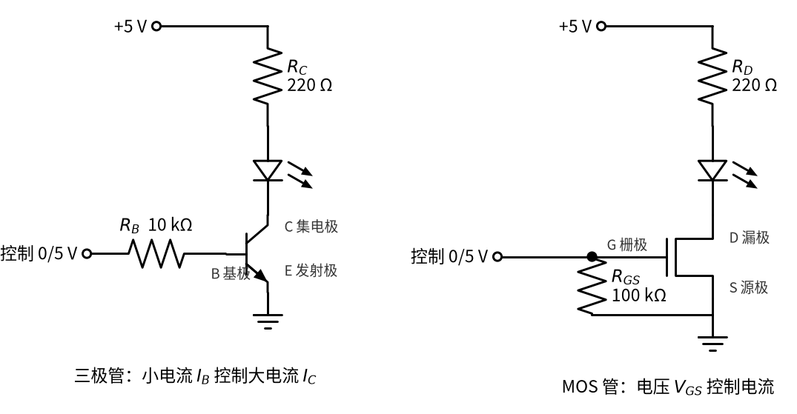
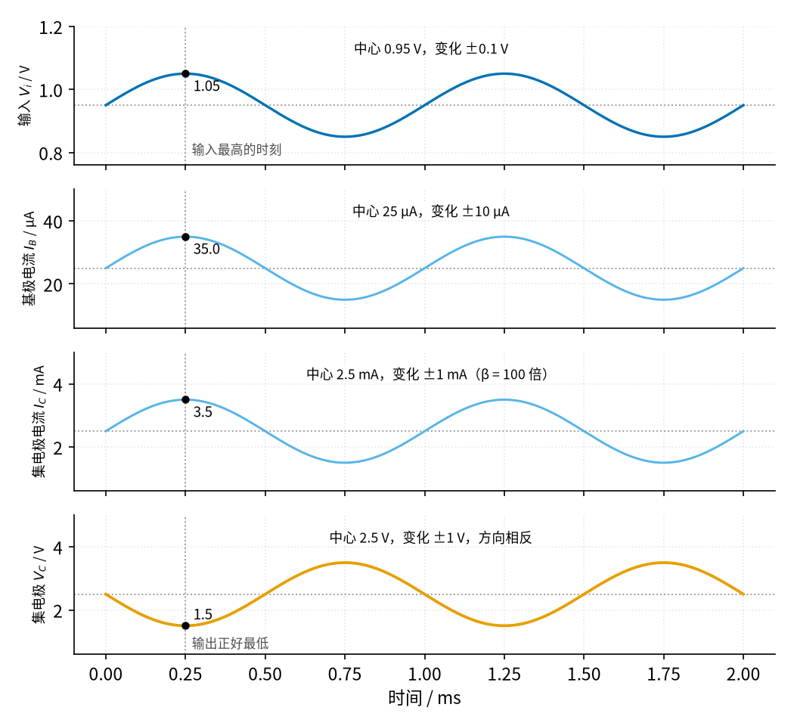
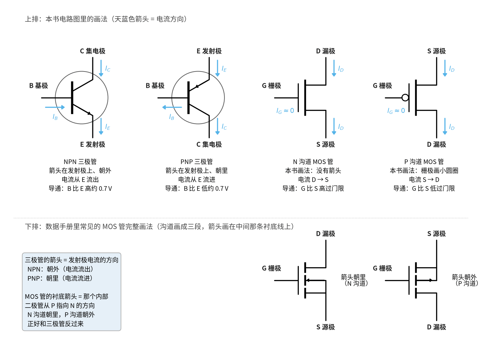
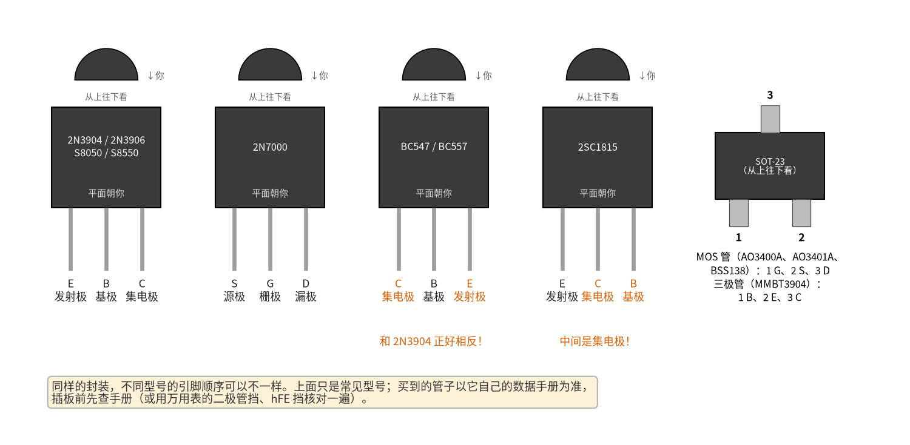
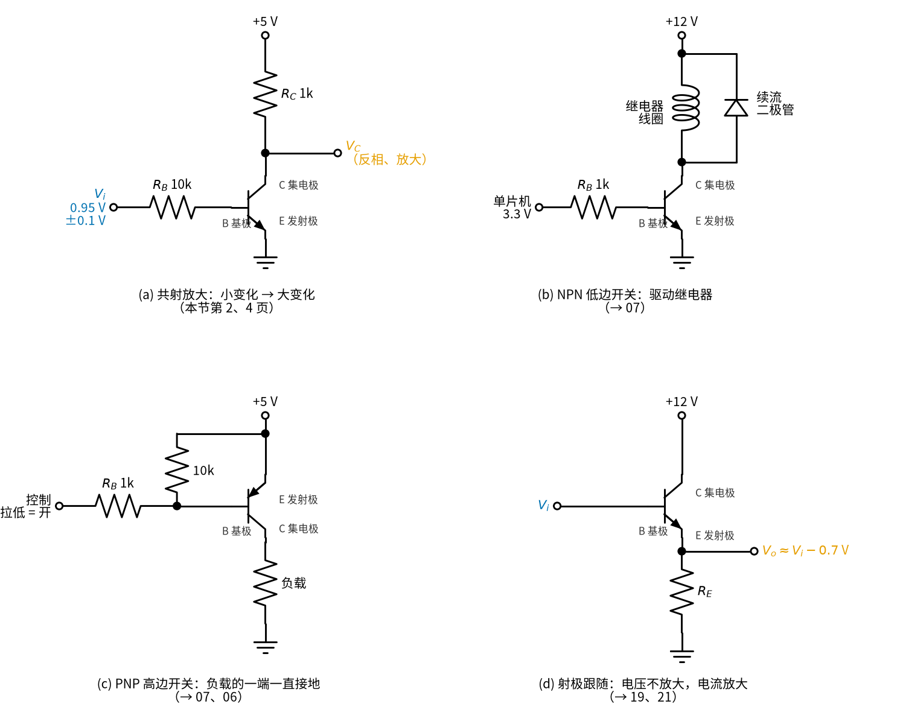
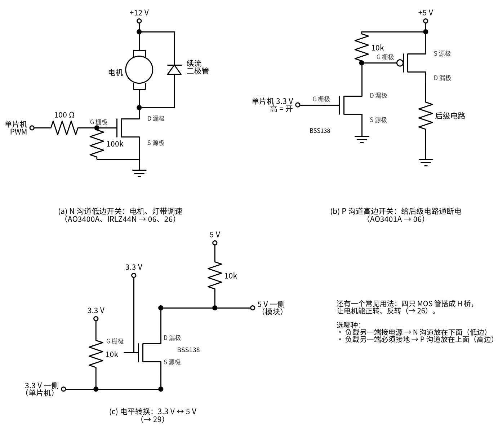

# 03 半导体入门 · 直觉篇

[上一页：02 运放入门 · 动手实验篇](../02-opamp-basics/page4.md) · 本页：直觉篇 · [原理与实现篇](page2.md) · [参数与调试篇](page3.md) · [动手实验篇](page4.md) · [下一页：原理与实现篇](page2.md) · 前置节点：[01 元件速成 · 直觉篇](../01-components-basics/page1.md)

## 为什么要学这一节

高中物理里的电路只有电池、电阻、开关和灯泡，电阻两端的电压和电流永远成正比。可是一拆开手机充电器、遥控器或者电动玩具，电路板上最多的反而是另外几种小黑块：二极管、稳压管、发光二极管（LED）、三极管和 MOS 管。后面的整流（13 节）、稳压（21、17 节）、开关电源（25 节）、继电器驱动（07 节），全都靠它们干活。

这些元件统称「半导体器件」。教科书讲它们要从硅晶体、PN 结、载流子讲起，读完一章可能还不会接一个 LED。好消息是：**做电路只需要会用，不需要会造**。本节点只教三件事：每种元件像生活里的什么东西；它有哪一两个关键电压要记住；新手最常犯哪三种错——忘记 0.7 V 压降、三极管不加基极电阻、MOS 管栅极悬空。

## 二极管：电路里的单向阀

家里的水管上常装一种「止回阀」：水只能朝一个方向流，倒流时阀门自己关上。二极管就是电路里的止回阀。它有两个脚，电流只能从**阳极**流向**阴极**，电路符号里那个三角形的尖头就是允许电流流动的方向，竖线一侧是阴极，实物上一般用一条色环标出阴极。

止回阀里有一根小弹簧，水压太小推不开它。二极管也一样：正向电压要超过大约 0.7 V（普通硅二极管）才会明显导通，导通以后两端电压基本就停在 0.7 V 左右，多出来的电压都落在别的元件上。这个「推开阀门要花掉的电压」叫正向压降，记作 $V_D$ 。

请看图 03-p1-1 的两个电路，比较二极管方向和灯的状态。

*图 03-p1-1　二极管正接时灯亮，反接时灯不亮*

左边二极管的尖头顺着电流方向（从电源正极出发，经过二极管、灯泡回到负极），阀门被推开，灯亮；右边把二极管调了个头，阀门被倒流的水压死死压住，整条回路没有电流，灯不亮。注意左边灯泡分到的电压并不是 6 V，而是大约 6 V − 0.7 V = 5.3 V，这 0.7 V 就是阀门的「过路费」。

## 稳压管：水位到了就溢出的溢流口

如果把一个特殊的二极管反着接，并且反向电压大到一定程度，它会突然「击穿」开始导电。普通二极管被击穿通常就坏了，**稳压管**却是专门设计在击穿状态下长期工作的。击穿以后，不管流过它的电流是多一点还是少一点，它两端的电压都几乎不变，这个电压叫稳压值，记作 $V_Z$ 。

生活类比是浴缸上沿的溢流口：水位一旦到达溢流口的高度，多放进来的水都从溢流口流走，水位就不再升高。稳压管就是电路里的溢流口，多余的电流从它身上流走，电压被钉在 $V_Z$ 。

请看图 03-p1-2：12 V 电源经过 1 kΩ 电阻接到一个 5.1 V 稳压管上，注意稳压管的阴极（带折角竖线的一端）朝向电源正极。

*图 03-p1-2　稳压管反向接入：输出被钉在约 5.1 V*

12 V 里约 6.9 V 落在电阻上，剩下约 5.1 V 落在稳压管上。电阻在这里不能省：它像溢流口前面的一段细水管，限制总的水流，否则电源会直接把稳压管烧掉。电阻怎么选是 17 节「稳压管稳压」的主题。

## 发光二极管：会发光的二极管

LED 也是二极管，同样只许电流单向通过，只是导通时会发光。它的「弹簧」更硬：红色 LED 正向压降约 2 V，蓝色、白色约 3 V 多。LED 和普通二极管一样，一旦导通，电压稍微升一点电流就猛增，所以**必须串一个限流电阻**，靠电阻来决定电流大小。

## 三极管：用小水流去推开大阀门的水龙头

想象一个特殊的水龙头：它没有把手，而是在旁边开了一根细细的控制水管。往细管里灌一点点水，主水管的大阀门就开一点；细管水流加倍，主水流也加倍。这就是 NPN 三极管：三个脚分别叫基极（B）、集电极（C）、发射极（E），流进基极的小电流 $I_B$ 控制着从集电极流到发射极的大电流 $I_C$ ，两者的比值叫电流放大倍数 $\beta$ ，常见的小三极管在 100 左右。

三极管有三种状态。基极没有电流时，大阀门关死，叫**截止**；基极电流适中时，主水流等于控制水流的 $\beta$ 倍，叫**放大**；基极电流足够大时，大阀门已经开到底，主水流只受外面水管粗细的限制，再加控制水流也没用，叫**饱和**，这时三极管就像一个闭合的开关。拿三极管当开关用，就是让它在截止和饱和之间切换。三极管有两大用法：一是**开关**（在截止和饱和之间切换，07 节的继电器驱动就是这样），二是**放大**（一直待在放大区，让小信号的变化变成大信号的变化，「放大」这个名字就是从这里来的）。下面先看开关，再一步一步看放大是怎么发生的。当开关用的时候要尽快穿过放大区——停在放大区的三极管既不算全开也不算全关，开关电流又大，自己会发热。

请看图 03-p1-3 左半部分：控制信号经过基极电阻 $R_B$ 进入三极管的基极，LED 和电阻 $R_C$ 串在集电极一侧。

*图 03-p1-3　左：NPN 三极管开关；右：N 沟道 MOS 管开关，栅极带下拉电阻*

左图里，控制端给 5 V，几百微安的小电流从基极流入，三极管饱和，LED 亮；控制端给 0 V，基极没有电流，三极管截止，LED 灭。基极电阻 $R_B$ 绝不能省：基极到发射极之间本身就像一个二极管，直接接 5 V 会产生很大电流，烧坏三极管或者控制它的芯片。

### 三极管怎样「放大」：小水流的变化 → 大水流的变化

还是用水龙头的比方：控制细管里的水流稍微变一点，主水管的水流就跟着变 $\beta$ 倍。下面用一组具体数字把这件事从头走一遍。电路是：输入电压 $V_i$ 经过 10 kΩ 的基极电阻 $R_B$ 进基极，集电极经过 1 kΩ 的电阻 $R_C$ 接 5 V 电源，发射极接地，三极管的 $\beta$ 取 100（电路图见 [03 半导体入门 · 原理与实现篇](page2.md) 共射放大小节的电路图）。

**第 1 步**：先给基极一个固定的「底水」。 基极到发射极之间就像一只二极管，要先交约 0.7 V 的「过路费」，基极才有电流。所以输入不能从 0 V 开始，而要先垫一个固定电压，这里取 0.95 V，叫**偏置**。这时 $R_B$ 两端的电压是 0.95 − 0.7 = 0.25 V，基极电流 $I_B$ = 0.25 V ÷ 10 kΩ = 0.025 mA = 25 µA。

**第 2 步**：基极电流放大成集电极电流。 $I_C \approx \beta I_B$ = 100 × 25 µA = 2.5 mA。电流方向： $I_B$ 从基极流进， $I_C$ 从集电极流进，两股电流在管子里汇合，一起从发射极流出到地。

**第 3 步**：集电极电流在 $R_C$ 上变成电压。 $R_C$ 两端的电压 = 2.5 mA × 1 kΩ = 2.5 V，它从 5 V 里「扣掉」，所以集电极电压 $V_C$ = 5 − 2.5 = 2.5 V。这一组数（0.95 V → 25 µA → 2.5 mA → 2.5 V）就是电路安安静静、没有信号时的状态，叫**静态工作点**，简称 Q 点。

**第 4 步**：让输入在 0.95 V 上下摆动 0.1 V。 把同样的三步再算两遍：

| 输入 $V_i$ | 基极电流 $I_B$ | 集电极电流 $I_C$ | $R_C$ 上的电压 | 集电极电压 $V_C$ |
|---|---|---|---|---|
| 0.85 V（低 0.1 V） | (0.85 − 0.7) ÷ 10k = 15 µA | 1.5 mA | 1.5 V | 5 − 1.5 = 3.5 V |
| 0.95 V（Q 点） | 25 µA | 2.5 mA | 2.5 V | 2.5 V |
| 1.05 V（高 0.1 V） | 35 µA | 3.5 mA | 3.5 V | 5 − 3.5 = 1.5 V |

**第 5 步**：比一比。 输入从 0.85 V 变到 1.05 V，一共只变了 0.2 V；输出从 3.5 V 变到 1.5 V，一共变了 2 V——变化大了 10 倍，而且方向相反：输入升高，输出反而降低（因为 $I_C$ 变大，扣掉的电压变多）。这就叫**放大**，「方向相反」叫**反相**。10 倍这个数也可以直接算：输入每变 0.1 V，基极电流变 0.1 V ÷ 10 kΩ = 10 µA，集电极电流变 100 倍即 1 mA，在 $R_C$ 上变成 1 V，所以放大倍数 = $\beta R_C / R_B$ = 100 × 1k ÷ 10k = 10。

请看图 03-p1-4，从上到下四条曲线分别是输入 $V_i$ 、基极电流 $I_B$ 、集电极电流 $I_C$ 、集电极电压 $V_C$ ，注意竖直虚线那一时刻四条线的数值。

*图 03-p1-4　输入在 0.95 V 上下摆动 0.1 V：基极电流、集电极电流跟着同步变，集电极电压变化大 10 倍且方向相反*

在竖直虚线那一刻，输入最高（1.05 V），基极电流最大（35 µA），集电极电流也最大（3.5 mA），而集电极电压正好最低（1.5 V）。前三条曲线同起同落，最后一条倒过来——这就是「反相」。

两个容易想歪的地方：第一，多出来的「力气」不是三极管变出来的，而是 5 V 电源给的，三极管只是按照基极的小信号去「拧」集电极那条路上的大电流，就像水龙头本身不产生水；第二，第 1 步的偏置不能省：如果输入的中心是 0 V，±0.1 V 永远够不到 0.7 V，基极始终没有电流，输出一直停在 5 V，什么也放大不了。偏置选多少才合适、选错了输出会怎样，[03 半导体入门 · 原理与实现篇](page2.md) 用曲线详细讲。

## MOS 管：按压就开的电压阀门

MOS 管（全称金属-氧化物-半导体场效应管，常写作 MOSFET）也能当开关，但控制方式不同：它的控制脚叫栅极（G），和里面的导电通道之间隔着一层极薄的绝缘层，几乎不吸收电流。决定它通不通的是栅极和源极（S）之间的电压 $V_{GS}$ 。打个比方，三极管像是要靠水流去推的阀门，MOS 管则像一个按压式阀门：只要按下去的「力」（电压）够大，阀门就打开，按住不动并不需要持续出力。

$V_{GS}$ 低于一个门限电压时 MOS 管关断，高出门限足够多时，漏极（D）和源极之间就像一个很小的电阻。图 03-p1-3 右半部分就是这样一个开关。注意栅极和地之间那个 100 kΩ 的电阻 $R_{GS}$ ：因为栅极几乎不吸收电流，它一旦悬空（比如控制线断开、单片机还没上电），手一靠近、旁边一有干扰，栅极上就可能积累电荷把管子「按开」，负载莫名其妙地动作。下拉电阻保证没人控制时栅极被拉回 0 V，MOS 管可靠关断（为什么要下拉、取多大，见 [06 MOS 管开关 · 直觉篇](../06-mosfet-switch/page1.md)）。

## 镜像版本：PNP 和 P 沟道 MOS 管

上面讲的 NPN 三极管和 N 沟道 MOS 管都接在负载和地之间（叫低边开关）。它们各有一个「镜像版本」：PNP 三极管和 P 沟道 MOS 管，电压和电流方向全部反过来，常放在电源和负载之间（叫高边开关）。P 沟道 MOS 管的栅极电压要比源极**低**才导通，这一点第一次接触时最容易搞反。[03 半导体入门 · 原理与实现篇](page2.md) 会用一个最小的例子演示它怎么开、怎么关，以及配套的「上拉电阻」是什么，[03 半导体入门 · 参数与调试篇](page3.md) 的练习再专门练。

## 三个脚叫什么、箭头是什么意思

电路图里每只三极管、MOS 管都有三个脚，名字和作用要先认清楚：

- 三极管：**B 基极**是控制脚，小电流从这里进出；**C 集电极**是大电流的一头，像在「收集」电流；**E 发射极**是大电流的另一头，NPN 里电流从这里「发射」出去到地。
- MOS 管：**G 栅极**（「栅」就是栅栏门）是控制脚，几乎不进电流；**D 漏极**和 **S 源极**是大电流的两头，N 沟道里电流从 D 流到 S。控制电压 $V_{GS}$ 永远是「栅极相对源极」量的。

请看图 03-p1-5 上排四个符号，每个脚旁边都写了名字，天蓝色箭头是电流方向。

*图 03-p1-5　上排：本书电路图里的画法，标出引脚名和电流方向；下排：数据手册里常见的 MOS 管完整画法*

三极管符号上唯一的箭头总是画在发射极上，**箭头指的就是电流方向**：NPN 的箭头朝外，电流从发射极流出；PNP 的箭头朝里，电流从发射极流进。所以看见箭头就知道它是哪一种，也就知道它要怎么接——NPN 的发射极一般接地，基极比发射极高约 0.7 V 才导通；PNP 的发射极一般接电源，基极比发射极低约 0.7 V 才导通。

MOS 管在本书里用简化画法：N 沟道栅极是一根直线，P 沟道栅极前多一个小圆圈（圆圈表示「反过来」：栅极要比源极**低**才导通）。数据手册里常见图 03-p1-5 下排那种完整画法，中间的竖线分成三段，箭头画在中间那条线上：N 沟道箭头朝里，P 沟道箭头朝外。注意这个箭头**不是**电流方向，它表示管子内部有一个 PN 结，箭头从 P 指向 N，所以正好和三极管的习惯反过来。认 MOS 管时，以「哪个脚接 G、哪个脚在箭头那一侧（S）」为准。

对照看：把图 03-p1-5 上下两排的 N 沟道 MOS 管放在一起比——G 栅极都在左边、D 漏极都在上面、S 源极都在下面，只是下排多画了三段沟道和箭头，两种画法说的是同一个零件；P 沟道也一样，只是 S 和 D 上下对调，栅极小圆圈换成了朝外的箭头。

符号上的脚好认，实物上的脚就要靠记和查了。请看图 03-p1-6，所有 TO-92 小黑管都是把**印字的平面朝向自己、脚朝下**，从左往右读。

*图 03-p1-6　常见三极管、MOS 管的引脚排列（TO-92 平面朝你、脚朝下，从左往右）*

2N3904、2N3906、S8050、S8550 都是「E B C」，本书实验用的就是 2N3904；同样是 TO-92 的 BC547 却是「C B E」，正好反过来，2SC1815 更是把集电极放在中间；2N7000 是「S G D」。贴片的 SOT-23 管子，MOS 管常见 1 脚 G、2 脚 S、3 脚 D。所以**插板前先查这只管子自己的数据手册**，型号上差一个字母，引脚顺序就可能不同。手边没有手册时，可以用万用表的二极管档判断：NPN 的红表笔接基极、黑表笔分别碰另外两个脚，都会显示约 0.6–0.7 V（基极到另外两脚各像一只二极管）；很多万用表还有 hFE 插座，插对了脚才会显示一个一两百的数。插反了引脚，最常见的现象是负载一直不亮或者一直亮，见 [参数与调试篇](page3.md) 的故障排查表。

## 三极管还是 MOS 管、NPN 还是 PNP：各用在哪

先比三极管和 MOS 管：

| | 三极管（BJT） | MOS 管（MOSFET） |
|---|---|---|
| 靠什么控制 | 基极**电流**（必须串基极电阻） | 栅源**电压**（栅极几乎不要电流，但要下拉电阻） |
| 开到底时像什么 | C、E 之间剩约 0.1–0.2 V | D、S 之间一个小电阻（好的管子只有几十 mΩ） |
| 最擅长 | 小信号放大；几十到几百 mA 的小开关；便宜 | 几百 mA 到几十 A 的大电流开关、PWM 调速；控制端几乎不耗电 |
| 常见型号 | 2N3904 / 2N3906、S8050 / S8550 | AO3400A / AO3401A、2N7000、BSS138、IRLZ44N |
| 后面在哪里用 | [07 继电器驱动](../07-bjt-relay-driver/page1.md)、[19 射极跟随](../19-emitter-follower/page1.md)、[21 线性稳压](../21-linear-regulator/page1.md) | [06 MOS 管开关](../06-mosfet-switch/page1.md)、[26 H 桥](../26-h-bridge/page1.md)、[29 电平转换](../29-pullup-level-shift/page1.md) |

再比「N 型」和「P 型」。NPN 和 N 沟道是一类，PNP 和 P 沟道是它们的镜像：

| | NPN 三极管 / N 沟道 MOS 管 | PNP 三极管 / P 沟道 MOS 管 |
|---|---|---|
| 符号上的箭头 | NPN 朝外 | PNP 朝里 |
| 什么时候导通 | B 比 E 高约 0.7 V / G 比 S 高过门限 | B 比 E 低约 0.7 V / G 比 S 低过门限 |
| 放在负载哪一边 | 负载下面，E 或 S 接地（**低边**开关） | 负载上面，E 或 S 接电源（**高边**开关） |
| 控制信号 | 给高电平 = 开 | 拉低 = 开（要上拉电阻保证默认是关） |
| 什么时候选它 | 负载另一端可以直接接电源：首选，同样大小的管子 N 型导通更好、更便宜 | 负载另一端必须接地，比如给一整块后级电路通断电源 |
| 常见型号 | 2N3904、S8050；AO3400A、2N7000 | 2N3906、S8550；AO3401A |

一句话记住选法：**先看负载另一端接在哪里——能接电源，就用 N 型放在下面；必须接地，就用 P 型放在上面**。

请看图 03-p1-7，它是三极管最常见的四种接法，每个管子的三个脚都标了名字。

*图 03-p1-7　三极管的四种常见用法：(a) 共射放大 (b) NPN 低边开关驱动继电器 (c) PNP 高边开关 (d) 射极跟随*

(a) 就是上面一步一步算过的放大电路，信号从基极进、从集电极出，发射极接地，所以叫「共射」放大，本节的原理篇和实验篇都用它。(b) 是 NPN 低边开关：单片机 3.3 V 经 1 kΩ 给基极约 2.6 mA，三极管饱和，继电器线圈通电；线圈旁边反着并一只**续流二极管**，断开瞬间线圈的电流有地方转圈，不会打坏三极管（详见 07 节）。(c) 是 PNP 高边开关：发射极接 +5 V，基极经 10 kΩ 上拉到 +5 V，平时管子关着；控制端拉低时基极电流从发射极流向基极再流出，管子导通，负载的一端可以一直接地。注意控制端的高电平要接近 +5 V 才关得断，3.3 V 的单片机要像图 03-p1-8 (b) 那样再加一只小管子。(d) 是射极跟随：输出从发射极取，输出电压总比输入低约 0.7 V，电压不放大，但能输出比输入大得多的电流（详见 19、21 节）。

对照看：四个电路里的三极管符号完全一样，变的只是「哪个脚接信号、哪个脚接地或电源、从哪个脚取输出」——(a)(b) 都是 E 发射极接地、从 C 集电极一侧干活；(c) 是 PNP，E 发射极朝上接电源，箭头朝里；(d) 的 C 集电极直接接电源，输出改从 E 发射极取。

再看图 03-p1-8，它是 MOS 管最常见的三种接法。

*图 03-p1-8　MOS 管的三种常见用法：(a) N 沟道低边开关 (b) P 沟道高边开关 (c) 3.3 V ↔ 5 V 电平转换*

(a) 是 N 沟道低边开关：单片机的 PWM 信号经 100 Ω 进栅极，栅源之间 100 kΩ 下拉保证默认关断，电机接在 +12 V 和漏极之间，旁边同样并一只续流二极管。3.3 V 单片机选 AO3400A 这种在 2.5 V 栅压下就标了导通电阻的「逻辑电平」管子，5 V 驱动时也可以用 IRLZ44N 这种能过十几安的大管子（详见 06 节，电机正反转见 26 节）。(b) 是 P 沟道高边开关：AO3401A 的源极接 +5 V，栅极经 10 kΩ 上拉到 +5 V 平时关断；3.3 V 单片机的高电平离 +5 V 还差 1.7 V，直接接栅极会关不断，所以加一只 BSS138 小管子来拉低栅极——单片机给高电平，BSS138 导通，P 沟道管栅极被拉到 0 V，后级电路通电。(c) 是 BSS138 电平转换：栅极固定接 3.3 V，两边各一只 10 kΩ 上拉，3.3 V 一侧拉低时管子导通把 5 V 一侧也拉低，双方都松开时各自被上拉成高电平，这样 3.3 V 的单片机和 5 V 的模块就能对话（详见 29 节）。

对照看：(a) 和 (c) 都是 N 沟道，S 源极在下、D 漏极在上；(b) 的 P 沟道 S 源极在上接 +5 V、D 漏极在下接负载，栅极带小圆圈，和图 03-p1-5 上排的两个 MOS 管符号一一对应。(b) 里其实有两只 MOS 管：上拉电阻和 BSS138 负责「翻译」控制信号，AO3401A 负责通断大电流。

## 一句话总结

二极管是单向阀，导通要交约 0.7 V 的「过路费」；稳压管是反着接的溢流口，把电压钉在 $V_Z$ ；三极管是用小电流 $I_B$ 推开大电流 $I_C$ 的水龙头，必须串基极电阻，给好偏置后小信号的变化会变成集电极上大约 $\beta R_C / R_B$ 倍、方向相反的变化；MOS 管是靠电压 $V_{GS}$ 按开的阀门，栅极不能悬空；三极管认 B 基极、C 集电极、E 发射极，箭头就是电流方向，MOS 管认 G 栅极、D 漏极、S 源极；负载另一端能接电源就用 N 型放在下面，必须接地就用 P 型放在上面，插板前先查手册对引脚。下一页（[03 半导体入门 · 原理与实现篇](page2.md)）把这些比喻换成曲线和公式，并用 Python 把它们算出来。
