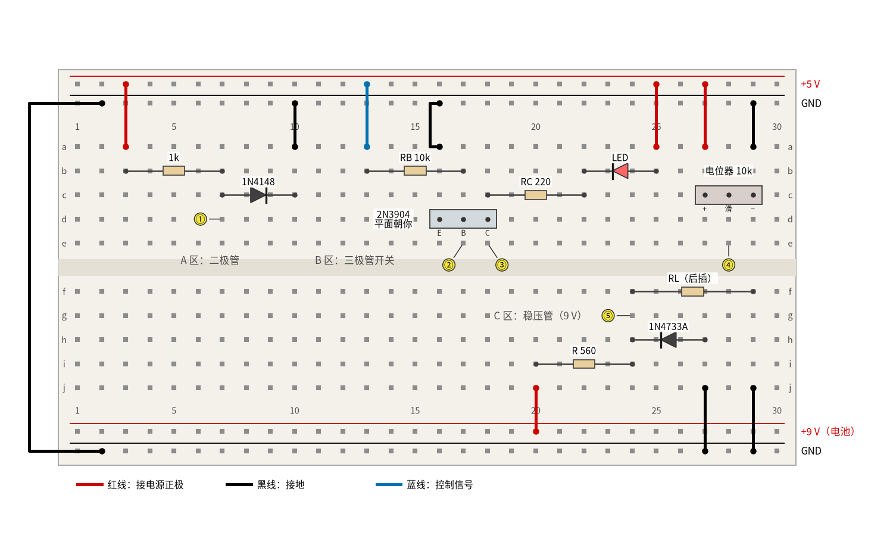
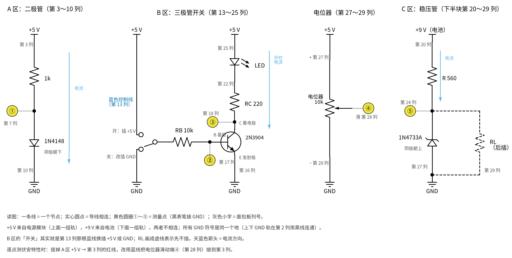
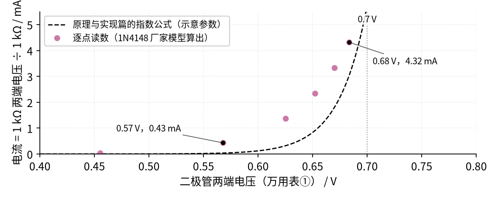
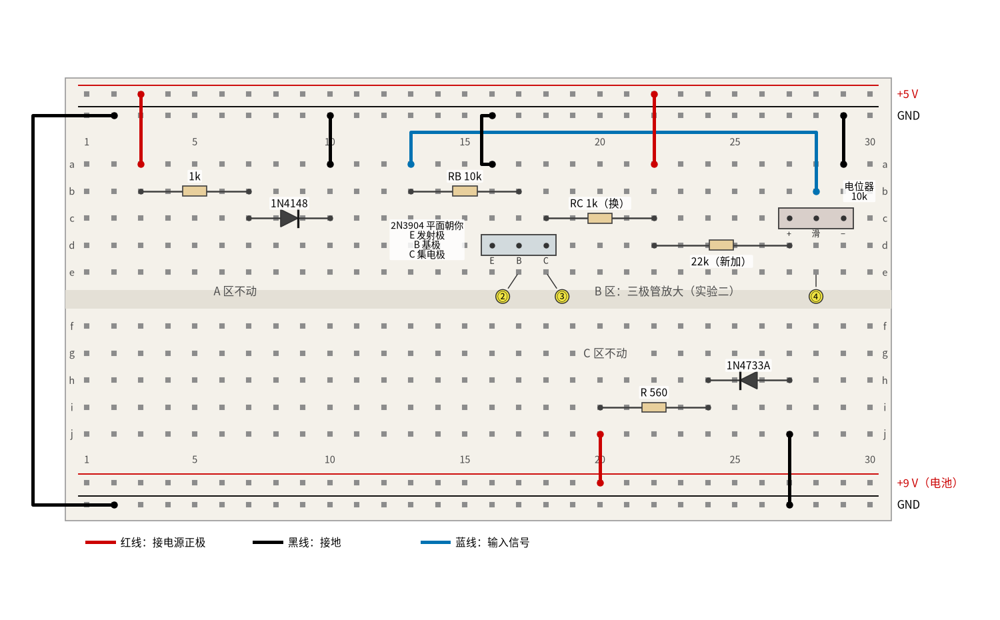
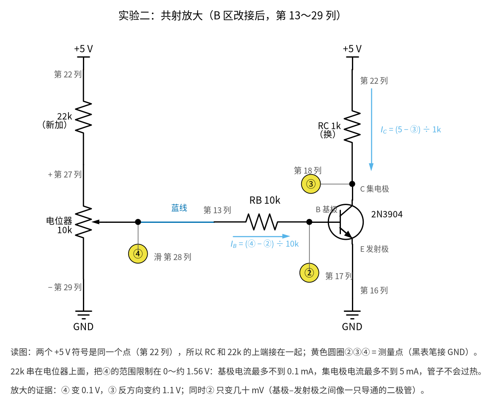
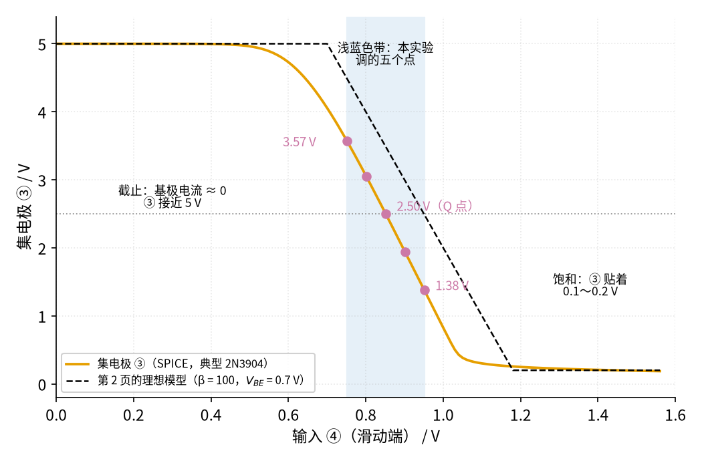

# 03 半导体入门 · 动手实验篇

[上一页：参数与调试篇](page3.md) · [直觉篇](page1.md) · [原理与实现篇](page2.md) · [参数与调试篇](page3.md) · 本页：动手实验篇 · [下一页：04 自锁 · 直觉篇](../04-self-locking/page1.md) · 前置节点：[01 元件速成 · 直觉篇](../01-components-basics/page1.md)

## 这次实验要验证什么

前三页讲了四种半导体器件，这一页挑最常用的三种，在面包板上把书里的结论一条条量出来：

1. **二极管的「0.7 V 规则」**：1N4148 串 1 kΩ 接 5 V，二极管两端只剩约 0.68 V，其余电压都落在电阻上；把电流从 0.4 mA 调到 4.3 mA，压降只多了约 0.1 V。对应 [03 半导体入门 · 原理与实现篇](page2.md) 第一节的指数曲线。
2. **稳压管的「墙」**：1N4733A 串 560 Ω 接 9 V 电池，输出稳在约 5.0 V；接上 1 kΩ 负载几乎不变，接上 470 Ω 负载就「墙倒了」，输出掉到约 4.1 V。对应 [03 半导体入门 · 原理与实现篇](page2.md) 第二节。
3. **三极管当开关**：基极通过 10 kΩ 接 5 V，集电极掉到 0.1 V 左右，LED 点亮；基极接地，LED 熄灭。选做部分把基极电阻换成 47 kΩ，让三极管停在放大区，看集电极电压怎样随 β 变化。对应 [03 半导体入门 · 原理与实现篇](page2.md) 第三节的三个区和负载线，以及 [03 半导体入门 · 参数与调试篇](page3.md) 第二节「基极电阻选大了就不饱和」。
4. **三极管怎样放大（实验二）**：把 B 区改成共射放大电路，用电位器当「输入信号」一点点拧，基极电压只变几十毫伏，集电极电压却变 2 V 多、而且方向相反，放大约 11 倍。对应 [03 半导体入门 · 直觉篇](page1.md) 的「三极管怎样放大」和 [03 半导体入门 · 原理与实现篇](page2.md) 的共射放大小节。

MOS 管这一页不做：它的门限电压离散很大，要配合后面的 [06 MOS 管开关 · 直觉篇](../06-mosfet-switch/page1.md) 一起做才有意思。

## ⚠️ 安全须知

- **只用 12 V 及以下的直流电**。本页上半块用 5 V（USB 面包板电源模块），下半块用一节 9 V 叠层电池。不要接任何市电插座，也不要用笔记本电脑的电源适配器直接供电。
- **两个电源只把地连在一起，正极绝对不能连**。图里左边那根黑线把上下两条 GND 轨接通；+5 V 轨和 +9 V 轨之间不准有任何导线。把 9 V 接到 5 V 模块上，可能烧坏模块或电脑的 USB 口。
- **电解电容分正负极**。本页没有用到电解电容；以后用到时记住：外壳上有"−"号白带的一脚是负极，接反了会发热、鼓包。
- **电阻、三极管、稳压管可能发烫，不要用手摸**。本页电流都在 15 mA 以下，正常时不会热。如果闻到焦味、看到冒烟，或者 9 V 电池明显变热，立刻拔掉电池扣，多半是电池正负极被一根线短接了。
- **接线、改线之前先断电**：拔掉电源模块的 USB 线，再把 9 V 电池扣拔下来；插好、检查一遍再通电。
- **LED 不能直接接电源**，一定要串限流电阻（本页是 220 Ω），否则一瞬间就烧了。

## 器材清单

| 元件 | 型号或数值 | 数量 | 说明 |
|---|---|---|---|
| 面包板 | 400 孔或 830 孔，上下各两条电源轨 | 1 | 本页按 30 列画 |
| 5 V 电源 | 面包板电源模块 + USB 线 | 1 | 只给上面那组电源轨供电 |
| 9 V 电源 | 9 V 叠层电池 + 带线的电池扣 | 1 | 只给下面那组电源轨供电 |
| 开关二极管 | 1N4148 | 1 | 黑色环一端是阴极 |
| 稳压管 | 1N4733A（5.1 V，1 W） | 1 | 黑色环一端是阴极 |
| 三极管 | 2N3904（NPN，TO-92 封装） | 1 | 平面朝自己、引脚朝下，从左到右是 E、B、C |
| LED | 5 mm 红色 | 1 | 长脚是阳极 |
| 电阻 | 1 kΩ，1/4 W，±5% | 3 | 二极管限流、选做和实验二的 RC、稳压管的 1 kΩ 负载 |
| 电阻 | 10 kΩ | 1 | 基极电阻 RB |
| 电阻 | 47 kΩ | 1 | 选做：放大区的基极电阻 |
| 电阻 | 22 kΩ | 1 | 实验二：串在电位器上端，把输入限制在 0～1.56 V |
| 电阻 | 220 Ω | 1 | LED 限流电阻 RC |
| 电阻 | 560 Ω | 1 | 稳压管限流电阻 R |
| 电阻 | 470 Ω | 1 | 稳压管的"太重"负载 |
| 电位器 | 10 kΩ，三脚，可插面包板 | 1 | 中间脚是滑动端 |
| 万用表 | 数字万用表，直流电压挡、电阻挡、二极管挡（有 hFE 挡更好） | 1 | 直流电压挡输入电阻一般约 10 MΩ |
| 跳线 | 红、黑、蓝三色杜邦线若干 | — | 红色接电源正极，黑色接地，蓝色当控制线 |

1N4733A 的 5.1 V 是手册在 49 mA 测试电流下的值，允许 ±5%；本页只给它约 7 mA，读数会比 5.1 V 低一点，这在 [03 半导体入门 · 原理与实现篇](page2.md) 第二节已经讲过。

## 搭建步骤

面包板的规矩和 [01 元件速成 · 动手实验篇](../01-components-basics/page4.md) 一样：同一列的 a～e 连通，f～j 连通，两半被中间的槽隔开，电源轨整条连通；"b3"指 b 行第 3 列。三个电路的原理图分别是 [03 半导体入门 · 直觉篇](page1.md) 里的二极管、稳压管和三极管三张电路图，对照着插。整块板子的接法见 图 03-p4-1。



*图 03-p4-1　03 动手实验的面包板接线图（上半块 5 V，下半块 9 V，两组电源只把地连在一起）*

面包板上元件挤在一起不好认时，对照 图 03-p4-3 的电路原理图：每个区画成一个独立的小电路，灰色小字是对应的面包板列号。



*图 03-p4-3　图 03-p4-1 各区对应的电路原理图（灰色小字是面包板列号，①～⑤是测量点）*

**对照看**：面包板"同一列五个孔连通、上下两半隔开"的规则和 [01 元件速成 · 动手实验篇](../01-components-basics/page4.md) 一样，原理图上的一个节点就对应一列。B 区的三极管最容易插错：d16、d17、d18 三个孔依次是 E、B、C，所以第 17 列就是基极 ②，第 18 列就是集电极 ③，发射极那一列直接用黑线接地。原理图里的"开关"其实就是第 13 列那根蓝线，插 +5 V 轨是开，改插 GND 轨是关。C 区的 1N4733A 阴极在上、朝着 +9 V，这就是"反着接"；+9 V 和 +5 V 在原理图上是两个不同的电源符号，只有 GND 是共用的。

图 03-p4-1 里红线接电源正极（上面是 +5 V，下面是 +9 V），黑线接地，蓝线是三极管的控制线。黑色三角加竖杠是二极管和稳压管，竖杠一侧是阴极；红色三角是 LED；灰色长方块是三极管和电位器，下面的小字是引脚名。黄色圆圈①～⑤是测量点。

**公共部分：电源轨**

1. 断电。电源模块插在面包板上端，跳线帽拨到 5 V，只给上面那组电源轨供电（靠外一条 +5 V，靠里一条 GND）。
2. 9 V 电池扣的红线插进下面靠里那条电源轨（+9 V，紧挨着 j 行），黑线插进最下面靠外那条（GND）。先不要扣上电池。
3. 黑线：上面 GND 轨第 2 列 → 下面 GND 轨第 2 列。**只接这一根，不要把 +5 V 和 +9 V 连起来**。

**A 区：二极管（上半块第 3～10 列）**

4. 红线：+5 V 轨第 3 列 → a3。
5. 1 kΩ 电阻：b3 → b7。
6. 1N4148：**阳极插 c7，阴极（黑色环）插 c10**。
7. 黑线：a10 → GND 轨第 10 列。第 7 列就是二极管阳极（测量点①）。

**B 区：三极管开关（上半块第 13～25 列）**

8. 2N3904 平面朝自己，三只脚分别插 d16（E）、d17（B）、d18（C）。
9. 黑线：a16 → GND 轨（发射极接地）。
10. RB（10 kΩ）：b13 → b17，接到基极。
11. 蓝色控制线：a13 → +5 V 轨第 13 列。这根线插 +5 V 就是"开"，改插 GND 轨就是"关"。
12. RC（220 Ω）：c18 → c22。LED：**长脚插 b25，短脚插 b22**。红线：+5 V 轨第 25 列 → a25。电流路径是 +5 V → LED → 220 Ω → 集电极 → 发射极 → 地。第 17 列是基极（测量点②），第 18 列是集电极（测量点③）。

**电位器（上半块第 27～29 列）**

13. 电位器三只脚插 c27、c28、c29，中间脚 c28 是滑动端。红线：+5 V 轨 → a27；黑线：a29 → GND 轨。第 28 列（测量点④）的电压可以在 0～5 V 之间调，后面逐点测量和选做部分要用它。

**C 区：稳压管（下半块第 20～29 列，9 V）**

14. 红线：+9 V 轨第 20 列 → j20。560 Ω 电阻：i20 → i24。
15. 1N4733A：**阴极（黑色环）插 h24，阳极插 h27**。黑线：j27 → 下面 GND 轨。注意稳压管是"反着"接的：阴极朝正电源。第 24 列就是稳压输出（测量点⑤）。
16. 负载 RL 先不插。需要时插在 f24 和 f29 之间，再用黑线把 j29 接到 GND 轨。
17. 检查：+5 V 和 +9 V 之间没有导线；二极管、稳压管、LED 方向都对。然后插上 USB、扣上电池。

## 测量表

万用表打到直流电压挡，**黑表笔一般接地**（任意一条 GND 轨），只有量电阻两端电压时才把黑表笔挪开。"应该读到"一栏的数来自两处：二极管和稳压管用 ngspice 加厂家模型（1N4148 用 Nexperia 的，1N4733A 用 Diodes Inc. 的）现算，由 `code/figs/03_figs.py` 打印；三极管那几行照搬 [03 的 SPICE 核对表](../review/spice/03.md) 的面包板读数。

| 步骤 | 测什么 | 红表笔 | 黑表笔 | 挡位 | 应该读到 | 读不到时先查 |
|---|---|---|---|---|---|---|
| 0 | 5 V 电源 | 上面 +5 V 轨 | GND 轨 | 直流 20 V | 4.75～5.25 V | 模块开关、跳线帽 |
| 1 | 9 V 电池 | 下面 +9 V 轨 | GND 轨 | 直流 20 V | 8 V 以上（新电池通常略高于 9 V） | 电池扣是否扣紧；低于 8 V 就换电池 |
| 2 | ① 1N4148 压降 | 第 7 列 | GND 轨 | 直流 20 V | 0.66～0.71 V（典型 0.68 V） | 读到约 5 V：二极管插反了 |
| 3 | 1 kΩ 两端 | 第 3 列 | 第 7 列 | 直流 20 V | 4.29～4.34 V | 应等于步骤 0 减步骤 2 |
| 4 | ① 把 1N4148 掉头再插 | 第 7 列 | GND 轨 | 直流 20 V | 约等于步骤 0（反向几乎不导电，电阻上几乎没压降） | 读到 0.7 V 左右：没掉头 |
| 5 | ② 基极，控制线接 +5 V | 第 17 列 | GND 轨 | 直流 20 V | 0.7～0.8 V，LED 亮 | 读到 5 V：发射极没接地或三极管引脚认错 |
| 6 | ③ 集电极，控制线接 +5 V | 第 18 列 | GND 轨 | 直流 20 V | 0.05～0.15 V（饱和） | 读到 1 V 以上：RB 是不是插成了 100 kΩ |
| 7 | ③ 集电极，控制线改接 GND | 第 18 列 | GND 轨 | 直流 20 V | 约 3～3.6 V，LED 灭 | 见思考题 2：读到的不是 5 V 很正常 |
| 8 | ⑤ 稳压输出，空载 | 第 24 列 | GND 轨 | 直流 20 V | 4.74～5.24 V（典型 4.99 V） | 读到约 0.8 V：稳压管插反了（变成正向导通） |
| 9 | 560 Ω 两端 | 第 20 列 | 第 24 列 | 直流 20 V | 步骤 1 减步骤 8（9 V 时约 4.0 V） | 除以 560 Ω 就是总电流，约 7 mA |
| 10 | ⑤ 接 RL = 1 kΩ | 第 24 列 | GND 轨 | 直流 20 V | 4.69～5.18 V（典型 4.93 V，只比空载低几十毫伏） | RL 另一端是否接了地 |
| 11 | ⑤ 换成 RL = 470 Ω | 第 24 列 | GND 轨 | 直流 20 V | 3.88～4.33 V（典型 4.11 V，稳压失效） | 见思考题 3 |
| 12 | 选做：④ 滑动端调到 1.64 V | 第 28 列 | GND 轨 | 直流 20 V | 调到 1.64 V（先把蓝线接好再调） | 电位器两端是否接了 +5 V 和地 |
| 13 | 选做：③ 放大区集电极 | 第 18 列 | GND 轨 | 直流 20 V | 0.2～3.0 V，典型约 2.3 V | 随 β 大幅变化，不是故障 |
| 14 | 选做：④ 调到 5 V 时 ③ | 第 18 列 | GND 轨 | 直流 20 V | 0.1～0.2 V（又饱和了） | 电位器是否拧到头 |

一共 15 个测量点。选做的第 12～14 步要先断电改三处：RB 换成 47 kΩ（仍插 b13–b17），RC 换成 1 kΩ（仍插 c18–c22），拔掉 LED，用一根红线把 +5 V 轨直接接到 a22；再把蓝色控制线从 +5 V 轨拔下，改接 a13 → b28（电位器滑动端）。

第 13 步的范围这么宽，是因为放大区的集电极电压 = 5 V − β × 基极电流 × 1 kΩ，而基极电流只有 (1.64 − 0.7) ÷ 47 kΩ ≈ 20 μA。按页面公式，β = 100 时是 3.0 V，β = 130 时是 2.4 V，β 到 230 就只剩 0.4 V、几乎饱和；2N3904 手册允许的 β 本来就从 100 到 300。有 hFE 挡的万用表可以先把三极管插进去量一下 β，再用下面的 Python 算。这正是 [03 半导体入门 · 参数与调试篇](page3.md) 第二节说的"放大区工作点随 β 走"。

## 没有示波器怎么办

本页全是直流，万用表就够了。但书里那条二极管伏安特性曲线，正规做法是用曲线仪一下扫出来；我们没有曲线仪，就**用电位器加万用表逐点测**。

1. 断电，把 A 区那根红线（+5 V 轨 → a3）拔掉，改用一根蓝线把 b28（电位器滑动端）接到 a3。
2. 通电。转电位器，让第 3 列对地依次是 0.5、1、2、3、4、5 V 左右。
3. 每一档记两个数：二极管电压（红表笔第 7 列、黑表笔接地）和 1 kΩ 两端电压（红表笔第 3 列、黑表笔第 7 列）。电流就是后者除以 1 kΩ，读到 1.37 V 就是 1.37 mA。
4. 把（二极管电压，电流）画在方格纸上，就得到 图 03-p4-2 那样的曲线。



*图 03-p4-2　没有曲线仪时，用电位器和万用表逐点测 1N4148 的伏安特性（串 1 kΩ）*

图 03-p4-2 里紫色圆点是 6 个档位上应该读到的点，用 1N4148 的厂家模型算出；黑色虚线是 [03 半导体入门 · 原理与实现篇](page2.md) 第一节用的指数公式。两个标了数的点最能说明问题：电流从 0.43 mA 涨到 4.32 mA，涨了 10 倍，二极管电压只从 0.57 V 涨到 0.68 V。这就是"导通以后压降差不多不变，按 0.7 V 估算"的来历。圆点整体比虚线偏左一点，是因为虚线用的是示意参数，不是 1N4148 的真实参数；形状一样，就说明你看懂了。最左边那个点（输入 0.5 V）电流只有约 0.04 mA，1 kΩ 上只有几十毫伏，万用表最后一位会跳，读到多少记多少即可。

同样的办法可以测稳压管：把 C 区的 9 V 换成电位器的 0～5 V 是不够的（还没到击穿电压），所以稳压管只做第 8～11 步的几个点，用"加负载看掉不掉"来代替整条曲线。

## 用 Python 核对你的读数

先断电量出各个电阻的实际值，再把电源电压和各步读数填进去。程序算出"应该读到"的值并比较：偏差超过 10%、并且差值超过 0.05 V 的会给出提示（集电极饱和电压只有 0.1 V 左右，差 0.02 V 就是 20%，单看百分比没有意义）。下面填的是一组示例。

```python
import sys, pathlib
sys.path.insert(0, str(pathlib.Path("code/figs").resolve()))  # 在仓库根目录运行
# ① 你量到的电源、电阻和三极管 β（β 用万用表 hFE 挡量；没有就填 130）
m = dict(V5=5.04, V9=9.28, R1k=0.992e3, R560=553.0, RL1k=1.003e3, RL470=468.0, RB47=46.6e3, beta=145)
# ② 你在各步读到的万用表读数（伏）
readings = {"2 二极管压降": 0.684, "3 1kΩ两端": 4.35, "5 基极(开)": 0.76, "6 集电极(饱和)": 0.11,
            "8 稳压空载": 5.02, "10 接1kΩ": 4.96, "11 接470Ω": 4.13, "13 放大区集电极": 2.18}
vin_lin = 1.64                     # 第 12 步调到的滑动端电压

expect = {
    "2 二极管压降": 0.683,                                     # 1N4148 厂家模型，5 V / 1 kΩ
    "3 1kΩ两端": m["V5"] - readings["2 二极管压降"],
    "5 基极(开)": 0.75,                                        # review 表 0.7–0.8 V 的中间
    "6 集电极(饱和)": 0.10,                                    # review 表 0.05–0.15 V 的中间
    "8 稳压空载": 4.99,                                        # 1N4733A 厂家模型，约 7 mA
    "10 接1kΩ": readings["8 稳压空载"] * 4.93 / 4.99,          # 只比空载低约 1%
    "11 接470Ω": m["V9"] * m["RL470"] / (m["R560"] + m["RL470"]),  # 稳压管退出，普通分压
    "13 放大区集电极": max(m["V5"] - m["beta"] * (vin_lin - 0.7) / m["RB47"] * m["R1k"], 0.2),
}
hint = {"2 二极管压降": "二极管方向；是不是插成了 1N4007（压降略高）",
        "3 1kΩ两端": "黑表笔要挪到第 7 列",
        "5 基极(开)": "三极管 E、B、C 是否认错",
        "6 集电极(饱和)": "RB 是否 10 kΩ；三极管是否插反",
        "8 稳压空载": "稳压管方向（阴极朝 560 Ω）；电池电压",
        "10 接1kΩ": "RL 另一端是否接地",
        "11 接470Ω": "这一步本来就不稳压，看是否等于分压值",
        "13 放大区集电极": "β 填对了吗；滑动端电压是否在接好蓝线以后调的"}
iz = (m["V9"] - readings["8 稳压空载"]) / m["R560"]
print(f"稳压管空载电流约 {iz * 1e3:.1f} mA；放大区基极电流约 {(vin_lin - 0.7) / m['RB47'] * 1e6:.0f} μA")
for k, v in readings.items():
    e = expect[k]
    dev = (v - e) / e * 100
    bad = abs(dev) > 10 and abs(v - e) > 0.05
    flag = f"  ← 偏差超过 10%，先查：{hint[k]}" if bad else ""
    print(f"{k:<10} 实测 {v:6.3f} V  计算 {e:6.3f} V  偏差 {dev:+6.1f}%{flag}")
```

示例里的读数都没有触发提示。第 13 步最容易"偏差大"，因为它对 β 和滑动端电压都很敏感：β 差 20%，集电极电压可以差 0.5 V 以上。

## 实验二：三极管放大——输入变一点，输出变很多

前面的选做第 12～14 步只量了一个工作点。这一节把 B 区改成 [03 半导体入门 · 原理与实现篇](page2.md) 的共射放大电路（基极电阻 10 kΩ、集电极电阻 1 kΩ、5 V），用电位器当一个「拧得很慢的输入信号」：先把集电极调到 2.5 V（Q 点），再让输入上下各变 0.05 V、0.10 V，看集电极怎么跟着变。整块板子改完的样子见图 03-p4-4，对应的原理图见图 03-p4-5。



*图 03-p4-4　实验二的面包板接线（只改 B 区和电位器）*



*图 03-p4-5　图 03-p4-4 对应的原理图（灰色小字是面包板列号，②③④是测量点）*

**对照看**：图 03-p4-5 最上面的 +5 V 在面包板上就是第 22 列——红线把 +5 V 轨接到 a22，RC（c18–c22）和 22 kΩ（d22–d27）的一端也都插在这一列，所以原理图里这三样画在同一个点上。22 kΩ 的另一端在第 27 列，就是电位器的「+」端；电位器「−」端第 29 列接地，滑动端第 28 列是测量点 ④。原理图里从 ④ 到 RB 的那段线，在面包板上是那根从 b28 绕到 a13 的蓝线，RB 插在 b13–b17，第 17 列是基极 ②。三极管仍是 d16、d17、d18 依次插 E 发射极、B 基极、C 集电极，第 18 列就是集电极 ③。

**为什么要加 22 kΩ**：它和 10 kΩ 电位器分压，电位器上端只有 5 × 10 ÷ (22 + 10) ≈ 1.56 V，整圈拧下来输入只在 0～1.56 V 之间变，放大区（约 0.7～1.0 V）占了很大一段，好调；同时基极电流最多不到 (1.56 − 0.6) ÷ 10 kΩ ≈ 96 μA，集电极电流最多不到 5 V ÷ 1 kΩ = 5 mA，Q 点时三极管发热只有 2.5 V × 2.5 mA ≈ 6 mW，完全安全。

### 改线步骤（接着第 17 步的板子做）

18. 断电。拔掉 LED，拔掉两根红线：+5 V 轨 → a25、+5 V 轨 → a27。
19. RC 从 220 Ω 换成 1 kΩ，仍插 c18–c22；加一根红线：+5 V 轨第 22 列 → a22。
20. RB 保持 10 kΩ（b13–b17）。如果刚做完选做第 12～14 步、插的是 47 kΩ，换回 10 kΩ。
21. 22 kΩ：d22 → d27。
22. 蓝线：把 a13 那根从 +5 V 轨拔下，改接到 b28（电位器滑动端）。如果做过选做，这根已经接好了。
23. 检查：第 22 列有红线、RC、22 kΩ 三样；a29 仍有黑线接地；A 区、C 区不用动。把电位器拧到「−」那头（④ 接近 0 V），再通电。

### 实验二测量表

黑表笔接地。第 16 步先找 Q 点，后面四步都以它为中心：比如第 16 步读到 ④ = 0.851 V，第 18 步就把 ④ 调到 0.751 V。电位器不好一次调准，调到相差 0.005 V 以内即可，**以实际读到的 ④ 为准**记下来。「应该读到」一栏是 ngspice 用 onsemi 的 2N3904 模型算出的典型值，由 `code/figs/03_figs.py` 打印。

| 步骤 | 测什么 | 红表笔 | 挡位 | 应该读到 | 读不到时先查 |
|---|---|---|---|---|---|
| 15 | 电位器上端 | 第 27 列 | 直流 20 V | 1.3～1.8 V（典型 1.56 V） | 读到 5 V：22 kΩ 没插或插到了别的列 |
| 16 | 拧电位器让 ③ = 2.50 V，记下此时的 ④ | 先第 18 列，再第 28 列 | 直流 20 V | ④ 约 0.75～0.95 V（典型 0.851 V） | ③ 拧不到 2.5 V：RC 是不是还是 220 Ω |
| 17 | Q 点的 ② 基极 | 第 17 列 | 直流 20 V | 0.62～0.70 V（典型 0.658 V） | 和 ④ 一样大：RB 没插好；接近 0：三极管引脚插错 |
| 18 | ④ = Q − 0.10 V 时的 ②、③ | 第 17、18 列 | 直流 20 V | ② 0.635 V，③ 3.57 V | ③ 变化反而和 ④ 同向：表笔接到了第 17 列 |
| 19 | ④ = Q − 0.05 V 时的 ②、③ | 第 17、18 列 | 直流 20 V | ② 0.648 V，③ 3.05 V | 同上 |
| 20 | ④ = Q + 0.05 V 时的 ②、③ | 第 17、18 列 | 直流 20 V | ② 0.667 V，③ 1.94 V | 同上 |
| 21 | ④ = Q + 0.10 V 时的 ②、③ | 第 17、18 列 | 直流 20 V | ② 0.674 V，③ 1.38 V | ③ 已贴到 0.2 V：这只管子 β 很大，只做 ±0.05 V 两步 |
| 22 | ④ 调到约 0.60 V 时的 ③ | 第 18 列 | 直流 20 V | 约 4.7 V（接近截止） | — |
| 23 | ④ 调到约 1.30 V 时的 ③ | 第 18 列 | 直流 20 V | 约 0.2 V（饱和） | 拧到头都下不去：RC 两端是否真是 1 kΩ |

第 18～21 步的 ③ 会随 β 变：β 越大，同样 ±0.10 V 输入下 ③ 摆得越远。不管数字是多少，有三件事一定成立，这就是「放大」的证据：① ④ 往上调，③ 往下走（反相）；② ③ 的变化比 ④ 大十倍左右；③ ② 几乎不动——④ 变 0.2 V，② 只变约 0.04 V，剩下的 0.16 V 都落在 RB 上，变成基极电流的变化 0.16 V ÷ 10 kΩ = 16 μA，再乘 β 变成集电极电流的变化。

请看图 03-p4-6：橙色实线是 SPICE 算出的 ③ 随 ④ 的变化，紫色圆点就是第 18～21 步和第 16 步的五个读数。



*图 03-p4-6　实验二应该读到的曲线：浅蓝色带是第 18～21 步调的范围*

左边 ④ 低于约 0.55 V 时，基极电流几乎为 0，③ 贴在 5 V（截止）；右边 ④ 高过约 1.05 V，③ 贴在 0.2 V 左右（饱和）；只有中间这一段是斜的，斜率就是放大倍数。浅蓝色带里 ④ 从 0.751 V 变到 0.951 V，③ 从 3.57 V 降到 1.38 V，放大倍数约 (1.38 − 3.57) ÷ 0.2 ≈ −11。黑色虚线是第 2 页 β = 100、 $V_{BE}$ = 0.7 V 的理想模型：斜率差不多，只是整体右移了约 0.1 V，因为真实管子的 $V_{BE}$ 只有约 0.66 V、β 约 130。你自己的读数点应该落在一条和橙色线差不多斜的线上，左右平移一点是 β 不同造成的，不是故障。

### 用 Python 核对实验二的读数

把第 15～21 步的读数填进 `readings`，每一步填（④，②，③）三个数。程序用欧姆定律算出每一步的 $I_B$ 和 $I_C$ ，再算 β 和放大倍数，并用 Q 点算出的 β 预测其余四步的 ③：偏差超过 10%、并且差值超过 0.05 V 的会给出提示。下面默认填的是 SPICE 典型值。

```python
import sys, pathlib
sys.path.insert(0, str(pathlib.Path("code/figs").resolve()))  # 在仓库根目录运行
# ① 你量到的电源和电阻（先断电用电阻挡量）
m = dict(V5=5.00, RB=10.0e3, RC=1.0e3)
# ② 各步读数（伏）：(④ 输入, ② 基极, ③ 集电极)
readings = {"18 Q-0.10": (0.751, 0.635, 3.57), "19 Q-0.05": (0.801, 0.648, 3.05),
            "16 Q 点":   (0.851, 0.658, 2.50), "20 Q+0.05": (0.901, 0.667, 1.94),
            "21 Q+0.10": (0.951, 0.674, 1.38)}
VT = 0.02585                                        # 热电压（第 2 页二极管公式里的那个数）

for k, (vi, vb, vc) in readings.items():
    ib = (vi - vb) / m["RB"]                        # RB 两端电压 ÷ RB
    ic = (m["V5"] - vc) / m["RC"]                   # RC 两端电压 ÷ RC
    print(f"{k:<10} I_B = {ib*1e6:5.1f} uA   I_C = {ic*1e3:4.2f} mA   I_C/I_B = {ic/ib:5.0f}")

vi_q, vb_q, vc_q = readings["16 Q 点"]
ib_q = (vi_q - vb_q) / m["RB"]
beta = (m["V5"] - vc_q) / m["RC"] / ib_q            # 用 Q 点算出这只管子的 β
rd = VT / ib_q                                      # 基极-发射极「二极管」的动态电阻
gain_expect = -beta * m["RC"] / (m["RB"] + rd)      # 比 -β·RC/RB 多算了 rd 这一点
lo, hi = readings["18 Q-0.10"], readings["21 Q+0.10"]
gain = (hi[2] - lo[2]) / (hi[0] - lo[0])
dvb = hi[1] - lo[1]
print(f"β ≈ {beta:.0f}，实测放大倍数 {gain:+.1f}，预测 {gain_expect:+.1f}，粗算 -β·RC/RB = {-beta*m['RC']/m['RB']:+.1f}")
print(f"输入变 {hi[0]-lo[0]:.3f} V，基极只变 {dvb*1e3:.0f} mV，集电极变 {hi[2]-lo[2]:+.2f} V")

for k, (vi, vb, vc) in readings.items():
    e = vc_q + gain_expect * (vi - vi_q)            # 用预测的放大倍数推这一步的 ③
    dev = (vc - e) / e * 100
    bad = abs(dev) > 10 and abs(vc - e) > 0.05
    flag = "  ← 偏差超过 10%，先查：④ 是否调准、③ 有没有贴到 0.2 V 或 5 V" if bad else ""
    print(f"{k:<10} ③ 实测 {vc:5.2f} V  预测 {e:5.2f} V  偏差 {dev:+5.1f}%{flag}")

assert gain < -5, "放大倍数应为负（反相），而且大小在 5 以上"
assert abs(dvb) < 0.3 * abs(hi[0] - lo[0]), "基极电压的变化应远小于输入的变化"
print("三条放大证据都成立：反相、放大十倍左右、基极几乎不动")
```

默认读数下，程序算出 β ≈ 130、实测放大倍数 −11.0、预测 −11.4，五个点都没有触发提示；基极只变 39 mV。如果你的 β 是 250，放大倍数会到 −20 左右，±0.10 V 时 ③ 可能已经贴到 0.2 V，这时把 `readings` 里第 18、21 两行换成第 19、20 步的读数，程序照样能用。

## 实验记录表

| 步骤 | 测什么 | 实测值 | 计算值 | 偏差 |
|---|---|---|---|---|
| 0 | 5 V 电源 |  |  |  |
| 1 | 9 V 电池 |  |  |  |
| 2 | 1N4148 压降 |  |  |  |
| 3 | 1 kΩ 两端 |  |  |  |
| 4 | 1N4148 掉头后第 7 列 |  |  |  |
| 5 | 基极（开） |  |  |  |
| 6 | 集电极（开） |  |  |  |
| 7 | 集电极（关） |  |  |  |
| 8 | 稳压输出（空载） |  |  |  |
| 9 | 560 Ω 两端 |  |  |  |
| 10 | 稳压输出（1 kΩ） |  |  |  |
| 11 | 稳压输出（470 Ω） |  |  |  |
| 13 | 放大区集电极（β = ___） |  |  |  |
| 14 | 滑动端 5 V 时集电极 |  |  |  |
| 15 | 实验二：电位器上端 |  |  |  |
| 16 | 实验二：Q 点的 ④（③ = 2.50 V） |  |  |  |
| 17 | 实验二：Q 点的 ② |  |  |  |
| 18 | Q − 0.10 V：④ / ② / ③ |  |  |  |
| 19 | Q − 0.05 V：④ / ② / ③ |  |  |  |
| 20 | Q + 0.05 V：④ / ② / ③ |  |  |  |
| 21 | Q + 0.10 V：④ / ② / ③ |  |  |  |
| 22 | ④ 约 0.60 V 时的 ③ |  |  |  |
| 23 | ④ 约 1.30 V 时的 ③ |  |  |  |

逐点测量另记一张表：输入档位、二极管电压、1 kΩ 两端电压、电流（mA）四栏，6 行。

## 思考题

**思考题 1**：逐点测量时，电流从约 0.43 mA 涨到约 4.3 mA，二极管电压只多了约 0.1 V。如果把电流再涨 10 倍到 43 mA，压降大概是多少？为什么本页不这么做？

<details><summary>答案</summary>

按指数规律，电流每涨 10 倍，压降大约多涨同样一截，所以估计在 0.8 V 上下；电流大了以后二极管内部的体电阻也开始起作用，实际会再高一点。本页不这么做，是因为 5 V 串 1 kΩ 最多只能给 4 mA 多；想要 43 mA 得把电阻换成约 100 Ω，电阻上要耗掉约 0.2 W，1/4 W 电阻会很烫，也超过了 1N4148 手册里那条"10 mA 时压降不超过 1 V"的测试条件。

</details>

**思考题 2**：第 7 步控制线接地以后，三极管已经截止，为什么集电极读到的是 3 V 多，而不是 5 V？

<details><summary>答案</summary>

因为万用表本身也是一条通路。红表笔插在集电极、黑表笔接地，等于在集电极和地之间接了一个约 10 MΩ 的电阻。截止的三极管不导电，但这条 10 MΩ 通路会让一个零点几微安的电流从 +5 V 经过 LED、220 Ω 流进万用表。LED 在这么小的电流下也有约 1.5 V 的压降（看不见亮），所以表上读到 5 − 1.5 ≈ 3.5 V。这不是故障，[03 的 SPICE 核对表](../review/spice/03.md) 里也是这样写的。

</details>

**思考题 3**：第 11 步接 470 Ω 负载以后，输出为什么掉到约 4.1 V，而且正好等于 560 Ω 和 470 Ω 的普通分压？

<details><summary>答案</summary>

稳压管能"稳住"，靠的是限流电阻里有富余的电流可以让它分走。9 V 电池经过 560 Ω，在输出为 5 V 时最多只能送出 (9 − 5) ÷ 560 ≈ 7.1 mA。470 Ω 负载在 5 V 下要 5 ÷ 470 ≈ 10.6 mA，比能送出的还多，输出只好往下掉；掉到 5 V 以下，稳压管就回到"墙"前面那段几乎不导电的区域，等于不存在，剩下的就是普通分压 9 × 470 ÷ (560 + 470) ≈ 4.1 V。接 1 kΩ 时负载只要约 5 mA，稳压管还能分到 2 mA 多，所以输出几乎不变。后面的 [17 稳压管稳压 · 直觉篇](../17-zener-regulator/page1.md) 会专门讲怎样选这个限流电阻。

</details>

**思考题 4**：实验二里 ④ 从 Q − 0.10 V 调到 Q + 0.10 V，一共变了 0.2 V，基极 ② 却只变了约 0.04 V。剩下的电压去哪了？为什么集电极 ③ 能变 2 V 多？

<details><summary>答案</summary>

第 1 步：剩下约 0.16 V 落在 RB（10 kΩ）上，所以基极电流变了 0.16 V ÷ 10 kΩ = 16 μA（读数里是 11.6 μA 变到 27.7 μA）。第 2 步：三极管把这 16 μA 放大 β 倍左右（约 130 倍），集电极电流变约 2.2 mA（1.43 mA 变到 3.62 mA）。第 3 步：这 2.2 mA 的变化全部流过 RC（1 kΩ），RC 上的电压就变约 2.2 V；RC 上多掉的电压，集电极就少了，所以 ③ 往下走约 2.2 V。多出来的能量来自 5 V 电源，三极管只是用小小的基极电流去「控制」从电源流过 RC 的大电流。

</details>

## 自测清单

- 我能看着 1N4148、1N4733A 和 LED 认出阴极，并按指定方向插进面包板。
- 我能用电位器和万用表逐点测出二极管的伏安特性，并说出"0.7 V 规则"在什么电流范围里成立。
- 我能用万用表判断三极管是饱和、截止还是在放大区，并解释截止时集电极为什么读不到 5 V。
- 我能算出稳压管限流电阻能带多大的负载，并用实验验证负载太重时稳压会失效。
- 我能在两组电源只共地的情况下正确接线，说出为什么 +5 V 和 +9 V 不能连在一起。
- 我能把共射放大电路的集电极调到约 2.5 V，用三个读数（④②③）说出「反相、放大十倍左右、基极几乎不动」这三条放大证据，并算出这只管子的 β。
