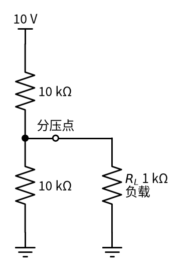
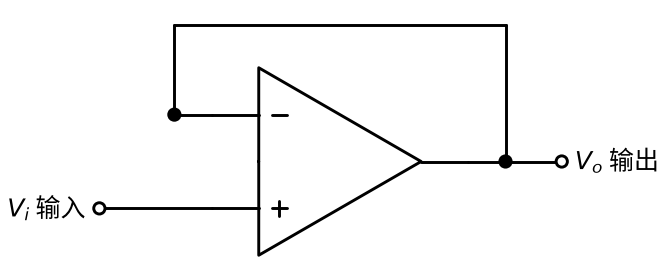
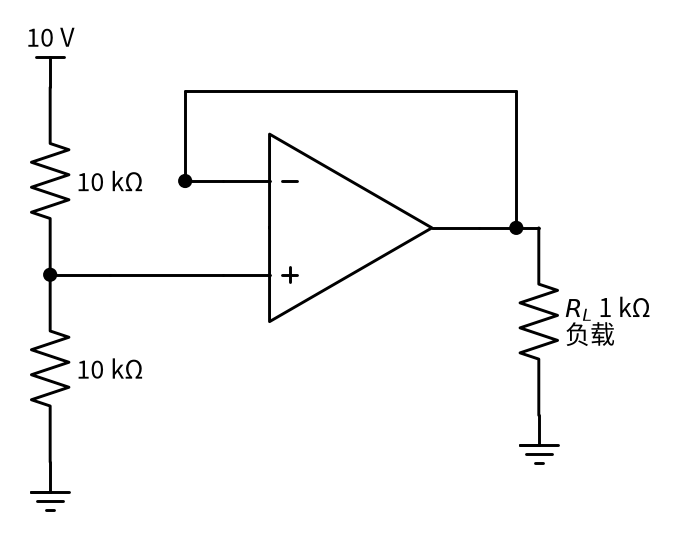

# 03 电压跟随器 · 直觉篇

[上一页：18 互锁 · 参数与调试篇](../18-interlock/page3.md) · 本页：直觉篇 · [原理与实现篇](page2.md) · [参数与调试篇](page3.md) · [下一页：原理与实现篇](page2.md) · 前置节点：[02 同相放大 · 直觉篇](../02-noninverting-amp/page1.md)

## 痛点：一接负载，电压就掉

用两个 10 kΩ 电阻把 10 V 分压，按 P1 的分压公式，中间点应该是 5 V。万用表一量，果然 5.00 V。可是把一个 1 kΩ 的负载（比如一个小模块的输入、一个 LED 驱动电路）接上去，电压一下子掉到不到 1 V。这就是"信号源**带不动**负载"。

问题出在哪里？先看出问题的接法 图 03-p1-1。

*图 03-p1-1　分压器直接接负载*

图 03-p1-1 中，负载 $R_L$ （负载电阻，L 是英文 load 的首字母）1 kΩ 和下面那个 10 kΩ **并联**了。并联后的电阻约 0.91 kΩ，比上面的 10 kΩ 小得多，按分压公式，分压点只剩 10 V × 0.91 ÷ (10 + 0.91) ≈ 0.83 V。负载一接，就把分压器"拉低"了。根本原因是：**负载要从分压点取电流，而分压器给不起**。

同样的事在很多地方出现：

- **传感器接长线和小电阻负载**：一个内阻 20 kΩ 的温度传感器（内阻：把信号源看成理想电压源串一个电阻，这个电阻就是内阻，见 [P1 元件速成 · 原理与实现篇](../P1-components-basics/page2.md) 第七节），直接接到输入电阻只有 10 kΩ 的电路上，读数只剩三分之一，看起来像"温度变低了"。
- **给模数转换器当基准**：单片机的模数转换器每次采样都要从输入端"吸"一小口电流，分压器给的基准电压会跟着一跳一跳，读数抖动。
- **滤波器后面接负载**：一个 RC 低通滤波器后面直接接小电阻，截止频率和衰减量全变了（[15 有源滤波 · 直觉篇](../15-active-filter/page1.md) 会用到这一点）。

这些问题有一个共同点：**前级本身没坏，是后级把它"拖垮"了**。好比一根细水管，本来出水压力正常，一下接上十个水龙头同时开，压力就掉了。我们要的不是换一根粗水管（换小电阻的分压器会白白耗电），而是在中间加一个"增压泵"。

## 一、电路长什么样：只有一根导线的"放大器"

解决办法是在中间加一个"中间人"：它从分压点**几乎不取电流**，却能向负载**提供足够的电流**，并且输出电压和输入**完全一样**。这就是**电压跟随器**，看 图 03-p1-2。

*图 03-p1-2　电压跟随器*

图 03-p1-2 中没有任何电阻：输入 $V_i$ 接同相端，输出 $V_o$ 用一根导线直接接回反相端。它就是 [02 同相放大 · 直觉篇](../02-noninverting-amp/page1.md) 在反馈电阻为 0、接地电阻断开时的特例：倍数 1 + 0 = 1。

$$V_o = V_i$$

代一组数：输入 5 V，输出 5 V；输入 −1.2 V，输出 −1.2 V。

## 二、直觉：一个"传话的人"

为什么倍数为 1 还有用？把跟随器想成一个**只负责传话、但嗓门很大的人**。分压器是一个说话很小声的人（内阻大、给不起电流），负载是远处一大群听众（要电流）。直接喊，听众听不清；中间站一个人，他把耳朵贴到分压器嘴边（几乎不打扰它），再用自己的大嗓门（运放从电源取电流）把**同样的话**喊给听众。

用 P3 的口诀说就是：**虚断**，同相端不取电流，所以分压器"感觉不到"后面接了东西，分压点仍是 5 V；**虚短**，有负反馈、且输出没有顶到电源时，反相端等于同相端，而反相端就是输出，所以输出也是 5 V。负载要的电流，由运放的输出级从电源"搬"过来。看 图 03-p1-3。

*图 03-p1-3　分压器经跟随器接负载*

图 03-p1-3 中，同样的分压器、同样 1 kΩ 的负载，中间多了一个跟随器。分压器只接在同相端上，相当于空载，分压点保持 5 V；跟随器输出 5 V，负载上也是 5 V，1 kΩ 负载需要的 5 mA 电流由运放提供。

## 三、在示波器上会看到什么

假设你在面包板上搭好了 图 03-p1-3 的电路，用双通道示波器（或者两块万用表）一步步测，会看到下面的现象：

1. **先不接负载**。通道 1 夹在分压点，通道 2 夹在跟随器输出。两条线都是一条平直的 5 V 横线，重合在一起。
2. **把 1 kΩ 负载接到跟随器输出**。两条线**纹丝不动**，仍是 5 V。如果再串一块电流表，会读到约 5 mA，这是运放从电源"搬"来的电流。
3. **作为对照，把负载改接到分压点**（也就是 图 03-p1-1 的接法）。通道 1 立刻从 5 V 掉到约 0.83 V，跟随器输出也跟着掉到 0.83 V，因为跟随器只是"照抄"它的输入。
4. **把输入换成 1 kHz 的正弦波**（比如信号源输出峰值 1 V）。两条正弦完全重合，波峰对波峰、过零对过零，既不放大也不反相。

第 3 步很重要：跟随器只能保护**它后面**的电路，不能修复**它前面**已经被拖低的信号。所以跟随器要紧贴在"娇气"的信号源后面，所有负载都接在它的输出端。

如果第 2 步看到输出明显低于 5 V，或者正弦波顶部被削平，多半是运放输出电流不够或输出到不了那么高，第三页会专门讲这些情况。

## 四、两个专业名词

用"电阻"来说，跟随器做了两件事：

1. **输入电阻极大**：从输入端看进去，几乎不取电流，好像是一个无穷大的电阻，不会"拖累"前级。
2. **输出电阻极小**：从输出端看进去，好像是一个理想电压源，负载变化时输出电压几乎不变。

这叫"阻抗变换"或"隔离缓冲"，跟随器也常被叫做**缓冲器**。前级是一个"娇气"的信号源（分压器、高内阻传感器、RC 滤波器），后级是一个"贪吃"的负载时，中间就该放一个跟随器。

## 五、新手常见误解

- **"倍数为 1，等于没接"**：电压没变，但能提供的电流变了，这才是它的价值。
- **"什么负载都能带"**：运放输出电流有限，一般只有几到几十毫安；接大电容、长电缆还可能振荡（第三页讲）。
- **"输出能到电源电压"**：普通运放输出离电源轨有一段距离，单电源时尤其要注意。

## 一句话总结

**电压跟随器把输出直接接回反相端， $V_o = V_i$ ；它几乎不从前级取电流，却能给后级提供电流，用来隔离"带不动负载"的信号源**。
