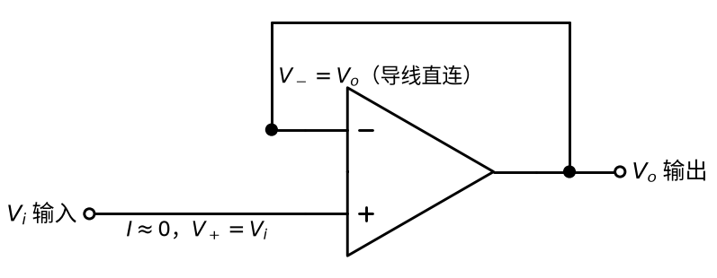
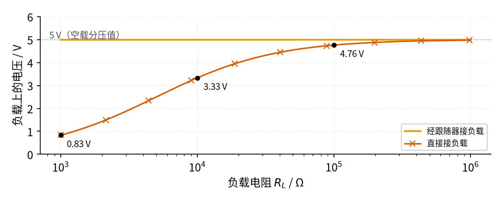
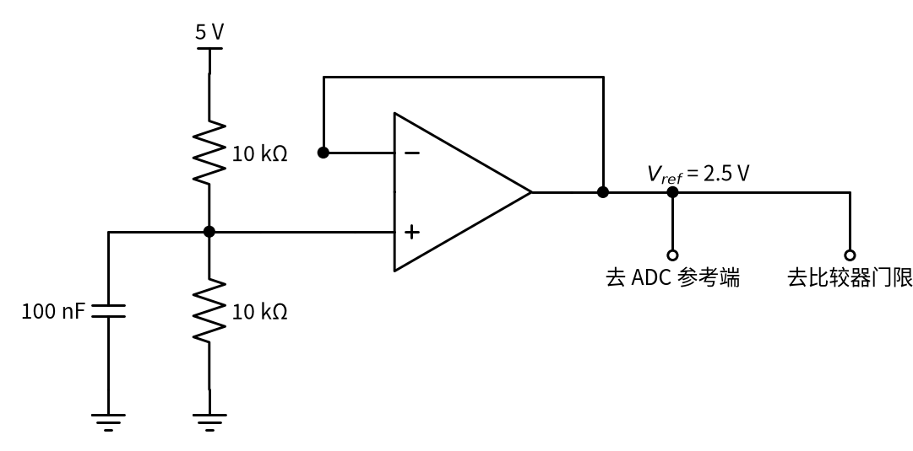

# 03 电压跟随器 · 原理与实现篇

[上一页：直觉篇](page1.md) · [直觉篇](page1.md) · 本页：原理与实现篇 · [参数与调试篇](page3.md) · [下一页：参数与调试篇](page3.md) · 前置节点：[02 同相放大](../02-noninverting-amp/page1.md)

## 这一页要解决的问题

直觉篇说跟随器"不打扰前级、又能喂饱后级"。这一页先用虚短虚断两行推出 $V_o = V_i$ ，再从 [02 同相放大](../02-noninverting-amp/page2.md) 的公式看它为什么是特例；然后用仿真定量回答"负载多重时，直接接法会掉多少"；最后三道例题，第三道是跟随器最常见的实际用途：**基准电压缓冲**。

## 一、推导：两行就够

看 图 03-p2-1，推导要用的关系都标在图上。



*图 03-p2-1　推导用的电压跟随器*

图 03-p2-1 中，反相端旁写着"等于输出（导线直连）"，输入线下写着"电流约为 0，同相端电压等于输入"。

**第一步：导线直连**。输出和反相端之间只有一根导线，所以反相端电压 $V_-$ 就是输出：

$$V_- = V_o$$

**第二步：虚短**。这是负反馈（输出接回反相端），输出没饱和时两输入端电压相等，同相端电压 $V_+$ （同相输入端对地的电压）就是输入：

$$V_o = V_- \approx V_+ = V_i$$

代数：输入 2.5 V，输出 2.5 V。

**和同相放大对照**。02 的公式是 $A_v = 1 + R_f/R_1$ 。跟随器的反馈电阻是一根导线（ $R_f$ = 0），接地电阻断开（ $R_1$ 无穷大），电阻比是 0，倍数正好是 1。

**输入电阻和输出电阻**。虚断说明同相端不取电流，所以从输入看进去的电阻极大（理想为无穷大）。输出端呢？负反馈会不断比较"输出是否等于输入"，输出稍一被负载拉低，差值就被运放放大 A 倍去纠正，所以输出电压几乎不随负载变化，相当于**输出电阻极小**的电压源。

**再严格一点：为什么是"几乎"相等**。虚短是一个近似。回到 [P3 运放入门](../P3-opamp-basics/page2.md) 的原始规律：输出等于开环增益 $A$ （运放不加反馈时的放大倍数，约 10 万）乘以两输入端的电压差。

1. 运放规律：输出 = A ×（同相端 − 反相端），即 $V_o = A(V_i - V_o)$ ，这里用了"反相端就是输出"。
2. 移项：把含 $V_o$ 的项都移到左边， $V_o + A V_o = A V_i$ 。
3. 提公因式再相除：

$$V_o = \frac{A}{1 + A} V_i$$

代数： $A$ = 100000 时，倍数是 100000/100001 ≈ 0.99999。输入 5 V，输出比 5 V 少约 0.05 mV，任何万用表都量不出来。这就是为什么可以放心地写 $V_o = V_i$ 。

**负载拉低输出时会发生什么**。设想负载突然变重，把输出往下拉了 1 mV。那么两输入端之差立刻变成约 1 mV，运放要把它放大 10 万倍，相当于想让输出升高 100 V，于是输出级马上加大电流把输出"推"回去，直到差值又回到几十微伏。这个"一被拉低就马上推回"的过程，就是负反馈让输出电阻变得极小的原因。它有两个前提：运放输出电流够大（一般几到几十毫安），输出电压没有碰到电源轨。任何一个不满足，跟随器就"跟不住"了。

## 二、仿真：负载越重，直接接法掉得越多

下面的仿真用直觉篇的分压器（10 V，两个 10 kΩ），让负载电阻 $R_L$ 从 1 kΩ 扫到 1 MΩ，比较两种接法下负载上的电压。直接接时，负载和下臂并联，再按分压公式算；经过跟随器时，分压器空载，负载电压始终是 5 V。代码与仓库里的 code/03_sim.py 完全一致，需要和仓库的 code/figs 目录放在一起运行。

```python
# 03 电压跟随器最小仿真：10 V 经两个 10 kΩ 分压得到 5 V，比较「直接接负载」和「经跟随器接负载」时负载上的电压。
import sys, os                                     # 下一行让 Python 找到 code/figs 里的共享画图样式
sys.path.insert(0, os.path.join(os.path.dirname(os.path.abspath(__file__)), "figs"))
import numpy as np                                 # 数组运算
import matplotlib.pyplot as plt                    # 画图
import figstyle as fs                              # 全书统一的颜色、轴标签、保存函数

V_s, Ra, Rb = 10.0, 10e3, 10e3                     # 电源 10 V，上下两个分压电阻都是 10 kΩ
V_open = V_s * Rb / (Ra + Rb)                      # 不接负载时分压点 5 V
RL = np.logspace(3, 6, 300)                        # 负载电阻从 1 kΩ 扫到 1 MΩ

def par(a, b):                                     # 两个电阻并联
    return a * b / (a + b)

V_direct = V_s * par(Rb, RL) / (Ra + par(Rb, RL))  # 直接接：负载和下臂并联，分压点被拉低
V_buffer = np.full_like(RL, V_open)                # 经跟随器：分压点只接同相端（不取电流），输出 = 5 V

fig, ax = plt.subplots(figsize=fs.SIZE["single"])  # 一张图
ax.semilogx(RL, V_buffer, **fs.LS["vout"], label="经跟随器接负载")       # 橙色：跟随器输出
ax.semilogx(RL, V_direct, **fs.LS["bad"], label="直接接负载")           # 朱红色带 ×：问题做法
for r in (1e3, 10e3, 100e3):                       # 标出三个负载值下直接接法的电压
    v = V_s * par(Rb, r) / (Ra + par(Rb, r))       # 这一点的负载电压
    print(f"负载 {r/1e3:g} kΩ：直接接 {v:.2f} V，经跟随器 {V_open:.2f} V")
    fs.mark(ax, r, v, fmt="{:.2f}", unit=" V", dx=6, dy=-12)
fs.ref_h(ax, V_open, f"{V_open:.0f} V（空载分压值）", x=0.02, ha="left")   # 灰色点线：设计值
assert abs(V_s * par(Rb, 1e3) / (Ra + par(Rb, 1e3)) - 0.83) < 0.01        # 1 kΩ 负载直接接只剩 0.83 V
assert np.all(V_buffer == 5.0)                     # 跟随器后负载电压不变
fs.axlabels(ax, "负载电阻 $R_L$", "Ω", "负载上的电压", "V")              # 轴标签
ax.set_ylim(0, 6); ax.legend(loc="lower right", fontsize=8)               # 纵轴范围和图例
fs.save(fig, "03", "03_p2_2_buffer_vs_direct.png")  # 保存到 03-voltage-follower/img/
```

运行后会打印（另有几行以 [数值]、[图] 开头的提示）：

```text
负载 1 kΩ：直接接 0.83 V，经跟随器 5.00 V
负载 10 kΩ：直接接 3.33 V，经跟随器 5.00 V
负载 100 kΩ：直接接 4.76 V，经跟随器 5.00 V
```

并生成 图 03-p2-2。



*图 03-p2-2　直接接负载与经跟随器接负载时的负载电压*

图 03-p2-2 中，橙色线（经跟随器）贴着灰色点线 5 V，一动不动。朱红色带 × 的线（直接接）在负载 1 kΩ 时只有 0.83 V，10 kΩ 时 3.33 V，100 kΩ 时 4.76 V，直到负载比分压电阻大一百倍，才勉强接近 5 V。经验规律是：**负载电阻要比信号源内阻大 100 倍以上，才可以直接接**；做不到就加跟随器。分压器的"内阻"是两个电阻并联，这里是 5 kΩ。

## 三、例题

### 例 1（完整示例）：用分压器给模块提供 3.3 V 参考

**题目**：5 V 电源，用 10 kΩ 和 20 kΩ 分压得到 3.3 V，送给一个输入电阻 2 kΩ 的模块。直接接会怎样？怎么改？

**解**：

1. 空载：5 V × 20/(10+20) ≈ 3.33 V。
2. 直接接：下臂 20 kΩ 和 2 kΩ 并联 ≈ 1.82 kΩ，分压 5 V × 1.82/(10+1.82) ≈ 0.77 V，远低于 3.3 V。
3. 改法：分压点接跟随器同相端，跟随器输出接模块。模块要的电流 3.33 V ÷ 2 kΩ ≈ 1.7 mA 由运放提供。
4. 检查：输出 3.33 V，若运放用 5 V 单电源，LM358B 的输出上限约 3.5 V，只剩 0.17 V 余量，最好提高运放电源或换轨到轨运放（第三页详讲）。

### 例 2（关键步骤留空）：直接接还是加跟随器

**题目**：某传感器内阻 50 kΩ，后级输入电阻 200 kΩ。直接接时后级得到传感器开路电压的百分之多少？要不要加跟随器？

```python
# 不运行
Rs, RL = 50e3, 200e3
ratio = RL / (____ + ____)   # 内阻和负载串联分压
print(ratio)                 # = ____，即掉了 ____ %
```

<details><summary>答案</summary>

ratio = RL / (Rs + RL) = 200 / 250 = 0.8，后级只得到 80%，掉了 20%。负载只比内阻大 4 倍，远不到 100 倍，应该加跟随器。

</details>

### 例 3（变体迁移）：基准电压缓冲

**题目**：单片机系统里常用分压得到一个 2.5 V 的"基准"，同时给模数转换器的参考端和一个比较器的门限端用。模数转换器每次采样时会突然抽一小股电流，基准就跟着跳。怎么办？

**解**：看 图 03-p2-3。



*图 03-p2-3　用跟随器缓冲 2.5 V 基准电压*

图 03-p2-3 中，分压器得到 2.5 V，100 nF 电容滤掉电源上的小毛刺，再进入跟随器；跟随器输出 $V_{ref}$ （基准电压，ref 是英文 reference 的缩写）2.5 V，同时送给两个负载。思路和例 1 一样：分压器只接同相端，相当于空载；负载突然抽电流时，由运放的输出级及时补上，基准电压几乎不跳。这种"分压 + 电容 + 跟随器"的组合在后面很多节点都会出现，例如单电源放大器的偏置电压。

## 本页小结

**跟随器：导线直连让反相端等于输出，虚短让它等于输入，所以 $V_o = V_i$ ；它是同相放大电阻比为 0 的特例。输入电阻极大、输出电阻极小，负载比信号源内阻小于 100 倍时就该用它隔离**。
