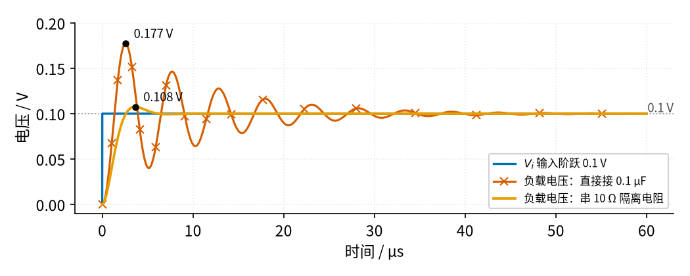
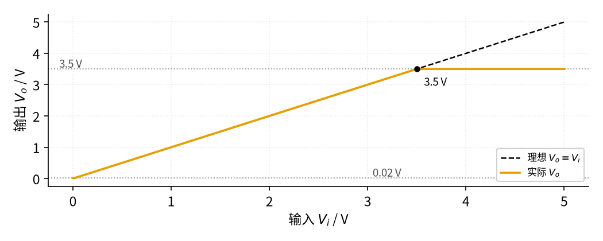

# 03 电压跟随器 · 参数与调试篇

[上一页：原理与实现篇](page2.md) · [直觉篇](page1.md) · [原理与实现篇](page2.md) · 本页：参数与调试篇 · [下一页：06 桥式整流 · 直觉篇](../06-bridge-rectifier/page1.md) · 前置节点：[02 同相放大 · 直觉篇](../02-noninverting-amp/page1.md) · 后续：[07 射极跟随器 · 直觉篇](../07-emitter-follower/page1.md)、[15 有源滤波 · 直觉篇](../15-active-filter/page1.md)

## 这一页解决什么问题

跟随器电路简单到只有一根导线，出问题时反而让人摸不着头脑。实际中最常见的两个坑是：**接了大电容就振荡**、**单电源下两头跟不上**。这一页把这两件事讲清楚，再讲速度限制，最后给一张故障表和五道练习。

## 一、容性负载：为什么"最稳"的电路会振荡

跟随器是增益为 1 的负反馈，反馈最深，本来对稳定性要求最高。如果输出直接接一个大电容（长电缆、MOS 管栅极、模数转换器输入端的滤波电容都算），运放内部的输出电阻和这个电容会形成一个额外的"迟到"：输出电压要先给电容充电才能变化，反馈回来的信号就慢了半拍，运放"纠正过头"，输出来回摆动，这就是**振铃**，严重时变成持续振荡。

治法是在运放输出和电容之间串一个几欧到几十欧的**隔离电阻** $R_{iso}$ （iso 是英文 isolation"隔离"的缩写），把电容和反馈点隔开一点。看 图 03-p3-1，输入是一个 0.1 V 的小阶跃，负载电容 0.1 μF。

*图 03-p3-1　跟随器驱动 0.1 μF 电容时的阶跃响应（由 code/figs/03_figs.py 生成）*

图 03-p3-1 中，朱红色带 × 的曲线（直接接电容）最高冲到 0.190 V，比目标 0.1 V 多出 90%，到 60 μs 还在来回振荡；红紫色点划线（串 10 Ω）好一些，过冲 40%；橙色曲线（串 33 Ω 隔离电阻）最高只有 0.101 V，过冲约 1%，约 8 μs 就稳在灰色点线 0.1 V 上（误差进入 ±2%）。

模型里运放的输出电阻取 300 Ω，出自 [LM358B 数据手册](https://www.ti.com/lit/ds/symlink/lm358.pdf) 电气特性表的"开环输出电阻 RO = 300 Ω（1 MHz、输出电流为 0）"。真实芯片的输出电阻随频率变化，这里当作一个固定值，是简化。同一张表还写着 LM358B 的"容性负载驱动能力"只有 100 pF，而 0.1 μF 是它的 1000 倍，所以振铃这么厉害并不奇怪。真实芯片的振铃程度仍要以实测为准，但"串隔离电阻能大幅减小振铃"这个结论，和 TI 参考设计 TIDU032C 用 6.2 Ω 驱动 0.1 μF 的做法一致（那款运放的输出电阻不同，所以电阻值也不同）。

隔离电阻的代价：负载电流在它上面会有压降。比如负载电流 1 mA、 $R_{iso}$ = 33 Ω，压降 33 mV。对精度要求高时，可以把反馈从电容一侧取回来（属于进阶内容，这里不展开）。

## 二、单电源：输入输出都有"禁区"

用 5 V 单电源、负极接地的 LM358B 做跟随器，输入 0～5 V 时输出能不能跟着走？看 图 03-p3-2。

*图 03-p3-2　5 V 单电源下 LM358B 跟随器的输入输出关系*

图 03-p3-2 中，黑色虚线是理想的 $V_o = V_i$ ，橙色实线是实际输出：输入高于 3.5 V 时，输出被削平在 3.5 V；输入接近 0 时，输出最低只到约 0.1 V。原因有两个：LM358B 的输出最高只能到 $V_+$ − 1.5 V（这里 $V_+$ 指运放的正电源），而且同相端的共模输入范围上限也是 $V_+$ − 1.5 V，超出后虚短不再成立。所以单电源跟随器要么把信号限制在 0.1～3.5 V，要么提高电源，要么换"轨到轨"运放。

## 三、速度：输入变得太快时跟不上

前面两节讲的是"电压范围"和"负载"，还有第三个参数常被忽略：**压摆率**，即运放输出电压每微秒最多能变化多少伏。LM358B 的典型值约 0.5 V/μs。正弦波过零时变化最快，峰值为 $V_p$ 、频率为 $f$ 的正弦，最快的变化速度是 $2\pi f V_p$ 。这个式子要用导数推，这里直接用结论，但可以不用导数理解它：四分之一周期（时长 $1/(4f)$ ）里，正弦从 0 走到 $V_p$ ，平均速度是 $4 f V_p$ ；而它在过零处走得最快、到峰顶时几乎停住，最快处正好是平均速度的 π/2 ≈ 1.57 倍，4 × π/2 = 2π。code/figs/03_figs.py 用相邻两点相减（np.diff）的办法数值验证过：1 kHz、峰值 1 V 时最大斜率是 6283 V/s，正好等于 2π × 1000 × 1。TI 的 SLOA060 也给出同样的要求：压摆率必须大于 $2\pi V_p f_0$ ，否则输出失真。

**意思**：信号越大、越快，要求的压摆率越高。**公式**：

$$f_{max} = \frac{SR}{2\pi V_p}$$

这里 $SR$ 是压摆率， $f_{max}$ 是不失真的最高频率。**代数**：峰值 1 V 时， $f_{max}$ = 0.5 V/μs ÷ (2π × 1 V) ≈ 80 kHz；峰值 3 V 时只有约 27 kHz。超过这个频率，正弦的斜坡会被"拉直"，看起来像三角波。

所以选跟随器的运放，至少要看四个参数：

1. **输出电流**：决定能带多重的负载。
2. **输出摆幅和共模输入范围**：决定单电源下信号能有多大。
3. **压摆率**：决定大信号能有多快。
4. **能否驱动容性负载**：手册里通常会给出"能直接驱动多少皮法"的说明，超过就要串隔离电阻。

跟随器的倍数只有 1，所以 [02 同相放大 · 参数与调试篇](../02-noninverting-amp/page3.md) 讲过的"闭环带宽 ≈ GBW ÷ 倍数"在这里最宽，约 1.2 MHz；对跟随器来说，大信号时先碰到的限制往往是压摆率，而不是带宽。

## 四、故障排查表

| 现象 | 原因 | 怎么查 | 怎么改 |
|---|---|---|---|
| 输出比输入低一截，负载越重越明显 | 运放输出电流不够，或负载太重 | 断开负载看输出是否恢复；算负载电流是否超过手册限值 | 加大负载电阻，或在跟随器后加三极管扩流 |
| 输出有高频振荡或阶跃后振铃 | 输出直接接大电容或长电缆 | 示波器看输出；断开电容看是否消失 | 串 10～50 Ω 隔离电阻；换能驱动容性负载的运放 |
| 输入较高时输出削平 | 超出单电源下的输出上限或共模上限 | 对照手册 $V_+$ − 1.5 V；逐步加大输入看削平点 | 提高电源电压，或换轨到轨运放 |
| 输出被锁在一个电源轨上不动 | 反馈线接到了同相端，变成正反馈 | 对照原理图检查输出接的是哪个输入端 | 输出必须接反相端，输入接同相端 |
| 正弦频率一高就变成三角波 | 压摆率不够，大信号跟不上 | 按 $2\pi f V_p$ 算所需压摆率，与手册对比；减小幅度看是否恢复 | 降低幅度或频率，或换压摆率更高的运放 |
| 输出带着电源的纹波或毛刺 | 运放电源引脚没有就近去耦（去耦：在芯片电源脚旁就近并一个 100 nF 电容，吸收电源上的高频毛刺），或输入端的分压点没有滤波 | 示波器交流档（只显示变化部分、去掉直流的档位）看电源引脚和输出 | 电源引脚就近并 100 nF 电容；分压点并电容（见[原理与实现篇](page2.md)例 3） |
| 输入悬空时输出乱漂 | 同相端没有直流通路，偏置电流（运放输入端实际仍有的纳安级微小电流）无处可去 | 量同相端对地电压是否漂动 | 同相端接一个电阻到地或到偏置电压 |

## 五、练习

**练习 1（基础）**：跟随器输入 1.8 V，输出多少？如果负载电阻 3.6 kΩ，负载电流多少？由谁提供？

答案

输出 1.8 V。负载电流 1.8 V ÷ 3.6 kΩ = 0.5 mA，由运放的输出级（从电源）提供，信号源几乎不提供电流。

**练习 2（进阶）**：一个温度传感器内阻 20 kΩ，后级输入电阻 20 kΩ。直接接时后级拿到开路电压的几分之几？加跟随器后呢？

答案

直接接：20 ÷ (20 + 20) = 1/2，掉一半。加跟随器后，跟随器输入几乎不取电流，传感器内阻上没有压降，后级拿到的就是开路电压（约 100%）。

**练习 3（诊断）**：跟随器的输出经一根 3 m 长的屏蔽线（外面包一层接地金属网、防干扰的电缆）接到模数转换器，示波器看到每次阶跃后输出都振铃（来回摆动）60 μs 不停。最可能的原因是什么？先做哪一步验证？怎么改？如果串 33 Ω 电阻、负载电流 0.5 mA，电阻上压降多少？

答案

原因：长屏蔽线的芯线和外层金属网之间相当于一个电容，线越长电容越大，这正是第一节的"容性负载"。验证：先断开电缆（或只接一小段），看振铃是否消失。改法：在运放输出和电缆之间串一个几十欧的隔离电阻，例如 33 Ω。压降 = 33 Ω × 0.5 mA = 16.5 mV，对多数测量可以接受；要求更高时把反馈从电缆一侧取回。

**练习 4（提高）**：用 LM358B（压摆率约 0.5 V/μs）做跟随器，传送峰值 2 V 的正弦。最高能传多高的频率不失真？如果要传 100 kHz，峰值最多多大？

答案

$f_{max}$ = 0.5 V/μs ÷ (2π × 2 V) = 500000 ÷ 12.6 ≈ 40 kHz。要传 100 kHz 时，峰值最多 0.5 V/μs ÷ (2π × 100 kHz) = 500000 ÷ 628000 ≈ 0.8 V。

**练习 5（变体迁移）**：要用 12 V 单电源给一个交流小信号放大器提供 6 V 的"中点偏置"，并且这个 6 V 要同时供给三个运放的同相端。参照[原理与实现篇](page2.md)例 3「基准电压缓冲」的思路设计，说出分压电阻、要不要电容、要不要跟随器，以及 LM358B 在 12 V 单电源下这个跟随器的输出能否达到 6 V。

答案

两个相同电阻（如 10 kΩ）把 12 V 分成 6 V，分压点并一个电容（如 10～100 μF，滤掉电源纹波），接跟随器同相端，跟随器输出作为 6 V 偏置送给三个运放。LM358B 在 12 V 单电源下输出上限约 12 − 1.5 = 10.5 V，共模上限也是 10.5 V，6 V 在范围内，可以达到。若跟随器后的连线很长、接了大电容，记得串一个小隔离电阻。

## 本页小结

**跟随器两大坑：容性负载会振铃（串几十欧隔离电阻），单电源下输出有上下禁区（LM358B 在 5 V 时约 0.1～3.5 V）。排查时先断负载、再看反馈线、最后对照电源范围**。
