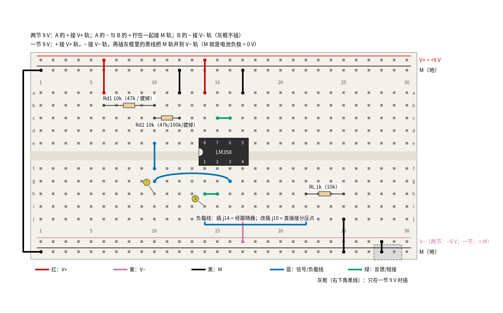
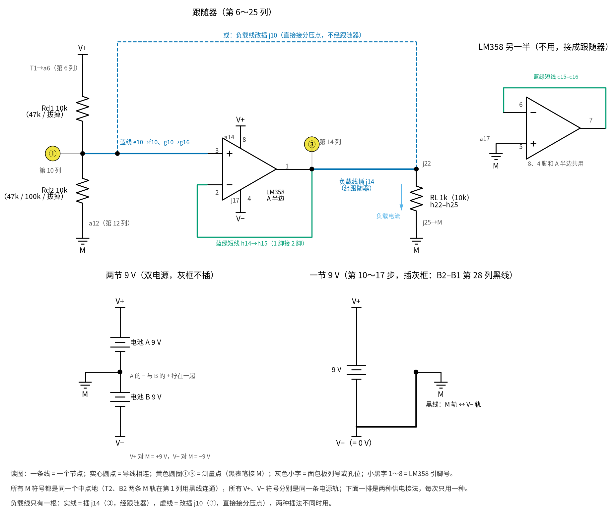
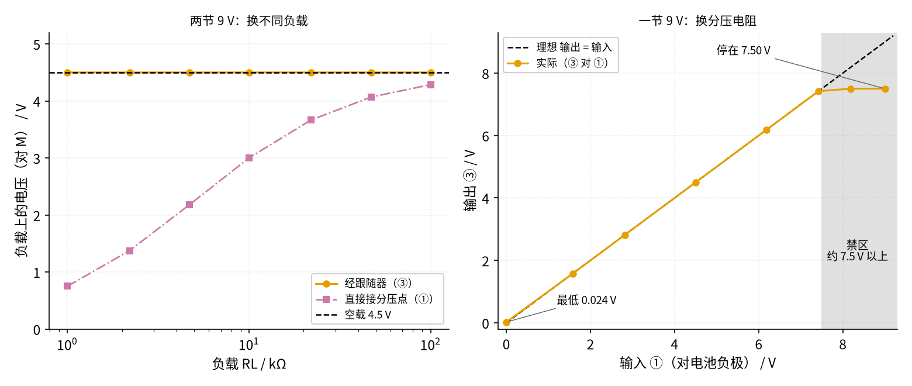

# 03 电压跟随器 · 动手实验篇

[上一页：参数与调试篇](page3.md) · [直觉篇](page1.md) · [原理与实现篇](page2.md) · [参数与调试篇](page3.md) · 本页：动手实验篇 · [下一页：06 桥式整流 · 直觉篇](../06-bridge-rectifier/page1.md) · 前置节点：[02 同相放大 · 直觉篇](../02-noninverting-amp/page1.md) · 后续：[07 射极跟随器 · 直觉篇](../07-emitter-follower/page1.md)、[15 有源滤波 · 直觉篇](../15-active-filter/page1.md)

## 这次实验要验证什么

这一页用一片 LM358、9 V 电池和几只电阻，把 [03 电压跟随器 · 直觉篇](page1.md) 开头那个"一接负载电压就掉"的分压器原样搭出来，只用万用表验证四件事：

1. **分压器带不动负载**：两只 10 kΩ 把 9 V 分成 4.5 V，直接接 1 kΩ 负载只剩约 0.75 V，接 10 kΩ 剩约 3.0 V。对应 [03 电压跟随器 · 直觉篇](page1.md) 的"痛点"和 [03 电压跟随器 · 原理与实现篇](page2.md) 第二节的仿真。
2. **跟随器把负载"隔开"**：同样的 1 kΩ 改接到跟随器输出，输出仍是 4.5 V，分压点也纹丝不动；负载要的约 4.5 mA 由运放从电池"搬"过来。对应直觉篇第二节的"传话的人"。
3. **跟随器只保护后面，不修复前面**：负载接回分压点时，跟随器输出跟着一起掉，它只是照抄输入。对应直觉篇第三节第 3 步。
4. **单电源的"禁区"**：一节 9 V、M 就是电池负极时，输入在 0～约 7.4 V 之间输出都跟得上；输入到 8.2 V、9 V 时，输出停在约 7.5 V 不动；输入是 0 V 时，输出只能到约 0.02 V。对应 [03 电压跟随器 · 参数与调试篇](page3.md) 第二节。

顺带还会得到一个很实用的结论：**一节 9 V 加一个分压器和一个跟随器，就能造出一个带得动负载的 4.5 V 中点**。前面 [P3 运放入门 · 动手实验篇](../P3-opamp-basics/page4.md) 和 [01 反相放大 · 动手实验篇](../01-inverting-amp/page4.md) 里用 1 kΩ/1 kΩ 加 47 μF 造中点，P3 思考题 3 的答案最后说"用一个运放跟随器把中点撑住"，指的就是这个。

## ⚠️ 安全须知

- **只用 12 V 及以下的直流电**。本页任何一点对 M 都不超过 9 V；两节 9 V 串联时 V+ 轨到 V− 轨是 18 V，这是本页上限，不要再加电池。
- **9 V 电池的两个扣子不能碰在一起**，短路几秒钟就发烫。没插进面包板的电池扣用胶带包好。
- **LM358 缺口朝左，8 脚接 V+、4 脚接 V−**。接反会发烫，**不要用手摸**，立即拔掉电池扣。
- **负载不要小于 1 kΩ，更不要把输出 ③ 直接接 M**。LM358 输出短路时会输出几十毫安，芯片发烫、电池很快耗光。
- **单电源时输入只来自分压器**。分压器两端是 V+ 和 M，分压点永远在两者之间，不会低于 4 脚。不要从别处引入比电池负极还低的电压：LM358 的输入脚不能比 4 脚低 0.3 V 以上（手册的绝对最大额定值），否则可能损坏芯片。
- **换电阻、挪负载线、改接法前先断电**。

## 器材清单

| 元件 | 型号或数值 | 数量 | 说明 |
|---|---|---|---|
| 运放 | LM358（DIP-8 直插） | 1 | 只用 A 半边，B 半边接成跟随器闲置 |
| 9 V 电池 | 6F22 叠层电池 + 电池扣 | 2 | 双电源两节，单电源一节 |
| 电阻 | 10 kΩ | 3 | 分压 Rd1、Rd2，第 8 步的负载 |
| 电阻 | 1 kΩ | 1 | 负载 RL |
| 电阻 | 47 kΩ | 1 | 第 13、16 步换分压电阻 |
| 电阻 | 100 kΩ | 1 | 第 14 步换 Rd2 |
| 电阻 | 2.2 kΩ、4.7 kΩ、22 kΩ | 各 1 | 只在"没有示波器怎么办"里逐点测用，可选 |
| 面包板 | 830 孔 | 1 | 上下各两条电源轨 |
| 跳线 | 红、黑、红紫、蓝、蓝绿 | 若干 | 颜色约定见下图 |
| 万用表 | 数字式，有直流 200 mV 挡 | 1 | 量 ③ 与 ① 之差用 |

电阻用 5% 碳膜电阻。"应该读到"的范围按 5% 公差、电池 9 V 算；电池实际电压在 8～9.6 V 之间，读数会按比例变化，用后面的 Python 按你量到的电池电压算就准了。

本页没有需要降压替代的地方：直觉篇用 10 V 分压，这里换成 9 V 电池，所有数按 9 V 重算。直觉篇第 4 步的 1 kHz 正弦需要信号源和示波器，这里换成逐点测量。

## 搭建步骤

**中点（地）怎么接**：所有电压都以 M 为参考，黑表笔几乎一直插在 M 上。上面第二条轨（T2）和下面第二条轨（B2）都是 M，最上面 T1 是 V+，下面 B1 是 V−。

- **两节 9 V（双电源，第 0～9 步）**：电池 A 的 + 接 V+ 轨；A 的 − 与电池 B 的 + 拧在一起接 M 轨；B 的 − 接 V− 轨。V+ 对 M 是 +9 V，V− 对 M 是 −9 V。右下角灰框里的黑线不插。
- **一节 9 V（单电源，第 10～17 步）**：拆掉电池 B。电池 + 接 V+ 轨，− 接 V− 轨，再插灰框里的黑线（B2 第 28 列接 B1 第 28 列），把 M 轨并到 V− 轨。**这时 M 就是电池负极，也就是 0 V**。本页不需要 1 kΩ/1 kΩ 那种分压中点：跟随器本身就是在"造中点"，第 12 步就是它。

见 图 03-p4-1。电路就是 [03 电压跟随器 · 直觉篇](page1.md) 第二节那张"分压器经跟随器接负载"的图，10 V 换成 9 V，"地"换成 M。



*图 03-p4-1　LM358 电压跟随器的面包板接法（负载线插 j14 经跟随器，改插 j10 直接接分压点）*

插线之前先对照 图 03-p4-3 的电路原理图把节点认清：上排是分压器、跟随器和负载，旁边是 LM358 不用的另一半，下排是两节 9 V 和一节 9 V 两种供电接法。



*图 03-p4-3　图 03-p4-1 对应的电路原理图（灰色小字是面包板列号或孔位，小黑字 1～8 是 LM358 引脚号）*

**对照看**：面包板的连通规则见 [P1 元件速成 · 动手实验篇](../P1-components-basics/page4.md)：同一列上半 a–e 连通、下半 f–j 连通，凹槽两边不通。本页的分压点①在第 10 列，Rd1、Rd2 和那根通往 3 脚的蓝线都插在这一列，所以原理图里它们汇成一个点。跟随器的 1 脚和 2 脚用一根蓝绿线短接，原理图里画成从输出绕回反相端的反馈线；输出③在第 14 列，负载线从 j14 引到 RL。把负载线改插 j10，就是原理图里那条虚线：RL 直接并到分压点上，不再经过运放。

图 03-p4-1 里红线是 V+，红紫色线是 V−，黑线是 M，蓝线是信号和负载线，蓝绿色线是反馈和短接，黄圈 ①③ 是测量点。按顺序插：

1. 黑线把上下两条 M 轨（T2 第 1 列和 B2 第 1 列）连通。
2. LM358 缺口朝左：1～4 脚在 f14～f17，8～5 脚在 e14～e17。
3. 电源：红线 a14 → V+ 轨（8 脚），红紫色线 j17 → V− 轨（4 脚）。
4. B 半边：蓝绿色短线 c15–c16（7 脚接 6 脚），黑线 a17 → M 轨（5 脚）。闲置的半边接成跟随器、输入接 M，就不会自己乱振。
5. 分压器：红线 T1 第 6 列 → a6；Rd1（10 kΩ）插 b6–b10；Rd2（10 kΩ）插 c10–c12；黑线 a12 → M 轨。第 10 列就是分压点 ①。
6. 蓝线 e10 → f10 跨过中间槽，再用蓝线 g10 → g16 把分压点接到 3 脚（同相端）。
7. 蓝绿色短线 h14 → h15：1 脚（输出）直接接 2 脚（反相端）。这根线就是跟随器的全部"反馈网络"。第 14 列是输出 ③。
8. 负载 RL（先用 1 kΩ）插 h22–h25，黑线 j25 → M 轨。负载线一端插 j22，另一端先**不插**；做到第 4 步再插 j14（经跟随器），第 6 步改插 j10（直接接分压点）。
9. 双电源做第 0～9 步；断电，拆电池 B、插灰框黑线，做第 10～17 步。

## 测量表

万用表直流电压挡，黑表笔接 M 轨（第 3 步例外，见表）。"仿真"值由 `code/figs/03_figs.py` 用 ngspice 加 TI 的 LM358B 模型、按本页这块板子（两节 9 V，或一节 9 V 且 M = 电池负极）现算并打印；范围按 5% 电阻、电池 9 V 算，毫伏级的范围参考 [03 的 SPICE 核对表](../review/spice/03.md)。

| 步骤 | 测什么 | 红表笔 | 黑表笔 | 挡位 | 应该读到 | 读不到时先查 |
|---|---|---|---|---|---|---|
| 0 | 双电源 V+ | V+ 轨 | M 轨 | 直流 20 V | +8 V 以上 | 电池 A 的电池扣 |
| 1 | 双电源 V− | V− 轨 | M 轨 | 直流 20 V | −8 V 以下 | 读到正值：电池 B 接反 |
| 2 | 不接负载，分压点 ① | 第 10 列 | M 轨 | 直流 20 V | 4.28～4.72 V（仿真 4.500 V） | Rd1 是否接到 V+、Rd2 是否接到 M |
| 3 | 不接负载，③ 与 ① 之差 | 第 14 列 | 第 10 列 | 直流 200 mV | −3～+3 mV（仿真 +0.36 mV） | 几伏：h14–h15 短线没插，变成开环 |
| 4 | 负载线插 j14（1 kΩ 接跟随器输出），量 ③ | 第 14 列 | M 轨 | 直流 20 V | 与第 2 步相同（仿真 4.500 V） | 明显变低：负载线插到了 j10 |
| 5 | 同上，量 ① | 第 10 列 | M 轨 | 直流 20 V | 与第 2 步相同（仿真 4.500 V），纹丝不动 | 变低：3 脚那根蓝线插错列 |
| 6 | 负载线改插 j10（1 kΩ 直接接分压点），量 ① | 第 10 列 | M 轨 | 直流 2 V | 0.68～0.82 V（仿真 0.750 V） | 这就是"带不动" |
| 7 | 同上，量 ③ | 第 14 列 | M 轨 | 直流 2 V | 与第 6 步相同（仿真 0.750 V） | 正常：跟随器照抄已经掉下来的输入 |
| 8 | RL 换 10 kΩ，负载线仍插 j10，量 ① | 第 10 列 | M 轨 | 直流 20 V | 2.80～3.20 V（仿真 3.000 V） | 负载轻一些，掉得少一些 |
| 9 | 负载线改插 j14（10 kΩ 接跟随器输出），量 ③ | 第 14 列 | M 轨 | 直流 20 V | 与第 2 步相同（仿真 4.500 V） | 又回到 4.5 V |
| 10 | 单电源（M = 电池负极），V+ 对 M | V+ 轨 | M 轨 | 直流 20 V | +8 V 以上；再量 V− 轨对 M 应为 0 | V− 不是 0：灰框黑线没插 |
| 11 | 拔掉负载线，量 ③ | 第 14 列 | M 轨 | 直流 20 V | 4.28～4.72 V（仿真 4.500 V） | 和双电源一样 |
| 12 | RL 换回 1 kΩ，负载线插 j14，量 ③ | 第 14 列 | M 轨 | 直流 20 V | 与第 11 步相同（仿真 4.500 V） | 一个带得动 4.5 mA 的中点 |
| 13 | 拔掉负载线，Rd2 换 47 kΩ，量 ③ | 第 14 列 | M 轨 | 直流 20 V | 7.29～7.55 V（仿真 7.42 V），与 ① 相差不到 0.05 V | 刚好在禁区边上 |
| 14 | Rd2 换 100 kΩ，量 ① | 第 10 列 | M 轨 | 直流 20 V | 8.10～8.25 V（仿真 8.18 V） | 100 kΩ 色环：棕黑黄 |
| 15 | 同上，量 ③ | 第 14 列 | M 轨 | 直流 20 V | 约 7.5 V（仿真 7.50 V），比 ① 低约 0.7 V | 正常：输入进了禁区 |
| 16 | Rd2 换回 10 kΩ，Rd1 换 47 kΩ，量 ③ | 第 14 列 | M 轨 | 直流 20 V | 1.45～1.71 V（仿真 1.58 V），与 ① 相同 | 47 kΩ 色环：黄紫橙 |
| 17 | 拔掉 Rd1（输入经 Rd2 接到 M），量 ③ | 第 14 列 | M 轨 | 直流 2 V | 0～0.05 V（仿真 0.024 V） | 正常：到不了真正的 0 V |

一共 18 步。第 4、5 两步是本页的主角：负载从分压点"挪"到跟随器后面，分压点和负载上都是 4.5 V，1 kΩ 里流着 4.5 mA，按欧姆定律这股电流如果从分压器出，分压器上面那只 10 kΩ 就要压降 45 V，根本不可能；它其实是 LM358 从 V+ 轨取来的。第 3 步量出的零点几毫伏，就是 [03 电压跟随器 · 原理与实现篇](page2.md) 第一节说的"倍数 0.99999"加上失调电压，万用表的 20 V 挡完全看不出来。

第 6、7 两步说明 [03 电压跟随器 · 直觉篇](page1.md) 第三节那句话：跟随器只保护**它后面**的电路。负载接在分压点上，分压点先掉到 0.75 V，跟随器老老实实照抄，输出也是 0.75 V。

第 13～17 步就是 [03 电压跟随器 · 参数与调试篇](page3.md) 第二节的"禁区"，只是电源从 5 V 换成了 9 V。上限约 V+ − 1.5 V = 7.5 V，下限约 0.02 V。注意第 15 步停在 7.5 V，比 [02 同相放大 · 动手实验篇](../02-noninverting-amp/page4.md) 第 12 步开环时的 7.8 V 还低：跟随器的输入等于输出，先撞上的是**输入**的共模上限，而不是输出的上限。实际芯片的共模上限在 V+ − 1.5 V 到 V+ − 2 V 之间，所以第 13 步如果读到比 ① 低几十毫伏，说明你的芯片禁区稍宽，也算正常。

## 没有示波器怎么办

直觉篇和参数与调试篇用示波器看两条线是否重合，没有示波器就**换电阻、逐点用万用表测**，结果画成 图 03-p4-2：

1. 两节 9 V，分压器保持 10 kΩ/10 kΩ。负载依次换 1 k、2.2 k、4.7 k、10 k、22 k、47 k、100 kΩ，每个负载各测两次：负载线插 j10 时量 ①，插 j14 时量 ③。
2. 一节 9 V、M = 电池负极，不接负载。按"Rd1 拔掉、47k/10k、22k/10k、10k/10k、10k/22k、10k/47k、10k/100k、Rd2 拔掉"的顺序换分压电阻（前一个是 Rd1，后一个是 Rd2），每次量 ① 和 ③。
3. 第 1 组以负载为横轴（每格乘 10 倍）、电压为纵轴；第 2 组以 ① 为横轴、③ 为纵轴，描点连线。



*图 03-p4-2　没有示波器时逐点测：左边换负载，右边换分压电阻*

图 03-p4-2 左图里，橙色圆点（经跟随器）从 1 kΩ 到 100 kΩ 一直贴着 4.5 V 的黑色虚线；红紫色方块（直接接）在 1 kΩ 时只有 0.75 V，负载越轻越接近 4.5 V，到 100 kΩ 还是只有 4.29 V。这和 [03 电压跟随器 · 原理与实现篇](page2.md) 第二节那张"负载越重，直接接法掉得越多"的图是一回事：分压器的内阻是两只 10 kΩ 并联，也就是 5 kΩ，负载要比 5 kΩ 大得多，直接接才不会明显掉。

右图里，橙色圆点在 0～7.42 V 之间贴着"输出 = 输入"的虚线，8.18 V 和 9 V 两个点都停在 7.50 V，灰色区就是禁区；最左边输入 0 V 时，输出停在 0.024 V，没有真正到 0。想让输出在 0～9 V 全程跟随，要么换轨到轨运放，要么像第 0～9 步那样用双电源。

## 用 Python 核对你的读数

先断电量出电池电压和各电阻的实际值，再填读数。偏差超过 10% 并且差值超过 0.05 V 的会给出提示；第 3 步是毫伏级，只看是否在 ±3 mV 以内，第 17 步只看是否低于 0.1 V。下面是一组示例读数。

```python
import sys, pathlib
sys.path.insert(0, str(pathlib.Path("code/figs").resolve()))  # 在仓库根目录运行
# ① 实际值：电池电压（正数）和电阻
m = dict(VA=9.38, Vsingle=9.36, Rd1=9.95e3, Rd2=10.04e3, R47=46.6e3, R100=99.2e3, RL1=0.992e3, RL10=10.06e3)
# ② 各步读数（伏）
r = {"2": 4.71, "3": 0.0004, "4": 4.71, "5": 4.71, "6": 0.78, "7": 0.78, "8": 3.15, "9": 4.71,
     "10": 9.36, "11": 4.70, "12": 4.70, "13": 7.70, "14": 8.50, "15": 7.80, "16": 1.66, "17": 0.023}


def par(a, b):
    return a * b / (a + b)


def div(v, top, bot):
    return v * bot / (top + bot)


half_d = div(m["VA"], m["Rd1"], m["Rd2"])
half_s = div(m["Vsingle"], m["Rd1"], m["Rd2"])
expect = {
    "2": (half_d, "Rd1 是否接 V+、Rd2 是否接 M"),
    "4": (half_d, "负载线是否插在 j14"),
    "5": (half_d, "3 脚蓝线是否插在第 10、16 列"),
    "6": (div(m["VA"], m["Rd1"], par(m["Rd2"], m["RL1"])), "负载线是否插在 j10"),
    "7": (div(m["VA"], m["Rd1"], par(m["Rd2"], m["RL1"])), "跟随器照抄第 6 步"),
    "8": (div(m["VA"], m["Rd1"], par(m["Rd2"], m["RL10"])), "RL 是否换成 10 kΩ"),
    "9": (half_d, "负载线是否插回 j14"),
    "10": (m["Vsingle"], "电池电压"),
    "11": (half_s, "灰框黑线是否插好"),
    "12": (half_s, "负载线是否插在 j14"),
    "13": (div(m["Vsingle"], m["Rd1"], m["R47"]), "Rd2 是否换成 47 kΩ"),
    "14": (div(m["Vsingle"], m["Rd1"], m["R100"]), "Rd2 是否换成 100 kΩ"),
    "15": (m["Vsingle"] - 1.5, "电池电压"),             # 跟随器最高约比 V+ 低 1.5 V（共模上限）
    "16": (div(m["Vsingle"], m["R47"], m["Rd2"]), "Rd1 是否换成 47 kΩ"),
}
print(f"第 3 步 ③−① {r['3'] * 1e3:+.2f} mV" + ("" if abs(r["3"]) <= 3e-3 else "  ← 超过 ±3 mV，先查 h14–h15 短线"))
print(f"第 17 步输出 {r['17']:+.3f} V" + ("（贴底，符合预期）" if r["17"] < 0.1 else "  ← 应在 0 V 附近，先查 Rd1 是否拔掉"))
print(f"分压器内阻 Rd1 ∥ Rd2 = {par(m['Rd1'], m['Rd2']) / 1e3:.2f} kΩ；第 5 步 ÷ 第 2 步 = {r['5'] / r['2']:.3f}（应为 1）")
for k, (e, hint) in expect.items():
    v = r[k]
    dev = (v - e) / abs(e) * 100
    flag = f"  ← 偏差超过 10%，先查：{hint}" if abs(dev) > 10 and abs(v - e) > 0.05 else ""
    print(f"第 {k:>2} 步  实测 {v:+7.3f} V  计算 {e:+7.3f} V  偏差 {dev:+6.1f}%{flag}")
```

示例读数都没有触发提示。第 15 步的计算值用的是经验规律"跟随器最高比 V+ 低约 1.5 V"（来自 SPICE 仿真和 LM358 手册的共模输入范围），只能估到零点几伏。

## 实验记录表

| 步骤 | 测什么 | 实测值 | 计算值 | 偏差 |
|---|---|---|---|---|
| 0 | 双电源 V+ |  |  |  |
| 1 | 双电源 V− |  |  |  |
| 2 | 空载分压点 ① |  |  |  |
| 3 | ③ − ①（mV） |  |  |  |
| 4 | 1 kΩ 接 ③：③ |  |  |  |
| 5 | 1 kΩ 接 ③：① |  |  |  |
| 6 | 1 kΩ 接 ①：① |  |  |  |
| 7 | 1 kΩ 接 ①：③ |  |  |  |
| 8 | 10 kΩ 接 ①：① |  |  |  |
| 9 | 10 kΩ 接 ③：③ |  |  |  |
| 10 | 单电源 V+ |  |  |  |
| 11 | 单电源空载 ③ |  |  |  |
| 12 | 单电源 1 kΩ 接 ③ |  |  |  |
| 13 | Rd2 = 47 kΩ：③ |  |  |  |
| 14 | Rd2 = 100 kΩ：① |  |  |  |
| 15 | Rd2 = 100 kΩ：③ |  |  |  |
| 16 | Rd1 = 47 kΩ：③ |  |  |  |
| 17 | Rd1 拔掉：③ |  |  |  |

逐点测量另记两张表：负载、①（直接接）、③（经跟随器）三栏；Rd1、Rd2、①、③ 四栏。

## 思考题

**思考题 1**：第 7 步跟随器输出也掉到了 0.75 V，有同学说"跟随器坏了"。你怎么向他解释？如果一块板子上分压点后面要接三个不同的负载，跟随器应该放在哪里？

<details><summary>答案</summary>

没坏。跟随器的任务是"输出等于输入"，第 7 步它的输入（分压点）已经被直接接上去的 1 kΩ 拉到 0.75 V，它照抄 0.75 V 正是在正常工作。跟随器只能保护它**后面**的电路，不能修复**前面**已经被拖低的信号。三个负载都应该接在跟随器输出上，分压点上除了 3 脚什么都不接；这样分压器始终相当于空载，三个负载要的电流都由运放提供，只要总电流不超过 LM358 的输出能力（本页的 1 kΩ 是 4.5 mA，远在限值以内）。

</details>

**思考题 2**：第 12 步用一节 9 V、一个分压器和一个跟随器造出了带得动负载的 4.5 V。能不能把它当成 [01 反相放大 · 动手实验篇](../01-inverting-amp/page4.md) 里的 M 来用？和那里的 1 kΩ/1 kΩ 加 47 μF 比，好在哪里？要注意什么？

<details><summary>答案</summary>

可以，这正是单电源电路里常用的"虚拟地"。好处有两个：分压器可以用两只 100 kΩ，只耗几十微安，而 1 kΩ/1 kΩ 要一直耗 4.5 mA；电流流进或流出中点时，跟随器会把它"顶住"，中点不会被拉偏，而电阻分压的中点会跟着电流移动。要注意的有三点：一是 LM358 刚好有两个半边，可以用闲着的 B 半边来做这个跟随器；二是不要在跟随器输出上直接并一个大电容来"稳住"中点，[03 电压跟随器 · 参数与调试篇](page3.md) 第一节讲过，容性负载会让跟随器振荡，电容应当并在分压点上，或者输出先串几十欧的隔离电阻再接电容；三是中点 4.5 V 本身要在跟随器能跟上的范围内，9 V 时上限约 7.5 V，4.5 V 很安全。

</details>

**思考题 3**：第 15 步跟随器输出停在约 7.5 V，可 [02 同相放大 · 动手实验篇](../02-noninverting-amp/page4.md) 里拔掉 Rf 后输出能到约 7.8 V。为什么跟随器反而"矮"了一截？如果想让跟随器在 9 V 单电源下跟到 8.5 V，有什么办法？

<details><summary>答案</summary>

LM358 有两个上限：输出最高约 V+ − 1.2 V，同相端和反相端的共模电压最高约 V+ − 1.5 V。同相放大时输入很小、输出很大，先撞上的是输出上限，所以是 7.8 V。跟随器的输入就等于输出，输入先走到 7.5 V 就超出了共模范围，虚短不再成立，输出也就停在 7.5 V。想跟到 8.5 V，要么提高电源（例如 12 V，上限约 10.5 V，见 [03 电压跟随器 · 参数与调试篇](page3.md) 练习 5），要么换"轨到轨输入输出"的运放，要么用两节 9 V 的双电源，让 8.5 V 离 V+ 远一些。

</details>

## 自测清单

- 我能说出分压器为什么带不动 1 kΩ 负载，并用 Rd2 ∥ RL 算出约 0.75 V。
- 我能在面包板上把 LM358 接成跟随器，并说出 1 脚接 2 脚的那根短线就是全部反馈。
- 我能用 200 mV 挡量出 ③ 与 ① 只差零点几毫伏，并说清楚负载电流是从哪里来的。
- 我能分别说清楚两节 9 V 和一节 9 V 时 M 接在哪里，并用跟随器造出一个带得动负载的 4.5 V 中点。
- 我能用换分压电阻的办法找到单电源跟随器的禁区，并解释它为什么停在约 V+ − 1.5 V 而不是 V+ − 1.2 V。
