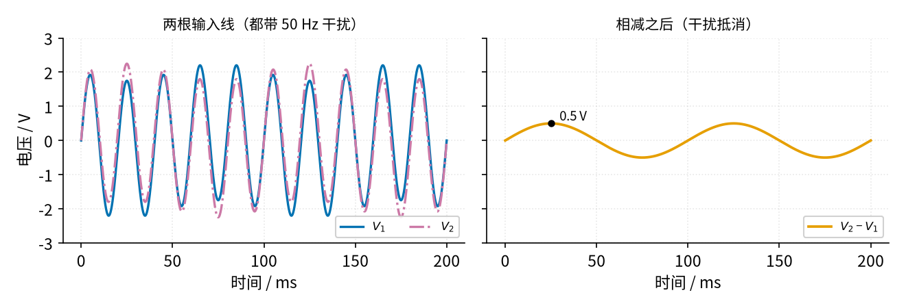
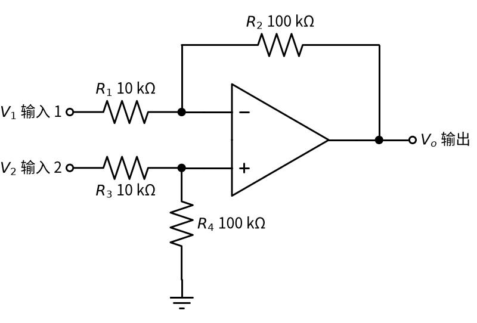

# 04 差分放大 · 直觉篇

[上一页：19 星三角降压启动 · 参数与调试篇](../19-star-delta-start/page3.md) · 本页：直觉篇 · [原理与实现篇](page2.md) · [参数与调试篇](page3.md) · [下一页：原理与实现篇](page2.md) · 前置节点：[01 反相放大 · 直觉篇](../01-inverting-amp/page1.md)、[02 同相放大 · 直觉篇](../02-noninverting-amp/page1.md)

## 痛点：有用的信号被"淹没"在干扰里

传感器离电路板几米远，信号沿两根线送过来，有用的信号只有十几毫伏。可是导线像天线一样，会"收"到 50 Hz 的市电干扰，一收就是零点几伏甚至几伏。用 [01 反相放大 · 直觉篇](../01-inverting-amp/page1.md) 或 [02 同相放大 · 直觉篇](../02-noninverting-amp/page1.md) 去放大其中一根线对地的电压，干扰会和信号一起被放大，示波器上只看到一片 50 Hz 的大波浪。

好在干扰有一个特点：**两根线挨得很近，收到的干扰几乎一模一样**。而有用的信号是两根线之间的**差**。那就只放大"差"、不管"一样的部分"——这就是**差分放大**。

这种情况在工程上到处都是：

- **电桥传感器**：称重用的应变片（受力拉长时电阻会变的薄片）、压力传感器都接成电桥（四只电阻接成一个菱形，两条对边中点之间的电压反映电阻的微小变化），两个输出端对地都是约 2.5 V，真正随重量变化的只是两端之间几毫伏的差。如果只量一端对地，2.5 V 的"底子"会把几毫伏的变化完全盖住。
- **测电流**：在电源线上串一只很小的采样电阻，电流流过时两端产生零点几伏的差，可两端对地都有十几伏，必须"只看差"。
- **音响的平衡线**：专业话筒用两根线反相传送同一个声音，到调音台再相减，路上收到的嗡嗡声被减掉，声音反而加倍。拿数字看：一根线送 +1、另一根送 −1，路上两根线都多了同样的干扰 0.3，于是收到 1.3 和 −0.7；相减得 1.3 − (−0.7) = 2，干扰没了，声音是原来的 2 倍。

再打个比方：你在一艘晃得很厉害的船上，想量两个人谁高、高多少。用尺子从甲板量到头顶，船一晃读数就变，因为整个甲板都在上下动（共模）；但让两个人背靠背站着，直接比头顶差多少，船怎么晃这个差都不变。差分放大做的就是"背靠背比头顶"。

## 一、"一样的部分"和"不一样的部分"

先给两个名词：两根线上**一模一样**的那部分叫**共模**（共同的模样），两根线之间的**差**叫**差模**或差分信号。看 图 04-p1-1，两根线上都骑着 2 V 的 50 Hz 干扰，它们之间差 0.5 V（为了看得清，这里把差值画得比实际大）。

*图 04-p1-1　两根线带同样的干扰，相减后只剩差值*

图 04-p1-1 左边，蓝色 $V_1$ 和红紫色点划线 $V_2$ 几乎叠在一起，都是 2 V 的快速波动，谁也看不出里面藏着什么。右边把两者相减，橙色线只剩一条平滑的慢正弦，最高 0.5 V——这才是传感器真正要说的话。干扰两边都有，一减就没了。

## 二、电路长什么样

做减法的电路看 图 04-p1-2。

*图 04-p1-2　四电阻差分放大*

图 04-p1-2 里有四只电阻：上面一路 $V_1$ 经 $R_1$ 进反相端，反馈电阻 $R_2$ 从输出接回反相端，这就是 01 的反相放大；下面一路 $V_2$ 经 $R_3$ 和 $R_4$ 分压后进同相端，这就是 02 的同相放大前面加了一个分压器。只要两组电阻**比例相同**（ $R_2/R_1 = R_4/R_3$ ），输出就是：

$$V_o = \frac{R_2}{R_1}(V_2 - V_1)$$

意思是：**输出只与两个输入的差有关，差多少，就放大 $R_2/R_1$ 倍**。代一组数：图中 $R_2/R_1$ = 100 kΩ ÷ 10 kΩ = 10。 $V_2$ = 2.01 V、 $V_1$ = 2.00 V，差 0.01 V，输出 0.1 V；两个输入同时加 1 V 变成 3.01 V 和 3.00 V，差没变，输出还是 0.1 V。

## 三、直觉：一架天平

把差分放大想成一架**天平**。 $V_1$ 放在左盘， $V_2$ 放在右盘，指针（输出）只看两边**差多少**。两边同时各加一块同样重的砝码（共模干扰），指针不动。天平要准，前提是**两边的臂长相等**；对应到电路，就是两组电阻的比例必须相同。臂长差一点点，"同样的砝码"也会让指针偏一点，干扰就漏进来了——这正是 [04 差分放大 · 原理与实现篇](page2.md) 仿真要看的事。

为什么叫"一侧反相、一侧同相"？ $V_1$ 走反相放大，贡献 $-(R_2/R_1)V_1$ ； $V_2$ 走同相放大，先被分压再放大，贡献 $+(R_2/R_1)V_2$ 。两个贡献一正一负，叠加起来就是减法。

## 四、在示波器上会看到什么

假设你在面包板上搭好 图 04-p1-2 的电路（倍数 10，四只电阻精确匹配），两根输入线都从一个"带 50 Hz 干扰的信号源"接来。用双通道示波器依次去看：

1. **通道 1 夹 $V_1$ 、通道 2 夹 $V_2$**。屏幕上是两条几乎重合的 50 Hz 大波浪，峰值约 2 V，就像 图 04-p1-1 左边那样。肉眼看不出两者有什么区别。
2. **示波器的"相减"功能（CH2 − CH1）**。大多数数字示波器都有这个数学功能。相减后的曲线突然变得干净：只剩一条小小的慢正弦，这就是藏在里面的差分信号。
3. **通道 1 改夹运放输出**。看到的形状和第 2 步一样，只是大了 10 倍。运放做的事，跟示波器的减法功能一样，只是还顺便放大了。
4. **把 $R_4$ 换成一只误差大的电阻（比如偏大 1%）**。输出上重新出现一串细细的 50 Hz 小波纹。电阻偏得越多，波纹越大。
5. **把两根输入线短接在一起，再接到信号源上**。两个输入完全一样，差为零，理想情况下输出应该是一条 0 V 直线。这一步是检查"天平是否平衡"的最简单方法：输出上残留的波纹越小，电阻配得越好。

第 5 步在实际调试中很有用：**输入短接后输出不为零，说明共模没减干净**，先查电阻比例，再查运放的输入范围是否够。

## 五、新手常见误解

- **"随便四只电阻就行"**：两组比例必须一样，而且要精确，1% 的误差就会让干扰明显漏进来。
- **"输入电阻很大"**：差分放大两个输入端都要经过电阻，从输入端看进去只有十千欧量级，信号源内阻（见 [P1 元件速成 · 原理与实现篇](../P1-components-basics/page2.md)）会破坏比例。
- **"只能放大，不能只做减法"**：四只电阻全取相同值，倍数就是 1，电路就成了一个纯粹的减法器。

## 一句话总结

**差分放大只放大两根线的"差"，两根线上一样的干扰（共模）会被抵消；前提是 $R_2/R_1 = R_4/R_3$ ，此时 $V_o = (R_2/R_1)(V_2 - V_1)$**。
