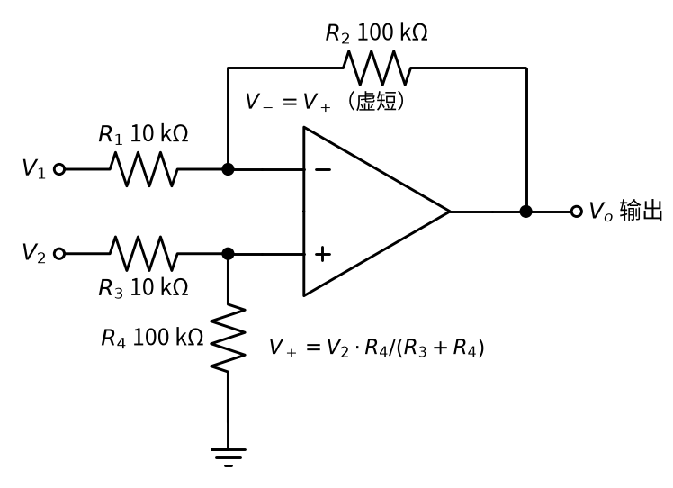
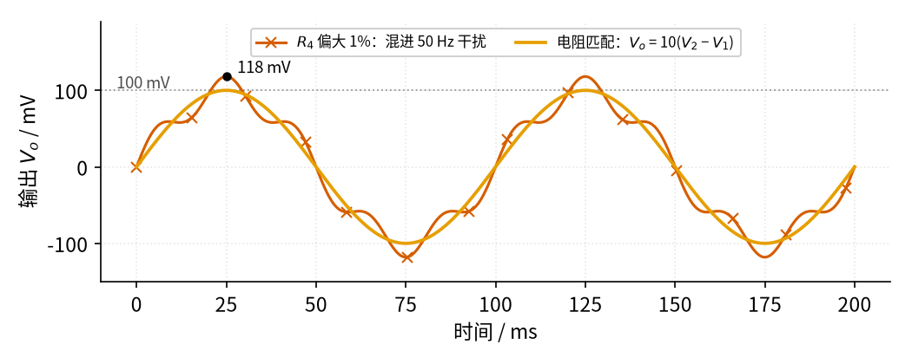
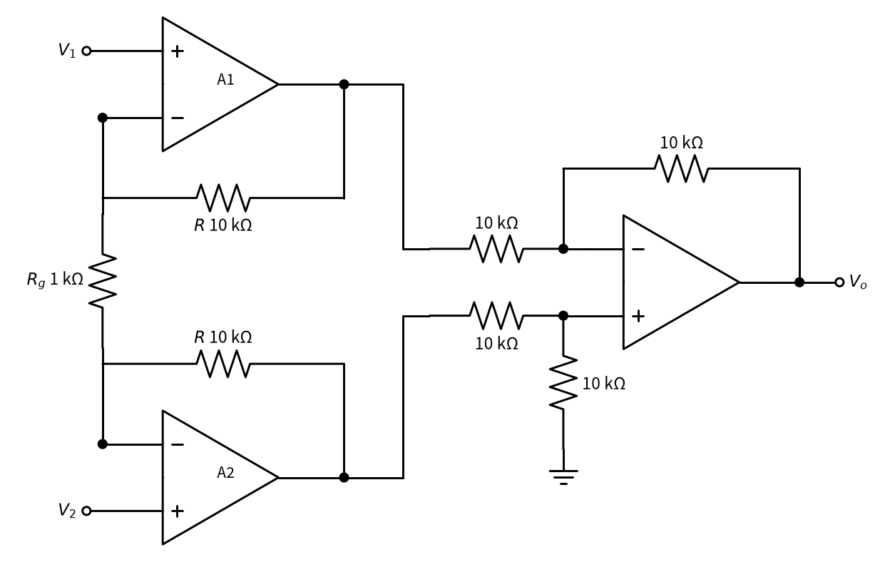

# 04 差分放大 · 原理与实现篇

[上一页：直觉篇](page1.md) · [直觉篇](page1.md) · 本页：原理与实现篇 · [参数与调试篇](page3.md) · [下一页：参数与调试篇](page3.md) · 前置节点：[01 反相放大](../01-inverting-amp/page1.md)、[02 同相放大](../02-noninverting-amp/page1.md)

## 这一页要解决的问题

直觉篇给出了结论 $V_o = (R_2/R_1)(V_2 - V_1)$ ，并且说"电阻比例必须相同"。这一页先用虚短、虚断三步推出一般公式，看清"比例相同"在公式里起什么作用；再用仿真定量看：**只有一只电阻偏大 1%，干扰会漏进来多少**；最后三道例题，第三道是工程上真正常用的**三运放仪表放大器**。

## 一、推导：三步

看 图 04-p2-1，推导要用的两条关系写在图上。



*图 04-p2-1　推导用的差分放大*

图 04-p2-1 中，下面一路是一个分压器，上面一路是反相放大的结构。

**第一步：同相端是分压**。运放同相端不取电流（虚断），所以 $V_2$ 经 $R_3$ 、 $R_4$ 分压：

$$V_+ = V_2 \cdot \frac{R_4}{R_3 + R_4}$$

代数： $V_2$ = 2.2 V、 $R_3$ = 10 kΩ、 $R_4$ = 100 kΩ，得 $V_+$ = 2.2 × 100/110 = 2.0 V。

**第二步：虚短**。有负反馈（ $R_2$ 接回反相端），所以 $V_- = V_+$ 。

**第三步：反相端电流守恒**。反相端不取电流，流过 $R_1$ 的电流全部流过 $R_2$ ：

$$\frac{V_1 - V_-}{R_1} = \frac{V_- - V_o}{R_2}$$

这个式子的意思是：左边是流进反相端的电流（ $V_1$ 比反相端高多少，除以 $R_1$ ），右边是从反相端流向输出的电流。目标是把 $V_o$ 单独解出来，按高中解方程的步骤一步一步做：

1. 两边同乘 $R_2$ ，去掉右边的分母： $\frac{R_2}{R_1}(V_1 - V_-) = V_- - V_o$ 。
2. 移项，把 $V_o$ 留在一边： $V_o = V_- - \frac{R_2}{R_1}(V_1 - V_-)$ 。
3. 展开括号，把含 $V_-$ 的两项合并： $V_o = V_- + \frac{R_2}{R_1}V_- - \frac{R_2}{R_1}V_1$ 。

于是得到：

$$V_o = V_-\left(1 + \frac{R_2}{R_1}\right) - \frac{R_2}{R_1} V_1$$

意思是：输出 = "同相端电压按同相放大放大" 减去 " $V_1$ 按反相放大放大"。这正好是 [02 同相放大](../02-noninverting-amp/page2.md) 和 [01 反相放大](../01-inverting-amp/page2.md) 两个公式的叠加。代数：接上面 $V_-$ = 2.0 V，再取 $V_1$ = 2.1 V，得 $V_o$ = 2.0 × 11 − 10 × 2.1 = 1.0 V。检查：差 2.2 − 2.1 = 0.1 V，乘 10 正是 1.0 V。

**比例相同的作用**。设 $R_2/R_1 = R_4/R_3 = k$ ，那么 $R_4/(R_3 + R_4) = k/(1 + k)$ ，乘上 $(1 + k)$ 正好消掉，剩下 $k V_2 - k V_1$ ：

$$V_o = k(V_2 - V_1)$$

两项的系数**严格相等**，所以两个输入里一样的部分（共模）被精确地减掉。比例一旦不同，两项系数不等，共模部分就减不干净。

**比例不同时漏多少：共模倍数**。为了看清"减不干净"有多严重，设两个输入完全相同， $V_1 = V_2 = V_{cm}$ （cm 是英文 common mode"共模"的缩写）。理想情况下输出应为 0。把它代入第三步的结果：

$$V_o = V_{cm}\left[\frac{R_4}{R_3 + R_4}\left(1 + \frac{R_2}{R_1}\right) - \frac{R_2}{R_1}\right]$$

方括号里的数叫**共模倍数**：共模电压每有 1 V，输出就漏出多少伏。代数：四只电阻全匹配（10 k、100 k、10 k、100 k）时，方括号 = 100/110 × 11 − 10 = 10 − 10 = 0；若 $R_4$ 偏大 1% 变成 101 kΩ，方括号 = 101/111 × 11 − 10 ≈ 10.009 − 10 = 0.009。共模 2 V 时，漏出约 18 mV。下面的仿真就是要把这个数在波形上"看"出来。

工程上常把"差分倍数 ÷ 共模倍数"叫**共模抑制比**，用分贝表示（分贝 = 20 × 以 10 为底的对数）。这里 10 ÷ 0.009 ≈ 1100，约 61 dB。第三页会继续用这个数。

## 二、仿真：一只电阻偏大 1%

下面的仿真模拟一个真实场景：传感器的差分信号是 10 Hz、幅度 10 mV；两根线上同时骑着 2 V、50 Hz 的共模干扰。差分倍数 10（ $R_1 = R_3$ = 10 kΩ， $R_2 = R_4$ = 100 kΩ）。对比四只电阻完全匹配，和 $R_4$ 偏大 1%（101 kΩ）两种情况。电路用第一节推出的公式直接计算。代码与仓库里的 code/04_sim.py 完全一致，需要和仓库的 code/figs 目录放在一起运行。

```python
# 04 差分放大最小仿真：10 mV 差分信号叠加 2 V、50 Hz 共模干扰，比较电阻完全匹配和一只电阻偏大 1% 时的输出。
import sys, os                                     # 下一行让 Python 找到 code/figs 里的共享画图样式
sys.path.insert(0, os.path.join(os.path.dirname(os.path.abspath(__file__)), "figs"))
import numpy as np                                 # 数组运算
import matplotlib.pyplot as plt                    # 画图
import figstyle as fs                              # 全书统一的颜色、轴标签、保存函数

t = np.linspace(0, 0.2, 4001)                      # 时间 0～200 ms
v_d = fs.sine(t, 10, amp=0.01)                     # 有用的差分信号：10 Hz、幅度 10 mV（V2 − V1）
v_cm = fs.sine(t, 50, amp=2.0)                     # 共模干扰：50 Hz、幅度 2 V，两根线上一模一样
V1 = v_cm - v_d / 2                                # 反相端那根线的电压
V2 = v_cm + v_d / 2                                # 同相端那根线的电压

def diff_amp(V1, V2, R1, R2, R3, R4):              # 四电阻差分放大的输出（理想运放，虚短虚断）
    Vp = V2 * R4 / (R3 + R4)                       # 同相端：V2 经 R3、R4 分压
    return Vp * (1 + R2 / R1) - V1 * R2 / R1       # 同相放大 Vp，再减去 V1 的反相放大

R1 = R3 = 10e3                                     # 输入电阻都是 10 kΩ
R2 = R4 = 100e3                                    # 反馈和接地电阻都是 100 kΩ，差分倍数 R2/R1 = 10
Vo_ok = diff_amp(V1, V2, R1, R2, R3, R4)           # 四只电阻完全成比例
Vo_bad = diff_amp(V1, V2, R1, R2, R3, R4 * 1.01)   # R4 偏大 1%，比例被破坏

leak = np.max(np.abs(Vo_bad - Vo_ok))              # 失配带来的共模泄漏幅度
print(f"匹配：输出最大 {Vo_ok.max()*1e3:.0f} mV（= 10 × 10 mV），共模 2 V 被完全抵消")
print(f"R4 偏大 1%：共模泄漏约 {leak*1e3:.0f} mV，占有用输出的 {leak/0.1*100:.0f}%")
assert abs(Vo_ok.max() - 0.1) < 1e-3               # 匹配时输出就是 10 × 差分信号
assert 0.015 < leak < 0.02                         # 失配 1% 时漏进约 18 mV 的 50 Hz 干扰

fig, ax = plt.subplots(figsize=fs.SIZE["single"])  # 一张图
ax.plot(t * 1e3, Vo_bad * 1e3, **fs.LS["bad"], label="$R_4$ 偏大 1%：混进 50 Hz 干扰")   # 朱红色带 ×
ax.plot(t * 1e3, Vo_ok * 1e3, **fs.LS["vout"], label="电阻匹配：$V_o$ = 10($V_2$ − $V_1$)")  # 橙色
k = np.argmax(Vo_bad)                              # 失配时输出最高的点
fs.mark(ax, t[k] * 1e3, Vo_bad[k] * 1e3, fmt="{:.0f}", unit=" mV", dx=6, dy=2)
fs.ref_h(ax, 100, "100 mV", x=0.02, ha="left")     # 灰色点线：匹配时的输出峰值
fs.axlabels(ax, "时间", "ms", "输出 $V_o$", "mV")  # 轴标签
ax.set_ylim(-150, 190); ax.legend(loc="upper center", ncol=2, fontsize=8)        # 纵轴范围和图例
fs.save(fig, "04", "04_p2_2_mismatch.png")         # 保存到 04-differential-amp/img/
```

运行后会打印（另有以 [数值]、[图] 开头的提示行）：

```text
匹配：输出最大 100 mV（= 10 × 10 mV），共模 2 V 被完全抵消
R4 偏大 1%：共模泄漏约 18 mV，占有用输出的 18%
```

并生成 图 04-p2-2。



*图 04-p2-2　电阻匹配与一只电阻偏大 1% 时的输出*

图 04-p2-2 中，橙色线是匹配时的输出：一条干净的 10 Hz 正弦，峰值正好贴着灰色点线 100 mV，2 V 的干扰一点也没有漏进来。朱红色带 × 的线是 $R_4$ 偏大 1% 的结果：正弦上叠加了一串 50 Hz 的小波纹，最高到 118 mV。算一下：共模倍数 ≈ 101/111 × 11 − 10 ≈ 0.009，2 V × 0.009 ≈ 18 mV，相当于有用输出的 18%。**电阻只差 1%，误差却到了 18%**，因为干扰（2 V）本来就比信号（10 mV）大 200 倍。所以差分放大要用 0.1% 甚至更精密的电阻，或者直接用集成的差分放大器芯片（四只电阻在芯片内部激光修调）。

## 三、例题

### 例 1（完整示例）：判断输出

**题目**：差分放大 $R_1 = R_3$ = 10 kΩ、 $R_2 = R_4$ = 100 kΩ。① $V_2$ = 3.01 V、 $V_1$ = 3.00 V；② $V_2$ = 5.01 V、 $V_1$ = 5.00 V。分别求输出。

**解**：

1. 检查比例：100/10 = 100/10 = 10，比例相同，可以用 $V_o = 10(V_2 - V_1)$ 。
2. ①：差 0.01 V，输出 0.1 V。
3. ②：差仍是 0.01 V，输出仍是 0.1 V。两个输入同时抬高 2 V（共模变化），输出不变。
4. 检查共模范围：同相端电压 = 5.01 × 100/110 ≈ 4.55 V，运放要能接受这个共模电压。用 ±15 V 供电没问题；若用 5 V 单电源的 LM358B，共模上限约 3.5 V，就超了。

### 例 2（关键步骤留空）：不对称的电阻

**题目**： $R_1 = R_3$ = 20 kΩ、 $R_2 = R_4$ = 60 kΩ， $V_2$ = 1.5 V、 $V_1$ = 1.2 V。按三步法求 $V_o$ ，并用简化公式验算。

```python
# 不运行
R1 = R3 = 20e3; R2 = R4 = 60e3; V2, V1 = 1.5, 1.2
Vp = V2 * ____ / (____ + ____)        # 第一步：同相端分压
Vo = Vp * (1 + R2 / R1) - ____ * V1   # 第三步
print(Vp, Vo, (R2 / R1) * (V2 - V1))  # 两种算法应相同
```

<details><summary>答案</summary>

Vp = V2 × R4 / (R3 + R4) = 1.5 × 60/80 = 1.125 V；Vo = 1.125 × 4 − 3 × 1.2 = 4.5 − 3.6 = 0.9 V。简化公式：3 × (1.5 − 1.2) = 0.9 V，相同。

</details>

### 例 3（变体迁移）：三运放仪表放大器

**题目**：四电阻差分放大的输入电阻只有十几千欧，信号源内阻会破坏比例（第三页定量看）；倍数也要靠换两只电阻才能改。怎样既保留"只放大差"，又让输入电阻极大、只用一只电阻调倍数？

**解**：在两个输入前各加一个同相放大，看 图 04-p2-3。



*图 04-p2-3　三运放仪表放大器*

图 04-p2-3 中，左边两个运放 A1、A2 的输入都是同相端，输入电阻极大（ [03 电压跟随器](../03-voltage-follower/page2.md) 讲过的那种），信号源内阻不再有影响。两个反相端之间接一只 $R_g$ （g 指 gain，倍数），两边各有一只反馈电阻 $R$ 。根据虚短，A1、A2 的反相端分别等于 $V_1$ 、 $V_2$ ，所以 $R_g$ 两端的电压就是差 $V_2 - V_1$ ，它产生的电流流过两只 $R$ ，把差值放大 $1 + 2R/R_g$ 倍；共模部分在 $R_g$ 上不产生电流，不被放大。右边是四只 10 kΩ 的差分放大（倍数 1），把放大后的差转成对地的输出：

$$V_o = \left(1 + \frac{2R}{R_g}\right)(V_2 - V_1)$$

代数： $R$ = 10 kΩ、 $R_g$ = 1 kΩ，倍数 1 + 20 = 21。只换 $R_g$ 一只电阻就能改倍数，这就是仪表放大器（例如 INA 系列芯片）的结构。

**用数字走一遍**。设 $V_1$ = 2.00 V、 $V_2$ = 2.01 V（共模约 2 V，差 10 mV）。虚短使 $R_g$ 两端分别是 2.00 V 和 2.01 V，电流 = 0.01 V ÷ 1 kΩ = 10 μA；这股电流也流过上下两只 10 kΩ，各产生 0.1 V 压降。于是 A2 输出 2.01 + 0.1 = 2.11 V，A1 输出 2.00 − 0.1 = 1.90 V：两者之差 0.21 V，正好是 10 mV 的 21 倍，而两者的平均值仍约 2 V——共模没有被放大，只是"原样传过去"，再由右边的差分级减掉。

## 本页小结

**差分放大 = 反相放大 + 同相放大的叠加；比例 $R_2/R_1 = R_4/R_3$ 时两项系数相等，共模被精确减掉。1% 的电阻失配就可能让大共模干扰漏进来一大截，所以要用精密电阻或集成芯片；要高输入电阻和单电阻调倍数，用三运放仪表放大器**。
