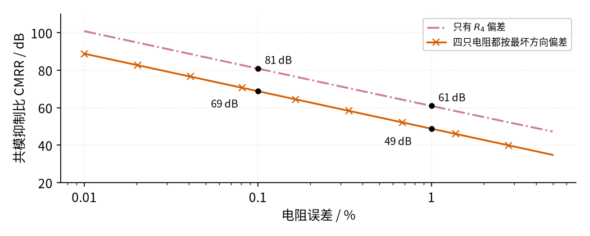
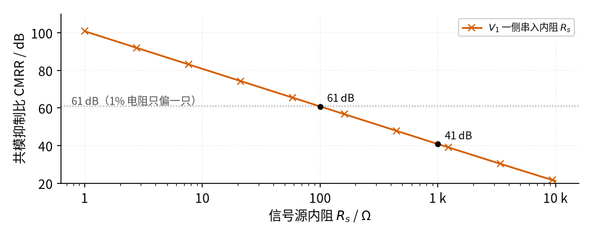

# 04 差分放大 · 参数与调试篇

[上一页：原理与实现篇](page2.md) · [直觉篇](page1.md) · [原理与实现篇](page2.md) · 本页：参数与调试篇 · [下一页：10 稳压管稳压 · 直觉篇](../10-zener-regulator/page1.md) · 前置节点：[01 反相放大 · 直觉篇](../01-inverting-amp/page1.md)、[02 同相放大 · 直觉篇](../02-noninverting-amp/page1.md)

## 这一页解决什么问题

差分放大搭出来"能用"很容易，"抗干扰抗得好"却很难。衡量抗干扰能力有一个专门的指标，叫**共模抑制比**。这一页先说清楚它是什么，再看两件最容易把它搞坏的事：**电阻误差**和**信号源内阻**。再讨论电阻取多大，最后是故障表和四道练习。

## 一、共模抑制比：差分倍数是共模倍数的多少倍

差分倍数 $A_d$ （d 指 difference，差）是"差值放大多少倍"，理想时等于 $R_2/R_1$ ；共模倍数 $A_{cm}$ （cm 指 common mode，共模）是"两根线上一样的部分放大多少倍"，理想时为 0。两者之比就是共模抑制比，工程上用分贝（dB）表示：

$$\mathrm{CMRR} = 20 \lg \frac{A_d}{A_{cm}}$$

式中 lg 就是以 10 为底的对数。为什么乘 20 而不是 10？分贝本来是为功率比定的（10 lg 功率比），而功率和电压的平方成正比，lg 电压² = 2 lg 电压，所以电压比要用 20 lg。分贝只是把"倍数"换个说法：每 20 dB 等于 10 倍，60 dB 就是 1000 倍，80 dB 是 10000 倍。代数：第二页的仿真里 $A_d$ = 10、 $A_{cm}$ ≈ 0.009，比值约 1100 倍，约 61 dB。意思是：同样大小的共模干扰和差分信号，干扰在输出端只有信号的约千分之一。

## 二、电阻误差：比例一歪，抑制比就掉

普通电阻有 1%、0.1% 等误差等级。看 图 04-p3-1，差分倍数仍是 10。

*图 04-p3-1　电阻误差与共模抑制比*

图 04-p3-1 中，红紫色点划线是只有一只电阻偏差的情况：误差 0.1% 时约 81 dB，1% 时约 61 dB。朱红色带 × 的线是更现实的最坏情况：四只电阻各偏 ε，而且偏的方向正好"凑到一起"，1% 时只剩约 49 dB，0.1% 时约 69 dB。"凑到一起"具体是： $R_1$ 、 $R_4$ 偏大， $R_2$ 、 $R_3$ 偏小（或者全部反过来）。这样 $V_1$ 一路的倍数 $R_2/R_1$ 变小，而 $V_2$ 一路的分压 $R_4/(R_3+R_4)$ 变大，两边的误差朝相反方向走，相减时不能互相抵消。code/figs/04_figs.py 算出的最坏值和估算式 $(1+k)/(4\varepsilon)$ 一致（ $k = R_2/R_1$ 是倍数， $\varepsilon$ 是电阻误差；这里直接用结论，推导要把四个误差都展开，不再列出）：倍数 10、误差 1% 时，11 ÷ 0.04 = 275 倍，约 49 dB。两条线都是斜直线：**误差每大 10 倍，抑制比少 20 dB**。TI 的差分放大电路手册（倍数为 1 的例子）给出的数也是同一个规律：1% 电阻最坏约 34 dB、0.1% 约 54 dB。它比本节低 15 dB，是因为倍数不同：代入估算式，倍数 1 时是 2 ÷ 0.04 = 50 倍，约 34 dB。**倍数越大，同样的电阻误差下抑制比越高**。所以要高抑制比，必须用 0.1% 甚至 0.01% 的电阻，或直接用内部电阻激光修调过的差分放大器芯片。

## 三、信号源内阻：外面的电阻也算进比例里

传感器或导线自身有电阻 $R_s$ ，它和 $R_1$ 串联，等效于 $R_1$ 变成了 $R_1 + R_s$ ，比例就歪了。看 图 04-p3-2，假设只有 $V_1$ 一侧有内阻。

*图 04-p3-2　信号源内阻对共模抑制比的影响*

图 04-p3-2 中，内阻只有 100 Ω 时，抑制比就掉到约 61 dB，和"1% 电阻偏一只"（灰色点线）一样糟；内阻到 1 kΩ 时只剩约 41 dB，差分倍数也从 10 变成 9.13。这里要说明一下：电阻不再对称时， $V_1$ 一路和 $V_2$ 一路的倍数不再相等，这时约定**差分倍数取两路倍数的平均，共模倍数取两路倍数的差**（两根线上一样的部分，正好被"两路之差"放大）。原因很直接：100 Ω 正好是 10 kΩ 的 1%。对策是让信号先过跟随器再进差分放大，也就是第二页例 3 的仪表放大器；或者把四只电阻都选大一些，使内阻相对可以忽略。

## 四、电阻取多大：不是越大越好，也不是越小越好

倍数只由比例决定，10 kΩ/100 kΩ 和 1 kΩ/10 kΩ 都是 10 倍，那该选哪一组？要在三件事之间权衡：

1. **太小：吃信号源的电流，也吃运放的电流**。差分放大的输入电阻大约就是 $R_1$ （以及 $R_3 + R_4$ ）。 $R_1$ 取 1 kΩ 时，上一节 100 Ω 的内阻就占了 10%，比例歪得更厉害；同时输出要驱动 $R_2$ ，电阻小了运放也更累。
2. **太大：怕运放的输入电流和外界干扰**。运放输入端其实有极小的偏置电流，流过几百千欧的电阻会产生毫伏级的误差电压；大电阻对附近导线"感应"来的干扰也更敏感。
3. **折中**：低频、普通精度的场合，四只电阻在几千欧到一百千欧之间比较常见。本节一直用 10 kΩ/100 kΩ 就是这个道理。

还有一个**共模范围**的问题：同相端电压 = $V_2 \times R_4/(R_3 + R_4)$ ，倍数越大，这个比例越接近 1，同相端几乎等于输入的共模电压。所以差分放大能接受多大的共模电压，主要由运放的共模输入范围决定。若共模电压超过运放电源，常见的做法是先用大电阻把两个输入一起衰减（例如倍数小于 1 的差分接法），再放大，或者直接选允许高共模电压的专用芯片。

## 五、故障排查表

| 现象 | 原因 | 怎么查 | 怎么改 |
|---|---|---|---|
| 输出里有明显的 50 Hz 波纹 | 电阻比例不匹配，共模干扰漏进来 | 两输入端短接后接同一个干扰源，看输出是否为 0 | 换 0.1% 电阻或集成差分放大器 |
| 倍数比计算值小 | 信号源内阻与 $R_1$ 或 $R_3$ 串联 | 量信号源内阻，与输入电阻比较 | 前面加跟随器，或改用仪表放大器 |
| 输入为 0 时输出有固定偏移 | 两组比例不同，加上直流共模电压 | 把两个输入同时接同一直流电压，看输出 | 调整电阻比例，或用可调电阻微调 |
| 输出削顶或不随输入变化 | 同相端共模电压超出运放共模范围 | 量同相端电压，对照手册共模范围 | 降低共模电压，增大分压比，或提高电源 |
| 一根输入线断开后输出顶到电源 | 断开的一侧悬空，运放输入端失去确定电压 | 逐根量两个输入端对地电压 | 检查接插件；输入端各加一个大电阻到地或到中点，给出确定电压 |
| 输出夹杂着高频噪声 | 电阻取得过大，或输入线太长没有屏蔽 | 把输入线缩短或换屏蔽线，看噪声是否减小 | 电阻改到几千欧到一百千欧；用双绞线（两根线拧在一起，两根收到的干扰几乎一样，正好被差分放大减掉）或屏蔽线（外面包一层接地的金属网，把干扰挡在外面）传送两根信号 |
| 输出符号反了 | $V_1$ 、 $V_2$ 接反 | 只给 $V_2$ 加正电压，看输出是否为正 | 交换两根输入线 |

## 六、练习

**练习 1（基础）**：四只电阻 $R_1 = R_3$ = 5 kΩ、 $R_2 = R_4$ = 50 kΩ， $V_2$ = 0.82 V、 $V_1$ = 0.80 V，输出多少？

答案

比例相同，倍数 50/5 = 10， $V_o$ = 10 × (0.82 − 0.80) = 0.2 V。

**练习 2（进阶）**：差分倍数 10，共模抑制比 60 dB。输入里有 1 V 的共模干扰，输出端会残留多大的干扰？若想让残留降到 1 mV，抑制比至少要多少？

答案

60 dB 即 $A_d/A_{cm}$ = 1000， $A_{cm}$ = 10 ÷ 1000 = 0.01，残留 1 V × 0.01 = 10 mV。要降到 1 mV， $A_{cm}$ 需为 0.001，比值 10000，即 80 dB。

**练习 3（提高）**：第二页仿真的差分放大（ $R_1 = R_3$ = 10 kΩ、 $R_2 = R_4$ = 100 kΩ），信号源 $V_1$ 一侧有 200 Ω 内阻，两根线上的共模干扰为 2 V。求此时的差分倍数大约是多少，以及输出端残留的共模干扰有多大。

答案

内阻与 $R_1$ 串联，等效 $R_1'$ = 10.2 kΩ。 $V_1$ 一路的倍数是 100/10.2 ≈ 9.80； $V_2$ 一路的倍数是 100/110 × (1 + 9.80) ≈ 9.82。按第三节的约定，差分倍数取两者的平均，约 9.81（比设计的 10 少了约 2%）。共模倍数 = 9.82 − 9.80 ≈ 0.018，2 V 共模在输出端残留约 2 × 0.018 ≈ 36 mV，比"一只电阻偏 1%"时的 18 mV 还大一倍，因为 200 Ω 相当于 $R_1$ 偏了 2%。

**练习 4（变体迁移）**：用一只 0.1 Ω 的采样电阻测电机电流，电阻两端对地电压约 12 V（共模），电流 2 A 时两端差 0.2 V。要求输出 2 V，并能接到单片机。请选差分放大的电阻，并说明共模电压对运放有什么要求、电阻误差有什么要求。

答案

倍数 2 ÷ 0.2 = 10，可取 $R_1 = R_3$ = 10 kΩ、 $R_2 = R_4$ = 100 kΩ。同相端电压约 12 × 100/110 ≈ 10.9 V，运放的共模输入范围要能覆盖它（例如用更高电源，或者把四只电阻改成先衰减共模的接法、选专用电流检测放大器）。共模 12 V 远大于差分信号 0.2 V，按 1% 电阻最坏约 49 dB（约 280 倍）算，12 V 的共模在输出端会残留约 12 × 10 ÷ 280 ≈ 0.43 V，误差太大，所以至少要 0.1% 电阻（约 69 dB，约 2800 倍，残留约 0.04 V），或用集成的电流检测放大器。

## 本页小结

**共模抑制比衡量差分放大抗干扰的能力，每 20 dB 是 10 倍。电阻误差每大 10 倍，抑制比少 20 dB；信号源内阻也会混进比例。高抑制比要靠精密电阻、集成芯片或仪表放大器**。
