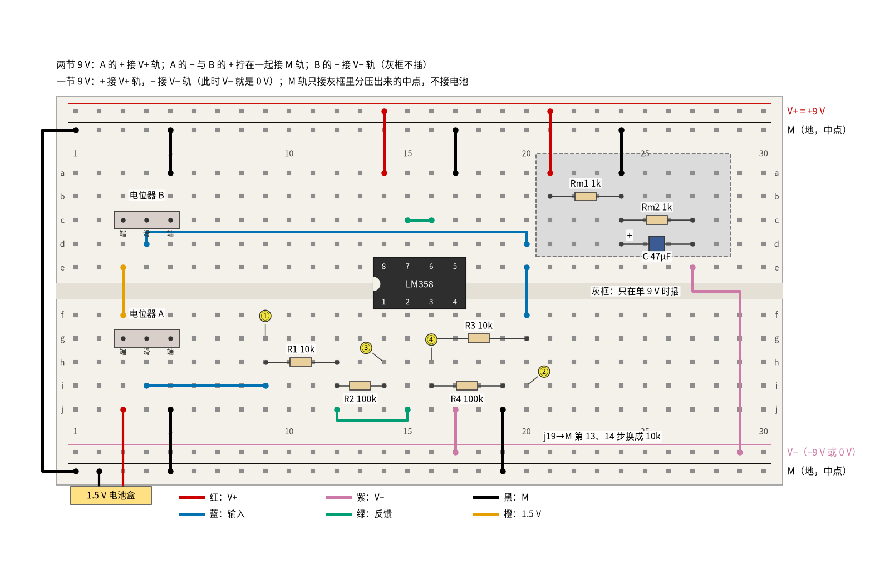
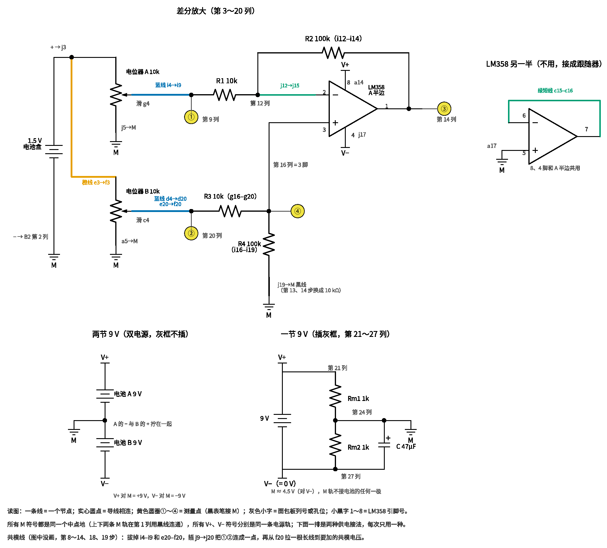
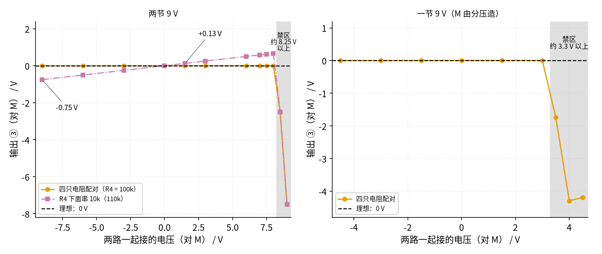

# 04 差分放大 · 动手实验篇

[上一页：参数与调试篇](page3.md) · [直觉篇](page1.md) · [原理与实现篇](page2.md) · [参数与调试篇](page3.md) · 本页：动手实验篇 · [下一页：10 稳压管稳压 · 直觉篇](../10-zener-regulator/page1.md) · 前置节点：[01 反相放大 · 直觉篇](../01-inverting-amp/page1.md)、[02 同相放大 · 直觉篇](../02-noninverting-amp/page1.md)

## 这次实验要验证什么

前三页用 ±15 V 电源、信号发生器和示波器讲差分放大，这一页换成一片 LM358、9 V 电池、一节 5 号电池和两个电位器，只用万用表，把下面五件事量出来：

1. **输出只看两路之差**：四只电阻 R1 = R3 = 10 kΩ、R2 = R4 = 100 kΩ，输出 = 10 ×（V2 − V1）。V1 = 0.50 V、V2 = 0.60 V 时输出约 +1.0 V；把 V2 调到 0.40 V，输出变成约 −1.0 V；两路一起抬高到 1.00 V 和 1.10 V，差值不变，输出还是约 +1.0 V。对应 [04 差分放大 · 原理与实现篇](page2.md) 第一节的三步推导。
2. **"一样的部分"被扔掉**：把两路输入短接在一起，再接到中点、1.5 V 或 −9 V，输出都只有几毫伏到零点几伏，这就是 [04 差分放大 · 直觉篇](page1.md) 第三节那架天平：两边加一样的砝码，指针不动。
3. **电阻比例一歪，共模就漏出来**：在 R4 下面串一只 10 kΩ，让 R4 变成 110 kΩ，同样是两路一起接 1.5 V，输出比配对时多出约 +0.125 V；接 −9 V 时多出约 −0.75 V。漏出的量和共模电压成正比，对应 [04 差分放大 · 参数与调试篇](page3.md) 第二节。
4. **共模电压有上限**：两路一起接 V+ 轨（+9 V）时，同相端被推到约 8.18 V，超过 LM358 允许的约 7.5 V，输出不再是 0，而是跑到好几伏。对应 [04 差分放大 · 参数与调试篇](page3.md) 第四节说的共模范围，以及故障排查表里"输出削顶或不随输入变化"那一行。
5. **单电源也能做，但上限更低**：一节 9 V 电池加分压造出中点，正负差值都能放大；可是共模电压只要比中点高出约 3.3 V 就出界，比两节 9 V 时的约 8.25 V 小得多。

## ⚠️ 安全须知

- **只用 12 V 及以下的直流电**。本页任何一点对中点 M 都不超过 9 V。两节 9 V 电池串联后 V+ 轨到 V− 轨之间是 18 V，这是本页的上限，不要再串第三节，也不要换成别的电源。
- **9 V 电池的两个扣子不能碰在一起**，短路几秒钟电池就会发烫。电池扣另一头没插进面包板时，用胶带包好。
- **LM358 缺口朝左，8 脚接 V+、4 脚接 V−**，接反时芯片很快发烫，**不要用手去摸**，立即拔掉电池扣。
- **共模线只接到本页指定的四个地方**：M 轨、电池盒正极所在的第 3 列、V− 轨、V+ 轨。它经过 10 kΩ 电阻才进运放，电流不到 1 mA，是安全的；但不要把共模线直接插到芯片的引脚上。
- **电解电容分正负极**：单电源时那只 47 μF 电容，长脚接 M，短脚（白色条纹一侧）接 0 V。
- **改接线之前先断电**。本页要拔插两次输入线、换一次 R4 下面的线、改一次电源接法，每次都先拔电池扣。

## 器材清单

| 元件 | 型号或数值 | 数量 | 说明 |
|---|---|---|---|
| 运放 | LM358（DIP-8 直插） | 1 | 只用 A 半边，B 半边接成跟随器 |
| 9 V 电池 | 6F22 叠层电池 + 电池扣 | 2 | 双电源用两节，单电源用一节 |
| 1.5 V 电池 | 5 号电池 + 单节电池盒 | 1 | 给两个电位器供电，也当 1.5 V 共模电压 |
| 电位器 | 10 kΩ，三脚直插 | 2 | A 调 V1，B 调 V2 |
| 电阻 | 10 kΩ | 4 | R1、R3、第 13、14 步串在 R4 下面的那只，以及逐点测时分压用的一只 |
| 电阻 | 100 kΩ | 3 | R2、R4，以及逐点测时分压用的一只 |
| 电阻 | 47 kΩ | 1 | 逐点测时分压用 |
| 电阻 | 1 kΩ | 2 | 单电源分压 Rm1、Rm2 |
| 电解电容 | 47 μF / 16 V | 1 | 稳住单电源的中点 |
| 面包板 | 830 孔 | 1 | 上下各两条电源轨 |
| 跳线 | 红、黑、紫、蓝、绿、橙 | 若干 | 颜色约定见下图；另备一根长蓝线当"共模线" |
| 万用表 | 数字式，有直流 200 mV 挡 | 1 | 量零点几毫伏的输出要用 200 mV 挡 |

电阻用普通 5% 碳膜电阻。四只 5% 电阻凑在一起，最坏时比例可以歪到百分之十几，所以"应该读到"一栏里共模那几步的范围很宽；实验前先用万用表量出四只电阻的实际值，后面的 Python 程序会按你的实际值算准。

## 搭建步骤

**中点（地）怎么接**是本页最要紧的事。所有电压都以中点 M 为参考，面包板上第二条轨（T2）和下面第二条轨（B2）都是 M，最上面的 T1 是 V+，下面的 B1 是 V−，万用表黑表笔几乎一直插在 M 上。

- **两节 9 V（双电源）**：电池 A 的 + 接 V+ 轨；电池 A 的 − 和电池 B 的 + 拧在一起接 M 轨；电池 B 的 − 接 V− 轨。V+ 对 M 是 +9 V，V− 对 M 是 −9 V。右上角灰框里的元件不插。
- **一节 9 V（单电源）**：电池 + 接 V+ 轨，− 接 V− 轨，这时 V− 轨就是 0 V。M 由灰框里两只 1 kΩ 电阻分压造出，约 4.5 V，再并一只 47 μF 电容。**M 轨不接电池的任何一极**。5 号电池的负极、两个电位器的一端、R4 的下端都接 M 轨，所以 V1、V2 和输出都是"对 M"的电压，可正可负。
- **第三种接法（本页不做）**：一节 9 V，M 直接接电池负极。这样输出只能是正的，V2 必须比 V1 大，两路输入也都不能低于电池负极。真实的传感器电路常这样用，但它看不到"差值为负"的那一半。

见 图 04-p4-1。电路和 [04 差分放大 · 直觉篇](page1.md) 第二节的四电阻差分放大完全一样，只是"地"换成了 M。



*图 04-p4-1　LM358 差分放大的面包板接法（第 8～14、18、19 步改用共模线；j19→M 的黑线在第 13、14 步换成 10 kΩ）*

对照 图 04-p4-3 的电路原理图看四只电阻：上半是反相一侧的 R1、R2，下半是同相一侧的 R3、R4，两只电位器的滑动端分别是两路输入。



*图 04-p4-3　图 04-p4-1 对应的电路原理图（灰色小字是面包板列号或孔位，小黑字 1～8 是 LM358 引脚号）*

**对照看**：面包板的连通规则见 [P1 元件速成 · 动手实验篇](../P1-components-basics/page4.md)，同一列的上半或下半五个孔是一个节点。两只电位器的滑动端都在第 4 列，但一个在下半（g4）、一个在上半（c4），隔着凹槽互不相通，所以原理图里是两路独立的输入。反相端 2 脚在第 15 列，靠 j12→j15 那根绿线才和 R1、R2 所在的第 12 列连上；同相端 3 脚在第 16 列，R3、R4 直接插在这一列。R4 下端经 j19 的黑线接 M，原理图里在这里注明第 13、14 步换成 10 kΩ。

图 04-p4-1 里红线是 V+，紫色线是 V−，黑线是 M，蓝线是输入，绿色线是反馈和短接，橙线把 1.5 V 送到电位器 B，黄圈 ①②③④ 是测量点。按顺序插：

1. 黑线把上面的 M 轨（T2 第 1 列）和下面的 M 轨（B2 第 1 列）连通。
2. LM358 缺口朝左跨在中间槽上：1～4 脚在 f14～f17，8～5 脚在 e14～e17。
3. 电源：红线 a14 → V+ 轨（8 脚），紫色线 j17 → V− 轨（4 脚）。
4. B 半边：绿色短线 c15–c16（7 脚接 6 脚），黑线 a17 → M 轨（5 脚）。
5. 电位器 A 插 g3、g4、g5，黑线 j5 → M 轨；电池盒红线插 j3，黑线插 M 轨（B2 第 2 列）。
6. 电位器 B 插 c3、c4、c5，黑线 a5 → M 轨；橙线 e3 → f3，把第 3 列的 1.5 V 也送到电位器 B 的一端。两个滑动端都能在 0～1.5 V 之间调。
7. V1 一路：蓝线 i4 → i9，第 9 列是输入点 ①，也就是 R1 的左端。R1（10 kΩ）插 h9–h12；绿色线 j12 → j15 把第 12 列接到 2 脚；R2（100 kΩ）插 i12–i14，第 14 列是输出 ③（1 脚）。
8. V2 一路：蓝线 d4 → d20（从上面绕过芯片），再用短蓝线 e20 → f20 跨过中间槽，第 20 列是输入点 ②，也就是 R3 的左端。R3（10 kΩ）插 g16–g20；R4（100 kΩ）插 i16–i19；黑线 j19 → M 轨。第 16 列是同相端 ④（3 脚）。
9. 单电源时再插灰框：红线 T1 第 21 列 → a21；Rm1 插 b21–b24；黑线 a24 → M 轨；Rm2 插 c24–c27；电容长脚 d24、短脚 d27；紫色线 e27 → V− 轨（B1 第 29 列）。
10. **共模线**（图里没画）：拔掉蓝线 i4–i9 和 e20–f20，用一根蓝线 j9 → j20 把两个输入点短接，再用一根长蓝线从 f20 接到要加的共模电压上。这样两路输入严格相等，而且直接来自电池或电源轨，内阻几乎为零。
11. 先按双电源接好，做第 0～14 步；断电改成单电源做第 15～19 步。

为什么用两个电位器而不是一个：电位器滑动端本身有零到两千多欧的内阻，[04 差分放大 · 参数与调试篇](page3.md) 第三节说过，内阻会算进比例里。本页量 ① 和 ② 时都是在电阻左端、接着电路量的，所以"输出 = 10 ×（② − ①）"不受这点内阻影响；而需要两路严格相等的共模实验，一律改用共模线。

## 测量表

万用表直流电压挡，黑表笔接 M 轨（第 4 步量两个输入之差，黑表笔插在第 9 列）。"应该读到"里的"仿真"值由 `code/figs/04_figs.py` 用 ngspice 加 TI 的 LM358B 模型现算并打印，电路就是本页这块板子（两节 9 V，或一节 9 V 加 1 kΩ/1 kΩ 分压）；范围是按四只 5% 电阻、理想运放算的。

| 步骤 | 测什么 | 红表笔 | 黑表笔 | 挡位 | 应该读到 | 读不到时先查 |
|---|---|---|---|---|---|---|
| 0 | 双电源 V+ | V+ 轨 | M 轨 | 直流 20 V | +8 V 以上 | 电池 A 的电池扣 |
| 1 | 双电源 V− | V− 轨 | M 轨 | 直流 20 V | −8 V 以下 | 读到正值：电池 B 接反 |
| 2 | 转电位器 A，把 ① 调到 +0.50 V | 第 9 列 | M 轨 | 直流 2 V | 0.500 V（边看边转） | 电池盒红线是否在 j3 |
| 3 | 转电位器 B，把 ② 调到 +0.60 V | 第 20 列 | M 轨 | 直流 2 V | 0.600 V（边看边转） | 橙线 e3–f3、蓝线 e20–f20 |
| 4 | 两路之差 ② − ① | 第 20 列 | 第 9 列 | 直流 2 V | 0.100 V | 表笔插错列 |
| 5 | ③ 输出 | 第 14 列 | M 轨 | 直流 2 V | +0.91～+1.11 V（仿真 +1.003 V） | 读到约 +6 V：R1 那一路没接上 |
| 6 | 把 ② 调到 +0.40 V，量 ③ | 第 14 列 | M 轨 | 直流 2 V | −0.84～−1.19 V（仿真 −0.997 V） | 差值为负，输出就为负 |
| 7 | ① 调到 +1.00 V、② 调到 +1.10 V，量 ③ | 第 14 列 | M 轨 | 直流 2 V | +0.89～+1.11 V（仿真 +1.003 V） | 和第 5 步差不多才对 |
| 8 | 断电接共模线，共模线接 M 轨，量 ③ | 第 14 列 | M 轨 | 直流 200 mV | −80～+80 mV，多数在 ±30 mV 以内（仿真 +3.2 mV） | 几百毫伏：j9–j20 没插好 |
| 9 | 共模线改接第 3 列（h3，1.5 V），量 ③ | 第 14 列 | M 轨 | 直流 2 V | −0.30～+0.25 V（仿真 +0.004 V） | 按实测电阻用 Python 算 |
| 10 | 共模线改接 V− 轨（−9 V），量 ③ | 第 14 列 | M 轨 | 直流 2 V | −1.5～+1.8 V（仿真 +0.000 V） | 按实测电阻用 Python 算 |
| 11 | 共模线改接 V+ 轨（+9 V），量 ④ 同相端 | 第 16 列 | M 轨 | 直流 20 V | 约 +8.2 V（仿真 +8.18 V） | 已超过约 7.5 V 的共模上限 |
| 12 | 同一状态下的 ③ | 第 14 列 | M 轨 | 直流 20 V | 明显离开 0，几伏（仿真 −7.50 V） | 这就是要演示的出界 |
| 13 | 共模线接回第 3 列，断电把 j19→M 的黑线换成 10 kΩ，量 ③ | 第 14 列 | M 轨 | 直流 2 V | 比第 9 步多 +0.10～+0.16 V（仿真 +0.129 V） | 10 kΩ 是否真的串在 R4 下面 |
| 14 | 共模线改接 V− 轨，量 ③ | 第 14 列 | M 轨 | 直流 2 V | 比第 10 步多 −0.57～−0.98 V（仿真 −0.750 V） | 漏出的量和共模电压成正比 |
| 15 | 断电换黑线回来、拆共模线、插回两根蓝线，改单电源（灰框插上），量 M | M 轨 | V− 轨（0 V） | 直流 20 V | 4.28～4.72 V（仿真 4.50 V） | 两只 1 kΩ 和电容方向 |
| 16 | 单电源，① 调到 +0.50 V、② 调到 +0.60 V，量 ③ | 第 14 列 | M 轨 | 直流 2 V | +0.91～+1.11 V（仿真 +1.003 V） | 黑表笔在 M 轨，不在 0 V |
| 17 | 单电源，② 调到 +0.40 V，量 ③ | 第 14 列 | M 轨 | 直流 2 V | −0.84～−1.19 V（仿真 −0.997 V） | 负的也能出来，靠的是中点 |
| 18 | 单电源接共模线，共模线接 V− 轨（对 M 约 −4.5 V），量 ③ | 第 14 列 | M 轨 | 直流 2 V | 零点几伏以内（仿真 +0.002 V） | 按实测电阻用 Python 算 |
| 19 | 共模线改接 V+ 轨（对 M 约 +4.5 V），量 ③ | 第 14 列 | M 轨 | 直流 20 V | 明显离开 0，几伏（仿真 −4.24 V） | 单电源时上限只有约 3.3 V |

一共 20 步。第 5、6、7 三步合起来就是差分放大的全部意思：第 5 步和第 7 步的两路输入各差了 0.5 V，可差值都是 0.1 V，输出都是 1 V；第 6 步差值变成 −0.1 V，输出也跟着变号。这时第 16 列的同相端分别约 0.55 V、0.36 V、1.00 V（仿真值），说明运放只是让 2 脚追着 3 脚走，真正决定输出的是两路之差。

第 8～10 步的读数离 0 有多远，几乎全看你那四只电阻配得好不好：同样是 5% 电阻，运气好时第 10 步只有几十毫伏，运气差时能到一伏多。第 8 步共模电压是 0，剩下的那几毫伏来自 LM358 自己的失调电压，被放大了约 11 倍。

第 11、12 步是这一页最值得记住的故障。同相端电压是共模电压 × 100 ÷ 110，接 +9 V 时约 8.18 V；LM358 的输入只能在"V− 到 V+ 减约 1.5 V"之间正常工作，也就是不超过约 7.5 V。超出以后运放无法让 2 脚追上 3 脚，输出就不再代表差值。仿真里 2 脚停在约 7.5 V，输出被拉到约 −7.5 V；实物的读数可能不同，但一定明显离开 0。反过来，第 10 步接 −9 V 时同相端约 −8.18 V，仍在"V− 以上"，所以一切正常，下限比上限宽得多。

第 13、14 步是故意把天平做歪。R4 变成 110 kΩ 以后，同相端多分到了一点电压，按 [04 差分放大 · 原理与实现篇](page2.md) 第一节的公式，共模 1.5 V 时多出 1.5 × (110 ÷ 120 × 11 − 10) ≈ 0.125 V，−9 V 时多出约 −0.75 V；而共模线接 M 时一点也不多。这正是 [04 差分放大 · 参数与调试篇](page3.md) 故障排查表第一行"输入为 0 时输出有固定偏移"的检查办法：两路接同一直流电压，看输出。

第 18、19 步说明单电源时共模上限变低了：M 本身已经在 4.5 V，同相端 = 4.5 V + 共模电压（对 M）× 100 ÷ 110，要不超过 7.5 V，共模电压对 M 只能到约 +3.3 V。接 V+ 轨时对 M 是 +4.5 V，于是出界；接 V− 轨时同相端约 0.41 V，仍在允许范围里。

## 没有示波器怎么办

前三页用示波器看"共模干扰被抵消"，没有示波器就**用共模线和万用表逐点测**：

1. 双电源，四只电阻配对，接上共模线。共模线依次接 V− 轨、M 轨、第 3 列；再拔掉 f20 那根长线、保留 j9–j20，插回蓝线 i4–i9，电位器 A 就同时驱动两路，调出 0～1.5 V 之间的几档。每档记下第 9 列对 M 的电压和 ③。
2. 想看 1.5 V 以上：在面包板空着的地方用两只电阻从 V+ 轨到 M 轨分压，上面 10 kΩ、下面 47 kΩ 得约 7.4 V，下面换成 100 kΩ 得约 8.2 V（刚好在上限边上），共模线接分压点；最后共模线直接接 V+ 轨。分压点接上电路后会被拉低一点，横轴一律用第 9 列的实测值。
3. 断电把 j19→M 的黑线换成 10 kΩ，重复第 1、2 步。
4. 改成单电源，重复第 1、2 步。
5. 在方格纸上以共模电压为横轴、输出为纵轴描点，就得到 图 04-p4-2。



*图 04-p4-2　没有示波器时，逐点测出的共模特性（左：两节 9 V；右：一节 9 V）*

图 04-p4-2 左图里橙色圆点是四只电阻配对时，几乎贴着黑色虚线（理想的 0 V）；紫色方块是 R4 串了 10 kΩ 以后，一条穿过原点的斜线，斜率约 0.083，共模 1.5 V 时 +0.13 V，−9 V 时 −0.75 V。两条线都在约 8.25 V 处突然掉下去，灰色区域就是共模出界的禁区。右图是单电源，禁区从约 3.3 V 就开始了。

这张图相当于 [04 差分放大 · 直觉篇](page1.md) 第四节在示波器上看到的东西：干扰同时加在两路上，配对时输出几乎看不到干扰；比例歪了，干扰就按比例漏出来。示波器看的是交流干扰，这里用一档一档的直流电压代替，道理完全一样。

## 用 Python 核对你的读数

先断电量出两节 9 V 电池、5 号电池和各个电阻的实际值，再把读数填进去。程序按你的实际值算出应该读到的数，偏差超过 10% 并且差值超过 0.05 V 的会给出提示；第 8 步只看是否在 ±80 mV 以内，第 12、19 步只看是否明显离开 0。下面是一组示例读数。

```python
import sys, pathlib
sys.path.insert(0, str(pathlib.Path("code/figs").resolve()))  # 在仓库根目录运行
# ① 实际值：电池电压（正数）和电阻；Rx 是第 13、14 步串在 R4 下面的那只
m = dict(VA=9.41, VB=9.35, AA=1.58, R1=9.96e3, R2=99.1e3, R3=10.03e3, R4=100.4e3, Rx=9.92e3)
# ② 你实际调到的输入（伏，对 M）：(①, ②)
vin = {"5": (0.502, 0.601), "6": (0.502, 0.399), "7": (1.003, 1.104),
       "16": (0.501, 0.602), "17": (0.501, 0.398)}
# ③ 各步读数（伏）；第 15 步是 M 对 V− 轨
r = {"4": 0.099, "5": 0.993, "6": -1.018, "7": 1.016, "8": 0.004, "9": 0.013, "10": -0.049,
     "11": 8.53, "12": -6.9, "13": 0.142, "14": -0.815, "15": 4.47, "16": 0.997, "17": -1.024,
     "18": -0.020, "19": -3.8}


def diff(v1, v2, r4):
    """四电阻差分放大的理想输出：V2 × R4/(R3+R4) × (1 + R2/R1) − V1 × R2/R1。"""
    return v2 * r4 / (m["R3"] + r4) * (1 + m["R2"] / m["R1"]) - v1 * m["R2"] / m["R1"]


R4, R4x = m["R4"], m["R4"] + m["Rx"]
expect = {
    "4": (vin["5"][1] - vin["5"][0], "表笔是否在第 20、9 列"),
    "5": (diff(*vin["5"], R4), "R1、R2、R3、R4 是否插对"),
    "6": (diff(*vin["6"], R4), "② 是否真的调到了 0.40 V"),
    "7": (diff(*vin["7"], R4), "两个滑动端的蓝线"),
    "9": (diff(m["AA"], m["AA"], R4), "共模线是否接在第 3 列"),
    "10": (diff(-m["VB"], -m["VB"], R4), "共模线是否接在 V− 轨"),
    "11": (m["VA"] * R4 / (m["R3"] + R4), "量的是不是第 16 列"),
    "13": (r["9"] + diff(m["AA"], m["AA"], R4x) - diff(m["AA"], m["AA"], R4), "10 kΩ 是否串在 j19 和 M 之间"),
    "14": (r["10"] + diff(-m["VB"], -m["VB"], R4x) - diff(-m["VB"], -m["VB"], R4), "共模线是否接在 V− 轨"),
    "16": (diff(*vin["16"], R4), "黑表笔是否在 M 轨"),
    "17": (diff(*vin["17"], R4), "中点分压和电容"),
    "18": (diff(-r["15"], -r["15"], R4), "共模线是否接在 V− 轨"),
}
print(f"差分倍数 R2/R1 = {m['R2'] / m['R1']:.2f}，R4/R3 = {R4 / m['R3']:.2f}；"
      f"共模 1 V 漏出 {diff(1, 1, R4) * 1e3:+.1f} mV（四只电阻配得越好越接近 0）")
print(f"第 8 步输出 {r['8'] * 1e3:+.1f} mV" + ("" if abs(r["8"]) <= 0.08 else "  ← 超过 ±80 mV，先查 j9–j20 是否插好"))
for k in ("12", "19"):
    print(f"第 {k} 步输出 {r[k]:+.2f} V" + ("（明显离开 0，共模出界，符合预期）" if abs(r[k]) > 1 else "  ← 应明显离开 0，先查共模线是否接到了 V+ 轨"))
for k, (e, hint) in expect.items():
    v = r[k]
    dev = (v - e) / abs(e) * 100
    flag = f"  ← 偏差超过 10%，先查：{hint}" if abs(dev) > 10 and abs(v - e) > 0.05 else ""
    print(f"第 {k:>2} 步  实测 {v:+7.3f} V  计算 {e:+7.3f} V  偏差 {dev:+6.1f}%{flag}")
```

示例读数都没有触发提示。第 9、10、18 步的计算值只有几毫伏到几十毫伏，百分比偏差会很大，这是正常的：程序只在差值也超过 0.05 V 时才提示，剩下的那点差别来自 LM358 的失调电压。第 11 步同相端的计算值没有算运放的偏置电流，差零点几伏不必紧张。

## 实验记录表

| 步骤 | 测什么 | 实测值 | 计算值 | 偏差 |
|---|---|---|---|---|
| 0 | 双电源 V+ |  |  |  |
| 1 | 双电源 V− |  |  |  |
| 2 | 输入 ① |  |  |  |
| 3 | 输入 ② |  |  |  |
| 4 | ② − ① |  |  |  |
| 5 | 输出 ③（0.50 / 0.60） |  |  |  |
| 6 | 输出 ③（0.50 / 0.40） |  |  |  |
| 7 | 输出 ③（1.00 / 1.10） |  |  |  |
| 8 | 共模接 M 的 ③（mV） |  |  |  |
| 9 | 共模接 1.5 V 的 ③ |  |  |  |
| 10 | 共模接 V− 的 ③ |  |  |  |
| 11 | 共模接 V+ 的 ④ |  |  |  |
| 12 | 共模接 V+ 的 ③ |  |  |  |
| 13 | R4 串 10 kΩ，共模 1.5 V 的 ③ |  |  |  |
| 14 | R4 串 10 kΩ，共模 V− 的 ③ |  |  |  |
| 15 | 单电源 M 对 0 V |  |  |  |
| 16 | 单电源 ③（0.50 / 0.60） |  |  |  |
| 17 | 单电源 ③（0.50 / 0.40） |  |  |  |
| 18 | 单电源共模接 V− 的 ③ |  |  |  |
| 19 | 单电源共模接 V+ 的 ③ |  |  |  |

逐点测量另记一张表：共模电压一栏，配对、R4 串 10 kΩ、单电源三种情况的输出各一栏。

## 思考题

**思考题 1**：第 10 步你读到的输出离 0 有零点几伏，说明四只电阻配得不够好。只有一盒 5% 电阻，不买新零件，怎样把它调小？

<details><summary>答案</summary>

先用万用表从一盒同值电阻里挑：R1 和 R3 挑两只读数最接近的，R2 和 R4 也挑两只最接近的。差分放大要的不是每只电阻都准，而是 R2 ÷ R1 = R4 ÷ R3 这两个比例相等，挑到读数差不到 0.5% 的两对并不难，第 10 步的漏出就能降到几十毫伏。还不够时，可以像第 13 步那样在 R4 下面串一只小电阻、或者换成一只电位器加固定电阻，一边让两路接 −9 V，一边调到输出最接近 0。这就是 [04 差分放大 · 参数与调试篇](page3.md) 故障排查表里"用可调电阻微调"的意思。

</details>

**思考题 2**：第 10 步接 −9 V 一切正常，第 12 步接 +9 V 却出界了。两边离电源都差不多远，为什么结果不对称？如果一定要测 +9 V 共模，可以怎么改？

<details><summary>答案</summary>

LM358 的输入级允许一直低到 V−，但最多只能高到比 V+ 低约 1.5 V。接 −9 V 时同相端约 −8.18 V，在 V− 以上，没问题；接 +9 V 时约 +8.18 V，超过了约 +7.5 V 的上限。改法有三种：把四只电阻换成"先衰减"的比例，例如 R1 = R3 = 100 kΩ、R2 = R4 = 10 kΩ，同相端只有共模电压的十一分之一，但差分倍数也降到 0.1；或者提高 V+，让上限跟着抬高；或者换一片输入能到正电源的运放。[04 差分放大 · 参数与调试篇](page3.md) 第四节给的就是前两种办法。

</details>

**思考题 3**：第 8～10 步为什么要拔掉两个电位器、改用共模线？把两个电位器都调到 1.00 V 来做"两路相等"不行吗？

<details><summary>答案</summary>

有两个问题。第一，万用表只能把两路调到相差 1 mV 左右，这 1 mV 是真正的差值，会被放大 10 倍，变成约 10 mV，和你想看的共模漏出混在一起。第二，电位器滑动端本身有零到两千多欧的内阻，串在 R1、R3 前面；两个电位器转的角度不同、零件也有误差，两路内阻不一样大，比例就歪了。按 [04 差分放大 · 参数与调试篇](page3.md) 第三节，只要一侧多出 1 kΩ，共模抑制比就掉到约 41 dB，相当于又多了一份电阻误差。共模线把两路短接在同一个点上，又直接接电池或电源轨，这两个问题就都没有了。真正的传感器内阻不可控时，办法是在两路前面各加一级 [03 电压跟随器 · 直觉篇](../03-voltage-follower/page1.md)，这就是三运放仪表放大器的思路。

</details>

## 自测清单

- 我能说清楚两节 9 V 和一节 9 V 两种接法里中点 M 从哪里来，并说出单电源时共模上限为什么变低。
- 我能用两个电位器调出两路输入，验证"输出 = 10 × 两路之差"，并说明两路一起抬高时输出为什么不变。
- 我能用共模线把两路输入短接到同一个电压，量出漏出的共模输出，并用实测电阻算出它应该是多少。
- 我能故意把一只电阻改大，演示比例一歪共模就按比例漏出，并说出怎样挑电阻或微调把它压小。
- 我能在没有示波器时用万用表逐点测出共模特性，并从图上读出 LM358 的共模上限。
