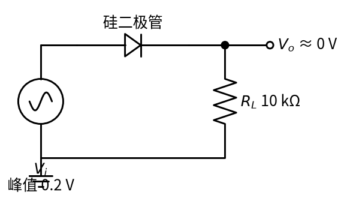
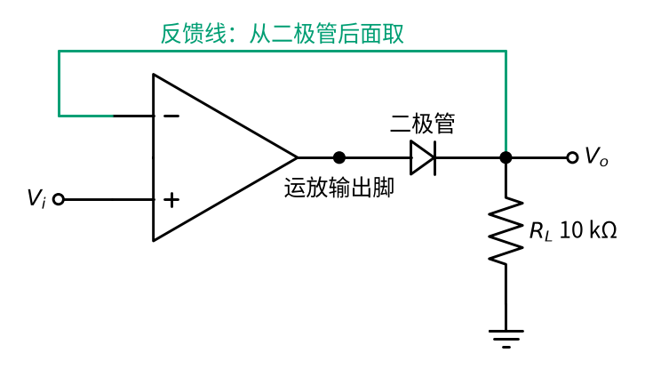
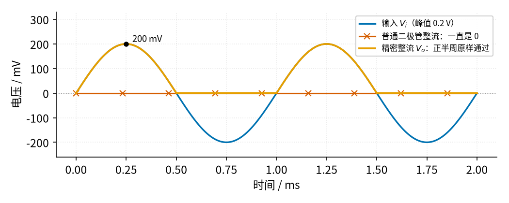
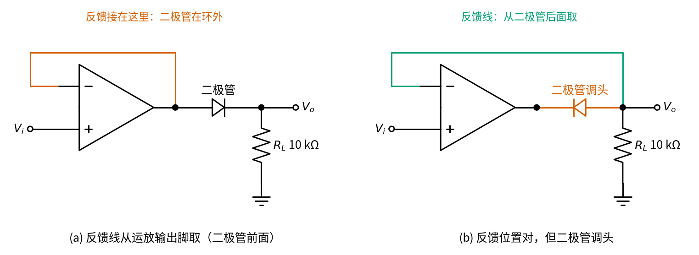

# 05 精密整流 · 直觉篇

[上一页：02 同相放大 · 动手实验篇](../02-noninverting-amp/page4.md) · 本页：直觉篇 · [原理与实现篇](page2.md) · [参数与调试篇](page3.md) · [下一页：原理与实现篇](page2.md) · 前置节点：[P2 半导体入门 · 直觉篇](../P2-semiconductor-basics/page1.md)、[01 反相放大 · 直觉篇](../01-inverting-amp/page1.md)

## 为什么需要精密整流

**整流**就是把交流信号里的一个方向留下、另一个方向去掉，或者把负的部分翻成正的。最简单的整流器只有一只二极管：它是电路里的单向阀，正半周放行，负半周关门（见 [P2 半导体入门 · 直觉篇](../P2-semiconductor-basics/page1.md)）。整流以后再求平均值，就能知道一个交流信号「有多大」。万用表的交流电压档、音响上跳动的电平表、测振动的传感器，里面都有这样一步。

问题出在 P2 反复强调的那 0.7 V。硅二极管要正向电压超过大约 0.7 V 才肯开门，这笔「过路费」对 220 V 市电来说微不足道，可是麦克风、热电偶、应变片给出的信号往往只有几十到几百毫伏，**整个信号的峰值还不够交过路费**。结果就是：输出一直是 0 V，信号整个被二极管吃掉了。

这一节要做的事情是：**让二极管的 0.7 V 压降「消失」**，哪怕只有几毫伏的信号也能被准确地整流。做法出奇地简单：把二极管放进运放的负反馈环里。

## 一、普通二极管整不了小信号

先看最普通的半波整流电路，见图 05-p1-1。

*图 05-p1-1　普通二极管半波整流，输入峰值只有 0.2 V*

信号源 $V_i$ 的正端经过二极管接到负载电阻 $R_L$ ，输出 $V_o$ 就是 $R_L$ 上的电压。如果输入峰值是 10 V，正半周二极管导通，输出约为 10 V − 0.7 V = 9.3 V，少掉的 0.7 V 只占 7%，大家通常就忍了。可是输入峰值只有 0.2 V 时，二极管两端的正向电压最多 0.2 V，永远到不了 0.7 V，阀门一次都没推开，输出始终是 0 V。

## 二、直觉：请运放替你交过路费

要是有人在二极管前面「多垫 0.7 V」，问题就解决了。可是 0.7 V 这个数并不固定：它随电流和温度变化，见 [P2 半导体入门 · 原理与实现篇](../P2-semiconductor-basics/page2.md) 的伏安特性曲线。手工垫一个固定电压，总会垫多或垫少。

运放正好擅长这种事。回忆 P3 和 01：运放的放大倍数 A 大约是 10 万，接上负反馈以后，它会**自己不停地调整输出，直到两个输入端的电压相等**（虚短）。虚短有两个前提：电路接了负反馈，而且运放输出没有冲到电源电压附近（没有饱和）；后面会看到，前提一旦不满足，虚短就不成立了。现在我们把二极管放在运放输出和反馈点之间，见图 05-p1-2。

*图 05-p1-2　基本型精密整流：二极管被包进反馈环（蓝绿色线是反馈线）*

图中的关键是那条蓝绿色的反馈线：它不是从运放输出脚取的，而是从**二极管后面**、也就是真正的输出 $V_o$ 取回反相端。运放只盯着一件事：反相端（也就是 $V_o$ ）要等于同相端的 $V_i$ 。

- 当 $V_i$ 是正的，比如 0.2 V：运放发现 $V_o$ 还不够 0.2 V，就把自己的输出脚往上推。推到 0.9 V 时，二极管交完 0.7 V 的过路费，后面正好剩下 0.2 V，两个输入端相等，运放就停在这里。**过路费是运放替你交的**，交多少它自己算，二极管压降怎么变它都能跟着改。
- 当 $V_i$ 是负的：运放想让 $V_o$ 也变负，于是把输出脚往下压。可是二极管反向不通，电流过不去， $V_o$ 只能停在 0 V（被 $R_L$ 拉到地）。于是负半周被挡掉了，这正是我们要的整流。

用生活来比喻：普通二极管像一扇很沉的门，力气小的小孩（小信号）推不开；精密整流相当于门后站了一个大力士（运放），他盯着门缝看，只要小孩往前推，他就帮着把门推开，而且推开的程度刚好让门缝等于小孩的力气。这种「运放 + 二极管」的组合常被叫作**超级二极管**，它像一只没有 0.7 V 压降的理想二极管。

## 三、看看波形：0.2 V 的信号也能整流

图 05-p1-3 把同一个峰值 0.2 V、频率 1 kHz 的正弦信号分别送进两种电路。

*图 05-p1-3　小信号整流：普通二极管与精密整流的输出对比*

蓝色是输入 $V_i$ 。朱红色带 × 的线是普通二极管的输出，从头到尾贴在 0 V 上，一点信号都没留下。橙色是精密整流的输出：正半周和蓝色曲线完全重合，峰值同样是 200 mV；负半周被削成 0 V。两种电路用的是同一种二极管，差别只在于二极管有没有被放进反馈环。

这张图是按「运放足够快」画的理想情况。真实的运放速度有限，信号频率一高，输出在过零点附近会出现缺口和毛刺，[05 精密整流 · 原理与实现篇](page2.md) 会用仿真把它画出来，[05 精密整流 · 参数与调试篇](page3.md) 再讲怎么挑运放。

## 四、新手最容易踩的三个坑

前两个坑都是接线问题，两种错误接法画在图 05-p1-4 里，可以和图 05-p1-2 的正确接法对照着看。

*图 05-p1-4　两种常见接错：(a) 反馈线取在二极管前面；(b) 二极管接反（朱红色是接错的地方）*

1. **反馈线接错位置**。反馈线如果从运放输出脚（二极管前面）取，二极管就在环外，运放只管让自己的输出脚等于 $V_i$ ，二极管照样吃掉 0.7 V，电路退化成「跟随器加普通二极管」，小信号还是整不出来。记住：反馈要从二极管后面取。
2. **二极管方向接反**。二极管调头以后，电路留下的是负半周，输出变成负的。这不一定是错，有时就是要负半周，但如果你想要的是正半周，输出就整个反了。
3. **以为运放什么频率都能跟上**。负半周时二极管不通，运放其实处在没有反馈的状态，输出脚会一路冲到负电源附近；下一个正半周开始时，它要先从那里爬回来，这段时间里输出是 0。频率越高，被吃掉的比例越大。[05 精密整流 · 原理与实现篇](page2.md) 的仿真和 [05 精密整流 · 参数与调试篇](page3.md) 的扫描图会专门看这个坑。

## 一句话总结

普通二极管的 0.7 V 压降让小信号无法整流；把二极管放进运放的负反馈环，运放会自动把输出抬高一个二极管压降，**二极管压降带来的误差被缩小到原来的大约 A 分之一**。下一页推导这个结论，并介绍一种更快、更稳的改进电路，它直接用到 01 的反相放大器。
