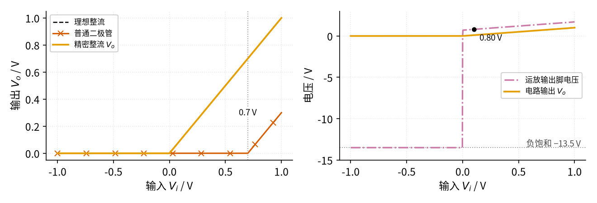
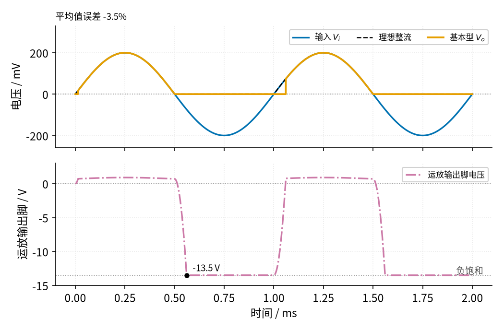
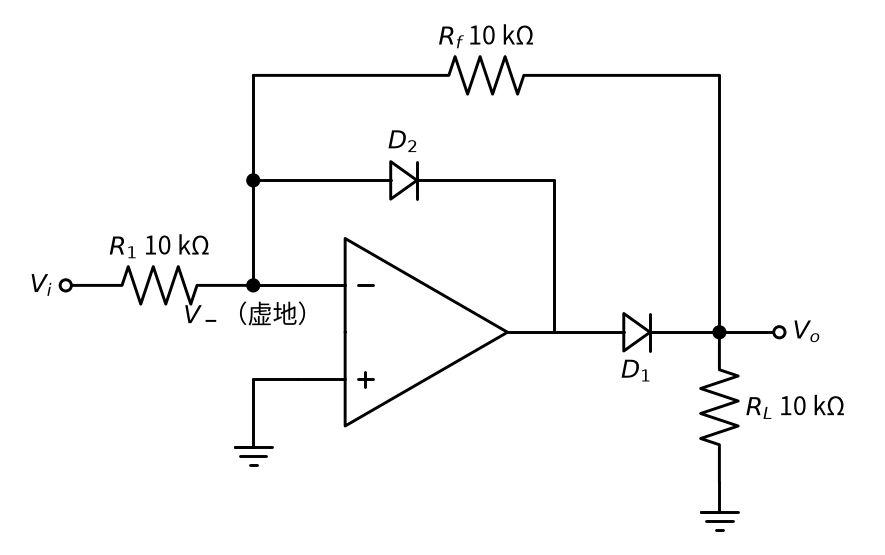
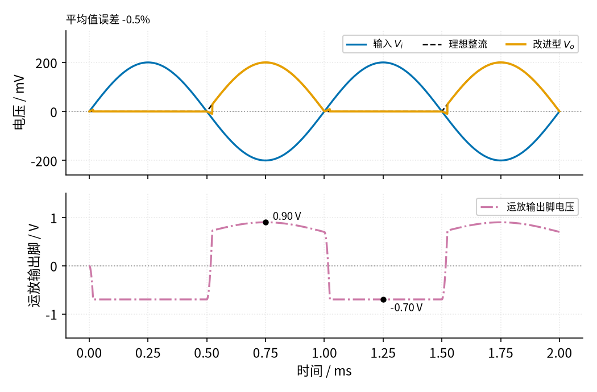

# 05 精密整流 · 原理与实现篇

[上一页：直觉篇](page1.md) · [直觉篇](page1.md) · 本页：原理与实现篇 · [参数与调试篇](page3.md) · [下一页：参数与调试篇](page3.md) · 前置节点：[P2 半导体入门 · 直觉篇](../P2-semiconductor-basics/page1.md)、[01 反相放大 · 直觉篇](../01-inverting-amp/page1.md)

## 本页要解决的问题

直觉篇说运放会「替二极管交过路费」。这一页把这句话变成算式：误差到底剩多少？负半周运放在干什么？为什么频率一高就出毛病？最后介绍一种用 01 反相放大器改出来的**改进型**电路，它把速度问题缓解了一大截。本页沿用 P3 和 01 的记号：开环增益 A 约 10 万，同相端 $V_+$ 、反相端 $V_-$ ，输入 $V_i$ 、输出 $V_o$ ；再加一个新记号：运放输出脚的电压记作 $V_{oa}$ （a 表示 amplifier），因为在这一节里它和电路输出 $V_o$ 中间隔着一只二极管，两者不相等。二极管导通压降记作 $V_D$ ，按 P2 的 0.7 V 规则取 0.7 V。

## 1. 基本型：正半周的误差只有几微伏

回到直觉篇的基本型电路：同相端接 $V_i$ ，运放输出脚经二极管接到 $V_o$ ， $V_o$ 再接回反相端。正半周二极管导通，P3 的运放公式和二极管的 0.7 V 规则各给一个方程：

$$V_{oa} = A\thinspace(V_i - V_o), \qquad V_o = V_{oa} - V_D$$

第一个式子移项得到 $V_o = V_i - V_{oa}/A$ 。也就是说，输出比输入少的那一点点，正好是「运放输出脚电压除以 A」。代数： $V_i$ = 0.1 V 时 $V_o$ 约 0.1 V，运放输出脚约 0.1 + 0.7 = 0.8 V，误差约 0.8 V ÷ 100000 = 8 μV。普通二极管在这里的误差是 0.1 V，整整 100%。

换个角度看：要让二极管开始导通，输入只需要超过 $V_D / A$ ，即 0.7 V ÷ 100000 = 7 μV。**二极管的门槛被运放缩小了 A 倍**，这就是「精密」二字的来历。

图 05-p2-1 把这个关系画成传输特性：横轴是输入，纵轴是输出。



*图 05-p2-1　基本型精密整流的传输特性（左）和运放输出脚电压（右）*

左图里黑色虚线是理想整流，橙色的精密整流和它重合在一起，几乎看不出来；朱红色带 × 的普通二极管要等输入过了灰色点线标出的 0.7 V 才开始上升。右图的红紫色点划线是运放输出脚电压：输入为正时，它始终比橙色的 $V_o$ 高出约 0.7 V，在 0.1 V 处是图上标出的 0.80 V；输入为负时，它直接跌到灰色点线标出的负饱和 −13.5 V。下一节就来解释这个「跌到底」。

## 2. 负半周：反馈断了，运放冲到负电源

输入变负时，运放照旧想让 $V_o$ 跟着变负，于是压低 $V_{oa}$ 。可是 $V_{oa}$ 一旦低于 $V_o$ ，二极管就反向截止，**反馈线和运放输出脚之间断开了**。此时 $V_o$ 只通过 $R_L$ 接地，等于 0 V，反相端也是 0 V，运放处在 P3 讲过的开环状态：

$$V_{oa} = A\thinspace(V_+ - V_-) = A\thinspace V_i$$

$V_i$ 只要负 1 mV， $A V_i$ 就是 −100 V，远超电源，于是 $V_{oa}$ 一直被压到负电源附近，±15 V 供电时约 −13.5 V。电路输出是对的（0 V），代价是运放输出脚在负半周「躺」在 −13.5 V 上。

麻烦出现在下一个正半周开始时。运放输出脚得先从 −13.5 V 爬回 +0.7 V，二极管才能重新导通。运放输出电压的变化速度有上限，叫**压摆率**（单位 V/μs），741 类老运放典型只有 0.5 V/μs（[LM741 数据手册](https://www.ti.com/lit/ds/symlink/lm741.pdf)）。这里换用 741 只是因为它是教材里最常见的老型号，01 用的 LM358B 压摆率典型也是 0.5 V/μs（见 [01 反相放大 · 参数与调试篇](../01-inverting-amp/page3.md)），两者速度同一档，下面的结论对 LM358B 一样适用。光按压摆率算，爬 14.2 V 就要 28.4 μs；而刚过零时输入只有几毫伏，运放「被催得不急」，实际爬得还要更慢。这段时间里输出一直是 0，正半周开头的一段信号就丢了。

图 05-p2-2 是仓库里 [code/05_sim.py](../code/05_sim.py) 的仿真结果：741 级运放（增益带宽积 1 MHz、压摆率 0.5 V/μs），输入 1 kHz、峰值 0.2 V。



*图 05-p2-2　基本型加 741 级运放的仿真波形，输入 1 kHz、峰值 0.2 V*

上图蓝色是输入，黑色虚线是理想整流，橙色是电路输出。第一个正半周是从 0 V 起步的，所以看不出问题；第二个正半周（1 ms 之后）开头，橙色线晚了一截才跳上去，仿真打印的结果是过零后 60 μs 输出才超过 10 mV。下图的红紫色点划线是运放输出脚：正半周停在约 0.9 V，负半周跌到 −13.5 V。左上角打印的平均值误差是 −3.5%，信号频率提高 10 倍，丢掉的比例也跟着变大，[05 精密整流 · 参数与调试篇](page3.md) 会扫一遍频率。

这里的仿真模型是简化过的：运放只考虑了两种限制，一是「增益随频率升高而下降」（由增益带宽积决定），二是压摆率；二极管用 0.7 V 折线模型，只用来看趋势，不能替代器件手册和实测。

## 3. 改进型：让运放输出脚永远不饱和

既然毛病出在运放「跌到底」，那就不要让它跌下去。办法是给运放另加一条负半周也能导通的反馈支路。[TI 的模拟电路手册 SBOA227B](https://www.ti.com/lit/an/sboa227b/sboa227b.pdf) 和 [Fiore 的运放教材 7.2 节](https://eng.libretexts.org/Bookshelves/Electrical_Engineering/Electronics/Operational_Amplifiers_and_Linear_Integrated_Circuits_-_Theory_and_Application_(Fiore)/07%3A_Nonlinear_Circuits/7.02%3A_Precision_Rectifiers) 都用下面这种反相型电路，它直接从 01 的反相放大器改出来，见图 05-p2-3。



*图 05-p2-3　改进型（反相型）精密半波整流*

和 01 的反相放大器比，只多了两只二极管： $D_1$ 串在运放输出脚和 $R_f$ 之间， $D_2$ 从反相端（虚地）接到运放输出脚。两种情况分开看：

- **输入为正**：电流从 $V_i$ 经 $R_1$ 流进虚地，运放要把这股电流「抽走」，就把 $V_{oa}$ 压低。压到 −0.7 V 时 $D_2$ 导通，电流经 $D_2$ 流进运放输出脚，负反馈成立，虚地保持 0 V。此时 $D_1$ 反偏截止， $V_o$ 只通过 $R_f$ 接到 0 V 的虚地，所以 $V_o$ = 0。
- **输入为负**： $V_{oa}$ 往上走， $D_2$ 截止， $D_1$ 导通，电路就是一个普通的反相放大器， $D_1$ 待在反馈环里，压降被运放补上。按 01 的公式， $V_o = -\frac{R_f}{R_1} V_i$ ，两个电阻相等时 $V_o = -V_i$ ，负半周被翻成了正的。

这个电路留下的是**负半周并把它翻正**，和基本型留正半周不一样，用的时候要注意。它最大的好处在运放输出脚上：任何时候都有一只二极管导通，反馈从不断开，运放输出脚只在 −0.7 V 和「 $V_o$ + 0.7 V」之间来回，每次过零只需走约 1.4 V，而不是 14 V。图 05-p2-4 是同样条件下的仿真。



*图 05-p2-4　改进型加 741 级运放的仿真波形，输入 1 kHz、峰值 0.2 V*

上图橙色输出在每个负半周都和翻正后的输入（黑色虚线）重合，只在过零点有很小的缺口；下图红紫色点划线最低 −0.70 V、最高 0.90 V，再也不去 −13.5 V。同一颗 741 级运放，平均值误差从 −3.5% 降到了 −0.5%。代价是：输入电流要流过 $R_1$ ，电路的输入电阻只有 $R_1$ ，信号源内阻 $R_s$ 会和 $R_1$ 串联、使增益变小（见 [01 反相放大 · 参数与调试篇](../01-inverting-amp/page3.md)），[05 精密整流 · 参数与调试篇](page3.md) 会再提。所谓内阻，是把真实信号源看成「理想电压源串一个电阻」时的那个电阻，详见 [P1 元件速成 · 原理与实现篇](../P1-components-basics/page2.md) 第七节（戴维南等效）。

## 4. 仿真：自己动手算一遍

下面这段代码用最朴素的办法一步一步地「走时间」：每一小步先算运放想把输出改多少（受增益带宽积和压摆率限制），再解一次二极管电路。照全书惯例在仓库根目录运行；它只用 Python 自带的 math 模块，不画图，所以不需要 figstyle，也不需要任何第三方库。

读代码前先弄懂两处「看起来像黑盒」的地方：

- **运放那一行** `wp * (A0 * diff - x)` ：运放的目标输出是 $A \thinspace (V_+ - V_-)$ ，也就是 `A0 * diff` ； `x` 是它此刻的实际输出。两者之差就是「离目标还差多远」，差得越远，输出变得越快，乘上的 `wp` 是一个反应快慢系数，等于 2π × 增益带宽积 ÷ A。算出来的速度再被压摆率 `SR` 截住，所以大跳变时运放只能按 0.5 V/μs 爬。
- **改进型那几行** `a11, a12, b1 = ...` ：二极管按「0.7 V 电池串 10 Ω 电阻」处理，导通时才有电流。对反相端 $V_-$ 和输出端 $V_o$ 两个节点各列一条「流进的电流之和 = 0」，就得到一个关于 $V_-$ 、 $V_o$ 的二元一次方程组，`a11 … b2` 是它的系数， `det` 那两行就是用消元法解出来的通用公式。比如 $V_-$ 节点：从 $R_1$ 流进 $(V_i - V_-)/R_1$ ，从 $R_f$ 流进 $(V_o - V_-)/R_f$ ， $D_2$ 导通时还要减去流出的 $(V_- - V_{oa} - 0.7)/10$ ，三项加起来等于 0，移项整理就是第一行。两只二极管各有通、断两种可能，代码把四种组合都试一遍，留下「假设导通的管子正向电压确实超过 0.7 V、假设截止的确实没超过」的那一组。

```python
# 在仓库根目录运行：/workspace/circuits-venv/bin/python 本段代码.py
import math

VON, RD, A0, RAIL = 0.7, 10.0, 1e5, 13.5   # 二极管 0.7 V、10 Ω；开环增益 10 万；输出最多 ±13.5 V
R1 = RF = RL = 10e3                          # 三个电阻都取 10 kΩ
GBW, SR = 1e6, 0.5e6                         # 741 级运放：增益带宽积 1 MHz，压摆率 0.5 V/µs

def basic(voa):                              # 基本型：运放脚 → 二极管 → R_L，返回 V_o
    return (voa - VON) * RL / (RL + RD) if voa > VON else 0.0

def improved(voa, vi):                       # 改进型：试 D1、D2 的四种通断，返回自洽的 (V_-, V_o)
    g = 1 / RD
    for a in (0, 1):
        for b in (0, 1):
            a11, a12, b1 = -1/R1 - 1/RF - b*g, 1/RF, -vi/R1 - b*g*(voa + VON)
            a21, a22, b2 = 1/RF, -a*g - 1/RF - 1/RL, -a*g*(voa - VON)
            det = a11*a22 - a12*a21
            vm, vo = (b1*a22 - a12*b2) / det, (a11*b2 - a21*b1) / det
            if ((voa - vo - VON) > 0) == bool(a) and ((vm - voa - VON) > 0) == bool(b):
                return vm, vo

def run(kind, f=1e3, vpk=0.2):
    dt = 1 / (2 * math.pi * GBW) / 8         # 时间步长：比运放反应时间短得多
    n = int(2 / f / dt)                      # 仿真两个周期
    wp = 2 * math.pi * GBW / A0              # 运放的反应快慢系数：2π × GBW ÷ A
    x = vm = vo = 0.0                        # x 是运放输出脚电压
    s_out = s_ideal = 0.0; lo = hi = 0.0
    for k in range(n):
        vi = vpk * math.sin(2 * math.pi * f * k * dt)
        diff = (vi - vo) if kind == "基本型" else (0.0 - vm)   # V+ − V−
        dv = max(-SR, min(SR, wp * (A0 * diff - x)))         # 运放想变多快，但不能超过压摆率
        x = max(-RAIL, min(RAIL, x + dv * dt))               # 也不能超过电源
        if kind == "基本型":
            vo = basic(x)
        else:
            vm, vo = improved(x, vi)
        if k >= n // 2:                      # 只统计第二个周期
            s_out += vo
            s_ideal += max(vi, 0) if kind == "基本型" else max(-vi, 0)
            lo, hi = min(lo, x), max(hi, x)
    print(f"{kind}：平均值误差 {(s_out / s_ideal - 1) * 100:.1f}%，运放脚在 {lo:.2f} V 到 {hi:.2f} V 之间")

run("基本型")
run("改进型")
```

运行后终端打印两行：

- 基本型：平均值误差 −3.5%，运放脚在 −13.50 V 到 0.90 V 之间
- 改进型：平均值误差 −0.5%，运放脚在 −0.70 V 到 0.90 V 之间

和图 05-p2-2、图 05-p2-4 的数字一致。仓库里的 [code/05_sim.py](../code/05_sim.py) 用的是同一个模型，加上了全书统一的配色和标注。可以先把这段代码存成自己的文件（比如 my_05.py），再试着把 `GBW, SR` 改成 `3e6, 8e6`（TL072 级），或者把 `run()` 的 `f` 改成 `1e4`，看看误差怎么变。

## 5. 例题：从照着做到自己做

**例 1（完整示例）** 基本型精密整流，A = 100000，二极管压降 0.7 V，输入为 50 mV 的直流电压。求运放输出脚电压、输出电压和误差。

解：二极管正偏导通，输出约等于输入 50 mV。运放输出脚要再高一个压降： $V_{oa}$ ≈ 0.05 + 0.7 = 0.75 V。误差 = $V_{oa} / A$ = 0.75 V ÷ 100000 = 7.5 μV，相对误差 0.015%。如果换成普通二极管，50 mV 推不开 0.7 V 的门槛，输出为 0，误差 100%。

**例 2（关键步骤留空）** 改进型电路， $R_1$ = 10 kΩ， $R_f$ = 20 kΩ，二极管压降 0.7 V。分别求 $V_i$ = −0.1 V 和 $V_i$ = +0.1 V 时的 $V_o$ 和运放输出脚电压。

解： $V_i$ = −0.1 V 时，运放输出脚往上走，导通的是 ___ ，电路是反相放大器， $V_o$ = ___ ；运放输出脚 = $V_o$ + ___ = ___ 。 $V_i$ = +0.1 V 时，导通的是 ___ ，运放输出脚被钳在 ___ ， $V_o$ = ___ 。

<details><summary>答案</summary>

$V_i$ = −0.1 V：导通的是 $D_1$ ， $V_o = -\frac{20}{10} \times (-0.1) = 0.2$ V；运放输出脚 = 0.2 + 0.7 = 0.9 V。 $V_i$ = +0.1 V：导通的是 $D_2$ ，运放输出脚被钳在 −0.7 V， $V_o$ = 0 V。改大 $R_f$ 就能在整流的同时放大，这是改进型的另一个好处。

</details>

**例 3（变体迁移）** 把改进型电路里的 $D_1$ 、 $D_2$ 同时调头，输出会变成什么？如果再把这个输出和原始输入一起送进 [01 反相放大 · 原理与实现篇](../01-inverting-amp/page2.md) 例 3 的反相加法器，能不能得到「全波整流」，也就是输出等于输入的绝对值？

<details><summary>答案</summary>

两只二极管同时调头后，导通条件正好反过来：输入为正时 $D_1$ 导通、电路是反相放大器， $V_o = -V_i$ （一个负的半波）；输入为负时 $D_2$ 导通， $V_o$ = 0。把这个半波输出记作 $V_h$ 。

送进加权加法器：输入 $V_i$ 走一个电阻 R， $V_h$ 走 R/2（权重是 2 倍），反馈电阻也是 R。按 01 的加权加法器公式，输出 $-(V_i + 2V_h)$ 。输入为正时 $V_h = -V_i$ ，输出 $-(V_i - 2V_i) = V_i$ ；输入为负时 $V_h$ = 0，输出 $-V_i$ ，也是正的。两种情况都等于 $|V_i|$ ，这就是运放全波整流。06 的变体二会把它完整地画出来并仿真。

</details>

## 小结

基本型精密整流的误差只有「运放输出脚电压 ÷ A」，几微伏量级；但负半周反馈断开，运放冲到负饱和，过零时要花几十微秒才能爬回来。改进型给运放加了一条负半周的反馈支路，运放输出脚只在 −0.7 V 和约 +0.9 V（即 $V_o$ 峰值 + 0.7 V）之间切换，速度好得多，还能顺便放大。下一页看这些毛病在多高的频率下变得不可接受，以及怎么挑运放和二极管。
