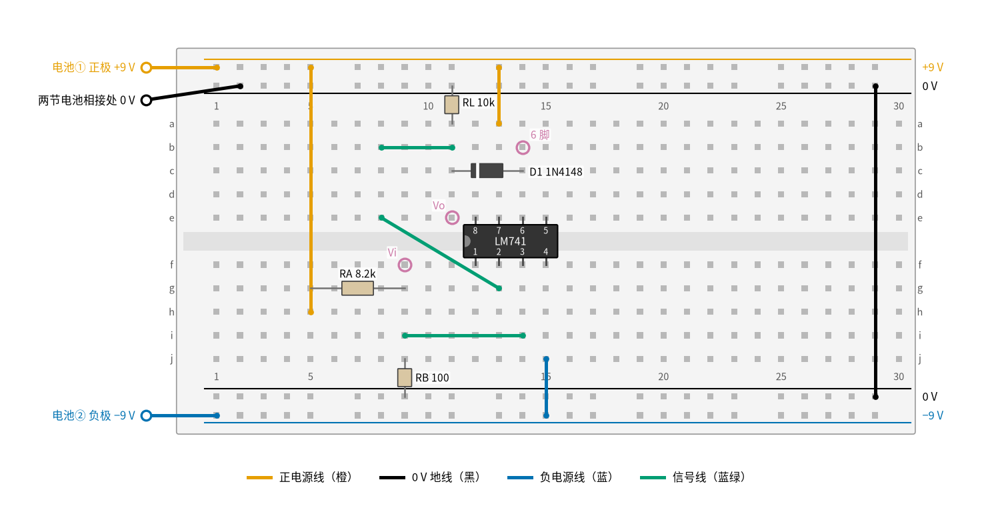
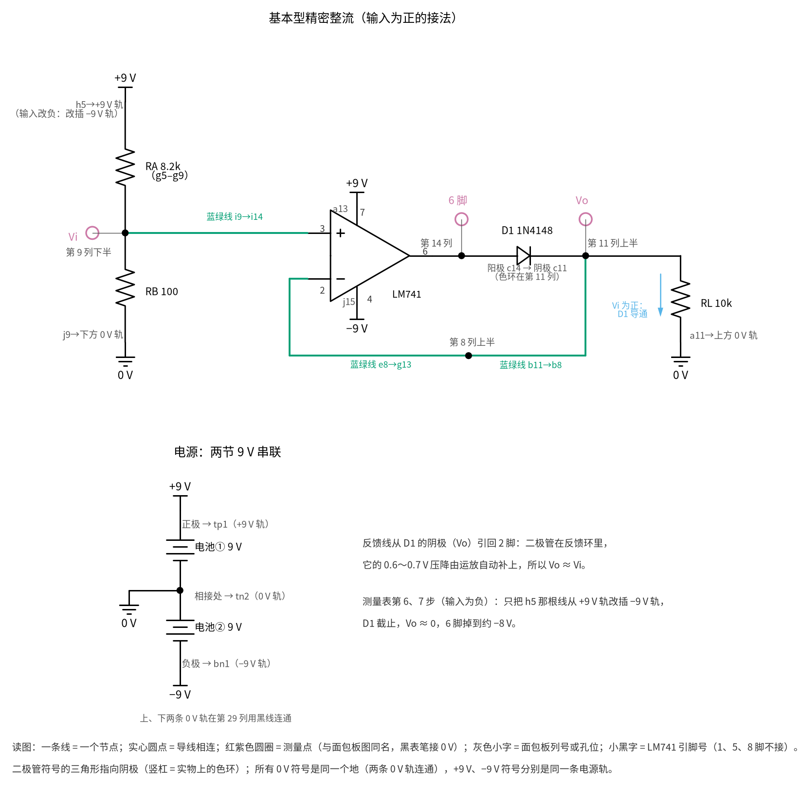
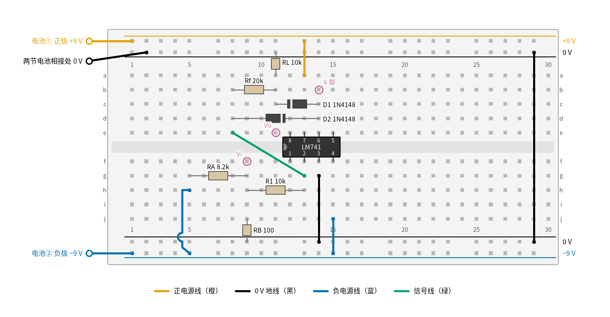
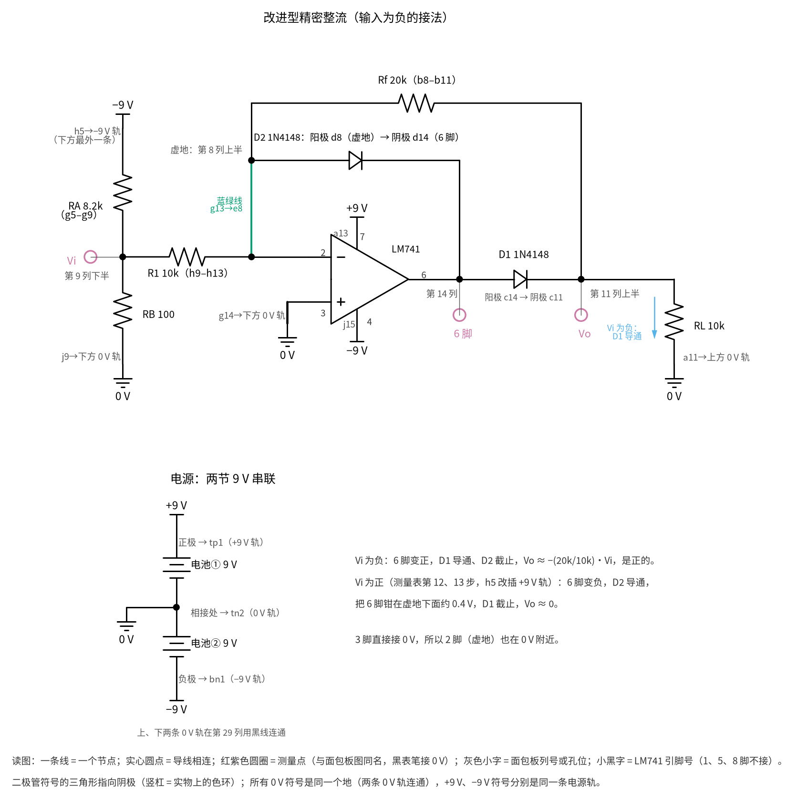

# 05 精密整流 · 动手实验篇

[上一页：参数与调试篇](page3.md) · [直觉篇](page1.md) · [原理与实现篇](page2.md) · [参数与调试篇](page3.md) · 本页：动手实验篇 · [下一页：14 电压比较器 · 直觉篇](../14-voltage-comparator/page1.md) · 前置节点：[P2 半导体入门 · 直觉篇](../P2-semiconductor-basics/page1.md)、[01 反相放大 · 直觉篇](../01-inverting-amp/page1.md) · 后续：[06 桥式整流 · 直觉篇](../06-bridge-rectifier/page1.md)

## 这次实验要验证什么

用万用表亲手确认两件事：第一，基本型精密整流对 0.1 V 这么小的正电压也能「原样放行」，运放输出脚自动比输出高出一个二极管压降，而输入为负时运放输出脚会一路跌到负电源附近（结论见 [05 精密整流 · 原理与实现篇](page2.md) 第 1、2 节）；第二，改成改进型以后，负输入被翻正并放大 $R_f/R_1$ 倍，运放输出脚却始终只在零点几伏的范围里活动（同一页第 3 节）。

## ⚠️ 安全须知

- **只用 12 V 及以下的直流电。** 本实验用两节 9 V 叠层电池串联，得到 +9 V、0 V、−9 V 三条电源线。原理篇和参数篇里的 ±15 V 超过了这个上限，本页统一改成 ±9 V，所有「应该读到」的数也按 ±9 V 重新算过。
- **电解电容分正负极。** 本实验的主电路没有电解电容；如果你想在电源轨上并一只电解电容滤波，长脚（正极）接 +9 V 轨，另一只的长脚接 0 V 轨、短脚接 −9 V 轨，接反会鼓包甚至爆裂。
- **元件可能发烫，不要用手摸。** 正常情况下这块板子上没有任何元件会热；如果运放插反了、或者电源正负接反了，运放会在几秒内烫手。闻到焦味或摸到外壳发热，先拔电池再检查。
- **接线、改线之前先断电。** 断电就是把两节电池的扣子都拔下来。只拔一节时，另一半电路仍然带电，运放会处在只有单边电源的异常状态。
- 9 V 电池两极碰在一起会短路发热，不用的电池扣要分开放好，不要和钥匙、硬币放在同一个口袋里。

## 器材清单

| 元件 | 型号或数值 | 数量 | 说明 |
|---|---|---|---|
| 运放 | LM741（或 μA741），8 脚双列直插 | 1 | 页面里一直用的 741 级运放；±9 V 在它的推荐电源范围内 |
| 小信号二极管 | 1N4148 | 2 | 基本型用 1 只（D1），改进型再加 1 只（D2）；黑色色环一端是阴极 |
| 电阻 | 8.2 kΩ | 1 | RA，和 RB 组成分压器，产生约 0.1 V 的输入 |
| 电阻 | 100 Ω | 1 | RB，分压器下半段 |
| 电阻 | 10 kΩ | 2 | RL（负载）和 R1（改进型的输入电阻） |
| 电阻 | 20 kΩ | 1 | Rf，改进型的反馈电阻；买不到可以用两只 10 kΩ 串联 |
| 9 V 叠层电池和电池扣 | 6F22 | 2 | 串联成 ±9 V；第一节的负极和第二节的正极相接，作为 0 V |
| 面包板 | 830 孔（30 列以上） | 1 | 上下各有两条电源轨 |
| 跳线 | 杜邦线或单芯线 | 若干 | 建议橙色接正电源、黑色接地、蓝色接负电源、绿色走信号 |
| 万用表 | 带 200 mV 或 2 V 直流挡 | 1 | 自动量程表也可以 |

电阻用普通 5% 碳膜电阻就行，但请先用万用表电阻挡把每只电阻量一遍，记下实际值，后面的 Python 要用。

## 搭建步骤

基本型的电路图见 [05 精密整流 · 直觉篇](page1.md) 第二节，改进型的电路图见 [05 精密整流 · 原理与实现篇](page2.md) 第 3 节，下面的面包板接法和它们一一对应。面包板的规矩先说清楚：同一列里 a–e 五个孔是连通的，f–j 五个孔是连通的，中间的凹槽把上下两半隔开；上下边缘的长条是电源轨，整条连通。**有的面包板电源轨在中间断开**，左半和右半不通，用之前拿万用表通断挡量一下两端，不通就补一根跳线。

先搭基本型，图 05-p4-1 是搭好后的俯视图。



*图 05-p4-1　基本型精密整流的面包板接线（±9 V，输入为正的接法）*

对照 图 05-p4-3 的电路原理图看信号怎么走：输入从分压器进 3 脚，6 脚经 D1 到输出，反馈从 D1 后面绕回 2 脚。



*图 05-p4-3　图 05-p4-1 对应的电路原理图（灰色小字是面包板列号或孔位，小黑字是 LM741 引脚号）*

**对照看**：面包板的连通规则见 [P1 元件速成 · 动手实验篇](../P1-components-basics/page4.md)，同一列上半 a–e、下半 f–j 各是一个节点。第 9 列下半同时插着 RA、RB 和 i9 那根蓝绿线，原理图里汇成 Vi 一个点；第 14 列上半是 6 脚和 D1 阳极，第 11 列上半是 D1 阴极、RL 和 b11，D1 的色环朝左，就是三角形指向输出。反馈要走两根蓝绿线：b11→b8 把输出带到第 8 列，e8→g13 再跨过凹槽到 2 脚，所以反馈取的是二极管后面的点。这张图和 [05 精密整流 · 直觉篇](page1.md) 第二节的基本型电路图是同一个电路，只是标上了孔位和 ±9 V。

1. **铺电源轨。** 最上面一条轨接 +9 V（电池①正极），它下面一条接 0 V（两节电池相接处），最下面一条接 −9 V（电池②负极），倒数第二条也是 0 V。用一根黑线把第 29 列的上方 0 V 轨和下方 0 V 轨连起来。先不要扣电池。
2. **插运放。** LM741 跨在凹槽上，缺口（或圆点）朝左，1 脚插 f12，于是 2 脚在 f13、3 脚在 f14、4 脚在 f15，8 脚在 e12、7 脚在 e13、6 脚在 e14、5 脚在 e15。1、5、8 脚不用接。
3. **给运放供电。** 橙线从 a13 接到上方 +9 V 轨（7 脚得 +9 V）；蓝线从 j15 接到下方 −9 V 轨（4 脚得 −9 V）。
4. **做输入分压器。** RA（8.2 kΩ）插 g5 和 g9；RB（100 Ω）插 j9 和它正下方的 0 V 轨；橙线从 h5 接到 +9 V 轨。第 9 列下半区就是输入点，电压约 9 × 100 ÷ 8300 ≈ 0.108 V。
5. **接同相输入。** 蓝绿线从 i9 接到 i14，把输入送到 3 脚。
6. **接二极管和负载。** D1（1N4148）的阳极插 c14（6 脚那一列），阴极（色环端）插 c11；第 11 列上半区就是输出端。RL（10 kΩ）一脚插 a11，另一脚插上方 0 V 轨。
7. **接反馈。** 蓝绿线从 g13（2 脚那一列）接到 e8，再用一根蓝绿线从 b8 接到 b11。这样反相端接的是**二极管后面的输出端**，二极管被包进了反馈环。
8. **检查一遍再上电。** 对照图 05-p4-1 数一遍：橙线 2 根（不算电池线），蓝线 1 根，蓝绿线 3 根，二极管色环朝左。确认无误后扣上两节电池。

图 05-p4-1 里红紫色圆圈是要下表笔的测量点：Vi 在第 9 列下半区，Vo 在第 11 列上半区，「6 脚」在第 14 列上半区。表笔尖插进同一列的空孔就能接触到，不必去碰芯片引脚。图里所有连接都由画图脚本自动核对过：脚本把每根线、每只元件脚登记到「网络」里，断言 7 脚连到 +9 V、反馈确实接在二极管后面，接错一处就画不出图。

**改成输入为负：** 断电，把 h5 那根橙线的另一头从 +9 V 轨挪到下方 −9 V 轨（颜色上它现在属于负电源线，换一根蓝线更清楚），输入就变成约 −0.108 V。

**改成改进型：** 断电，按图 05-p4-2 改线。



*图 05-p4-2　改进型精密整流的面包板接线（输入为负的接法）*

改进型的电路原理图是 图 05-p4-4，和 图 05-p4-3 对照着看改了哪几处。



*图 05-p4-4　图 05-p4-2 对应的电路原理图（改进型，输入为负的接法）*

**对照看**：连通规则还是 [P1 元件速成 · 动手实验篇](../P1-components-basics/page4.md) 里那一条，同一列的半边是一个节点。第 8 列上半现在是虚地：2 脚经 g13→e8 引上来，D2 的阳极 d8 和 Rf 的一端 b8 都插在这里，原理图里它们汇成同一个点。D2 的色环在 d14，也就是三角形指向 6 脚；D1 仍是 c14→c11，三角形指向输出 Vo。3 脚经 g14 的黑线接 0 V，输入改从 R1 进反相端，这是它和基本型最大的区别。同一个电路在 [05 精密整流 · 原理与实现篇](page2.md) 第 3 节有一张不标孔位的电路图。

9. 拔掉 i9–i14 和 b8–b11 两根蓝绿线。
10. 黑线从 g14 接到下方 0 V 轨，让 3 脚接地。
11. R1（10 kΩ）插 h9 和 h13，把输入经 R1 送到 2 脚。
12. D2（1N4148）阳极插 d8（虚地那一列），阴极（色环端）插 d14（6 脚那一列）。
13. Rf（20 kΩ）插 b8 和 b11，从输出端接回虚地。g13–e8 这根蓝绿线保留，它把 2 脚引到第 8 列。
14. RA 上端那根线接到 −9 V 轨（图 05-p4-2 画的就是这种接法），检查后上电。

和图 05-p4-1 相比，图 05-p4-2 只多了 R1、D2、Rf 三个元件和一根接地黑线，二极管 D1、负载 RL、分压器都没动。注意 D2 的方向：色环在第 14 列一端，阳极对着虚地。D2 插反，负输入时运放输出会被它直接拉到虚地附近，电路就不工作了。

## 测量表

万用表黑表笔一律接 0 V（任意一条 0 V 轨的空孔）。下表的「应该读到」是用 TI 的 LM741 模型和 Nexperia 的 1N4148 模型、按本页的 ±9 V 电路和标称阻值做 ngspice 仿真得到的，和 [review/spice/05.md](../review/spice/05.md) 里 ±15 V 的面包板读数相比，小信号部分几乎一样，只有饱和电压跟着电源变了。电池电压、电阻公差会让读数差几个百分点。

| 步骤 | 测什么 | 红表笔 | 黑表笔 | 挡位 | 应该读到 | 读不到时先查 |
|---|---|---|---|---|---|---|
| 1 | 正电源 | +9 V 轨 | 0 V 轨 | 直流 20 V | 接近 9 V | 电池扣是否扣紧，电池是否用旧 |
| 2 | 负电源 | −9 V 轨 | 0 V 轨 | 直流 20 V | 接近 −9 V | 两节电池是否按「①负接②正」串联 |
| 3 | 基本型输入 $V_i$ | 第 9 列下半区 | 0 V 轨 | 直流 2 V | 0.108 V | RA、RB 是否插错位置；RB 是否接到 0 V 轨 |
| 4 | 基本型输出 $V_o$ | 第 11 列上半区 | 0 V 轨 | 直流 2 V | 0.109 V，比 $V_i$ 高约 1 mV | 反馈线是否接在二极管后面（b8–b11） |
| 5 | 运放输出（6 脚） | 第 14 列上半区 | 0 V 轨 | 直流 2 V | 0.50 V | 读到 0.108 V 说明反馈接在了二极管前面 |
| 6 | 输入改负后的 $V_o$ | 第 11 列上半区 | 0 V 轨 | 直流 2 V | 约 0 V（几毫伏以内） | 二极管是否插反（色环应在第 11 列） |
| 7 | 输入改负后的 6 脚 | 第 14 列上半区 | 0 V 轨 | 直流 20 V | 约 −8.0 V | 4 脚是否接到 −9 V |
| 8 | 改进型输入 $V_i$（负） | 第 9 列下半区 | 0 V 轨 | 直流 2 V | −0.107 V | 比步骤 3 的绝对值略小是正常的，R1 分走了一点电流 |
| 9 | 改进型输出 $V_o$ | 第 11 列上半区 | 0 V 轨 | 直流 2 V | 0.22 V | Rf 是否是 20 kΩ；D1 方向 |
| 10 | 改进型 6 脚 | 第 14 列上半区 | 0 V 轨 | 直流 2 V | 0.66 V | 读到 −8 V 左右说明 D2 没接上或插反 |
| 11 | 改进型虚地（2 脚） | 第 8 列上半区 | 0 V 轨 | 直流 200 mV | 约 1 mV | 3 脚是否接地；g13–e8 跳线是否插好 |
| 12 | 改进型输入改正后的 $V_o$ | 第 11 列上半区 | 0 V 轨 | 直流 200 mV | 约 0 mV（1 mV 以内） | D1 是否插反 |
| 13 | 改进型输入改正后的 6 脚 | 第 14 列上半区 | 0 V 轨 | 直流 2 V | −0.38 V | 读到 −8 V 左右说明 D2 插反或没插 |

读表时注意两个细节。第一，步骤 4 里输出比输入还高约 1 mV，这不是表坏了，而是运放的输入失调电压：LM741 两个输入端之间好像串了一节一毫伏左右的小电池，模型里取典型值 1 mV，你手上那只可能是正的也可能是负的，最大可达几毫伏。第二，步骤 5 的 0.50 V 比书上常说的「二极管 0.7 V」小，因为这时流过 D1 的电流只有 0.109 V ÷ 10 kΩ ≈ 11 μA，二极管电流越小压降越小。

## 没有示波器怎么办

精密整流本来是给交流信号用的，但它的核心性质用直流就能看清楚：**把输入从负到正一个点一个点地设好，量出每个点的输出，画出来就是传输特性曲线**，和原理篇第 1 节那张传输特性图对得上。做法是保留分压器，把 RB 依次换成 47 Ω、100 Ω、220 Ω、470 Ω，每换一次分别把 RA 接到 +9 V 和 −9 V，得到 8 个输入点（约 ±0.05 V 到 ±0.49 V）。把它们和对应的 $V_o$ 填进下面 Python 代码里的 `sweep` 列表，代码会逐点打印，基本型应该是「负半边全是 0、正半边等于输入」的折线，改进型则是「正半边全是 0、负半边翻正后乘 2」。

想看「普通二极管为什么整不了小信号」，只要再搭一个对照组：把运放拿掉，分压点直接经一只 1N4148 接到 10 kΩ 负载。仿真结果是：输入 0.108 V 时负载上只有约 0.3 mV，二极管基本没导通；把 RB 换成 470 Ω（输入约 0.48 V）也只能读到约 0.10 V，只有输入的五分之一。这正是直觉篇开头那个痛点，万用表 200 mV 挡就能看出来。

**如果你有函数信号发生器但没有示波器**，万用表直流挡读的是平均值，可以用它检查整流效果。信号发生器调成 1 kHz、峰值 0.2 V 的正弦，代替分压器接到输入点：

- 基本型：输出直流读数应在 0.060 V 左右。理想半波整流的平均值是峰值除以 π，即 0.064 V；741 每次从负饱和爬回来要花时间，读数低了约 5%。
- 改进型（ $R_f$ = 20 kΩ）：输出直流读数约 0.130 V，理想值是 2 × 0.2 ÷ π = 0.127 V，多出的 2% 主要来自失调。

这两个数也是用 ±9 V 和厂家模型仿真得到的。把信号频率调到 10 kHz 再读一次，基本型的读数会明显下降，改进型基本不变，这就是参数篇扫描二说的「误差随频率变化」。

**只有示波器才能看到的**：运放输出脚在负半周掉到负电源、下一个正半周开头输出缺一块的那个过程，发生在几十微秒之内，万用表和手机都跟不上。示波器上应该看到的样子见 [05 精密整流 · 原理与实现篇](page2.md) 第 2 节的基本型仿真波形图：输出在正半周开头晚了一截才跳上去，运放输出脚在负半周贴着负电源；改进型见同一页第 3 节的波形图，运放输出脚只在 −0.7 V 和约 +0.9 V 之间切换。

## 用 Python 核对你的读数

把你量到的电池电压、电阻实际值和各点读数填进去。代码按公式算出这次应该读到的值，逐项比较：期望值不接近 0 时，偏差超过 10% 就提示；期望值接近 0 时，改用「绝对值超过 10 mV」作为提示门槛。运放输出脚的读数取决于二极管压降，代码只检查它是否落在合理窗口里。

```python
import sys, pathlib
sys.path.insert(0, str(pathlib.Path("code/figs").resolve()))  # 在仓库根目录运行
# 05 精密整流 · 动手实验核对：填入实测值，算出期望读数并比较

# ---- 1. 你量到的电源和电阻（示例值，换成你自己的）----
VP, VN = 9.31, -9.18              # +9 V 轨、−9 V 轨对 0 V 的读数 / V
RA, RB = 8.17e3, 99.6             # 分压电阻 / Ω
R1, RF, RL = 9.96e3, 19.85e3, 10.02e3

# ---- 2. 你量到的各点读数 / V（对应测量表步骤 3–13）----
m = dict(vi_b=0.1124, vo_b=0.1135, pin6_b=0.497,       # 基本型，输入为正
         vo_bn=-0.002, pin6_bn=-8.28,                    # 基本型，输入为负
         vi_i=-0.1101, vo_i=0.2228, pin6_i=0.66, vm_i=0.0011,   # 改进型，输入为负
         vo_ip=0.0004, pin6_ip=-0.38)                    # 改进型，输入为正

par = lambda a, b: a * b / (a + b)
calc = {}
calc["vi_b"] = VP * RB / (RA + RB)                       # 同相端几乎不取电流
calc["vo_b"] = calc["vi_b"]                              # 基本型：V_o = V_i
calc["vo_bn"] = 0.0                                      # 输入为负：二极管截止，V_o = 0
rb_eff = par(RB, R1)                                     # 改进型：R1 接虚地，和 RB 并联
calc["vi_i"] = VN * rb_eff / (RA + rb_eff)
calc["vo_i"] = -RF / R1 * calc["vi_i"]                   # 改进型：V_o = −(Rf/R1)·V_i
calc["vm_i"] = 0.0                                       # 虚地
calc["vo_ip"] = 0.0

warn = 0
print(f"{'项目':<8}{'实测/V':>9}{'计算/V':>9}{'偏差':>9}")
for k, c in calc.items():
    x = m[k]
    if abs(c) > 0.02:
        dev = (x - c) / abs(c) * 100
        flag = abs(dev) > 10
        txt = f"{dev:+.1f}%"
    else:
        flag = abs(x - c) > 0.010
        txt = f"{(x - c) * 1e3:+.1f}mV"
    warn += flag
    print(f"{k:<8}{x:>9.4f}{c:>9.4f}{txt:>9}" + ("   ← 偏差太大，先查测量表最后一列" if flag else ""))

# 运放输出脚：导通时比输出高一个小电流下的二极管压降，负饱和时离负电源一两伏
checks = [("pin6_b − vo_b", m["pin6_b"] - m["vo_b"], 0.3, 0.7),
          ("pin6_i − vo_i", m["pin6_i"] - m["vo_i"], 0.3, 0.7),
          ("pin6_ip", m["pin6_ip"], -0.7, -0.3),
          ("pin6_bn − VN", m["pin6_bn"] - VN, 0.3, 2.0)]
for name, v, lo, hi in checks:
    ok = lo <= v <= hi
    warn += not ok
    print(f"{name:<14}= {v:+.3f} V，合理范围 {lo:+.1f} ~ {hi:+.1f} V" + ("" if ok else "   ← 超出范围"))

# 没有示波器时的传输特性：(V_i, 基本型 V_o) 逐点填
sweep = [(-0.49, 0.000), (-0.24, 0.000), (-0.11, -0.002), (-0.05, -0.001),
         (0.05, 0.051), (0.11, 0.113), (0.24, 0.242), (0.49, 0.492)]
for vi, vo in sweep:
    ideal = max(vi, 0.0)
    print(f"V_i = {vi:+.2f} V → V_o = {vo:+.3f} V（理想 {ideal:.3f} V）")
print("全部在范围内" if warn == 0 else f"有 {warn} 项需要检查")
```

示例数据里电池是新的（9.31 V），所以输入和输出都比 9 V 算出来的 0.108 V 高了约 4%，但代码用你量到的电池电压重新算期望值，偏差就只剩零点几个百分点。这正是要先量电源、再量电阻的原因：拿标称值去比，误差会被冤枉到电路头上。

## 实验记录表

| 项目 | 实测值 | 计算值 | 偏差 |
|---|---|---|---|
| +9 V 轨 / −9 V 轨 |  |  |  |
| RA / RB / R1 / Rf 实际阻值 |  |  |  |
| 基本型 $V_i$ （正） |  |  |  |
| 基本型 $V_o$ （正） |  |  |  |
| 基本型 6 脚（正） |  |  |  |
| 基本型 $V_o$ / 6 脚（负） |  |  |  |
| 改进型 $V_i$ （负） |  |  |  |
| 改进型 $V_o$ / 6 脚（负） |  |  |  |
| 改进型 2 脚（虚地） |  |  |  |
| 改进型 $V_o$ / 6 脚（正） |  |  |  |

### 思考题

**1. 基本型里，你量到的 $V_o$ 比 $V_i$ 高（或低）了一两毫伏，是电阻不准吗？**

<details><summary>答案</summary>

不是。基本型的 $V_o = V_i$ 和电阻无关，RL 取多少都一样。这一两毫伏来自运放的输入失调电压，它相当于在两个输入端之间串了一节毫伏级的小电池，正负因芯片而异。把输入接地再量 $V_o$ ：失调为正时输出就是这几毫伏；失调为负时运放想输出负电压，二极管截止，输出是 0。

</details>

**2. 为什么改进型的输入（步骤 8）比基本型的输入（步骤 3）绝对值小了约 1%？**

<details><summary>答案</summary>

改进型的输入端经 R1 接到虚地，相当于给 RB（100 Ω）并了一只 10 kΩ，下半段变成约 99 Ω，分出来的电压就小了约 1%。基本型的输入接在同相端，运放几乎不取电流，分压器不受影响。这就是原理篇说的「改进型的输入电阻只有 $R_1$ 」。只要你量的是接上电路之后的 $V_i$ ，再乘 $R_f/R_1$ 去比 $V_o$ ，这 1% 就不会算到增益误差里。

</details>

**3. 基本型输入为负时，6 脚停在 −8 V 左右，而改进型输入为正时 6 脚只到 −0.38 V。这个差别对交流信号意味着什么？**

<details><summary>答案</summary>

信号下一次变正时，基本型的运放输出要从 −8 V 爬回约 +0.5 V，走 8 V 多；改进型只要从 −0.38 V 走到约 +0.66 V，走 1 V 左右。741 的压摆率只有约 0.5 V/μs，前者要十几微秒，后者两微秒左右。频率越高，这段「爬坡时间」占的比例越大，所以基本型的平均值误差随频率变大，改进型几乎不变。没有示波器时，用信号发生器加万用表直流挡在 1 kHz 和 10 kHz 各读一次，就能间接看到这个差别。

</details>

## 自测清单

- 我能说出面包板上哪些孔是连通的，知道电源轨可能在中间断开，并会用通断挡确认。
- 我能用两节 9 V 电池搭出 ±9 V 电源，并按引脚号把 LM741 插对、供上电。
- 我能用万用表量出基本型「输入为正时 $V_o \approx V_i$ 、输入为负时 6 脚跌到负电源附近」这两个现象。
- 我能把基本型改成改进型，并解释为什么改进型的 6 脚读数始终在零点几伏以内。
- 我能用实测的电池电压和电阻值算出期望读数，判断偏差是来自元件公差、失调，还是接线错误。
