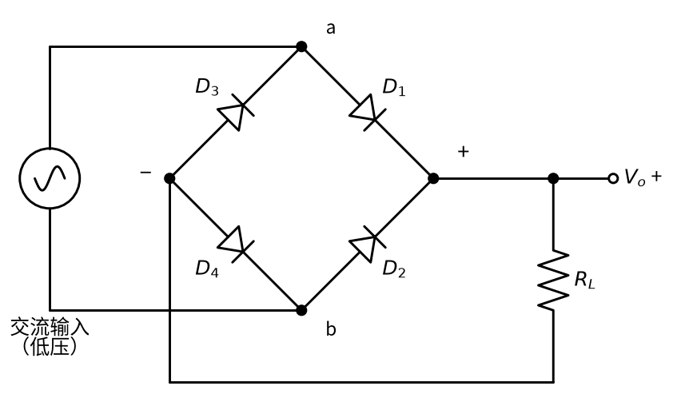
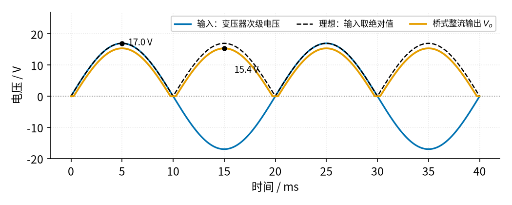
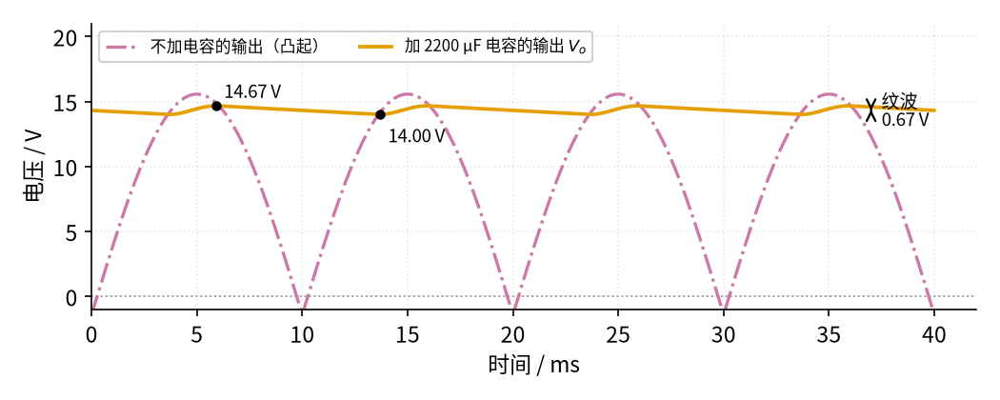

# 06 桥式整流 · 直觉篇

[上一页：03 参数与调试篇](../03-voltage-follower/page3.md) · 本页：直觉篇 · [原理与实现篇](page2.md) · [参数与调试篇](page3.md) · [下一页：原理与实现篇](page2.md) · 前置节点：[P1 元件速成](../P1-components-basics/page1.md)、[P2 半导体入门](../P2-semiconductor-basics/page1.md)、[05 精密整流](../05-precision-rectifier/page1.md)

> [!WARNING]
> **市电危险**：本电路的实际版本接 220V/380V 市电，触电可能致命。本页的仿真和动手实验只在 12V 以下的低压电源上进行；任何接线、改线都必须在断电并验电后操作，由持证电工完成。
>
> 本节特有的危险：
> - 220 V 是有效值，它的峰值约 311 V，比很多人想象的高得多。
> - 滤波电容在断电以后**还带着电**，大容量电容能存住几十伏、几秒到几分钟；摸之前先放电，正式电路要加泄放电阻。
> - 电解电容接反极性会内部短路、发热，甚至鼓包、爆裂。
> - 示波器的地夹通常和插座的地线连在一起。把地夹夹在桥的输出端，会把一只二极管短路；如果整流桥直接接市电（不经变压器），等于把市电短路。
> - 刚合上开关的一瞬间，空电容会吸走很大的浪涌电流。

## 为什么需要桥式整流

手机、电脑、LED 灯、单片机，里面的电路几乎都要**直流电**：电压方向不变，最好大小也不变。可墙上插座给的是**交流电**：每秒 50 次来回翻转方向，一会儿是正，一会儿是负。直接把交流接到一个需要直流的电路上，它在负半周会被反着加电，轻则不工作，重则烧毁。

所以几乎每一个插电的电器里，都有一个把交流变成直流的环节，叫**整流**。05 已经见过最简单的整流：一只二极管只放行正半周，负半周直接扔掉。这样做浪费了一半的能量，输出在负半周干脆是 0，一闪一闪的。本节要做得更好：**把负半周也翻成正的，一起利用起来**。用到的元件只有 4 只二极管，排成一个菱形，叫**二极管桥**；后面再加一只大电容，把一闪一闪的波形「填平」。

## 一、四只二极管，两条单行道

二极管是单向阀，正向电压超过约 0.7 V 才导通，反向不通（见 P2 page1）。把四只二极管排成菱形，见图 06-p1-1。

*图 06-p1-1　二极管桥：上下两点接交流，左右两点出直流*

交流从上顶点 a 和下顶点 b 进来，直流从右顶点（+）和左顶点（−）出去，负载 $R_L$ 接在 + 和 − 之间。图中四只二极管的箭头全都指向右边的 + 端或者从左边的 − 端出发，这是记住接法的窍门：**电流只能从 − 端流进桥，从 + 端流出桥**。

- **正半周**（a 比 b 高）：电流从 a 经 $D_1$ 到 + 端，穿过负载 $R_L$ 回到 − 端，再经 $D_4$ 回到 b。
- **负半周**（b 比 a 高）：电流从 b 经 $D_2$ 到 + 端，同样**从上往下**穿过 $R_L$ ，再经 $D_3$ 回到 a。

两个半周走的是两条不同的「单行道」，但穿过负载的方向始终一样，所以负载上的电压永远是正的。这就像一座立交桥：不管车从东边来还是从西边来，匝道都把它引到同一条向北的车道上。

注意每条路上都串着**两只**二极管，每只要收 0.7 V 的「过路费」。所以输出峰值比输入峰值少 2 × 0.7 V = 1.4 V。这是本节最容易漏算的一笔账。

## 二、看波形：负半周被翻上来了

用 12 V 交流（变压器次级的有效值，峰值约 17 V）接到桥上，负载 75 Ω，先不加电容。仿真结果见图 06-p1-2。

*图 06-p1-2　不加电容时的桥式整流输出：两个半周都变成正的*

蓝色线是变压器次级的输入，峰值 17.0 V，正负来回摆。橙色线是桥的输出：原来朝下的负半周被翻到了上面，每 10 ms 就有一个凸起，频率从 50 Hz 变成了 100 Hz。黑色虚线是「理想情况」，也就是输入的绝对值。橙色线始终比黑色虚线低一截，峰值只有 15.4 V，少了 1.6 V：其中 1.4 V 是两只二极管的压降，剩下 0.2 V 落在变压器绕组的电阻上。另外在每次过零附近，输入还不到 1.4 V 时二极管推不开，输出贴在 0 V 上，形成一小段平台。

## 三、加一只大电容：把凸起填平

现在的输出虽然方向不变了，但大小一直在 0 和 15 V 之间起伏，单片机这样的电路是受不了的。办法是在输出端并上一只大电容。电容就像一个水桶（见 P1 page1）：峰值附近二极管导通，给水桶灌满；二极管关断以后，负载从水桶里慢慢取水，电压只下降一点点，等下一个峰值到来再补满。结果见图 06-p1-3。

*图 06-p1-3　加 2200 µF 电容后，输出变成带小纹波的直流*

红紫色点划线是不加电容时的凸起，橙色线是加了 2200 µF 电容以后的输出。橙色线最高 14.67 V，最低 14.00 V，几乎是一条水平线，只剩下 0.67 V 的小起伏，这个起伏叫**纹波**。每一段，橙色线只在红紫色凸起的顶部附近被「托」上去一次（这时二极管导通，给电容充电），其余时间都在缓慢下滑（电容给负载放电）。

这里有一个反直觉的地方：负载平均只要 0.19 A，可是二极管每个半周只在顶部导通 2.42 ms，要在这么短的时间里把整个半周的电量补回去，电流尖峰高达 1.19 A，是平均电流的 6 倍多。所以挑二极管和变压器时，不能只看平均电流，page3 会再谈。

## 四、记住三句话

1. **四只二极管轮流导通**，每个半周两只，负载上的电压方向始终不变；输出峰值比输入峰值少约 1.4 V。
2. **电容越大，纹波越小**。纹波大约是 $\Delta V \approx \dfrac{I}{2fC}$ ，下一页会从电容公式推出它。
3. 交流的**有效值不是峰值**。12 V 交流的峰值约 17 V，220 V 市电的峰值约 311 V，选二极管、电容的耐压都要按峰值算。

> [!WARNING]
> 想自己动手看这些波形，只用**低压**交流：信号发生器，或者输出 12 V 以下、带保险丝的成品变压器（初级插头和外壳都是封闭的）。不要自己去接变压器的 220 V 初级。断电后先用一只电阻把滤波电容放电，再动手改线。

## 小结

二极管桥让交流的两个半周都从同一个方向穿过负载，把「一正一负」变成了「两个正的凸起」，代价是两只二极管的压降。再并上一只大电容，凸起之间的低谷就被填平，只剩下纹波。下一页 [原理与实现篇](page2.md) 会算清楚：输出电压是多少、纹波公式从哪里来、电容和二极管怎么选；还会用 05 的精密整流和 01 的加法器，搭出一个能整流几十毫伏小信号的「运放全波整流」。
