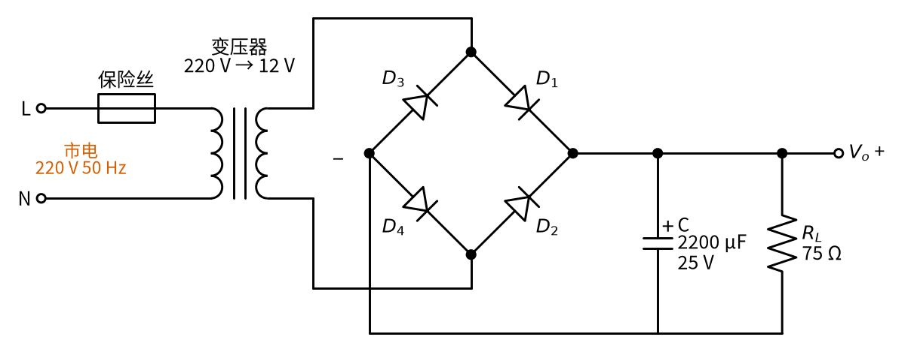
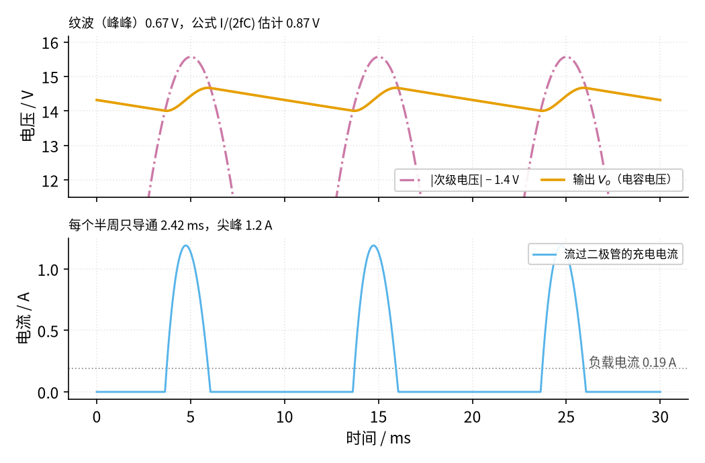
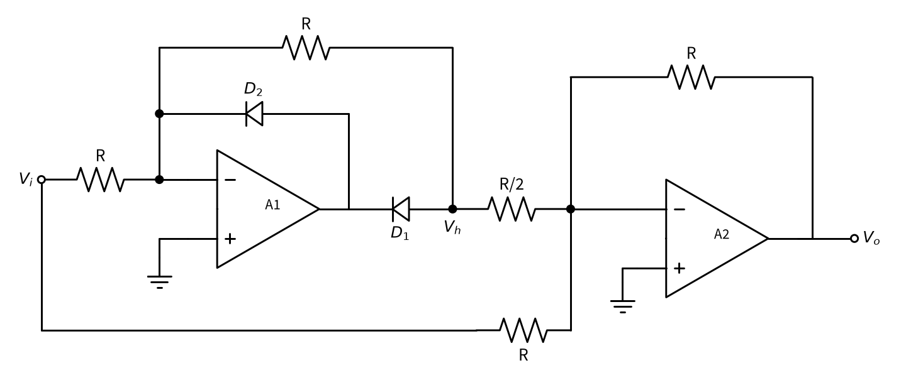
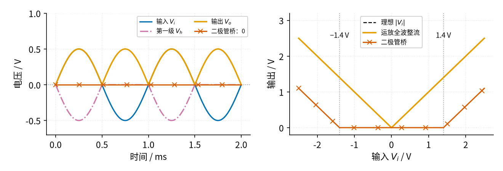

# 06 桥式整流 · 原理与实现篇

[上一页：直觉篇](page1.md) · [直觉篇](page1.md) · 本页：原理与实现篇 · [参数与调试篇](page3.md) · [下一页：参数与调试篇](page3.md) · 前置节点：[P1 元件速成 · 直觉篇](../P1-components-basics/page1.md)、[P2 半导体入门 · 直觉篇](../P2-semiconductor-basics/page1.md)、[05 精密整流 · 直觉篇](../05-precision-rectifier/page1.md)

> [!WARNING]
> **市电危险**：本电路的实际版本接 220V/380V 市电，触电可能致命。本页的仿真和动手实验只在 12V 以下的低压电源上进行；任何接线、改线都必须在断电并验电后操作，由持证电工完成。
>
> 本节特有的危险：220 V 市电峰值约 311 V；滤波电容断电后仍带电，要加泄放电阻、动手前先放电；电解电容接反会短路、鼓包甚至爆裂；示波器地夹接到桥的输出端会短路一只二极管（无变压器时等于短路市电）；上电瞬间有很大的浪涌电流。

## 本页要解决的问题

直觉篇看到了两件事：桥式整流的输出比输入峰值低一截；加电容以后剩下一点纹波。做一个真正的电源，需要把它们变成数字：给定变压器电压和负载电流，**输出是多少伏？纹波多大？电容取多大、耐压多少？二极管选哪一型**？这一页先推公式，再用一段 Python 仿真验证，最后做三道例题。页末还有本节的变体二：用两只运放做成的「全波整流」，专门对付二极管桥整不了的小信号。

## 1. 输出电压：峰值减两个压降

变压器铭牌上写的「12 V」是**有效值**。正弦交流的峰值是有效值的 $\sqrt{2}$ 倍：

$$V_p = \sqrt{2} \times 12\ \text{V} \approx 16.97\ \text{V}$$

每个半周电流要串联穿过两只二极管，每只的压降记作 $V_D$ （约 0.7 V，见 [P2 半导体入门 · 直觉篇](../P2-semiconductor-basics/page1.md)），所以不加电容时输出的峰值是

$$V_{o,\max} = V_p - 2V_D \approx 16.97 - 1.4 = 15.57\ \text{V}$$

ESP 的电源设计文章也特别提醒：桥式整流每个半周有两只二极管同时导通，这 1.4 V 左右（大电流时接近 1.8 V）一定要从峰值里扣掉。直觉篇的仿真得到 15.4 V，比 15.57 V 还低 0.2 V，那是变压器绕组电阻上的压降，第 3 节会看到它在大电流时更明显。

## 2. 真实电路长什么样

真正的电源前面还有变压器和保险丝，见图 06-p2-1。

> [!WARNING]
> 下图左半部分接的是 **220 V 市电**，只作为读图用，不要照着接线。本节的所有实验都从变压器的低压次级（或信号发生器）开始。



*图 06-p2-1　变压器 + 二极管桥 + 电容滤波：一个最简单的直流电源*

从左往右看：

- **保险丝**串在火线 L 上，电路短路时熔断，保护变压器和电线。
- **变压器**把 220 V 降到 12 V，同时把次级和市电**隔离**开：次级两根线和大地之间没有直接的导电通路，这是低压部分相对安全的原因。
- **二极管桥**把交流变成单向的凸起，接法同直觉篇。
- **电解电容 C** 有正负极，图上标「+」的一端必须接桥的 + 端；它的耐压（图上 25 V）必须高于它会承受的最高电压。
- 直流输出 $V_o$ 从**电容两端**引出，再接负载 $R_L$ 。ESP 的文章强调输出要从电容端子取，而不是从整流桥取，因为桥到电容这段导线上流着很大的尖峰电流。

## 3. 纹波公式：从电容的「水位」推出来

[P1 元件速成 · 原理与实现篇](../P1-components-basics/page2.md) 给过电容的基本关系：在一段时间 $\Delta t$ 里，电流 $I$ 流出电容，电压下降

$$\Delta V_C = \frac{I \cdot \Delta t}{C}$$

二极管关断的时候，电容独自给负载供电，放电电流就是负载电流 $I$ 。下一次充电要等到下一个凸起的顶部，也就是差不多半个周期以后。50 Hz 的半个周期是 $\Delta t \approx \dfrac{1}{2f}$ = 10 ms，代入得到桥式整流的**纹波公式**：

$$\Delta V \approx \frac{I}{2fC}$$

这里的 $\Delta V$ 是峰峰值纹波，「峰峰值」就是波形最高点减最低点的差。维基百科「Ripple」词条给出的全波整流纹波也是这个式子。直觉篇的例子里负载电流 0.19 A、电容 2200 µF，公式给出 0.87 V。仿真的细节见图 06-p2-2。



*图 06-p2-2　稳态时的输出电压（上）和二极管电流（下）*

上图橙色输出在每个周期里有两个阶段：在红紫色凸起顶部附近被托起（充电），其余时间沿直线下降（放电）。下降的斜率就是 $I / C$ = 0.191 ÷ 0.0022 ≈ 86.8 V/s（用仿真打印的负载电流 191 mA），也就是每毫秒降 0.087 V。仿真的纹波是 0.67 V，比公式的 0.87 V 小，原因是公式假设电容要放电整整 10 ms，实际上下一个凸起爬上来以后提前约 2.4 ms 就开始充电了，真正放电只有约 7.6 ms：0.087 × 7.6 ≈ 0.66 V。所以**这个公式是偏保守的估计**，按它选电容，实际纹波只会更小。

下图的天蓝色线是流过二极管的电流。它每个半周只有一个 2.42 ms 宽的尖峰，峰值 1.2 A，而灰色点线标出的负载电流只有 0.19 A。尖峰的面积（电量）正好补上一个半周里负载取走的电量，所以时间越短，尖峰越高。电容越大，纹波越小，导通时间越短，尖峰反而越高，ESP 的文章说这个峰值电流可以超过直流电流的 5 倍。

上电的一瞬间更凶：电容是空的，相当于短路。仿真里第一个周期的电流达到 6.7 A，是稳态尖峰的 5.7 倍；如果恰好在交流峰值时刻合闸，浪涌电流约等于 (16.97 − 1.4) ÷ 1 Ω ≈ 15.6 A，只受变压器绕组电阻限制。这个值是仿真里假设的 1 Ω 内阻算出来的，真实变压器的内阻要看铭牌或实测。内阻的意思是：把变压器次级看成「理想电压源串一个电阻」，这个电阻就是内阻，详见 [P1 元件速成 · 原理与实现篇](../P1-components-basics/page2.md) 第七节（戴维南等效）。

## 4. 二极管和电容怎么选

**二极管的反向耐压**。正半周 $D_1$ 、 $D_4$ 导通时，不导通的 $D_2$ 一端接 b、一端接 + 端，承受的反向电压约等于输入峰值 $V_p$ 。ESP 的文章给出同样的结论：桥式整流里每只二极管的耐压只需超过交流峰值。再考虑市电 ±10% 的波动，并留出余量，常见做法是取峰值的 2 倍以上。Vishay 的 1N4001 到 1N4007 数据手册给出的反向耐压分别是 50、100、200、400、600、800、1000 V，平均整流电流都是 1 A，能承受 30 A 的单次浪涌（8.3 ms）。

**电容的容量**按纹波公式反推：

$$C \ge \frac{I}{2f \cdot \Delta V}$$

算出来的值一般买不到，要往大取一个常用规格。电解电容常见的容量有 1000、2200、3300、4700、6800、10000 µF（每档约差 1.5 倍）。

**电容的耐压**要高于输出电压的最高值（市电偏高 10% 时）并留余量；电解电容的正极接 + 端。

## 5. 仿真：自己动手算一遍

下面的代码把变压器次级看成「正弦电压 + 1 Ω 内阻」，二极管只在 $|e|$ 比电容电压高出 1.4 V 时导通，然后每 10 µs 用一次 [P1 元件速成 · 原理与实现篇](../P1-components-basics/page2.md) 的电容公式更新电压。照全书惯例在仓库根目录运行；它只用 Python 自带的 `math`，不画图，所以不需要 figstyle。

```python
# 在仓库根目录运行：/workspace/circuits-venv/bin/python 本段代码.py
import math

VD, F, DT = 0.7, 50.0, 10e-6        # 二极管压降 0.7 V；市电 50 Hz；步长 10 µs
VP = 12 * math.sqrt(2)              # 次级 12 V 有效值 → 峰值约 16.97 V
RS, C, RL = 1.0, 2200e-6, 75.0      # 内阻 1 Ω（假设值）、滤波电容 2200 µF、负载 75 Ω

v = 0.0                             # 电容电压，也就是输出 V_o
vs, ion = [], 0                     # 记录最后两个周期的输出；数导通的步数
n = int(0.5 / DT)                   # 仿真 0.5 s，足够进入稳态
for k in range(n):
    e = VP * math.sin(2 * math.pi * F * k * DT)
    i = max(abs(e) - 2 * VD - v, 0.0) / RS   # 只有 |e| 比电容高出 1.4 V 时，二极管才导通充电
    v += (i - v / RL) * DT / C               # 电容：ΔV = (充电电流 − 负载电流) × Δt / C
    if k * DT >= 0.5 - 2 / F:
        vs.append(v)
        ion += i > 0

avg = sum(vs) / len(vs)
I = avg / RL
print(f"平均 {avg:.2f} V，纹波 {max(vs) - min(vs):.2f} V，负载电流 {I * 1e3:.0f} mA")
print(f"公式 I/(2fC) = {I / (2 * F * C):.2f} V；每个半周只导通 {ion * DT / 4 * 1e3:.2f} ms")
```

运行后打印：

- 平均 14.34 V，纹波 0.67 V，负载电流 191 mA
- 公式 I/(2fC) = 0.87 V；每个半周只导通 2.42 ms

和图 06-p2-2 的数字一致。仓库里的 [code/06_sim.py](../code/06_sim.py) 用的是同一个模型，还画出了图并扫描了电容。可以先把这段代码存成自己的文件（比如 my_06.py），再试试把 `C` 改成 `4700e-6`，纹波会怎么变；把 `RS` 改成 `0.1`，平均电压和导通时间又怎么变。

## 6. 变体二：运放全波整流，对付小信号

二极管桥有一个硬伤：输入小于 1.4 V 就完全没有输出。整流 220 V 时这无所谓，可是要测量一个峰值只有 0.5 V 的交流信号（比如传感器输出），二极管桥一点输出都没有。05 解决过同样的问题：把二极管放进运放的反馈环，压降就「消失」了。[05 精密整流 · 原理与实现篇](../05-precision-rectifier/page2.md) 例 3 已经给出了思路：精密半波整流 + 加权加法器 = 全波整流。电路见图 06-p2-3。



*图 06-p2-3　运放全波整流：A1 做半波，A2 做加权相加*

左边的 A1 是 05 的改进型精密整流，把 $D_1$ 、 $D_2$ 同时调头（见 [05 精密整流 · 原理与实现篇](../05-precision-rectifier/page2.md) 例 3）：输入为正时 $D_1$ 导通，A1 是增益为 −1 的反相放大器， $V_h = -V_i$ ；输入为负时 $D_2$ 导通， $V_h$ = 0。右边的 A2 是 [01 反相放大 · 原理与实现篇](../01-inverting-amp/page2.md) 例 3 的反相加法器，只是 $V_h$ 那一路的电阻减半成 R/2，权重变成 2：

$$V_o = -\left(V_i + 2V_h\right)$$

- 输入为正： $V_o = -(V_i - 2V_i) = V_i$ 。
- 输入为负： $V_h$ = 0， $V_o = -V_i$ ，也是正的。

两种情况都等于 $|V_i|$ ，所以它也叫**绝对值电路**。Fiore 的教材 7.2.2 节就是这样构造的：两只运放，除一只是 R/2 以外所有电阻同值。图 06-p2-4 是 R = 10 kΩ、运放开环增益 10 万时的计算结果，由 [code/figs/06_figs.py](../code/figs/06_figs.py) 计算并打印（不是 06_sim.py），下面的 500.0 mV、40 µV、318.0 mV 都能在它的输出里找到。



*图 06-p2-4　峰值 0.5 V 的小信号：运放全波整流（左：波形，右：输入–输出曲线）*

左图蓝色输入峰值 0.5 V。红紫色点划线 $V_h$ 只在输入为正的半周出现，并且是翻转后的负值；橙色输出两个半周都是朝上的凸起，峰值 500.0 mV，和 $|V_i|$ 的最大误差只有 40 µV，平均值 318.0 mV，和理论的 $\dfrac{2}{\pi} \times 0.5$ V = 318.3 mV 几乎一样。带×的朱红色线是同一信号送进二极管桥的结果：始终是 0。

右图把输入从 −2.5 V 扫到 +2.5 V。橙色的运放全波整流是一个标准的 V 字，和黑色虚线（理想的 $|V_i|$ ）完全重合，所以虚线被盖住了；朱红色的二极管桥在 −1.4 V 到 +1.4 V 之间是一段平的「死区」，两只二极管的压降全在这里。

这张图只算了静态（低频）的情况，没有考虑运放的速度。A1 在过零时同样要「跳过」两只二极管的压降，频率高了会出现 [05 精密整流 · 参数与调试篇](../05-precision-rectifier/page3.md) 讨论过的过零缺口，挑运放的方法也一样：看压摆率和增益带宽积。另外它和二极管桥分工不同：二极管桥做电源，能输出几安培；运放全波整流只能输出几毫安，专门用来测量。

## 7. 例题：从照着做到自己做

**例 1（完整示例）** 用 12 V 交流变压器、桥式整流、2200 µF 电容，给一个 0.2 A 的负载供电。估算输出电压和纹波，选二极管和电容耐压。

解：峰值 $V_p$ = 12 × 1.414 ≈ 16.97 V，减两个二极管压降，电容充到的最高电压约 16.97 − 1.4 = 15.57 V。

纹波按公式： $\Delta V \approx \dfrac{0.2}{2 \times 50 \times 0.0022}$ ≈ 0.909 V。输出在 15.57 V 和 14.66 V 之间起伏，平均约 15.57 − 0.909 ÷ 2 ≈ 15.1 V。

二极管反向耐压要大于峰值 17 V，1N4001（50 V、1 A）就够了，余量接近 3 倍。电容耐压：市电高 10% 时峰值约 15.57 × 1.1 ≈ 17.1 V（粗略估算），常用规格里取 25 V。

仿真的平均值只有 14.34 V，比 15.1 V 低，是因为仿真里有 1 Ω 绕组电阻，1.2 A 的尖峰电流在上面又压掉一截。估算时记住：**公式给的是上限，真实输出还要再低一些**。

**例 2（关键步骤留空）** 用 9 V 交流变压器给 0.5 A 负载供电，要求纹波不超过 1 V。

解：峰值 $V_p$ = 9 × 1.414 ≈ ____ V，电容最高约 ____ V。电容至少 $C \ge \dfrac{I}{2f \cdot \Delta V}$ = ____ µF，选一个常用规格：____ µF。

<details><summary>答案</summary>

峰值 12.73 V，减 1.4 V 后约 11.33 V。电容至少 0.5 ÷ (2 × 50 × 1) = 0.005 F = 5000 µF，常用规格没有 5000 µF，往大取 6800 µF。耐压：11.33 × 1.1 ≈ 12.5 V，16 V 的电容余量太小，取 25 V。二极管反向耐压只需大于约 13 V，1N4001 可用；不过 0.5 A 负载对应的尖峰电流有好几安培，变压器的电流规格也要留足。

</details>

**例 3（变体迁移）** 如果省掉两只二极管，只用一只二极管做半波整流，再加同样的电容，纹波公式变成什么？输出电压呢？用例 1 的数字算一算。

<details><summary>答案</summary>

半波整流每个周期只充电一次，电容要独自放电差不多一整个周期， $\Delta t \approx \dfrac{1}{f}$ ，纹波变成 $\Delta V \approx \dfrac{I}{fC}$ ，是桥式的 2 倍（维基百科「Ripple」词条给出的半波公式也是这样）。例 1 的数字代入：0.2 ÷ (50 × 0.0022) ≈ 1.82 V。好处是电流只经过一只二极管，最高电压约 16.97 − 0.7 = 16.27 V，比桥式多 0.7 V。

另外要注意：负半周时电容还保持着约 +16 V，而输入是 −17 V，这只二极管要承受约 33 V 的反向电压，接近峰值的 2 倍，比桥式电路里每只二极管承受的高一倍。

</details>

## 小结

桥式整流的输出峰值是 $V_p - 2V_D$ ，纹波约 $\dfrac{I}{2fC}$ ，这个公式偏保守；二极管只在峰值附近短暂导通，尖峰电流和上电浪涌比平均电流大得多。二极管耐压按峰值选，电解电容注意极性和耐压。测量小信号时用运放全波整流：A1 做半波、A2 按 1 : 2 加权相加，没有死区。下一页 [参数与调试篇](page3.md) 扫描电容大小对纹波的影响，列出故障排查表，并讲一个用示波器时很容易犯的接地错误。
