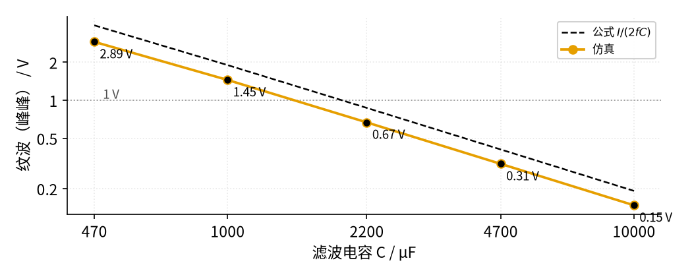
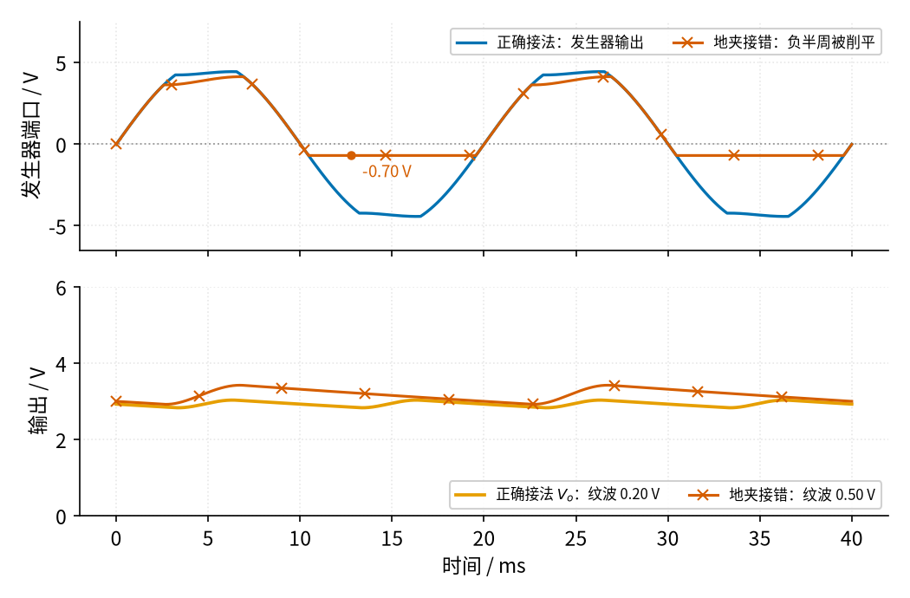

# 06 桥式整流 · 参数与调试篇

[上一页：原理与实现篇](page2.md) · [直觉篇](page1.md) · [原理与实现篇](page2.md) · 本页：参数与调试篇 · [下一页：12 积分电路 · 直觉篇](../12-integrator/page1.md) · 前置节点：[P1 元件速成 · 直觉篇](../P1-components-basics/page1.md)、[P2 半导体入门 · 直觉篇](../P2-semiconductor-basics/page1.md)、[05 精密整流 · 直觉篇](../05-precision-rectifier/page1.md) · 后续：[10 稳压管稳压 · 直觉篇](../10-zener-regulator/page1.md)

> [!WARNING]
> **市电危险**：本电路的实际版本接 220V/380V 市电，触电可能致命。本页的仿真和动手实验只在 12V 以下的低压电源上进行；任何接线、改线都必须在断电并验电后操作，由持证电工完成。
>
> 本节特有的危险：220 V 市电峰值约 311 V；滤波电容断电后仍带电，要加泄放电阻、动手前先放电；电解电容接反会短路、鼓包甚至爆裂；示波器地夹接到桥的输出端会短路一只二极管（无变压器时等于短路市电）；上电瞬间有很大的浪涌电流。

## 本页要解决的问题

公式会算了，真到挑元件、搭电路、拿示波器测的时候，还会遇到一堆新问题：数据手册上那么多参数该看哪几个？电容大一倍，纹波到底小多少？输出电压不对、电容鼓包、保险丝一上电就烧，分别该查哪里？本页先列参数，再做两组仿真扫描，最后是故障排查表和练习。

## 1. 数据手册里最该看的参数

| 元件 | 参数 | 含义 | 例子 | 怎么用 |
|---|---|---|---|---|
| 整流二极管 | 反向耐压 $V_{RRM}$ | 反接时能承受的最高电压 | 1N4001 为 50 V，1N4007 为 1000 V | 大于交流峰值（按市电高 10% 算），再留余量（见 [P2 半导体入门 · 参数与调试篇](../P2-semiconductor-basics/page3.md)） |
| 整流二极管 | 平均整流电流 $I_{F(AV)}$ | 长期能通过的平均电流 | 1N400x 为 1 A | 大于负载电流，并留余量 |
| 整流二极管 | 浪涌电流 $I_{FSM}$ | 单次能扛住的短时大电流 | 1N400x 为 30 A（8.3 ms） | 和上电浪涌比较，[06 桥式整流 · 原理与实现篇](page2.md) 估算过可达十几安培 |
| 整流二极管 | 正向压降 $V_F$ | 导通时两端电压，本教程记作 $V_D$ | 1N400x 在 1 A 时最大 1.1 V | 估算用 0.7 V；大电流时按手册值扣 |
| 电解电容 | 容量 | 决定纹波 | 2200 µF | 按 $C \ge I/(2f\Delta V)$ 选 |
| 电解电容 | 耐压 | 两端最高电压 | 25 V | 大于输出最高电压并留余量 |
| 电解电容 | 纹波电流、ESR | 能承受的交流电流；ESR 是等效串联电阻，即电容内部自带的那一点电阻，电流流过它会发热 | 见具体型号手册 | 尖峰电流大时电容发热，寿命缩短 |

二极管的数字取自 Vishay 的 1N4001–1N4007 数据手册。ESP 的电源设计文章特别指出：**滤波电容是这类电源的头号故障源**，纹波电流大、温度高、ESR 上升，都会让它提前老化。

## 2. 扫描：电容大一倍，纹波小一半

负载和变压器都不变（12 V 交流、75 Ω），只换滤波电容，仿真结果见图 06-p3-1。

*图 06-p3-1　纹波随滤波电容的变化（12 V 交流、75 Ω 负载）*

橙色带圆点的线是仿真：470 µF 时纹波 2.89 V，1000 µF 时 1.45 V，2200 µF 时 0.67 V，4700 µF 时 0.31 V，10000 µF 时 0.15 V。电容每大约翻一倍，纹波大约减半，和公式 $\Delta V \approx \dfrac{I}{2fC}$ 的规律一样，ESP 的文章也有同样的说法。黑色虚线是公式，它始终在橙色线上方，也就是**公式总是高估纹波**，原因在 [06 桥式整流 · 原理与实现篇](page2.md) 已经说过：电容并没有放电整整 10 ms。灰色点线标出 1 V。1000 µF 时纹波 1.45 V，还在线上方；按仿真的「纹波和电容成反比」估算，要纹波小于 1 V 约需 0.67 × 2200 ≈ 1500 µF；按偏保守的公式则是 0.19 ÷ (100 × 1) = 1900 µF 以上。常用规格选 2200 µF，两种算法都满足。

电容也不是越大越好：电容越大，二极管导通的时间越短、尖峰电流越高，上电浪涌也越大，对二极管、变压器和电容自身都是负担。

## 3. 动手实验：示波器的地夹接错了会怎样

> [!WARNING]
> 本实验只用**信号发生器**（或 12 V 以下的成品低压交流电源）作为输入，绝不接市电。接线、改线前先关掉信号发生器，并用一只 1 kΩ 电阻把电容两端短接放电。电解电容的「+」极接桥的 + 端，耐压选 16 V 以上。

**器材**：信号发生器（设为 50 Hz 正弦、峰值 5 V；大多数发生器的输出内阻是 50 Ω），4 只 1N4148 或 1N4001，100 µF 电解电容，1 kΩ 电阻作负载，双通道示波器。

**接法**：按直觉篇的电路接好。一般的信号发生器和示波器，它们的地（探头地夹和 BNC 外壳）都通过电源线连到插座的地线，所以**两台仪器的地本来就是连在一起的**。假设发生器的地（黑夹子）接在直觉篇桥式电路图里的 b 点、红夹子接 a 点（接反过来道理一样，只是短路的换成另一只二极管）。如果再把示波器的地夹夹在桥的输出负端，就多出一根「看不见的导线」：b → 发生器的地 → 插座地线 → 示波器的地 → 地夹 → 输出负端。b 和输出负端之间本来隔着 $D_4$ ，现在被这根线直接连起来，正好把 $D_4$ 短路。仿真对比见图 06-p3-2。

*图 06-p3-2　低压实验：示波器地夹接在桥的输出负端（朱红色）与正确接法（蓝色、橙色）对比*

上图蓝色是正确接法时发生器端口的电压，是一个完整的正弦。地夹接错以后（朱红色带×），负半周发生器的输出经 b → 地线 → 输出负端 → $D_3$ → a 被直接短路，端口电压被钳在 −0.70 V，短路电流约 86 mA，全靠发生器的 50 Ω 内阻限流。下图看输出：正确接法（橙色）平均 2.93 V、纹波 0.20 V；接错以后（朱红色带×）只剩正半周给电容充电，电路退化成了半波整流，纹波变成 0.50 V，而因为正半周只经过一只二极管，平均电压反而升到 3.17 V。

低压实验里这只是「波形怪了」；可如果整流桥直接接在市电上（不经变压器，有些廉价电源就是这样做的），同样的接法就是**把市电通过地线短路**，会炸掉二极管、烧掉探头，甚至危及人身。正确做法：两个探头的地夹都夹在发生器的地上，一个探头测 + 端、一个测 − 端，用示波器的「CH1 − CH2」功能看两者之差；或者用电池供电的万用表测直流电压。

## 4. 故障排查表

下表按低压实验写。凡是要改线、拆元件、换元件的步骤，都先断电，并把电容放电；如果是接市电的成品电源，不要自己动手，请电工处理。

| 现象 | 可能原因 | 怎么查 | 怎么改 |
|---|---|---|---|
| 输出比 $\sqrt{2}$ 倍有效值低 1.4–2 V | 两只二极管的压降，加上绕组电阻的压降（正常现象） | 先断电，改接成空载；空载和带载分别测，差值来自绕组电阻 | 设计时就把 $2V_D$ 扣掉；需要更高电压就换次级电压更高的变压器 |
| 纹波比计算值大很多 | 电容容量不够、老化、ESR 变大 | 测电容两端纹波；断电放电后换一只新电容对比 | 按 $C \ge I/(2f\Delta V)$ 加大容量；选低 ESR、纹波电流够的型号 |
| 电容鼓包、漏液、发烫 | 极性接反；耐压不够；纹波电流过大 | 先断电并放电，再看「+」极是否接桥的 + 端；对比耐压和实际最高电压 | 断电放电后更换，注意极性；耐压留足余量 |
| 二极管短路、发烫 | 反向耐压不够；上电浪涌或负载短路电流超过 $I_{FSM}$ | 断电后用万用表二极管档逐个测；对比 $V_{RRM}$ 和峰值 | 换耐压更高、电流更大的二极管；大电容时加限流措施 |
| 纹波频率变成 50 Hz，纹波变大一倍 | 桥里有一只二极管开路，只剩半波整流 | 示波器看纹波周期：正常应是 10 ms，变成 20 ms 就说明少了一个半周 | 断电放电后逐个测二极管，更换开路的那只 |
| 一上电保险丝就熔断 | 二极管短路；电容接反或击穿；保险丝选得太小，扛不住浪涌 | 断电放电后，断开负载和电容逐级排查；查保险丝规格 | 断电后更换损坏元件；用慢熔型保险丝 |
| 接上示波器后波形变形、发生器发热 | 示波器地夹接在桥的输出负端，短路了一只二极管 | 看地夹夹在哪里 | 先关掉发生器再挪地夹：地夹只夹在发生器的地上，用两个通道相减测量 |
| 断电后电容两端还有电压 | 大电容没有放电通路 | 断电后用万用表测电容电压 | 加泄放电阻；动手前用电阻放电 |
| 运放全波整流输出不对称，一个半周偏大或偏小 | 加法器权重不对，R/2 那只电阻偏差太大 | 输入直流 +0.3 V 和 −0.3 V，比较两次输出 | 断电后换用 1% 或更好的电阻，R/2 可用两只 R 并联 |
| 二极管桥整不出小信号，输出一直是 0 | 信号峰值小于 1.4 V，落在死区里 | 比较信号峰值和 $2V_D$ | 改用运放全波整流（[06 桥式整流 · 原理与实现篇](page2.md) 第 6 节） |

## 5. 练习

**练习 1（易）**：市电偏高 10% 时，[06 桥式整流 · 原理与实现篇](page2.md) 例 1 的 12 V 变压器次级峰值是多少？电容最高要承受多少伏？25 V 的电容还够吗？

答案

次级有效值变成 12 × 1.1 = 13.2 V，峰值 13.2 × 1.414 ≈ 18.67 V，减 1.4 V 后电容最高约 17.27 V。25 V 的电容仍有约 45% 的余量，够用。如果选 16 V 的电容，就会被过压，这就是不能「刚好够」的原因。

**练习 2（易）**：换成 24 V 交流变压器，桥里的二极管至少要多大的反向耐压？1N4001 能用吗？

答案

峰值 24 × 1.414 ≈ 33.9 V，市电高 10% 时约 37.3 V。二极管反向耐压至少要大于 37.3 V，1N4001 的 50 V 刚刚够，几乎没有余量；遇到市电尖峰就可能击穿。更稳妥的是选 1N4002（100 V）或更高耐压的型号，价格几乎一样。

**练习 3（中）**：给 [06 桥式整流 · 原理与实现篇](page2.md) 例 1 的 2200 µF 电容加一只泄放电阻，要求断电后大约 10 s 内电压降到原来的 37%。电阻取多大？它平时消耗多少功率？

答案

电压降到约 37% 正好是一个时间常数 $\tau = RC$ （见 [P1 元件速成 · 原理与实现篇](../P1-components-basics/page2.md)）。 $R = \tau / C$ = 10 ÷ 0.0022 ≈ 4.5 kΩ，取常用值 4.7 kΩ。平时它两端约 15.6 V，功率 15.6² ÷ 4700 ≈ 0.052 W，用 1/4 W 的电阻就够；它额外从电源取约 3.3 mA 电流，和 0.2 A 的负载相比可以忽略。ESP 的文章也建议用泄放电阻让电容在 10 s 左右放到这个程度。

**练习 4（难，变体迁移）**：用 [06 桥式整流 · 原理与实现篇](page2.md) 的运放全波整流测一个峰值 0.3 V 的正弦信号，输出的平均值是多少？如果有人把 R/2 那只电阻错装成 R，输出会变成什么样？平均值又是多少？

答案

全波整流输出是 $|V_i|$ ，平均值是峰值的 2/π 倍：0.3 × 0.637 ≈ 0.191 V。

把 R/2 换成 R 以后，两路权重都是 1，输出 $V_o = -(V_i + V_h)$ 。输入为正时 $V_h = -V_i$ ，输出 0；输入为负时 $V_h$ = 0，输出 $-V_i$ 。电路退化成了只留负半周（并翻正）的半波整流，平均值减半，约 0.095 V。故障排查表里「输出不对称」那一行就是这个原因的轻微版本。

## 小结与下一步

桥式整流电源的核心参数只有几个：二极管看反向耐压、平均电流和浪涌电流；电容看容量、耐压、极性和纹波电流。电容翻倍，纹波减半，但尖峰和浪涌会更大。用示波器测量时，牢记仪器的地是连在一起的，地夹不要乱夹。整流滤波后的电压仍然带纹波，而且随负载和市电变化，下一步要把它稳住：后续节点 [10 稳压管稳压 · 直觉篇](../10-zener-regulator/page1.md) 就从这里接着往下做。按阅读顺序，下一个节点是 [12 积分电路 · 直觉篇](../12-integrator/page1.md)，它会再次用到 P1 的电容公式。
