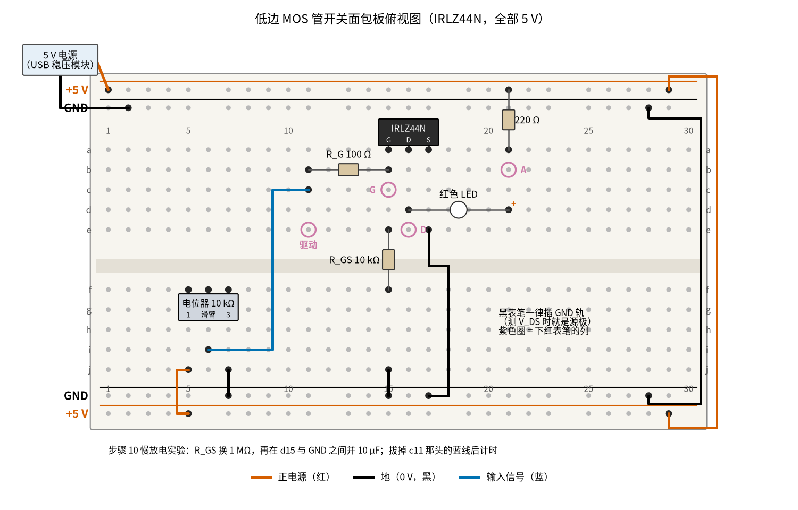
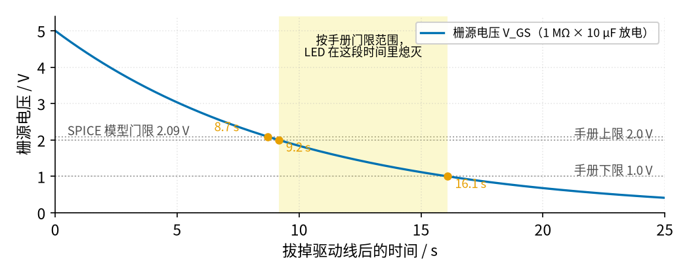

# 06 MOS 管开关 · 动手实验篇

[上一页：参数与调试篇](page3.md) · [直觉篇](page1.md) · [原理与实现篇](page2.md) · [参数与调试篇](page3.md) · 本页：动手实验篇 · [下一页：07 三极管开关与继电器驱动 · 直觉篇](../07-bjt-relay-driver/page1.md) · 前置节点：[01 元件速成 · 直觉篇](../01-components-basics/page1.md) · [03 半导体入门 · 直觉篇](../03-semiconductor-basics/page1.md)

## 这次实验要验证什么

用一只 IRLZ44N 在面包板上搭出低边开关，亲手确认三件事：栅极给 5 V 时管子「开到底」，漏源之间只剩不到 1 mV；栅极电压要越过门限（手册 1.0–2.0 V）才开始导电，这个门限能用一个秒级的放电实验量出来；栅极下拉电阻和栅极电阻会分压，稳态 $V_{GS}$ 比驱动电压略低 1%。这些结论分别对应 [06 MOS 管开关 · 原理与实现篇](page2.md) 开头「先补一点最小知识」里的门限与导通电阻，以及 [06 MOS 管开关 · 参数与调试篇](page3.md) 第 1 节表格下面那段分压计算。

页面里讲的 12 V、3 A 灯带面包板走不了：面包板的弹片一般只适合几百毫安以内的电流，3 A 会让触点发热甚至熔化塑料。所以本页把负载换成一只红色 LED 加 220 Ω 电阻，全部只用一个 5 V 电源，电流约 13 mA。管子的工作方式和大电流时完全一样，只是热量小到可以忽略。

## ⚠️ 安全须知

- **只用 12 V 及以下的直流电**。本实验只用 5 V：USB 充电头配一块面包板电源模块，或者四节 AA 电池经 5 V 稳压模块都可以。不要拿页面里的 12 V、3 A 灯带上面包板。
- **电解电容分正负极**。第 10 步的慢放电实验会用到一只 10 µF 电容。如果你用的是电解电容，长脚（正极）接栅极那一列，短脚接 GND；接反了会漏电变大，严重时鼓包。用 10 µF 陶瓷电容就没有极性问题，而且漏电更小。
- **元件可能发烫，不要用手摸**。正常情况下本实验里没有任何元件会热。如果 LED 那一路漏接了 220 Ω、或者把漏极直接接到 +5 V，电流会大到让电阻、LED 或面包板发烫。闻到焦味先拔电源。
- **接线、改线之前先断电**。断电就是把电源模块的开关拨到关，或者拔掉 USB 线。MOS 管的栅极很怕静电，插拔它之前先摸一下金属水龙头或暖气片，把身上的静电放掉。
- 本节点不涉及市电。页面里提到的电机、灯带如果是接 220 V 的，**不要接 220 V**，那一部分的接线请电工做；本页只在 5 V 上做实验。

## 器材清单

| 元件 | 型号或数值 | 数量 | 说明 |
|---|---|---|---|
| N 沟道 MOS 管 | IRLZ44N（TO-220 封装） | 1 | 页面一直用的逻辑电平管；印字面朝你，三只脚从左到右是 G、D、S |
| 红色 LED | 5 mm 普通红色 | 1 | 长脚是阳极（+），短脚是阴极 |
| 电阻 | 220 Ω | 1 | LED 限流电阻，相当于页面里的「负载」 |
| 电阻 | 100 Ω | 1 | 栅极电阻 $R_G$ |
| 电阻 | 10 kΩ | 1 | 栅源下拉电阻 $R_{GS}$ |
| 电阻 | 1 MΩ | 1 | 第 10 步慢放电实验用，临时替换 10 kΩ |
| 电容 | 10 µF（陶瓷或电解） | 1 | 第 10 步用，并在栅极和 GND 之间 |
| 电位器 | 10 kΩ 线性，三脚 | 1 | 当作「单片机引脚」：拧到一头是 0 V，另一头是 5 V |
| 5 V 电源 | 面包板电源模块或 USB 5 V | 1 | 电流能力 0.5 A 以上即可 |
| 面包板 | 830 孔（30 列以上） | 1 | 上下各两条电源轨 |
| 跳线 | 杜邦线或单芯线 | 若干 | 建议红色接 +5 V、黑色接 GND、蓝色走驱动信号 |
| 万用表 | 带 200 mV、20 V 直流挡和二极管挡 | 1 | 自动量程表也可以 |
| 计时工具 | 手机秒表 | 1 | 第 10 步用 |

所有电阻先用万用表电阻挡量一遍实际值，记下来，后面的 Python 要用。

## 搭建步骤

电路就是 [06 MOS 管开关 · 直觉篇](page1.md) 里的低边开关电路图，只把单片机换成电位器、把灯带换成 LED 加 220 Ω。面包板的规矩先说清楚：同一列里 a–e 五个孔是连通的，f–j 五个孔是连通的，中间的凹槽把上下两半隔开；上下边缘的长条是电源轨，整条横向连通。有的面包板电源轨在中间断开，用之前拿万用表通断挡量一下两端。

请看图 06-p4-1：红色线全是 +5 V，黑色线全是 GND，只有一根蓝色线是「驱动信号」，从电位器的滑臂送到栅极电阻。



*图 06-p4-1　低边 MOS 管开关的面包板接线（5 V，LED 负载，电位器代替单片机引脚）*

面包板上 MOS 管的三只脚挨在一起，栅极、漏极各接了什么不容易一眼看清；对照 图 06-p4-3 的电路原理图，先认 G、D、S，再按下面的步骤插线。


*图 06-p4-3　图 06-p4-1 对应的电路原理图（灰色小字是面包板孔位，红、黑、蓝线与面包板图同色，箭头是开通时的电流方向）*

**对照看**：面包板的连通规则见 [01 元件速成 · 动手实验篇](../01-components-basics/page4.md)：同一列的 a–e 五个孔连通，所以 a15、a16、a17 三只脚一插下去，第 15、16、17 列上半区就分别成了 G、D、S，b15 的栅极电阻、d16 的 LED 短脚、e17 的黑线都是靠这一点接上去的。原理图里 R_GS 画在栅极和 GND 之间，面包板上它是从 e15 跨过凹槽到 f15，再由 j15 的黑线接地。对照原理图看：负载（220 Ω 加 LED）在上、MOS 管在下、源极接地，正是 [06 MOS 管开关 · 直觉篇](page1.md) 「最常用的接法：低边开关」那张图，只是 +12 V 换成 +5 V、单片机换成电位器滑臂。测量表里 G、D 两点对 GND 的读数就是 $V_{GS}$ 和 $V_{DS}$ ，A 点的读数减去 D 点就是 LED 的压降。步骤 10 换上的 1 MΩ 和 10 µF 都接在 G 这一个节点上，栅极电压慢慢下降的道理见 [06 MOS 管开关 · 原理与实现篇](page2.md) 「1. 开通过程拆成三段」。

1. **铺电源轨**。5 V 电源的正极接上方最外侧一条轨（+5 V），负极接它下面一条（GND）。再用一根红线、一根黑线绕到右边，把上方两条轨分别和下方对应的轨连起来。先不要开电源。
2. **插 MOS 管**。IRLZ44N 印字面朝你，三只脚插在 a15、a16、a17，分别是栅极 G、漏极 D、源极 S。于是第 15 列上半区是栅极，第 16 列上半区是漏极，第 17 列上半区是源极。
3. **源极接地**。黑线从 e17 接到下方 GND 轨。
4. **接下拉电阻**。 $R_{GS}$ （10 kΩ）一脚插 e15，另一脚跨过凹槽插 f15；黑线从 j15 接到下方 GND 轨。这样栅极经 10 kΩ 接地，没有驱动时管子一定是关的。
5. **接栅极电阻**。 $R_G$ （100 Ω）插 b11 和 b15。第 11 列上半区就是「驱动点」。
6. **接负载**。LED 长脚（阳极）插 d21，短脚（阴极）插 d16，也就是接到漏极那一列。220 Ω 一脚插 a21，另一脚插上方 +5 V 轨。电流的路径是：+5 V → 220 Ω → LED → 漏极 → 源极 → GND。
7. **接电位器**。三只脚插 f5、f6、f7，中间那只是滑臂。红线从 j5 接到 +5 V 轨，黑线从 j7 接到 GND 轨，蓝线从 i6 接到 c11，把滑臂电压送到驱动点。
8. **检查一遍再上电**。把电位器先拧到接 GND 的那一头（逆时针到底，如果方向相反就反过来记）。对照图 06-p4-1 数一遍：黑线 3 根（不算电源线和右边绕线），红线 1 根，蓝线 1 根；LED 短脚在第 16 列。确认无误后开电源，LED 应该不亮。
9. **拧电位器**。慢慢把电位器往 5 V 那头拧，LED 会在某个位置「突然」亮起来，再往后拧亮度几乎不变。拧到底时就相当于单片机输出高电平。
10. **慢放电实验**（测门限）。断电，把 $R_{GS}$ 从 10 kΩ 换成 1 MΩ，再把 10 µF 电容插在 d15 和 GND 之间（用一根黑线把电容另一脚引到 GND 轨；电解电容的长脚插 d15）。通电，电位器拧到 5 V 那头，LED 亮。然后拔掉 c11 那一头的蓝线，同时按下秒表，盯着 LED，熄灭那一刻再按一次。

图 06-p4-1 里紫色圆圈标的是要下红表笔的位置：驱动点在第 11 列，G 在第 15 列，D 在第 16 列，A 是 220 Ω 和 LED 相接的第 21 列。表笔尖插进同一列的空孔就能碰到，不必去碰管子的脚。黑表笔一律插 GND 轨；源极接在 GND 上，所以「对 GND 的电压」就是 $V_{GS}$ 和 $V_{DS}$ 。

## 测量表

下表「应该读到」一栏的数，来自 ngspice 仿真：Infineon 的 IRLZ44N 官方模型，加上 LTspice 器件库里的通用红色 LED 模型，电路和本页完全相同（5 V、220 Ω、100 Ω、10 kΩ）。体二极管一行取自 [review/spice/06.md](../review/spice/06.md) 的面包板读数表。慢放电的时间由画图脚本按 $t = \tau \ln(5/V_{th})$ 算出。你的 LED 颜色、亮度不同，压降会差零点几伏，后面的 Python 会用你量到的 LED 压降重新算。

| 步骤 | 测什么 | 红表笔 | 黑表笔 | 挡位 | 应该读到 | 读不到时先查 |
|---|---|---|---|---|---|---|
| 1 | 电源电压 | +5 V 轨 | GND 轨 | 直流 20 V | 约 5 V（4.75–5.25 V 都正常） | 电源模块开关、USB 线是否插好 |
| 2 | 开通时 $V_{GS}$ （电位器拧到 5 V 头） | 第 15 列（G） | GND 轨 | 直流 20 V | 4.95 V，比电源低约 1% | 读到 0 V：蓝线是否接到 c11；读到 5.0 V 整：下拉电阻没插上 |
| 3 | 开通时 220 Ω 两端 | +5 V 轨 | 第 21 列（A） | 直流 20 V | 2.94 V（电流约 13.4 mA） | LED 是否插反（长脚应在 d21） |
| 4 | 开通时 LED 压降 | 第 21 列（A） | 第 16 列（D） | 直流 20 V | 2.06 V（模型值；你的 LED 可能是 1.8–2.2 V 之间的某个数） | 读到 5 V 而 LED 不亮：LED 插反 |
| 5 | 开通时 $V_{DS}$ | 第 16 列（D） | GND 轨 | 直流 200 mV | 约 0.3 mV（1 mV 以内） | 读到几百毫伏以上：管子没开到底，查步骤 2 |
| 6 | 关断时 $V_{GS}$ （电位器拧到 GND 头） | 第 15 列（G） | GND 轨 | 直流 20 V | 0 V | 读到几伏：电位器两端接反，换个方向拧 |
| 7 | 关断时 220 Ω 两端 | +5 V 轨 | 第 21 列（A） | 直流 20 V | 约 0 V（零点几毫伏） | 有几伏：管子没关，查 G、D、S 是否插错 |
| 8 | 关断时 $V_{DS}$ | 第 16 列（D） | GND 轨 | 直流 20 V | 几伏（模型 3.6 V），不一定是 5 V | 见下文说明，只要步骤 7 约 0 V 就正常 |
| 9 | LED 刚亮时的 $V_{GS}$ | 第 15 列（G） | GND 轨 | 直流 20 V | 模型约 2.09 V；手册保证 1.0–2.0 V | 一下子就亮到底是正常的，拧慢一点 |
| 10 | 慢放电：拔线到 LED 熄灭的时间 | 不接表 | — | 秒表 | 模型门限对应 8.7 s；手册门限范围对应 9.2–16.1 s | 几秒内就灭：电解电容漏电大，换陶瓷电容 |
| 11 | 断电后测体二极管 | 第 17 列（S） | 第 16 列（D） | 二极管挡 | 约 0.45 V（模型值）；表笔对调显示 OL | 两个方向都通：管子已击穿 |

读表时注意三个细节。第一，步骤 2 的 4.95 V 比电源低，是 $R_G$ 和 $R_{GS}$ 分压的结果：5 × 10000 ÷ 10100 ≈ 4.95 V，和 [06 MOS 管开关 · 参数与调试篇](page3.md) 第 1 节算的一样。第二，步骤 5 的 0.3 mV 很小，因为电流只有 13 mA，乘上二十几毫欧的导通电阻只剩零点几毫伏；如果你的表在 200 mV 挡只能显示到 0.1 mV，读到 0.2–0.5 mV 都正常。第三，步骤 8 关断时漏极不一定是 5 V：管子关断后仍有微安级的漏电流，LED 在这么小的电流下压降只有一点几伏，漏极电压由这点漏电和万用表本身的 10 MΩ 内阻共同决定，不同的管子读数可以差很多。判断「关没关」请看步骤 7，220 Ω 两端约 0 V 就是关好了。

步骤 9 很能说明问题：模型里 LED 电流从 0.1 mA 到 5 mA，栅压只变了 0.01 V 左右，所以你会觉得 LED「一下子就亮了」。这是因为本实验的电流太小，刚过门限一点点就够用了；页面里 3 A 的灯带就完全不是这样，必须把栅压抬到手册标注 $R_{DS(on)}$ 的 4–5 V 以上才能开到底。**门限只告诉你从哪开始开，不告诉你能不能开到底**，这句话在小电流实验里看不出来，正好提醒你别被小电流的结果骗了。

## 没有示波器怎么办

MOS 管真正的开关过程（栅极充电、米勒平台、漏极电压下落）只有零点几微秒，万用表和手机都跟不上。办法是把栅极这个「电容」故意做大、把放电电阻做大，让过程慢到秒级：第 10 步给栅极并上 10 µF，下拉换成 1 MΩ，时间常数就是 $\tau = RC$ = 1 MΩ × 10 µF = 10 s。拔掉驱动线后，栅压从 5 V 按指数规律往下掉，掉到门限时 LED 熄灭，所以熄灭时刻满足 $t = \tau \ln(5/V_{th})$ 。反过来，量出 $t$ 就能算出你这只管子的门限 $V_{th} = 5\thinspace e^{-t/\tau}$ 。

请看图 06-p4-2 里蓝色曲线和三条灰色点线的交点：



*图 06-p4-2　没有示波器时的慢放电实验：栅压经 1 MΩ 和 10 µF 下降，LED 在栅压跌破门限时熄灭*

图 06-p4-2 里，蓝色曲线是栅源电压，三个橙色圆点是它穿过门限的时刻。SPICE 模型的门限约 2.09 V，对应 8.7 s；手册保证的门限在 1.0–2.0 V 之间，对应黄色高亮带里的 9.2–16.1 s。你的秒表读数落在哪里，就说明你手上这只管子的门限在哪里。熄灭的过程只占零点几秒，因为本实验的电流很小，门限附近栅压稍微一变，LED 就从亮变灭。

做这个实验有三个容易出错的地方。一是万用表不要一直插在栅极上看：它的 10 MΩ 内阻和 1 MΩ 并联，时间常数变成 9.09 s，按模型门限算熄灭时间会提前到 7.9 s。二是电解电容本身会漏电，相当于又并了一只电阻，时间会变短；用陶瓷电容更准。三是手指不要碰栅极那一列：人体会把电荷带走或带来，这正是下面要说的「栅极悬空」现象。

顺手做一个对照实验：把 1 MΩ 和 10 µF 都拔掉，让栅极只经 100 Ω 连着蓝线。通电、把电位器拧到 5 V，然后拔掉蓝线。你会发现 LED 可能一直亮着，甚至过很久才灭：栅极本身就是一个几纳法的电容，没有下拉电阻时电荷没地方去。再用手指碰一下栅极那一列，LED 可能会闪或灭。这就是 [06 MOS 管开关 · 参数与调试篇](page3.md) 第 1 节说的「下拉电阻保证栅极不悬空」，单片机复位期间引脚是高阻态，没有下拉，负载就可能乱动作。这个对照现象因管子和环境湿度而异，本页不给「应该读到」的数。

**只有示波器才能看到的**：开通时栅压先升到门限、再在米勒平台上停一小段、漏极电压同时往下落的整个过程，只持续零点几微秒。示波器上应该看到的样子见 [06 MOS 管开关 · 原理与实现篇](page2.md) 第 3 节的栅极电荷仿真波形图：上排驱动电压和 $V_{GS}$ ，下排 $V_{DS}$ 和漏极电流。还有感性负载关断时的电压尖峰，[review/spice/06.md](../review/spice/06.md) 的结论是有续流二极管约 12.5 V、没有时约 55 V 的雪崩尖峰，都只持续微秒到几十微秒，万用表看不到。

## 用 Python 核对你的读数

把你量到的电源电压、电阻实际值、各点读数和秒表时间填进去。代码按公式算出这次应该读到的值，逐项比较，偏差超过 10% 就提示；导通压降很小，改用「按手册最大导通电阻算出的上限」来判断；最后用秒表时间反推门限。

```python
import sys, pathlib
sys.path.insert(0, str(pathlib.Path("code/figs").resolve()))  # 在仓库根目录运行
# 06 MOS 管开关 · 动手实验核对：填入实测值，算出期望读数并比较
import math

# ---- 1. 你量到的电源和元件（示例值，换成你自己的）----
VCC = 5.08                    # +5 V 轨对 GND / V
RL, RG, RGS = 218.0, 99.2, 9.93e3   # 220 Ω、100 Ω、10 kΩ 的实际值 / Ω
R_SLOW, C_SLOW = 0.99e6, 10e-6      # 慢放电实验的 1 MΩ（实测）和 10 µF（标称）

# ---- 2. 你量到的读数（对应测量表步骤 2–5、9、10）----
m = dict(vgs_on=5.03,         # 步骤 2：开通时 V_GS / V
         v_rl=3.02,           # 步骤 3：220 Ω 两端 / V
         v_led=2.05,          # 步骤 4：LED 压降 / V
         vds_on=0.0003,       # 步骤 5：开通时 V_DS / V（200 mV 挡读到 0.3 mV）
         vgs_light=1.95,      # 步骤 9：LED 刚亮时的 V_GS / V
         t_off=9.6)           # 步骤 10：拔线到 LED 熄灭的时间 / s

RDS_MAX = 0.025               # IRLZ44N 手册：V_GS = 5 V 时 R_DS(on) 最大 25 mΩ
calc = {}
calc["vgs_on"] = VCC * RGS / (RG + RGS)              # R_G 与 R_GS 分压
calc["v_rl"] = VCC - m["v_led"] - m["vds_on"]        # 电源 = 电阻 + LED + V_DS
i_on = m["v_rl"] / RL                                # 由电阻压降算电流
print(f"负载电流 I = {i_on*1e3:.2f} mA")

warn = 0
print(f"{'项目':<8}{'实测':>9}{'计算':>9}{'偏差':>9}")
for k, c in calc.items():
    dev = (m[k] - c) / c * 100
    flag = abs(dev) > 10
    warn += flag
    print(f"{k:<8}{m[k]:>9.3f}{c:>9.3f}{dev:>+8.1f}%" + ("   ← 偏差太大，先查测量表最后一列" if flag else ""))

# 导通压降：不该超过 I × R_DS(on)最大值，再留 0.2 mV 给万用表最后一位
vds_lim = i_on * RDS_MAX + 0.0002
ok = m["vds_on"] <= vds_lim
warn += not ok
print(f"V_DS = {m['vds_on']*1e3:.2f} mV，上限 {vds_lim*1e3:.2f} mV，"
      f"估算 R_DS(on) ≈ {m['vds_on']/i_on*1e3:.0f} mΩ" + ("" if ok else "   ← 太大：管子没开到底"))

# 慢放电反推门限：V_th = V0·e^(−t/τ)，V0 取步骤 2 量到的 V_GS（下拉换成 1 MΩ 后几乎等于 VCC）
tau = R_SLOW * C_SLOW
v0 = VCC * R_SLOW / (RG + R_SLOW)
vth = v0 * math.exp(-m["t_off"] / tau)
print(f"τ = {tau:.2f} s，反推门限 V_th ≈ {vth:.2f} V（手册 1.0–2.0 V）；步骤 9 直接读到 {m['vgs_light']:.2f} V")
in_range = 0.9 <= vth <= 2.2
warn += not in_range
if not in_range:
    print("   ← 门限超出手册范围：先查电容是否漏电、万用表是否一直并在栅极上")
if abs(vth - m["vgs_light"]) / m["vgs_light"] > 0.10:
    print("   提示：两种方法得到的门限差了 10% 以上，电解电容的容量公差常有 ±20%，换陶瓷电容再测一次")
print("全部在范围内" if warn == 0 else f"有 {warn} 项需要检查")
```

示例数据里 USB 电源是 5.08 V，所以开通时栅压是 5.03 V 而不是 4.95 V；代码用你量到的电源电压重新算，偏差就只剩零点几个百分点。这正是要先量电源、再量电阻的原因：拿标称值去比，误差会被冤枉到电路头上。反推门限时电容用的是标称值，电解电容的容量公差往往有 ±20%，所以这个门限只能当估计。

## 实验记录表

| 项目 | 实测值 | 计算值 | 偏差 |
|---|---|---|---|
| 电源电压 |  |  |  |
| 220 Ω / 100 Ω / 10 kΩ / 1 MΩ 实际阻值 |  |  |  |
| 开通时 $V_{GS}$ |  |  |  |
| 开通时 220 Ω 两端电压 |  |  |  |
| 开通时 LED 压降 |  |  |  |
| 开通时 $V_{DS}$ 和估算的 $R_{DS(on)}$ |  |  |  |
| 关断时 220 Ω 两端电压 |  |  |  |
| LED 刚亮时的 $V_{GS}$ |  |  |  |
| 慢放电熄灭时间和反推的门限 |  |  |  |
| 体二极管压降 |  |  |  |

### 思考题

**1. 把 $R_{GS}$ 从 10 kΩ 换成 1 kΩ，开通时的 $V_{GS}$ 会变成多少？对这个 LED 实验有没有影响**？

<details><summary>答案</summary>

分压变成 5 × 1000 ÷ 1100 ≈ 4.55 V，比 10 kΩ 时低了约 9%。对 13 mA 的 LED 没有影响，因为栅压过了 2 V 多一点管子就已经够用了。但对页面里的 3 A 灯带就要小心：手册在 5 V 时保证 25 mΩ，4 V 时最大 35 mΩ，栅压降低会让导通发热变大。所以下拉电阻不要取得太小。

</details>

**2. 关断时你量到漏极对地有三四伏，而不是 0 V 或 5 V。这说明管子坏了吗**？

<details><summary>答案</summary>

不说明。管子关断后还有很小的漏电流，万用表本身也有 10 MΩ 内阻，它们和「LED 加 220 Ω」串在一起，LED 在微安级电流下压降只有一点几伏，于是漏极停在一个中间值。判断管子关没关，要看 220 Ω 两端是不是约 0 V、LED 是不是完全不亮。真正坏掉的 MOS 管通常是漏源击穿短路，这时不管栅压多少，LED 都一直亮。

</details>

**3. 慢放电实验里，如果你一直把万用表插在栅极上看读数，LED 熄灭的时间会提前还是推后？提前或推后多少**？

<details><summary>答案</summary>

会提前。万用表的 10 MΩ 内阻和 1 MΩ 并联，等效电阻约 0.909 MΩ，时间常数从 10 s 变成 9.09 s。按 SPICE 模型门限 2.09 V 算，熄灭时间从 8.7 s 提前到 7.9 s，大约提前 9%。这就是「测量仪器会改变被测电路」的一个例子：电阻越大的电路，越要考虑万用表内阻的影响。

</details>

## 自测清单

- 我能认出 IRLZ44N 的 G、D、S 三只脚，并按低边开关的接法把它插到面包板上。
- 我能用万用表量出开通时的 $V_{GS}$ 、 $V_{DS}$ ，并解释为什么 $V_{GS}$ 比电源低 1%、 $V_{DS}$ 只有零点几毫伏。
- 我能用慢放电实验和秒表估算出一只 MOS 管的门限电压，并说出电解电容漏电和万用表内阻会怎样影响结果。
- 我能说清楚为什么小电流实验里「刚过门限就开到底」，而 3 A 负载必须按手册的测试栅压来驱动。
- 我能用实测的电源电压和电阻值算出期望读数，判断偏差是来自元件公差还是接线错误。
