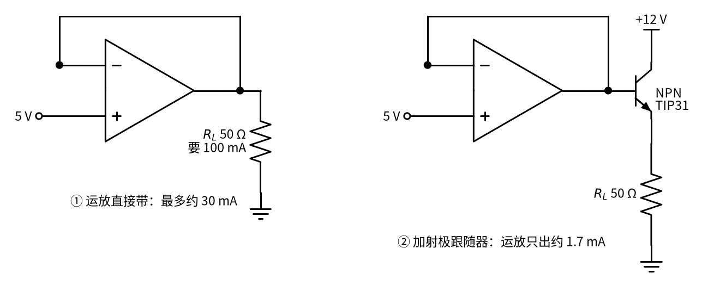
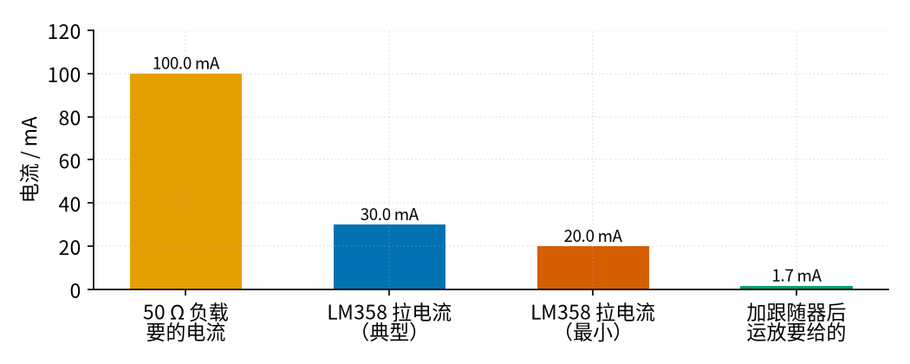
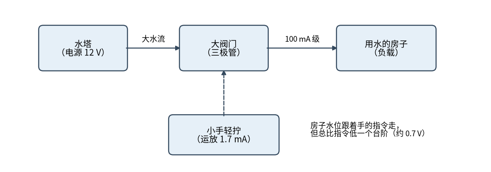

# 07 射极跟随器 · 直觉篇

[上一页：13 微分电路 · 参数与调试篇](../13-differentiator/page3.md) · 本页：直觉篇 · [原理与实现篇](page2.md) · [参数与调试篇](page3.md) · [下一页：原理与实现篇](page2.md) · 前置节点：[P2 半导体入门 · 直觉篇](../P2-semiconductor-basics/page1.md)、[03 电压跟随器 · 直觉篇](../03-voltage-follower/page1.md)

## 一、痛点：电压对了，电流不够

在 [03 电压跟随器 · 直觉篇](../03-voltage-follower/page1.md) 里，我们用运放把一个"软"的电压（比如分压器分出来的 5 V）变"硬"：后面接什么负载，输出都还是 5 V。可是那一节有个前提——负载要的电流不大。

现在换一个负载：一个 50 Ω 的小喇叭、一段电热丝，或者一排 LED。按欧姆定律，5 V 加在 50 Ω 上要 100 mA。常见的运放 LM358，数据手册上写的输出拉电流典型只有 30 mA，最差的芯片只保证 20 mA。运放再"聪明"也变不出电流来：它会进入限流，输出电压被压到 1.5 V 左右，负载根本带不动。

有人会想两个"省事"的办法，都行不通。第一个：干脆不要运放，直接用电阻分压分出 5 V 去带负载。可 [P1 元件速成 · 直觉篇](../P1-components-basics/page1.md) 里说过，分压器的输出电压取决于下面那只电阻和负载并联后的大小，接上 50 Ω 以后电压会塌得一塌糊涂。第二个：换一只能出大电流的"功率运放"。这种芯片确实有，但价格贵、型号少，而且电源电压、散热都有讲究。更常见、更便宜的做法，是在普通运放后面加一只三极管，让"会算的"和"能扛的"各干各的活。

图 07-p1-1 左边就是这种"运放直接带"的接法，右边是本节的办法：在运放后面加一只 NPN 三极管，集电极接 12 V 电源，发射极接负载。

*图 07-p1-1　运放直接带负载（左）与加一级射极跟随器（右）*

图 07-p1-1 右边这种接法，输出从三极管的**发射极**取出，所以叫"射极跟随器"（也叫共集电极电路）。负载要的 100 mA 改由 12 V 电源经三极管提供，运放只需要给基极一点点电流去"拧阀门"。

差距有多大，看图 07-p1-2：

*图 07-p1-2　负载要的电流、运放能给的电流、加跟随器后运放要给的电流*

图 07-p1-2 里，橙色柱子（100 mA）远远高过运放能给的蓝色（30 mA）和朱红色（20 mA）。加了跟随器以后，运放只要出最右边那根很矮的柱子——约 1.7 mA，大约是负载电流的 1/β（这里按 β = 50 估）。三极管把电流放大了几十倍，这正是 [P2 半导体入门 · 直觉篇](../P2-semiconductor-basics/page1.md) 里说的"小电流控制大电流"。

## 二、类比：小手拧大阀门，水位总低一个台阶

P2 里把三极管比作"用小水流推开大阀门的水龙头"。射极跟随器就是这个水龙头的一种用法，见图 07-p1-3：

*图 07-p1-3　射极跟随器的水塔类比*

图 07-p1-3 中，水塔是 12 V 电源，房子是负载，阀门是三极管。运放是那只"小手"，只用很小的力（1.7 mA）就能控制 100 mA 级的大水流。有意思的是这个阀门的脾气：它总想让房子里的水位**跟着手的指令走**，但永远**比指令低一个台阶**。这个台阶就是三极管基极到发射极的压降 $V_{BE}$ （读作"V-B-E"，硅管大约 0.7 V）。你给基极 5 V，发射极大约只有 4.3 V。

所以射极跟随器有两个关键特点：

- 电流放大约 β 倍，电压放大约 1 倍——输出电压"跟随"输入，但不放大；
- 输出比输入低约 0.7 V，而且这个差值几乎不随负载变化。

为什么输出会"自己跟着走"？关键在于负载接在发射极上。假如负载突然要更多电流，发射极电压就会往下掉一点；基极电压是运放定死的，于是 $V_{BE}$ 变大，阀门开得更大，电流跟上去，发射极电压又被拉回来。反过来，发射极电压偏高时 $V_{BE}$ 变小，阀门关小一点。三极管自己就在做一种"负反馈"，所以输出总是稳稳地贴在"输入减 0.7 V"附近。

这个阀门也有两个脾气要记住。第一，它只会"往外放水"：NPN 管只能把电流从电源推向负载，不能把负载上的电荷抽走，输出要往下走，全靠负载自己放电。第二，基极电压低于约 0.6 V 时阀门完全关死，输出就是 0 V。所以单电源供电时，输入要是一路降到 0 V，输出在最低那一段会被"削平"。

## 三、看一眼它和 03 电压跟随器的区别

| | 03 运放电压跟随器 | 07 射极跟随器 |
|---|---|---|
| 输出电压 | 等于输入 | 比输入低约 0.7 V |
| 能带的电流 | 受运放限制（几十 mA） | 受三极管和电源限制（可到安培级） |
| 输入要的电流 | 几乎为零 | 约为负载电流的 1/β |
| 谁发热 | 运放 | 三极管（要算功耗） |

两者经常**串起来用**：运放负责"电压准"，三极管负责"电流大"。如果把运放的反馈从三极管发射极取回来，连那 0.7 V 的台阶也能被运放自动补上——这一招在原理篇会讲，到了下一节的线性稳压里还会再见到。

## 四、用万用表和示波器看一遍

搭好电路以后，先用万用表量直流。按原理篇的低压实验：9 V 电源，电位器把基极调到 5 V，发射极接 1 kΩ，发射极电压按模型约 4.36 V；把负载换成 220 Ω，电流变成约 4.5 倍，发射极只降到约 4.28 V。再做个对比，拿掉三极管、把 220 Ω 直接挂在电位器滑片上，滑片电压会一下掉到约 2.36 V。同一个"软"电源，加不加三极管，差别一目了然。

再用示波器看交流。通道 1 接基极，通道 2 接发射极，输入一个 3 V 到 7 V 的正弦。你会看到两条波形形状一模一样，通道 2 只是整体往下平移了一截：输入峰值 7.00 V 时，输出约 6.28 V，差 0.72 V。把两个通道调成同一挡位、叠在一起看，最容易看出"平移而不缩小"。如果把三极管拿掉、让运放直接推 50 Ω，通道 2 会变成一条贴在 1.5 V 附近的直线，波形完全没了。最后用手指轻碰一下三极管：在 12 V 电源下带 50 Ω 负载时，它要发约 0.65 W 的热，2N3904 这种小管子很快就会烫手甚至过热，这就是参数与调试篇要专门算功耗的原因。

## 五、一句话总结

**射极跟随器 = 三极管当"电流放大器"：输出电压约等于输入减 0.7 V，电流却可以大几十倍**；代价是那 0.7 V 的台阶和三极管自己的发热。

## 参考资料

- ADI 大学课程 第 9 章 9.4 节，电压跟随器（射极跟随器的增益、 $V_{BE}$ 偏移、电流增益）：https://wiki.analog.com/university/courses/electronics/text/chapter-9
- TI，LM358 数据手册（输出拉电流典型 30 mA、最小 20 mA）：https://www.ti.com/lit/ds/symlink/lm358.pdf
- Electronics Tutorials，共集电极放大器（输出比基极低约 0.7 V、同相）：https://www.electronics-tutorials.ws/amplifier/common-collector-amplifier.html
