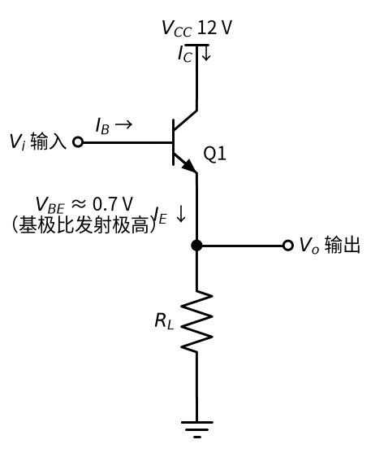
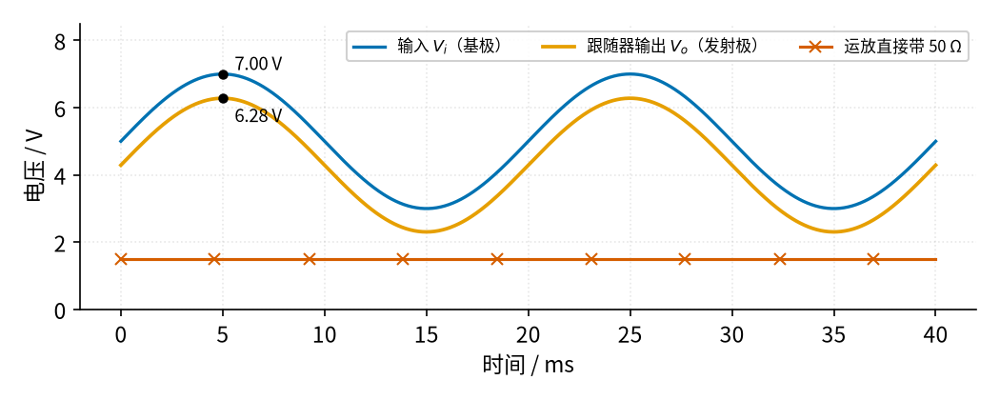
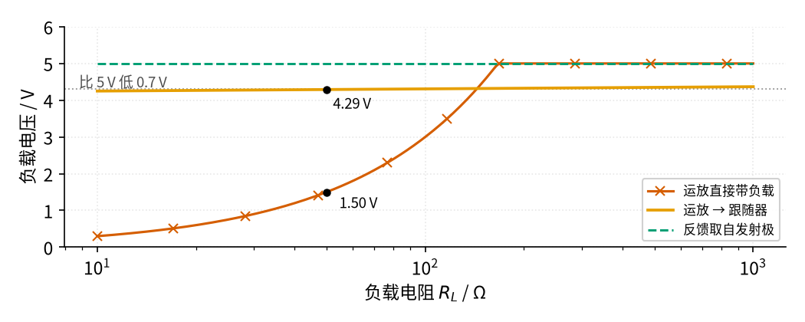
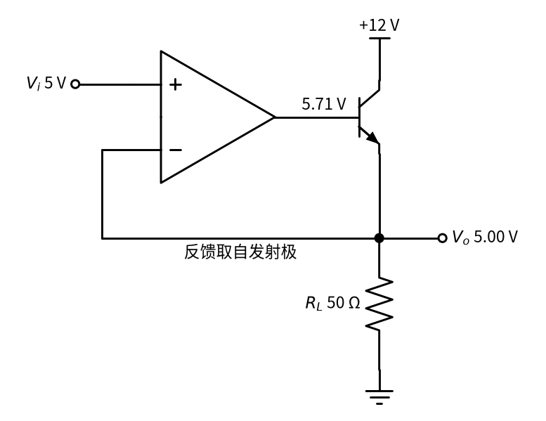

# 07 射极跟随器 · 原理与实现篇

[上一页：直觉篇](page1.md) · [直觉篇](page1.md) · 本页：原理与实现篇 · [参数与调试篇](page3.md) · [下一页：参数与调试篇](page3.md) · 前置节点：[P2 半导体入门 · 直觉篇](../P2-semiconductor-basics/page1.md)、[03 电压跟随器 · 直觉篇](../03-voltage-follower/page1.md)

## 一、最小知识

本页只用到前置节点里的三件事：

1. 三极管工作在放大区时，集电极电流是基极电流的 β 倍： $I_C = \beta I_B$ （见 [P2 半导体入门 · 原理与实现篇](../P2-semiconductor-basics/page2.md)）。发射极电流是两者之和： $I_E = I_B + I_C = (\beta + 1) I_B$ 。
2. 硅管导通时，基极比发射极高约 0.7 V，记作 $V_{BE}$ （见 [P2 半导体入门 · 原理与实现篇](../P2-semiconductor-basics/page2.md) 的"0.7 V 规则"）。更准确地说， $V_{BE}$ 随电流按对数缓慢变化：电流每变 10 倍， $V_{BE}$ 只变约 60 mV。
3. 运放接成负反馈、并且输出没有饱和（没顶到电源电压）时"虚短"：两个输入端电压几乎相等（见 [03 电压跟随器 · 原理与实现篇](../03-voltage-follower/page2.md)）。

本页的符号：输入电压 $V_i$ （加在基极），输出电压 $V_o$ （从发射极取出），集电极电源 $V_{CC}$ ，负载电阻 $R_L$ ，电压放大倍数 $A_v$ 。

## 二、推导

下面的分析图标出了所有要用的量，见图 07-p2-1：



*图 07-p2-1　射极跟随器的分析图*

**推导一：输出电压**。中文：从基极走到地，先经过一个 $V_{BE}$ ，再经过负载上的 $V_o$ ，两段加起来就是输入。公式：

$$V_i = V_{BE} + V_o$$

代数：移项得

$$V_o = V_i - V_{BE} \approx V_i - 0.7\ \text{V}$$

图 07-p2-1 里 $V_{BE}$ 标在基极和发射极之间，就是这个"台阶"。

**推导二：电流**。中文：负载电流全部从发射极流出，而基极只需要它的 $1/(\beta+1)$ 。公式：

$$I_E = \frac{V_o}{R_L},\qquad I_B = \frac{I_E}{\beta + 1}$$

代数：以 $V_i = 5\ \text{V}$ 、 $R_L = 50\ \Omega$ 、 $\beta = 50$ 为例， $V_o \approx 4.3\ \text{V}$ ， $I_E \approx 86\ \text{mA}$ ， $I_B \approx 1.7\ \text{mA}$ 。运放只需提供 1.7 mA，远小于 LM358 的 20 mA 下限。图 07-p2-1 中 $I_C$ 从电源流进集电极，这才是负载电流真正的来源。

**推导三：电压放大倍数为什么接近 1**。中文：输入变化 $\Delta V_i$ 时，如果 $V_{BE}$ 不变，输出就一模一样地变化；实际 $V_{BE}$ 会跟着电流稍微变一点点。公式：

$$A_v = \frac{\Delta V_o}{\Delta V_i} = 1 - \frac{\Delta V_{BE}}{\Delta V_i}$$

代数：正弦从 3 V 摆到 7 V（ $\Delta V_i = 4\ \text{V}$ ），电流大约从 46 mA 变到 126 mA，不到 3 倍， $V_{BE}$ 只变约 26 mV，所以 $A_v \approx 1 - 0.026/4 \approx 0.99$ 。（26 mV 是只按指数模型算的；真实管子内部的体电阻也有压降，用厂家模型算要变 60～90 mV，但相对 4 V 的摆幅仍然很小，增益还是 0.98 左右。）这和 ADI 教材的结论一致：增益总是略小于 1。

**推导四：三极管的功耗**。中文：三极管两端的电压是 $V_{CE} = V_{CC} - V_o$ ，流过它的是 $I_C$ ，两者相乘就是它发的热。公式：

$$P_C = V_{CE} I_C \approx (V_{CC} - V_o)\frac{V_o}{R_L}$$

代数：12 V 电源、 $V_o = 4.3\ \text{V}$ 、 $R_L = 50\ \Omega$ 时， $P_C \approx 7.7 \times 0.084 \approx 0.65\ \text{W}$ 。这个数很容易被忽略——它比负载上的 $4.3 \times 0.086 \approx 0.37\ \text{W}$ 还大。

## 三、仿真

下面的程序把上面的结论都算一遍。三极管用指数模型 $I_C = I_S e^{V_{BE}/V_T}$ ，每一点用二分法解出 $V_o$ ；运放按 LM358 典型拉电流 30 mA 限流。β = 50 和 $I_S$ 都是示意值。程序要在**仓库根目录**运行（第二行靠这个找到 `code/figs` 里的共享画图样式），它会重新生成 图 07-p2-2 和 图 07-p2-3。想改参数做实验，先复制一份：`cp code/07_sim.py my_07.py`，再改 `my_07.py`。

```python
# 07 射极跟随器最小仿真：运放（输出电流有限）直接带 50 Ω 负载，和"运放 → NPN 射极跟随器 → 负载"对比。
# 三极管用指数模型 I_C = I_S·e^(V_BE/V_T)（与 P2 相同的思路），β 取 50；运放按 LM358 典型拉电流 30 mA 限流。
import sys, pathlib
sys.path.insert(0, str(pathlib.Path("code/figs").resolve()))  # 在仓库根目录运行
import numpy as np                                 # 数组运算
import matplotlib.pyplot as plt                    # 画图
import figstyle as fs                              # 全书统一的颜色、轴标签、保存函数

VT, IS, BETA = 0.02585, 1e-13, 50.0                # 热电压 25.85 mV；I_S 示意值；β 示意值（TIP31 在 1 A 时 ≥ 25）
VCC, I_LIM = 12.0, 0.030                           # 集电极电源 12 V；LM358 在 15 V 供电时典型拉电流 30 mA
V_OH = 12.0 - 1.5                                  # 运放输出最高约到正电源下 1.5 V（按 12 V 供电估）

def direct(vi, rl):                                # 运放直接接负载：电流不超过 I_LIM 时输出 = V_i，否则被限流
    return np.minimum(vi, I_LIM * rl)              # 负载电压 = min(想要的电压, 限流 × 负载电阻)

def follower(vb, rl):                              # 射极跟随器：已知基极电压 vb，二分法解出发射极电压 V_o
    lo, hi = 0.0, vb                               # V_o 一定在 0 和 vb 之间
    for _ in range(60):                            # 二分 60 次，精度远小于 1 μV
        vo = (lo + hi) / 2                         # 猜一个 V_o
        ic = vo / rl * BETA / (BETA + 1)           # 负载电流就是发射极电流 I_E，其中 β/(β+1) 是 I_C
        vbe = VT * np.log(ic / IS + 1)             # 管子流这么多电流需要的 V_BE
        lo, hi = (vo, hi) if vb - vo > vbe else (lo, vo)   # 基极—发射极电压还有富余，说明 V_o 可以更高
    return vo, vbe, vo / rl                        # 返回 V_o、V_BE、I_E

# ---------- ① 正弦输入：V_i = 5 V ± 2 V，50 Hz，负载 50 Ω ----------
R_L = 50.0
t = np.linspace(0, 0.04, 801)                      # 0 ~ 40 ms，两个周期
vi = fs.sine(t, 50, amp=2.0, offset=5.0)           # 输入正弦
res = np.array([follower(v, R_L) for v in vi])     # 每一点解一次
vo, vbe, ie = res[:, 0], res[:, 1], res[:, 2]
vd = direct(vi, R_L)                               # 运放直接带 50 Ω
gain = (vo.max() - vo.min()) / (vi.max() - vi.min())
print(f"[正弦] 输入 {vi.min():.1f}~{vi.max():.1f} V；跟随器输出 {vo.min():.2f}~{vo.max():.2f} V；V_BE {vbe.min():.3f}~{vbe.max():.3f} V；交流增益 {gain:.3f}")
print(f"[正弦] 运放直接带 50 Ω：输出被限在 {vd.max():.2f} V（30 mA × 50 Ω）")
assert 0.6 < vbe.min() and vbe.max() < 0.8         # 结论 1：输出比输入低 0.6~0.8 V，即一个 V_BE
assert gain > 0.98                                 # 结论 2：交流增益约等于 1
assert vd.max() < 0.35 * vi.max()                  # 结论 3：直接带负载时输出被限流压扁

fig, ax = plt.subplots(figsize=fs.SIZE["single"])
ax.plot(t * 1e3, vi, **fs.LS["vin"], label="输入 $V_i$（基极）")
ax.plot(t * 1e3, vo, **fs.LS["vout"], label="跟随器输出 $V_o$（发射极）")
ax.plot(t * 1e3, vd, **fs.LS["bad"], label="运放直接带 50 Ω")
k = np.argmax(vi)                                  # 在输入最高点标出两条线的差
fs.mark(ax, t[k] * 1e3, vi[k], "{:.2f}", " V", dx=6, dy=2)
fs.mark(ax, t[k] * 1e3, vo[k], "{:.2f}", " V", dx=6, dy=-12)
fs.axlabels(ax, "时间", "ms", "电压", "V"); ax.set_ylim(0, 8.5)
ax.legend(loc="upper right", fontsize=8, ncol=3)
fs.save(fig, "07", "07_p2_2_sine.png")

# ---------- ② 负载扫描：V_i = 5 V，R_L 从 10 Ω 到 1 kΩ ----------
RL = np.logspace(1, 3, 200)
v_dir = direct(5.0, RL)                            # 运放直接带
v_fol = np.array([follower(5.0, r)[0] for r in RL])   # 运放 → 跟随器（反馈只取运放自己的输出）
v_loop = np.full_like(RL, 5.0)                     # 反馈取自发射极：运放自动多给一个 V_BE，V_o = V_i
for r in (1000, 100, 50, 20):
    vf, vb_, ie_ = follower(5.0, r)
    p = (VCC - vf) * ie_ * BETA / (BETA + 1)       # 管子功耗 = V_CE × I_C
    print(f"[负载] R_L = {r:>4} Ω：直接 {float(direct(5.0, r)):.2f} V；跟随器 {vf:.2f} V（I_E {ie_*1e3:.0f} mA，I_B {ie_/(BETA+1)*1e3:.2f} mA，管耗 {p:.2f} W）")
vf50, vbe50, ie50 = follower(5.0, 50.0)
p50 = (VCC - vf50) * ie50 * BETA / (BETA + 1)
vf20 = follower(5.0, 20.0)[0]; vf1k = follower(5.0, 1000.0)[0]
print(f"[负载] 直接接法要 R_L ≥ {5.0 / I_LIM:.0f} Ω（电流 ≤ 30 mA）才不被限流")
print(f"[负载] 负载从 1 kΩ 变到 20 Ω（电流变 50 倍），跟随器输出只变 {(vf1k - vf20)*1e3:.0f} mV")
print(f"[反馈] 反馈取自发射极时，50 Ω 负载下运放输出 = {5.0 + vbe50:.2f} V（低于上限 {V_OH:.1f} V），基极电流 {ie50/(BETA+1)*1e3:.2f} mA（低于 30 mA）")
assert vf1k - vf20 < 0.2                           # 结论 4：负载变 50 倍，输出只变一百多毫伏
assert ie50 / (BETA + 1) < I_LIM and 5.0 + vbe50 < V_OH   # 结论 5：反馈接发射极时运放完全带得动
P_3904, RTH_3904 = 0.625, 200.0                   # onsemi 2N3904（TO-92）：环境 25 °C 时额定 625 mW；结到环境热阻 200 °C/W
print(f"[功耗] 50 Ω 时管耗 {p50:.2f} W，超过 2N3904 额定 {P_3904 * 1e3:.0f} mW（25 °C）；温升 {p50:.2f} × {RTH_3904:.0f} = {p50 * RTH_3904:.0f} °C，25 °C 环境下结温约 {25 + p50 * RTH_3904:.0f} °C，超过 150 °C 上限")
assert P_3904 < p50 < 2.0 and 25 + p50 * RTH_3904 > 150   # 结论 6：管耗超过 2N3904 的额定值，但在 TIP31 不加散热片的 2 W 以内

fig, ax = plt.subplots(figsize=fs.SIZE["single"])
ax.semilogx(RL, v_dir, **fs.LS["bad"], label="运放直接带负载")
ax.semilogx(RL, v_fol, **fs.LS["vout"], label="运放 → 跟随器")
ax.semilogx(RL, v_loop, **fs.LS["fb"], label="反馈取自发射极")
fs.ref_h(ax, 5.0 - 0.7, "比 5 V 低 0.7 V", x=0.02, ha="left")
fs.mark(ax, 50, vf50, "{:.2f}", " V", dx=4, dy=-12)
fs.mark(ax, 50, float(direct(5.0, 50)), "{:.2f}", " V", dx=8, dy=-10)
fs.axlabels(ax, "负载电阻 $R_L$", "Ω", "负载电压", "V"); ax.set_ylim(0, 6)
ax.legend(loc="lower right", fontsize=8)
fs.save(fig, "07", "07_p2_3_load.png")
```

运行结果：

```text
[正弦] 输入 3.0~7.0 V；跟随器输出 2.31~6.28 V；V_BE 0.694~0.720 V；交流增益 0.994
[正弦] 运放直接带 50 Ω：输出被限在 1.50 V（30 mA × 50 Ω）
[数值] (5, 7.00 V)
[数值] (5, 6.28 V)
[负载] R_L = 1000 Ω：直接 5.00 V；跟随器 4.37 V（I_E 4 mA，I_B 0.09 mA，管耗 0.03 W）
[负载] R_L =  100 Ω：直接 3.00 V；跟随器 4.31 V（I_E 43 mA，I_B 0.84 mA，管耗 0.32 W）
[负载] R_L =   50 Ω：直接 1.50 V；跟随器 4.29 V（I_E 86 mA，I_B 1.68 mA，管耗 0.65 W）
[负载] R_L =   20 Ω：直接 0.60 V；跟随器 4.27 V（I_E 213 mA，I_B 4.18 mA，管耗 1.62 W）
[负载] 直接接法要 R_L ≥ 167 Ω（电流 ≤ 30 mA）才不被限流
[负载] 负载从 1 kΩ 变到 20 Ω（电流变 50 倍），跟随器输出只变 101 mV
[反馈] 反馈取自发射极时，50 Ω 负载下运放输出 = 5.71 V（低于上限 10.5 V），基极电流 1.68 mA（低于 30 mA）
[功耗] 50 Ω 时管耗 0.65 W，超过 2N3904 额定 625 mW（25 °C）；温升 0.65 × 200 = 130 °C，25 °C 环境下结温约 155 °C，超过 150 °C 上限
[数值] (50, 4.29 V)
[数值] (50, 1.50 V)
```

## 四、看结果

第一张图是正弦输入，见图 07-p2-2：



*图 07-p2-2　正弦输入下的跟随器输出与运放直接带 50 Ω 的对比*

图 07-p2-2 里橙色的输出和蓝色的输入形状完全一样，只是整体往下平移了一截：峰值处输入 7.00 V、输出 6.28 V，差 0.72 V。程序打印的交流增益是 0.994，几乎就是 1。朱红色带×的那条是运放直接带 50 Ω 的结果：运放被限在 30 mA，输出只有 1.50 V，而且是一条直线——波形完全丢了。

第二张图扫描负载，见图 07-p2-3：



*图 07-p2-3　负载从 10 Ω 变到 1 kΩ 时三种接法的负载电压*

图 07-p2-3 横轴是对数坐标。朱红色的直接接法只在负载大于 167 Ω（电流不超过 30 mA）时才是 5 V，再往左就一路往下掉，50 Ω 时只剩 1.50 V。橙色的跟随器几乎是一条水平线：负载从 1 kΩ 变到 20 Ω，电流变了约 50 倍，输出只变 101 mV，正好贴着灰色点线"比 5 V 低 0.7 V"。蓝绿色虚线是本页第五节要讲的"反馈取自发射极"的接法，它把那 0.7 V 也补回来了。

结论汇总（都由程序的 `assert` 检查过）：输出比输入低 0.6 V 到 0.8 V；交流增益大于 0.98；负载变 50 倍输出只变一百多毫伏；50 Ω 负载下三极管功耗 0.65 W，已经超过小管子 2N3904 的额定值（onsemi 手册：TO-92 封装、环境 25 °C 时 625 mW，环境每升高 1 °C 再减 5 mW）。手册给的结到环境热阻是 200 °C/W，意思是每发 1 W 热，管子内部比周围空气热 200 °C；0.65 W 就是 130 °C 温升，25 °C 室温下结温约 155 °C，超过 150 °C 的上限，必须换 TIP31 这种功率管。

**从两头看：跟随器把"软"和"硬"换了个位置**。"软""硬"说的是电源的内阻：一个电源可以看成理想电压源串一个内阻，内阻越小，接上负载后电压掉得越少，越"硬"（见 [P1 元件速成 · 原理与实现篇](../P1-components-basics/page2.md) 第七节）。跟随器里有**两种不同的"缩小"**，分开来看。

**第一种：管子自己带来的 0.48 Ω（和 β 无关）**。先假设基极由一个很硬的电源（比如运放）推着，基极电压一点不动。负载从 1 kΩ 变到 20 Ω，发射极电流从约 4.4 mA 增加到 213 mA，多了约 209 mA，输出只降了 101 mV。两者相除：

$$R_{\text{out}} \approx \frac{\Delta V_o}{\Delta I_E} = \frac{0.101\ \text{V}}{0.209\ \text{A}} \approx 0.48\ \Omega$$

也就是说，从负载往回看，跟随器像一个内阻不到 1 Ω 的"硬"电源。这 0.48 Ω 来自 $V_{BE}$ 随电流的对数变化：电流涨了约 49 倍， $V_{BE}$ 只多了 $V_T \ln 49 \approx 0.10\ \text{V}$ ，和程序打印的 101 mV 对得上。这个 0.48 Ω 只取决于 $V_{BE}$ 的对数特性，换一只 β 不同的管子，它几乎不变。

> **💡 实际芯片会怎样**（用厂家 SPICE 模型复核；本页程序用的是理想指数模型、β = 50）
>
> - **输出内阻**：0.48 Ω 只考虑了 $V_{BE}$ 的对数特性。真实管子内部还有几欧以下的体电阻，电流到一两百毫安时管子也开始「吃力」：负载从 1 kΩ 变到 20 Ω，2N3904 输出约掉 280 mV（相当于 1.4 Ω），TIP31C 约掉 170 mV（0.8 Ω）。内阻是「1 Ω 上下」，仍然很硬，只是没有 0.48 Ω 那么理想。
> - **20 Ω 那一行**：程序按 β = 50 算出基极电流 4.18 mA。真的 2N3904 流 200 mA 时已经到了手册的 $I_C$ 上限，β 会掉到 20 左右，基极电流要 9 mA 上下，管耗 1.5 W 也远超额定值。20 Ω 这种负载只能用 TIP31 一类的功率管。
> - **峰值处差多少**：图 07-p2-2 里差 0.72 V；实际要看管子，小管 2N3904 流 120 mA 时 $V_{BE}$ 接近 0.9 V，TIP31 这种功率管只有约 0.63 V，所以输出比输入低 0.6～0.9 V。
> - **运放直接带 50 Ω**：程序按 30 mA 限流算出 1.50 V；LM358 的限流值典型 30～40 mA，个体差别不小，厂家模型给出 2.02 V。不管 1.5 V 还是 2 V，波形都完全丢了，结论不变。

**第二种：前级内阻被除以 β + 1**。如果推基极的不是运放，而是一个本身就"软"的电源，比如内阻为 $R_s$ 的电位器滑片，那么 $R_s$ 上流过的是基极电流，只有发射极电流的 $1/(\beta+1)$ ，它造成的压降折算到输出端，就好像内阻变成了 $R_s/(\beta+1)$ 。以第七节的动手实验为例：电位器滑片的内阻约 247 Ω，2N3904 按 β = 100 算，从负载往回看只剩 $247 / 101 \approx 2.4\ \Omega$ ，再加上第一种的不到 1 Ω，仍然很"硬"。

再看输入端。运放推的是基极，基极电流只有负载电流的 $1/(\beta+1)$ ，所以从运放往前看，50 Ω 的负载好像被放大成了

$$R_{\text{in}} \approx (\beta + 1) R_L = 51 \times 50\ \Omega = 2550\ \Omega$$

运放眼里的负载从 50 Ω 变成约 2.55 kΩ，按 5 V 算只要 2 mA 左右，和推导二里的 1.68 mA 是同一回事（差别来自那 0.7 V）。一句话：前级的内阻被缩小，输入端的负载被放大，倍数都是大约 β + 1；管子自己再贡献一个与 β 无关、不到 1 Ω 的内阻。动手实验第 4 步说"三极管把电位器的内阻缩小了约 β + 1 倍"，指的就是第二种。

## 五、把跟随器放进运放的反馈环

0.7 V 的台阶能不能消掉？能。把 03 节点那个跟随器的反馈线不接运放自己的输出，而改接到三极管的**发射极**，见图 07-p2-4：



*图 07-p2-4　反馈取自发射极，运放自动多给一个 V_BE*

图 07-p2-4 里用虚短来想（这里是负反馈，运放输出 5.71 V 离它的上限 10.5 V 还远，没有饱和，所以虚短成立）：运放会一直调整自己的输出，直到反相端（也就是发射极）等于同相端的 5 V。为此运放的输出必须比 5 V 高一个 $V_{BE}$ ，程序算出是 5.71 V，基极电流 1.68 mA，两者都在 LM358 的能力之内。这样 $V_o = V_i$ ，误差交给运放的高增益去压；TI 的应用笔记 AN-272 也说，助推级通常就放在运放的反馈环里，以保住运放的低漂移和稳定增益。

图 07-p2-4 这个结构请记住：后面的 [08 线性稳压 · 直觉篇](../08-linear-regulator/page1.md) 里的"调整管"就是一只放在反馈环里的射极跟随器，运放比较的是输出和基准电压。代价是三极管多了一点相移，接长电缆或大电容时可能振荡（TI AN-4），这在参数与调试篇的排查表里会讲。

## 六、渐隐例题

**例 1（完整）**： $V_i = 6\ \text{V}$ ， $R_L = 100\ \Omega$ ，β = 50， $V_{CC} = 12\ \text{V}$ 。求 $V_o$ 、 $I_E$ 、 $I_B$ 、 $P_C$ 。

- 输出： $V_o = 6 - 0.7 = 5.3\ \text{V}$ 。
- 负载电流： $I_E = 5.3 / 100 = 53.0\ \text{mA}$ 。
- 基极电流： $I_B = 53.0 / 51 = 1.04\ \text{mA}$ ，运放给得起。
- 管耗： $P_C \approx (12 - 5.3) \times 53.0 \times 50/51\ \text{mA} \approx 0.348\ \text{W}$ 。它没有超过 2N3904 在 25 °C 下的 625 mW，但按 200 °C/W 算温升约 $0.348 \times 200 \approx 70$ °C，管子烫得不能碰；机箱里温度一高，额定值还要往下减，余量很小，稳妥起见换 TIP31。

**例 2（填空）**： $V_i = 3.3\ \text{V}$ ， $R_L = 47\ \Omega$ ，β = 50， $V_{CC} = 12\ \text{V}$ 。 $V_o = 3.3 - \square$ ，电流 $I_E = V_o / \square$ ，基极电流 $I_B = I_E / \square$ ，管耗 $P_C \approx (\square - V_o) I_C$ 。

<details><summary>答案</summary>

$V_o = 3.3 - 0.7 = 2.6\ \text{V}$ ； $I_E = 2.6/47 = 55.3\ \text{mA}$ ； $I_B = 55.3/51 = 1.08\ \text{mA}$ ； $P_C \approx (12 - 2.6) \times 55.3 \times 50/51\ \text{mA} \approx 0.510\ \text{W}$ 。输出低、电源高，三极管上压降大，所以管耗比例 1 的 0.348 W 还大。

</details>

**例 3（变体迁移）**：要在 50 Ω 上得到 5 V，不用反馈环，用 β = 100 的管子。输入要多大？12 V 和 7 V 两种电源下管耗各是多少？

<details><summary>答案</summary>

输入要比 5 V 高一个 $V_{BE}$ ： $V_i = 5.7\ \text{V}$ ，负载电流 100 mA，基极电流 0.99 mA。12 V 电源时管耗 $(12 - 5) \times 0.1 \times 100/101 \approx 0.693\ \text{W}$ ；换 7 V 电源只有约 0.198 W。负载拿到的功率不变，电源电压只要留够余量，越低三极管越凉快。

</details>

## 七、低压动手实验

材料：9 V 电池或直流电源、2N3904、1 kΩ 电位器、1 kΩ 和 220 Ω 电阻各一、万用表。

1. 电位器两端接 9 V 和地，把滑片调到 5 V。
2. 滑片直接接 2N3904 的基极，集电极接 9 V，发射极经 1 kΩ 接地。测基极电压 $V_B$ 和发射极电压 $V_E$ 。本实验的估算按 2N3904 常见的 β = 100（手册在 10 mA 时为 100 到 300）计算，并计入电位器滑片的内阻：滑片把 1 kΩ 分成约 444 Ω 和 556 Ω，从滑片看进去两段并联，约 247 Ω（并联和内阻见 [P1 元件速成 · 原理与实现篇](../P1-components-basics/page2.md) 第七节）。按模型估算 $V_E \approx 4.36\ \text{V}$ ， $V_B$ 和 $V_E$ 相差约 0.6 V 到 0.7 V。
3. 把 1 kΩ 换成 220 Ω， $V_E$ 估计只降到约 4.28 V。
4. 对比：拿掉三极管，把 220 Ω 直接接到滑片上，滑片电压估计会掉到约 2.36 V。电位器就像一个"软"电源，三极管把它的内阻缩小了约 β + 1 倍（见第四节"从两头看"的第二种缩小）。
5. 用手摸一下三极管：220 Ω 时管耗只有约 0.09 W，几乎不热。不要把负载换成几十欧，否则 2N3904 会超过额定功耗，烫得能伤手。

以上估算是"未经实测"的模型值，你手里的管子 β 和 $V_{BE}$ 不同，读数会差几十毫伏。

## 参考资料

- ADI 大学课程 第 9 章 9.4 节（射极跟随器增益小于 1、 $V_{BE}$ 偏移约 0.65 V、例题）：https://wiki.analog.com/university/courses/electronics/text/chapter-9
- Wikipedia，Common collector（ $V_o = V_i - V_{BE}$ 、增益约 1、电流增益 β+1）：https://en.wikipedia.org/wiki/Common_collector
- Electronics Tutorials，共集电极放大器（输出幅度为输入的 98% 到 99%）：https://www.electronics-tutorials.ws/amplifier/common-collector-amplifier.html
- TI，LM358 数据手册（拉电流 30 mA 典型 / 20 mA 最小）：https://www.ti.com/lit/ds/symlink/lm358.pdf
- TI AN-272 Op Amp Booster Designs（助推级放在反馈环里）：https://www.ti.com/lit/an/snoa600b/snoa600b.pdf
- TI AN-4（射极跟随器接长电缆时振荡、加磁珠）：https://www.ti.com/lit/an/snoa650b/snoa650b.pdf
- onsemi 2N3903/2N3904 数据手册（TO-92，环境 25 °C 时 625 mW、每升高 1 °C 减 5 mW，结到环境热阻 200 °C/W，10 mA 时 $h_{FE}$ 100 到 300）：https://www.onsemi.com/download/data-sheet/pdf/2n3903-d.pdf
- PySpice 三极管例子（同样的 $I_B$ – $V_{BE}$ 指数关系，用 SPICE 求解）：https://pyspice.fabrice-salvaire.fr/releases/v1.5/examples/transistor/transistor.html
