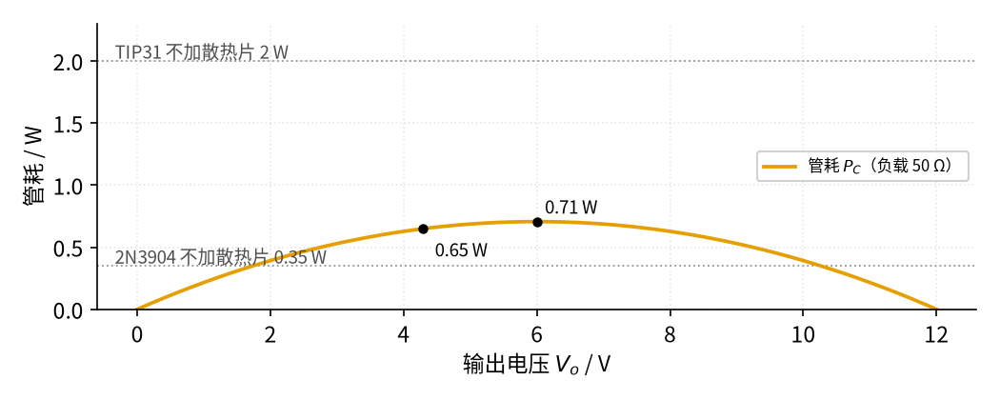
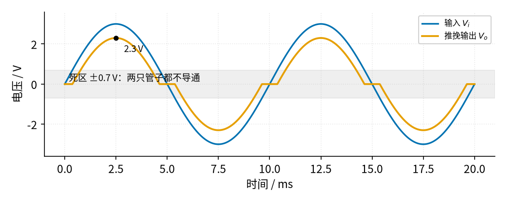

# 07 射极跟随器 · 参数与调试篇

[上一页：原理与实现篇](page2.md) · [直觉篇](page1.md) · [原理与实现篇](page2.md) · 本页：参数与调试篇 · [下一页：15 有源滤波 · 直觉篇](../15-active-filter/page1.md) · 前置节点：[P2 半导体入门 · 直觉篇](../P2-semiconductor-basics/page1.md)、[03 电压跟随器 · 直觉篇](../03-voltage-follower/page1.md)

## 一、参数表

本页沿用原理篇的符号：输入 $V_i$ 、输出 $V_o$ 、电源 $V_{CC}$ 、负载 $R_L$ ，管耗 $P_C$ 。表中数字来自 `python code/figs/07_figs.py` 的输出或所列数据手册。

| 参数 | 典型取值 | 影响什么 | 选择要点 |
|---|---|---|---|
| $V_{BE}$ | 0.6 V 到 0.8 V（小电流）；TIP31 在 3 A 时最大 1.8 V | 输出比输入低多少 | 要精确就把跟随器放进运放反馈环 |
| β（ $h_{FE}$ ） | 2N3904 为 100 到 300（10 mA）；TIP31 在 1 A 时至少 25 | 运放要给多少基极电流 | 按手册**最小值**算基极电流 |
| $V_{CC}$ | 比最高输出高 2 V 到 3 V 即可 | 管耗 | 留够余量就行，越高越热 |
| $P_C$ 上限 | 2N3904 为 350 mW（Semelab）；TIP31 不加散热片 2 W、加散热片可到 40 W（管壳 25 °C） | 管子会不会烧 | 按最坏情况 $V_o = V_{CC}/2$ 估 |
| $\theta_{JA}$ | TIP31 为 62.5 °C/W | 不加散热片时的温升 | 温升 = 功耗 × $\theta_{JA}$ |
| 运放拉电流 | LM358 典型 30 mA、最小 20 mA | 能推动多大的基极电流 | 基极电流留几倍余量 |

β 变化的影响由程序扫描给出（ $V_i = 5\ \text{V}$ 、 $R_L = 50\ \Omega$ ）：

| β | 25 | 50 | 100 | 300 |
|---|---|---|---|---|
| $V_o$ | 4.291 V | 4.290 V | 4.290 V | 4.290 V |
| $I_B$ | 3.30 mA | 1.68 mA | 0.85 mA | 0.29 mA |

β 从 25 变到 300，输出几乎不变，变的只是运放要出的电流。这就是射极跟随器"好用"的原因：它对 β 不敏感，只要运放给得起基极电流。

真正要算的是功耗，见图 07-p3-1：

*图 07-p3-1　负载 50 Ω、电源 12 V 时三极管管耗随输出电压的变化*

图 07-p3-1 的曲线是一条倒扣的抛物线：输出为 0 时没有电流，输出接近 12 V 时三极管上没有压降，两头都不发热；最热的是输出等于电源一半（6.0 V）的时候，0.71 W。原理篇的工作点（4.29 V）是 0.65 W。两条灰色点线中，2N3904 的 0.35 W 被曲线大段超过，TIP31 不加散热片的 2 W 则绰绰有余。按 $\theta_{JA}$ 估，0.65 W 让 TIP31 的结温比环境高约 41 °C，最坏的 0.71 W 高约 44 °C——摸上去烫手，但在 150 °C 的结温上限以内。

## 二、故障排查

| 现象 | 原因 | 怎么查 | 怎么改 |
|---|---|---|---|
| 输出总比想要的低 0.6 V 到 0.7 V | 忘了 $V_{BE}$ | 万用表测基极和发射极，差值就是 $V_{BE}$ | 输入提高一个 $V_{BE}$ ，或把反馈取自发射极（原理篇第五节） |
| 输入很小时输出为 0 | 输入低于约 0.6 V，三极管截止 | 测基极电压是否低于 0.6 V | 单电源时让输入保持在 0.7 V 以上，或改用推挽加双电源 |
| 三极管烫手、冒烟 | 管耗超过额定值 | 算 $(V_{CC} - V_o) I_C$ ，与手册 $P_D$ 比较 | 换功率管、加散热片、降低 $V_{CC}$ |
| 输出上不去，到某个电压就平了 | 运放输出摆不到电源轨，或 $V_{CC}$ 余量不够 | 测运放输出最高能到多少 | 运放电源比 $V_{CC}$ 高一点，或换轨到轨运放 |
| 接了长电缆或大电容后输出有高频振荡 | 射极跟随器与容性负载形成振荡（TI AN-4） | 示波器看输出，有几十 kHz 以上的毛刺 | 在跟随器与电缆之间串磁珠（TI AN-4）；基极串一只电阻，TI AN-4 图 8 的输出缓冲用 470 Ω 消除输出管的寄生振荡 |
| 加了基极电阻后输出整体又低了零点几伏 | 基极电流流过基极电阻也有压降，而电阻在反馈环外 | 测基极电阻两端电压，约等于 $I_B$ × 阻值 | 把反馈取自发射极，让运放自动补上；或在不振荡的前提下减小阻值 |
| 负载重时输出掉得比预期多 | β 太小，运放基极电流不够，进入限流 | 测运放输出电流或输出是否被压低 | 按 β 最小值重算；换 β 更大的管子或达林顿 |

**基极电阻怎么选**。振荡那一行的改法里，基极电阻的作用是给"三极管 + 电缆电容"组成的高频谐振回路加一点损耗，让它起不了振。TI 的 AN-4 给了一个实例：LM101 后面接一对互补三极管做大电流缓冲，运放输出和两管基极之间串了 470 Ω，文中明说这只电阻是为了消除输出管的寄生振荡；同一份资料还建议在集电极各串 50 Ω 来限流。

这只电阻不是白来的。基极电流流过它会产生压降：按原理篇的 50 Ω 负载、β = 50 算，基极电流 1.68 mA，470 Ω 上就要降掉

$$1.68\ \text{mA} \times 470\ \Omega \approx 0.79\ \text{V}$$

如果反馈只取运放自己的输出，跟随器的输出会再低 0.79 V，从 4.29 V 掉到 3.5 V 左右。如果像原理篇第五节那样把反馈取自发射极，运放会自动把输出抬到约 $5 + 0.71 + 0.79 = 6.50\ \text{V}$ ，仍低于它 10.5 V 的上限，输出照样是 5.00 V。β 按最小值 25 算时基极电流翻倍到 3.30 mA，压降约 1.55 V，运放要到约 7.3 V，也还够。所以基极电阻最好和"反馈取自发射极"一起用；阻值先按资料取几百欧，再看示波器上毛刺是否消失，不要盲目加大。

排查顺序建议：先测 $V_B$ 和 $V_E$ 看差值是否在 0.6 V 到 0.8 V 之间（判断管子是否正常导通），再测 $V_{CE}$ 和电流算功耗，最后才用示波器看振荡。

## 三、练习

**练习 1**： $V_i = 9\ \text{V}$ ， $R_L = 20\ \Omega$ ，β = 50， $V_{CC} = 15\ \text{V}$ ，用 TIP31 不加散热片。求 $V_o$ 、 $I_B$ 和 $P_C$ ，判断是否安全。

答案

$V_o = 9 - 0.7 = 8.3\ \text{V}$ ，负载电流 415 mA，基极电流 8.14 mA（LM358 能给）。管耗 $(15 - 8.3) \times 0.415 \times 50/51 \approx 2.73\ \text{W}$ ，超过不加散热片的 2 W；按 62.5 °C/W 算温升约 170 °C，不安全。必须加散热片，或把 $V_{CC}$ 降到 11 V 左右。

**练习 2**：全部用 5 V 单电源：LM358 和三极管集电极都接 5 V，β = 100， $R_L = 100\ \Omega$ 。输入 2.7 V 时输出多少？想让输出到 4 V 行不行？

答案

输入 2.7 V 时 $V_o = 2.0\ \text{V}$ ，电流 20 mA，基极电流 0.20 mA，管耗约 0.059 W。想到 4 V 不行：LM358B 输出离正电源典型差 1.4 V，最高约 3.6 V，再减一个 $V_{BE}$ ，跟随器输出最高只有约 2.9 V。解决：运放电源比 5 V 高一些，或换轨到轨运放，并给三极管集电极留余量。

**练习 3**：某同学测得 $V_B = 5.0\ \text{V}$ 、 $V_E = 0\ \text{V}$ ，负载不工作；另一块板子测得 $V_B = V_E = 5.0\ \text{V}$ 、负载电流远超预期。各是什么故障？

答案

第一块：基极有电压、发射极为 0，说明三极管没导通——可能管脚接错（集电极和发射极对调）、发射极到负载断线，或者管子 B–E 结已经烧开路。第二块：基极和发射极一样高，说明 B–E 结已经击穿短路，运放直接在带负载，这通常是之前过热烧坏的后果。两种情况都要先断电，用万用表二极管挡量 B–E、B–C 结。

**练习 4（变体迁移）**：推挽跟随器。把一只 NPN 和一只 PNP 的基极接在一起、发射极接在一起，NPN 集电极接正电源、PNP 集电极接负电源，就能让输出既能"推"正电流又能"拉"负电流。可是输入一个 ±3 V 正弦，输出会变成下图的样子，见图 07-p3-2：

*图 07-p3-2　推挽射极跟随器的交越失真*

请解释图 07-p3-2 中过零处的平台是怎么来的，并说出一种改进办法。

答案

输入在 +0.7 V 以上时只有 NPN 导通，输出 = 输入 − 0.7 V；在 −0.7 V 以下时只有 PNP 导通，输出 = 输入 + 0.7 V；夹在中间的 ±0.7 V 里两只管子都不导通，输出为 0，于是图 07-p3-2 里过零处出现平台，峰值也只剩 2.3 V。这叫交越失真。改进：用两只二极管给两管基极各预加约 0.7 V 偏置（AB 类），或者像原理篇那样把推挽级放进运放反馈环，让运放自动补上死区（TI AN-272 的做法）。

## 参考资料

- Central Semiconductor，TIP31 数据手册（2 W / 40 W、62.5 °C/W、 $h_{FE}$ 、 $V_{BE(on)}$ ）：https://www.mouser.com/datasheet/2/68/tip31-845511.pdf
- Semelab，2N3904 数据手册（350 mW、 $h_{FE}$ 100 到 300）：https://www.farnell.com/datasheets/1686115.pdf
- TI，LM358 数据手册（拉电流、LM358B 输出摆幅）：https://www.ti.com/lit/ds/symlink/lm358.pdf
- TI AN-4（射极跟随器接长电缆振荡、磁珠；图 8 大电流输出缓冲中基极串 470 Ω 消除寄生振荡、集电极串 50 Ω 限流）：https://www.ti.com/lit/an/snoa650b/snoa650b.pdf
- TI AN-272（推挽助推级、二极管补偿 $V_{BE}$ ）：https://www.ti.com/lit/an/snoa600b/snoa600b.pdf
- Electronics Tutorials，交越失真（死区、二极管预偏置的 AB 类）：https://www.electronics-tutorials.ws/amplifier/amp_7.html
