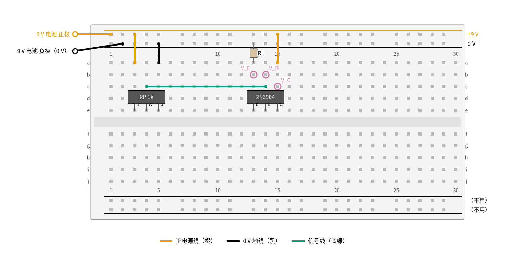
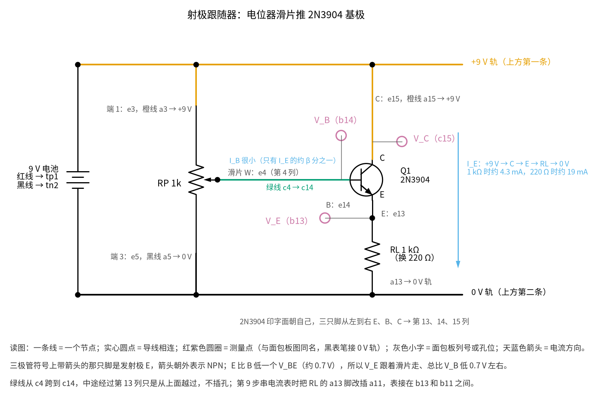
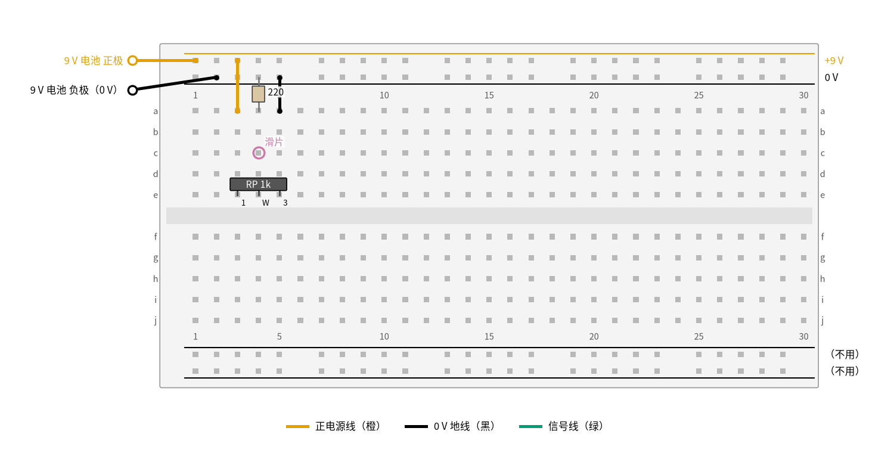
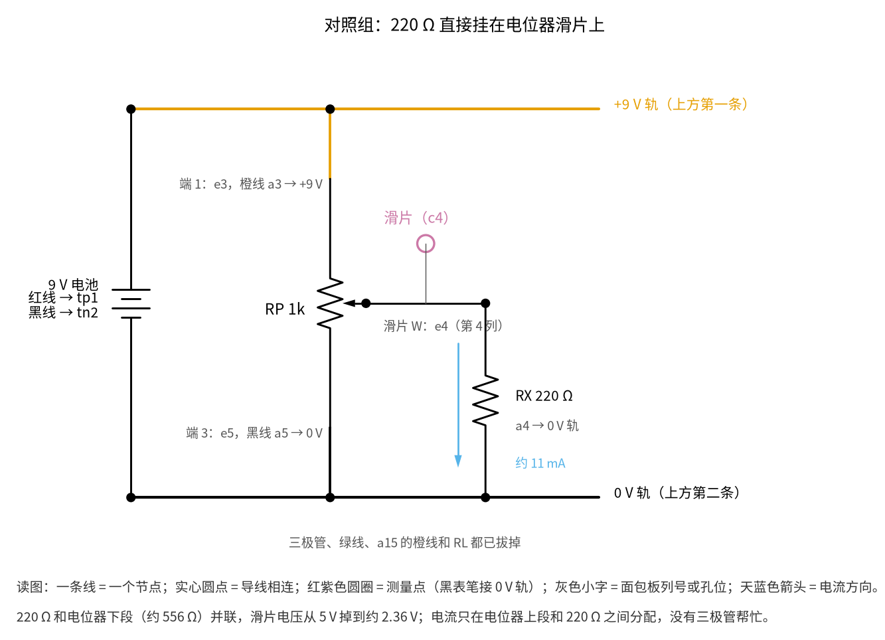

# 07 射极跟随器 · 动手实验篇

[上一页：参数与调试篇](page3.md) · [直觉篇](page1.md) · [原理与实现篇](page2.md) · [参数与调试篇](page3.md) · 本页：动手实验篇 · [下一页：15 有源滤波 · 直觉篇](../15-active-filter/page1.md) · 前置节点：[P2 半导体入门 · 直觉篇](../P2-semiconductor-basics/page1.md)、[03 电压跟随器 · 直觉篇](../03-voltage-follower/page1.md)

## 这次实验要验证什么

用一节 9 V 电池、一只电位器和一只 2N3904，亲手量出射极跟随器的两个招牌性质：发射极电压总比基极低一个 $V_{BE}$ （约 0.7 V），而且负载电流变大好几倍时它几乎不往下掉；同样的电位器直接带负载，电压却一下塌掉一半（结论见 [07 射极跟随器 · 原理与实现篇](page2.md) 第二节的推导一、推导二和第七节的低压动手实验）。

## ⚠️ 安全须知

- **只用 12 V 及以下的直流电。** 本实验用一节 9 V 叠层电池，也可以用输出 9 V 的直流稳压电源。原理篇第三、四节那个 12 V、50 Ω 负载的仿真场景只在电脑上看，不要照着搭。
- **电解电容分正负极。** 本实验的电路里没有电解电容。如果你想在电池两端并一只电解电容，长脚（正极）接 +9 V 轨，带「−」条纹的一脚接 0 V 轨，接反会鼓包甚至爆裂。
- **元件可能发烫，不要用手摸。** 负载是 220 Ω 时，三极管的功耗只有约 0.09 W，只是微温。但**负载绝对不要换成几十欧**：那样 2N3904 的功耗会超过它的额定值，几秒内就烫得能伤手。三极管插错脚（比如 C、E 互换）时也可能异常发热，闻到焦味先拔电池。
- **接线、改线之前先断电。** 断电就是把电池扣从电池上拔下来。改线时电池扣的两个金属头不要碰在一起，9 V 电池短路会发热。
- 测电流时万用表必须**串**在电路里，而且红表笔要插在 mA 插孔；量完电流马上把红表笔插回电压插孔，否则下次量电压时会把表的保险丝烧掉。

## 器材清单

| 元件 | 型号或数值 | 数量 | 说明 |
|---|---|---|---|
| NPN 三极管 | 2N3904，TO-92 封装 | 1 | 平面（印字面）朝自己、脚朝下时，从左到右是 E、B、C |
| 电位器 | 1 kΩ，三脚可插面包板的蓝白微调电位器或小旋钮电位器 | 1 | RP，把 9 V 分出一个 0～9 V 可调的基极电压 |
| 电阻 | 1 kΩ | 1 | 第一种负载 RL |
| 电阻 | 220 Ω | 1 | 第二种负载 RL，也用于「不接三极管直接挂滑片」的对照 |
| 9 V 叠层电池和电池扣 | 6F22 | 1 | 也可以用 9 V 直流稳压电源 |
| 面包板 | 830 孔（30 列以上） | 1 | 本实验只用上方两条电源轨 |
| 跳线 | 单芯线或杜邦线 | 若干 | 橙色接 +9 V，黑色接 0 V，绿色走信号 |
| 万用表 | 带直流 20 V 挡和 200 mA 挡 | 1 | 自动量程表也可以 |

先用万用表电阻挡量两只负载电阻的实际阻值，再量一下电位器两个固定端之间的总阻值，都记下来，后面的 Python 要用。

## 搭建步骤

电路就是 [07 射极跟随器 · 原理与实现篇](page2.md) 第二节那张分析图：基极接输入，集电极接电源，发射极经 $R_L$ 接地；只是把「输入」换成了电位器滑片。图 07-p4-1 是搭好后的俯视图。



*图 07-p4-1　射极跟随器的面包板接线（9 V 电池，负载 RL 先用 1 kΩ）*

对照 图 07-p4-3 的电路原理图认清三极管的三只脚：基极接滑片，集电极接 +9 V，发射极经 RL 接 0 V。



*图 07-p4-3　图 07-p4-1 对应的电路原理图（灰色小字是面包板列号或孔位，天蓝色箭头是电流方向）*

**对照看**：面包板的连通规则见 [P1 元件速成 · 动手实验篇](../P1-components-basics/page4.md)，同一列 a–e 五个孔是一个节点。2N3904 印字面朝自己时三只脚从左到右是 E、B、C，分别占第 13、14、15 列，所以 b13、b14、c15 就是原理图里的 V_E、V_B、V_C；符号上带箭头的那只脚是发射极，箭头朝外表示 NPN。绿线从第 4 列（滑片）直接跳到第 14 列（基极），从第 13 列上方越过而不相连，原理图里它和发射极是两个节点。同样的接法在 [07 射极跟随器 · 直觉篇](page1.md) 第四节也画成了电路图。

面包板的规矩：同一列里 a–e 五个孔连通，f–j 五个孔连通，中间的凹槽把上下两半隔开；上方两条电源轨整条连通（有的面包板在中间断开，用通断挡量一下两端）。本实验只用上半区。

1. **铺电源轨。** 电池扣红线插最上面一条轨（+9 V），黑线插第二条轨（0 V）。先不要扣电池。
2. **插电位器。** RP 的三只脚插 e3、e4、e5，中间那只（滑片 W）在 e4。
3. **给电位器接电源。** 橙线从 a3 接到 +9 V 轨，黑线从 a5 接到 0 V 轨。
4. **先调滑片。** 扣上电池，红表笔插 c4、黑表笔插 0 V 轨，转电位器直到读数为 5.00 V。然后拔下电池。这一步要在接三极管之前做，读到的就是滑片的「空载电压」。
5. **插三极管。** 2N3904 印字面朝自己，E 脚插 e13、B 脚插 e14、C 脚插 e15。
6. **接集电极和基极。** 橙线从 a15 接到 +9 V 轨；绿线从 c4 接到 c14，把滑片电压送到基极。绿线跨过第 13 列时只是从上面经过，不插进第 13 列的孔。
7. **接负载。** RL（先用 1 kΩ）一脚插 a13，另一脚插 0 V 轨。
8. **检查一遍再上电。** 对照图 07-p4-1：印字面朝自己，橙线 2 根（不算电池线），黑线 1 根，绿线 1 根。确认后扣上电池。

图 07-p4-1 里的红紫色圆圈是测量点：V_E 在 b13，V_B 在 b14，V_C 在 c15。表笔插进同一列的空孔就能接触到。画图脚本把每根线、每只元件脚登记到「网络」里，断言滑片确实连到基极、集电极接 +9 V、发射极经 RL 到 0 V，而且基极和发射极没有被连在一起；接错一处，图就画不出来。

**换 220 Ω 负载：** 断电，把 RL 换成 220 Ω，插在同样的位置（a13 和 0 V 轨），再上电。电位器不要动。

**对照组：不要三极管，220 Ω 直接挂滑片。** 断电，按图 07-p4-2 改：拔掉三极管、绿线、a15 的橙线和 RL，把 220 Ω 一脚插 a4（滑片那一列），另一脚插 0 V 轨。



*图 07-p4-2　对照组：220 Ω 直接挂在电位器滑片上*

对照组的电路原理图是 图 07-p4-4，比 图 07-p4-3 少了整个三极管那一支。



*图 07-p4-4　图 07-p4-2 对应的电路原理图（对照组）*

**对照看**：连通规则还是 [P1 元件速成 · 动手实验篇](../P1-components-basics/page4.md) 那一条：220 Ω 插在 a4，和滑片 e4、测量点 c4 同在第 4 列上半，所以原理图里它直接挂在滑片上。这样 220 Ω 和电位器下段并联，滑片电压从 5 V 掉到约 2.36 V，对应测量表第 10 步。和 图 07-p4-3 对比就能看出：有三极管时，滑片只需供给很小的基极电流，负载电流由集电极从 +9 V 轨直接取。

## 测量表

黑表笔除了第 5、7、8 步以外一律接 0 V 轨。下表「应该读到」的数取自 [review/spice/07.md](../review/spice/07.md) 的面包板读数表，是用 onsemi 的 2N3904 模型、电位器滑片调到 5 V（上段 444 Ω、下段 556 Ω）做 ngspice 仿真得到的；第 3、7 步的基极电压和第 9 步的电流来自同一个网表。你手里的管子 β 和 $V_{BE}$ 不同，读数会差几十毫伏。

| 步骤 | 测什么 | 红表笔 | 黑表笔 | 挡位 | 应该读到 | 读不到时先查 |
|---|---|---|---|---|---|---|
| 1 | 电池电压 | +9 V 轨 | 0 V 轨 | 直流 20 V | 9 V 左右（新电池可达 9.5 V） | 电池扣是否扣紧 |
| 2 | 滑片空载电压（搭建第 4 步） | c4 | 0 V 轨 | 直流 20 V | 调到 5.00 V | 电位器两端是否接在 +9 V 和 0 V 上 |
| 3 | 基极 $V_B$ （1 kΩ） | b14 | 0 V 轨 | 直流 20 V | 4.99 V | 读到明显低于 5 V：三极管 B、E 插反 |
| 4 | 发射极 $V_E$ （1 kΩ） | b13 | 0 V 轨 | 直流 20 V | 4.31 V | 读到 0 V：RL 没插好或三极管没接集电极 |
| 5 | $V_{BE}$ （1 kΩ） | b14 | b13 | 直流 2 V | 0.68 V | 大于 1 V：三极管坏了或 E 脚没接触 |
| 6 | 发射极 $V_E$ （220 Ω） | b13 | 0 V 轨 | 直流 20 V | 4.20 V | 比第 4 步低很多：电位器被碰动了 |
| 7 | $V_B$ 和 $V_{BE}$ （220 Ω） | b14 | 0 V 轨 / b13 | 直流 20 V / 2 V | 4.95 V / 0.76 V | — |
| 8 | $V_{CE}$ （220 Ω） | c15 | b13 | 直流 20 V | 4.8 V（管耗约 0.09 W） | 接近 0 V：C、E 插反 |
| 9 | 负载电流（220 Ω） | 见下方说明 | 见下方说明 | 直流 200 mA | 19 mA | 读到 0：表笔没插 mA 孔或保险丝已断 |
| 10 | 对照组：220 Ω 直接挂滑片 | c4 | 0 V 轨 | 直流 20 V | 2.36 V | — |

**第 9 步怎么串电流表：** 断电，把 RL 插在 a13 的那只脚拔出来，改插到 a11（一个空列）。红表笔（插在 mA 孔）插 b13，黑表笔插 b11，万用表就串在发射极和 RL 之间了。上电读数，读完断电、把 RL 插回 a13、红表笔插回电压孔。

对比第 4 步和第 6 步：负载从 1 kΩ 换成 220 Ω，电流从约 4.3 mA 变成约 19 mA，是原来的 4.4 倍，发射极电压只掉了 0.11 V；而第 10 步不要三极管时，同样的 220 Ω 把滑片电压从 5 V 拉到 2.36 V。这就是原理篇说的「三极管把电位器的内阻缩小了约 β + 1 倍」。

## 没有示波器怎么办

射极跟随器的主要性质都是直流性质，万用表完全够用。把它的「跟随」看成一条曲线：保持 1 kΩ 负载，每次断开绿线（让滑片空载）把滑片调到一个电压，再接回绿线读 $V_E$ 。仿真给出的对应关系如下，你量出来应该是一条斜率接近 1、整体下移约 0.7 V 的直线：

| 滑片空载电压 | 1 V | 2 V | 3 V | 4 V | 5 V | 6 V | 7 V | 8 V |
|---|---|---|---|---|---|---|---|---|
| $V_E$ （1 kΩ，仿真） | 0.42 V | 1.37 V | 2.34 V | 3.32 V | 4.31 V | 5.30 V | 6.29 V | 7.29 V |

从 2 V 到 8 V，滑片每升 1 V， $V_E$ 也升 0.98～0.99 V，这就是「电压放大倍数接近 1」；滑片只有 1 V 时 $V_E$ 是 0.42 V，台阶只剩 0.58 V，因为电流小了， $V_{BE}$ 也小。再低到 0.5 V 左右，三极管就截止了，这就是 [07 射极跟随器 · 参数与调试篇](page3.md) 故障排查表里「输入很小时输出为 0」那一行。

想「看见」跟随，还可以把 RL 换成一只 1 kΩ 电阻串一只 LED（LED 长脚朝发射极）：慢慢转电位器，滑片要超过「LED 压降（红色约 1.8 V）加一个 $V_{BE}$ 」以后 LED 才开始发光，之后越转越亮，亮度跟着滑片走。这是粗略的估算，你可以用万用表量一下 LED 刚亮时的滑片电压来验证。

**只有示波器才能看到的**：输入一个正弦时，输出和输入形状完全一样、只是整体下移一个 $V_{BE}$ 。这一段在原理篇第三、四节里是仿真（12 V、50 Ω，只在电脑上看）：正弦输入下的波形图里，橙色输出和蓝色输入平行，峰值处差约 0.7 V；运放直接带 50 Ω 的那条朱红色线则被压成一条直线。推挽跟随器的交越失真也只能在示波器上看，见 [07 射极跟随器 · 参数与调试篇](page3.md) 第三节练习里的推挽交越失真图：输出在零点附近有一段「平台」。

## 用 Python 核对你的读数

把你量到的电池电压、滑片空载电压、电位器总阻值、负载实际阻值和各步读数填进去。代码先由滑片空载电压和电位器阻值算出「电位器看进去的内阻」，再用一个按 2N3904 厂家模型拟合的 $V_{BE}$ 公式（ $V_{BE}$ 随电流对数增长，再加一点体电阻压降）解出期望读数，偏差超过 10% 就提示。

```python
import sys, pathlib
sys.path.insert(0, str(pathlib.Path("code/figs").resolve()))  # 在仓库根目录运行
# 07 射极跟随器 · 动手实验核对：填入实测值，算出期望读数并比较
import numpy as np

# ---- 1. 你量到的值（示例值，换成你自己的）----
V9 = 9.42          # 第 1 步：电池电压 / V
VW0 = 5.00         # 第 2 步：滑片空载电压 / V
RPOT = 985.0       # 电位器两个固定端之间的总阻值 / Ω
R1K, R220 = 992.0, 218.0
BETA = 100.0       # 2N3904 在 10 mA 附近的典型 β
m = dict(vb_1k=4.98, ve_1k=4.30, vb_220=4.94, ve_220=4.17, i_220=19.2e-3, vw_direct=2.39)

def vbe(i):
    """按 onsemi 2N3904 模型拟合：0.6 mA～32 mA 内误差 < 1 mV。"""
    return 0.898 + 0.0404 * np.log(i) + 0.906 * i

# 电位器滑片的戴维南等效：空载电压 VW0，内阻 = 上段 ∥ 下段
r_low = RPOT * VW0 / V9
r_th = (RPOT - r_low) * r_low / RPOT

def follower(rl):
    lo, hi = 0.0, VW0
    for _ in range(60):                      # 二分法解发射极电压
        ve = (lo + hi) / 2
        ie = ve / rl
        vb = VW0 - ie / (BETA + 1) * r_th
        lo, hi = (ve, hi) if vb - ve > vbe(ie) else (lo, ve)
    return vb, ve, ie

calc = {}
calc["vb_1k"], calc["ve_1k"], _ = follower(R1K)
calc["vb_220"], calc["ve_220"], calc["i_220"] = follower(R220)
calc["vw_direct"] = VW0 * R220 / (R220 + r_th)
print(f"电位器内阻约 {r_th:.0f} Ω；从发射极看进去只有约 {r_th / (BETA + 1):.1f} Ω（再加上三极管自身的一点）")

warn = 0
for k, c in calc.items():
    x = m[k]
    dev = (x - c) / c * 100
    flag = abs(dev) > 10
    warn += flag
    unit = "mA" if k.startswith("i_") else "V"
    s = 1e3 if unit == "mA" else 1
    print(f"{k:<10} 实测 {x * s:7.3f} {unit}  计算 {c * s:7.3f} {unit}  偏差 {dev:+5.1f}%" + ("  ← 偏差太大，先查测量表最后一列" if flag else ""))

for tag, (vb, ve, rl) in {"1k": (m["vb_1k"], m["ve_1k"], R1K), "220": (m["vb_220"], m["ve_220"], R220)}.items():
    v = vb - ve
    ok = 0.55 <= v <= 0.85
    warn += not ok
    p = (V9 - ve) * ve / rl
    print(f"RL={tag}：V_BE = {v:.2f} V（合理范围 0.55～0.85 V）{'' if ok else '  ← 超出范围'}，三极管管耗 {p * 1e3:.0f} mW")
print("全部在范围内" if warn == 0 else f"有 {warn} 项需要检查")
```

示例数据里电池是新的（9.42 V），滑片仍然调到 5.00 V，所以期望值和测量表里的数几乎一样，只是电位器内阻按实测阻值重算了。如果你的 $V_{BE}$ 比 0.68 V 小几十毫伏，说明你那只管子的 β 或饱和电流和模型不同，属于正常的个体差异。

## 实验记录表

| 项目 | 实测值 | 计算值 | 偏差 |
|---|---|---|---|
| 电池电压 |  |  |  |
| 滑片空载电压 |  |  |  |
| $V_B$ / $V_E$ （1 kΩ） |  |  |  |
| $V_{BE}$ （1 kΩ） |  |  |  |
| $V_B$ / $V_E$ （220 Ω） |  |  |  |
| $V_{BE}$ （220 Ω） |  |  |  |
| $V_{CE}$ 和管耗（220 Ω） |  |  |  |
| 负载电流（220 Ω） |  |  |  |
| 对照组滑片电压 |  |  |  |

### 思考题

**1. 负载从 1 kΩ 换成 220 Ω，电流变成 4.4 倍，为什么发射极电压只掉了约 0.1 V？**

<details><summary>答案</summary>

有两个原因，都很小。第一，基极电流只有发射极电流的 $1/(\beta+1)$ ，19 mA 的负载电流只要电位器给出约 0.19 mA，它流过约 247 Ω 的电位器内阻，只让基极电压降了约 0.05 V。第二， $V_{BE}$ 随电流对数增长，电流变成 4.4 倍， $V_{BE}$ 从 0.68 V 升到 0.76 V，又多了约 0.08 V。两者加起来约 0.1 V。

</details>

**2. 不接三极管时，220 Ω 直接挂到滑片上，为什么电压会掉到 2.36 V？**

<details><summary>答案</summary>

滑片看进去相当于一个 5 V 的电源串着约 247 Ω 的内阻（上段 444 Ω 和下段 556 Ω 并联）。220 Ω 接上以后和这 247 Ω 分压： $5 \times 220/(220+247) \approx 2.36\ \text{V}$ 。加了三极管以后，负载「看到」的内阻缩小了约 β + 1 倍，只剩两三欧，所以几乎不掉。

</details>

**3. 测量表第 8 步量到 $V_{CE}$ 约 4.8 V，如果把负载换成 22 Ω，三极管的功耗大约是多少？为什么不能这样做？**

<details><summary>答案</summary>

发射极电压仍约 4.2 V（实际会再低一点），电流约 4.2 ÷ 22 ≈ 0.19 A， $V_{CE}$ 约 4.8 V，功耗约 4.8 × 0.19 ≈ 0.9 W，超过 2N3904 在 25 °C 时 625 mW 的额定功耗，管子会迅速发烫甚至损坏。这正是 [07 射极跟随器 · 参数与调试篇](page3.md) 第一节专门计算管耗的原因；要带这么重的负载，得换 TIP31 这类功率管并加散热片。

</details>

## 自测清单

- 我能按 E、B、C 的顺序把 2N3904 插对，并说出印字面朝向和管脚的关系。
- 我能用万用表量出 $V_B$ 、 $V_E$ 和 $V_{BE}$ ，并判断三极管是否正常导通。
- 我能把万用表串进电路量负载电流，并在量完后把表笔插回电压孔。
- 我能用「戴维南等效 + 内阻缩小 β + 1 倍」解释加不加三极管时滑片电压的巨大差别。
- 我能在不用示波器的情况下，用调滑片、读 $V_E$ 的办法画出跟随器的传输特性。
