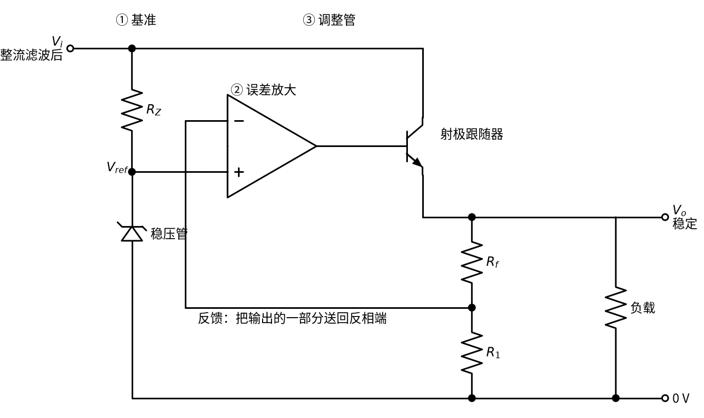
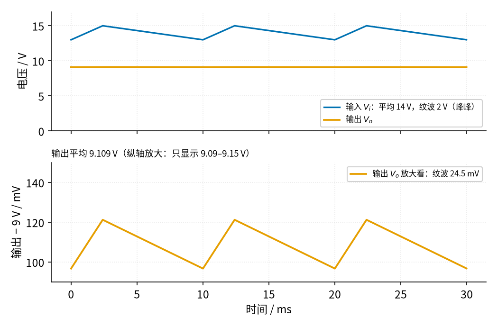
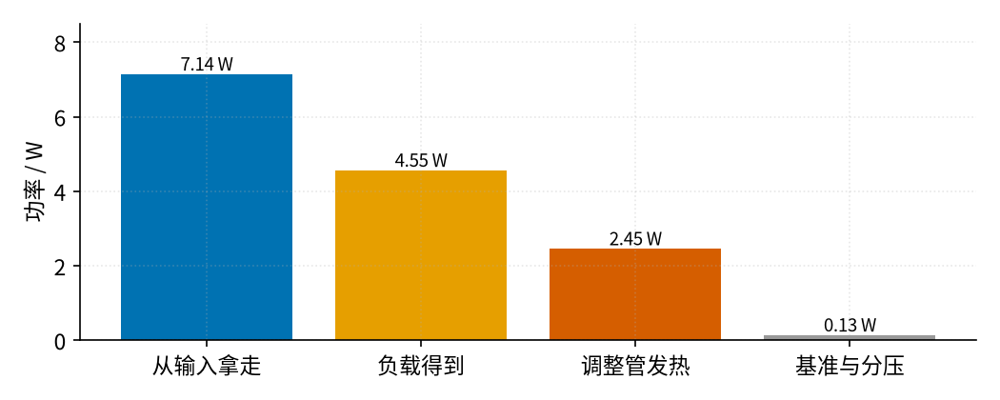

# 08 线性稳压 · 直觉篇

[上一页：15 有源滤波 · 参数与调试篇](../15-active-filter/page3.md) · 本页：直觉篇 · [原理与实现篇](page2.md) · [参数与调试篇](page3.md) · [下一页：原理与实现篇](page2.md) · 前置节点：[02 同相放大 · 直觉篇](../02-noninverting-amp/page1.md)、[07 射极跟随器 · 直觉篇](../07-emitter-follower/page1.md)、[10 稳压管稳压 · 直觉篇](../10-zener-regulator/page1.md)

> [!NOTE]
> 本节电路本身只工作在十几伏的低压上。它的输入如果来自 06 的变压器整流电源，那么变压器初级仍然接着 220 V 市电，[06 桥式整流 · 直觉篇](../06-bridge-rectifier/page1.md) 开头的安全提示全部适用。本节的动手实验一律用**可调直流电源**（实验室稳压电源）代替整流电源。

## 为什么需要线性稳压

回忆 [06 桥式整流 · 直觉篇](../06-bridge-rectifier/page1.md) 做出来的电源：12 V 交流经过整流桥和 2200 µF 电容，负载 0.19 A 时平均 14.34 V，还带着 0.67 V 的锯齿形纹波（见 06 page2）。负载一加大，电容放电更快，纹波跟着变大；电网电压高一点低一点，输出也跟着高一点低一点。单片机、传感器、音频放大器都不喜欢这种"会晃的电压"。

[10 稳压管稳压 · 直觉篇](../10-zener-regulator/page1.md) 给了第一个办法：一只电阻加一只稳压管。它确实能把 1 V 的纹波压到 36.5 mV（见 10 page1），可是它有两个硬伤：输入 10 V 时，负载超过约 27.3 mA 就失去稳压（见 10 page2）；输入 12 V、负载 20 mA 时效率只有约 23%（见 10 page1）。想给一个要 0.5 A 的负载供电，这条路走不通。

10 的末尾还试过"稳压管 + 射极跟随器"：电流是大了，可输出被固定在 $V_Z - V_{BE}$ ，想要 9 V 就得重新找稳压管，而且 $V_{BE}$ 随电流和温度变化，输出也跟着漂。

这一节要做的，就是把前面学过的三样东西拼在一起，得到一个**电流大、电压可调、几乎不受纹波和负载影响**的电源。

## 一、电路：三块积木拼起来

先看整体结构，见图 08-p1-1：

*图 08-p1-1　线性稳压的三块积木：基准、误差放大、调整管*

图 08-p1-1 从左到右是三块：

1. **① 基准**：电阻 $R_Z$ 加稳压管，就是 10 节的电路，只是它现在不用带负载，只给运放一个稳定的参考电压 $V_{ref}$ 。不带负载的稳压管最舒服，电压最稳。
2. **② 误差放大**：运放接成 [02 同相放大 · 直觉篇](../02-noninverting-amp/page1.md) 的样子。同相端接 $V_{ref}$ ，反相端接输出经 $R_f$ 、 $R_1$ 分压后的那一点。它不停地比较"输出的一部分"和"基准"，差多少就调多少。
3. **③ 调整管**：一只 NPN 三极管，接成 [07 射极跟随器 · 直觉篇](../07-emitter-follower/page1.md)。运放只出几毫安的基极电流，大电流从输入经集电极、发射极流到负载。

07 page2 的最后已经预告过这个结构：把射极跟随器放进运放的反馈环，反馈从发射极取回，运放会自动多给一个 $V_{BE}$ 。在图 08-p1-1 里，运放比较的不再是输入信号，而是基准电压，于是输出电压就被"钉"在一个固定值上。

## 二、类比：盯着水位计拧阀门的人

把输入想成一个水位忽高忽低的水塔，负载是下游的用户，调整管是水塔出口的阀门。

- 基准电压是墙上画的一条"目标水位线"；
- 分压电阻是一根水位计，把下游的实际水位按比例显示出来；
- 运放是一个一刻不停盯着水位计的人：水位比线低，就把阀门开大一点；比线高，就关小一点。

水塔水位上涨（纹波的波峰），阀门自动关小；用户突然多用水（负载加大），阀门自动开大。只要水塔的水位始终比目标线**高出一截**，下游的水位就能保持不动。这"高出的一截"，就是后面要讲的**压差**。

## 三、效果：2 V 的纹波只剩几十毫伏

用程序把本节的主例（输出约 9.1 V、负载 0.5 A）仿真一遍，见图 08-p1-2：

*图 08-p1-2　带纹波的输入与稳定的输出（负载 0.5 A）*

图 08-p1-2 上半部分，蓝色输入平均 14 V，纹波 2 V（峰峰值），这差不多就是 06 的整流电源带 0.5 A 负载时的样子；橙色输出几乎是一条水平线。下半部分把纵轴放大到只显示 9.09 V 到 9.15 V，才看出输出还有一个 24.5 mV 的小锯齿：2 V 的纹波被压小了约 80 倍。负载从 0.01 A 变到 0.5 A，输出的变化更是小到只有几微伏（原理篇会算）。

## 四、代价：多出来的电压全变成热

天下没有免费的午餐。调整管就像一个**会自动调节的电阻**，它把输入和输出之间多出来的电压"吃掉"。吃掉的电压乘以流过的电流，就是它发的热，见图 08-p1-3：

*图 08-p1-3　输入 14 V、负载 0.5 A 时功率的去向*

图 08-p1-3 里，蓝色柱子是从输入拿走的 7.14 W，橙色柱子是负载真正得到的 4.55 W，朱红色柱子是调整管变成热量的 2.45 W，灰色的小柱子是基准和分压电阻用掉的 0.13 W。效率约 64%，比 10 节的 23% 好得多，但仍有三分之一的能量变成了热。2.45 W 已经超过了 TIP31 不加散热片能承受的 2 W（见 07 page3），所以**线性稳压的调整管一般都要装散热片**。

输入电压越高，调整管吃掉的电压越多，发热越厉害。这正是下一步要学 09 开关电源的原因。

## 五、记住三句话

- 线性稳压 = 基准 + 误差放大 + 调整管，输出由基准和两个电阻决定： $V_o = V_{ref}(1 + R_f/R_1)$ 。
- 输入必须始终比输出高出一个压差（本例约 2.3 V），否则稳压失效。
- 调整管的功耗是 $(V_i - V_o) I$ ，压差越大越烫。

## 小结

线性稳压把 10 的稳压管降级成"只负责给基准"，把 02 的同相放大用来"比较和放大误差"，把 07 的射极跟随器用来"出大电流"。三块合在一起，纹波、负载变化都被反馈环压了下去。原理篇会推出输出电压公式、算出压差，并介绍把这三块做进一颗芯片的三端稳压器 7805。

## 参考资料

- Wikipedia，Linear regulator（调整元件的功耗为 $I(V_{in} - V_{out})$ 、7805 需要约 7 V 输入）：https://en.wikipedia.org/wiki/Linear_regulator
