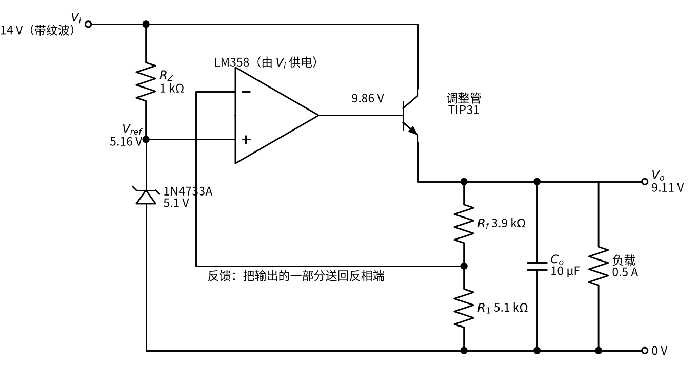
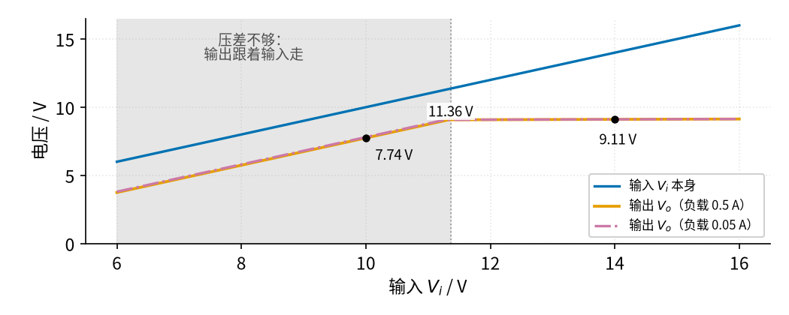
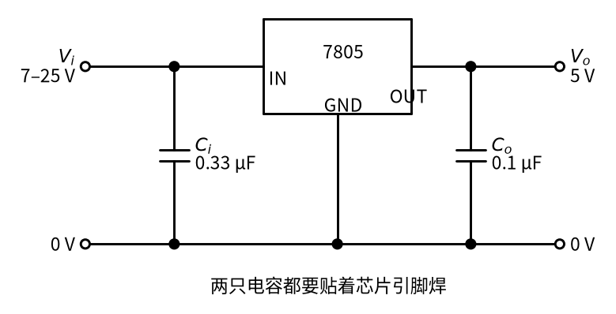

# 08 线性稳压 · 原理与实现篇

[上一页：直觉篇](page1.md) · [直觉篇](page1.md) · 本页：原理与实现篇 · [参数与调试篇](page3.md) · [下一页：参数与调试篇](page3.md) · 前置节点：[02 同相放大 · 直觉篇](../02-noninverting-amp/page1.md)、[07 射极跟随器 · 直觉篇](../07-emitter-follower/page1.md)、[10 稳压管稳压 · 直觉篇](../10-zener-regulator/page1.md)

> [!NOTE]
> 本页电路工作在 20 V 以下的低压直流上。如果输入来自 06 的变压器整流电源，变压器初级接着 220 V 市电，[06 桥式整流 · 直觉篇](../06-bridge-rectifier/page1.md) 开头的安全提示全部适用；做实验时请用可调直流电源代替。

## 这一页要回答什么

直觉篇说：输出约 8.5 V，2 V 的纹波只剩 24.5 mV，输入不能低于约 10.8 V。这一页把这些数一个个推出来，最后看看把同样的结构做进一颗芯片的 7805。

## 一、用到的旧知识

- **稳压管基准**（见 [10 稳压管稳压 · 原理与实现篇](../10-zener-regulator/page2.md)）：手册说 1N4733A 在测试电流 $I_{ZT}$ = 49 mA 时是 5.1 V，动态电阻 $r_Z$ = 7 Ω。和 10 节一样，把它看成一节 $V_{Z0}$ 的电池串一只 7 Ω 的小电阻，电压 $V_{Z0} + r_Z I_Z$ ，其中击穿起点 $V_{Z0}$ = 5.1 − 7 × 0.049 ≈ 4.757 V，这样 49 mA 时正好回到手册的 5.1 V。电流比 49 mA 小，电压就比 5.1 V 低。
- **同相放大**（见 [02 同相放大 · 原理与实现篇](../02-noninverting-amp/page2.md)）：只要运放接成负反馈、输出又没有顶到电源（没有饱和），"虚短"就让两个输入端电压相等，"虚断"让输入端不取电流，于是 $V_o = (1 + R_f/R_1) V_i$ 。
- **射极跟随器**（见 [07 射极跟随器 · 原理与实现篇](../07-emitter-follower/page2.md)）：发射极电压比基极低一个 $V_{BE}$ （约 0.7 V），基极电流只有发射极电流的 $1/(\beta + 1)$ ；放进运放的反馈环里， $V_{BE}$ 会被运放自动补上。

## 二、输出电压公式

把电路完整画出来，元件取值都标在图上，见图 08-p2-1：



*图 08-p2-1　分立元件线性稳压电路（输入 14 V、负载 0.5 A）*

注意：用 TI 的 LM358 模型仿真，把一只理想的 10 µF 电容直接并在输出端、负载 0.5 A 时，输出会以约 19 kHz、近 1 V 峰峰值持续振荡。电容串一只约 1 Ω 的电阻（或用 ESR 约 1 Ω 的电解电容）后，至少在轻载 0.05 A 时仿真是稳定的。所以图中的 $C_o$ 只是示意值，照图搭好后第一次上电，一定要按 [08 线性稳压 · 参数与调试篇](page3.md) 第五节第 5 步用示波器看一遍输出。

按图 08-p2-1 从左往右推：

**第 1 步，基准**。 $R_Z$ 上的电流就是稳压管电流： $I_Z = (14 - 4.757) / (1000 + 7)$ ≈ 9.18 mA，所以 $V_{ref} = 4.757 + 7 \times 0.00918$ ≈ 4.821 V。运放同相端不取电流（虚断），这 9.18 mA 全部流进稳压管。

**第 2 步，虚短**。电路是负反馈（输出经分压送回反相端），只要运放没有饱和（输出没顶到电源，第四节会看到顶到头的情况），它就让反相端电压也等于 $V_{ref}$ 。

**第 3 步，分压**。反相端是 $R_f$ 和 $R_1$ 的中点，电压为 $V_o \cdot R_1/(R_1 + R_f)$ 。令它等于 $V_{ref}$ ，得到

$$V_o = V_{ref}\left(1 + \frac{R_f}{R_1}\right)$$

代入：4.821 × (1 + 3.9 ÷ 5.1) = 4.821 × 1.765 ≈ 8.508 V。这和 02 的同相放大公式一模一样，只是"输入"换成了固定不变的基准。所以输出是 8.51 V 而不是整数：基准是 10 节那只稳压管在 9 mA 下的电压 4.82 V，比手册上 49 mA 时的 5.1 V 低。

**第 4 步，运放要给多少**。调整管发射极是 8.51 V，负载 0.5 A 时 $V_{BE}$ ≈ 0.755 V，所以运放输出要到 8.51 + 0.755 ≈ 9.26 V；基极电流 $I_B$ = 0.5 ÷ 51 ≈ 9.8 mA（ $\beta$ = 50），没有超过 LM358 最少 20 mA 的输出能力（见 [07 射极跟随器 · 直觉篇](../07-emitter-follower/page1.md)）。

## 三、为什么 $V_{BE}$ 不影响输出

第 4 步里 $V_{BE}$ 明明出现了，为什么第 3 步的公式里没有它？把运放看成放大倍数为 $A$ 的放大器（这里取 $10^5$ ，只是示意值），设 $K = R_1/(R_1 + R_f)$ ≈ 0.567。运放输出 $A(V_{ref} - K V_o)$ ，再减去 $V_{BE}$ 就是 $V_o$ ：

$$V_o = \frac{A V_{ref} - V_{BE}}{1 + A K}$$

分子分母同时除以 $AK$ ：第一项接近 $V_{ref}/K$ ，就是上面的公式；第二项是 $V_{BE}/(AK)$ ， $AK$ ≈ 56667，所以 $V_{BE}$ 变化 0.1 V，输出只变 0.1 ÷ 56667 ≈ 1.8 µV。但 $10^5$ 这个增益是运放轻载、直流时的值。运放要给调整管供几毫安基极电流，输出级本身也有压降，真实电路里负载从 0.01 A 加到 0.5 A 时，运放输出要多升约 0.2 V，输出才跟着变**零点几毫伏**。用 TI 的 LM358 模型做 SPICE 仿真，这个变化约 0.2 mV（200 µV），是 1.8 µV 的一百多倍。这已经比单独用稳压管（[10 稳压管稳压 · 原理与实现篇](../10-zener-regulator/page2.md)）好得多，直觉篇说的"负载变化几乎不影响输出"仍然成立，只是不要指望到微伏级。

一句话：**误差被缩小了 $AK$ 倍**。[07 射极跟随器 · 原理与实现篇](../07-emitter-follower/page2.md) 已经见过同样的道理，这里只是把它用在了电源上。

## 四、压差：输入最低能到多少

运放的输出不可能比自己的电源还高。LM358 由输入 $V_i$ 供电，输出最高约 $V_i - 1.5$ V。这里沿用 [07 射极跟随器 · 原理与实现篇](../07-emitter-follower/page2.md) 的估算；[07 射极跟随器 · 参数与调试篇](../07-emitter-follower/page3.md) 引的 LM358B 手册典型值是差 1.4 V，取 1.5 V 是多留 0.1 V 余量，算出的最低输入偏保守。它要给出 $V_o + V_{BE}$ ，所以

$$V_i \ge V_o + 1.5 + V_{BE}$$

负载 0.5 A 时压差 1.5 + 0.755 = 2.255 V，输入最低约 8.51 + 2.255 ≈ 10.76 V。输入再低，运放顶到头，输出就只能跟着输入往下掉，见图 08-p2-2：



*图 08-p2-2　输出电压随输入电压变化（两种负载）*

图 08-p2-2 里，橙色曲线（0.5 A）在拐点右边是水平的，这段叫"稳压区"；灰色阴影区里它和蓝色输入线平行，始终比输入低 2.26 V，这段叫"跟随区"，输入 10 V 时输出只有 7.74 V。红紫色点划线是 0.05 A 负载，此时 $V_{BE}$ 约 0.696 V，拐点左移到 10.70 V，相差不大：压差主要是运放的 1.5 V 决定的。

运放的电源就是带纹波的 $V_i$ ，为什么电源上的 2 V 起伏不会直接出现在输出上？因为运放的输出由两个输入端的电压差决定，只要电源始终够高、输出没顶到头，电源电压的起伏对输出影响很小（手册里把这种能力叫"电源抑制比"，这里直接用结论）。所以真正漏到输出的纹波走的是下一节说的另一条路。

## 五、纹波是怎么被压下去的

既然 $V_{BE}$ 的变化被缩小了几万倍，输入的纹波又从哪里漏到输出？答案是**基准**。输入纹波 $\Delta V_i$ 经过 $R_Z$ 和 $r_Z$ 分压，漏到 $V_{ref}$ 上：

$$\Delta V_{ref} = \Delta V_i \cdot \frac{r_Z}{R_Z + r_Z}$$

2 V × 7 ÷ 1007 ≈ 13.9 mV。运放把基准原样放大 1.765 倍，所以输出纹波 ≈ 13.9 × 1.765 ≈ 24.5 mV，和直觉篇的仿真一致。2 V 变成 24.5 mV，缩小了约 80 倍。工程上常用"分贝"（dB）表示这种倍数：20 dB 是 10 倍，40 dB 是 100 倍，80 倍约为 38 dB。这个指标叫**纹波抑制比**。

要提醒一句：7 Ω 是手册在 49 mA 测试电流下给的动态电阻（见 [10 稳压管稳压 · 参数与调试篇](../10-zener-regulator/page3.md) 的参数表），本例稳压管只有 9.18 mA，不同厂家、不同批次的管子在这个电流下的动态电阻差别不小。用 Diodes 公司的 1N4733A 模型做 SPICE 仿真，输出纹波约 20 mV，输入 13→15 V 时输出变化也约 20 mV。实测在 20～30 mV 之间都算正常，关键是数量级：2 V 被压到几十毫伏。

想再好一些，就要让基准更干净，比如把 $R_Z$ 换成恒流源（不管两端电压怎么变，都送出固定电流的电路；电流不随 $V_i$ 变， $V_{ref}$ 也就不跟着纹波晃），或者在稳压管上并一只电容。7805 的典型纹波抑制比是 78 dB（约 8000 倍），靠的就是芯片内部更讲究的基准。

## 六、用程序验证

下面的程序只用 Python 标准库，把上面的推导算一遍，在仓库根目录运行即可。完整的绘图版本在 `code/08_sim.py`。

```python
# 在仓库根目录运行（只用标准库，不读写文件）
import math

VZ, IZT, RZ_DYN, R_Z = 5.1, 0.049, 7.0, 1000.0   # 1N4733A：49 mA 时 5.1 V，r_Z 7 Ω（见 10 page2）
VZ0 = VZ - RZ_DYN * IZT              # 击穿起点 ≈ 4.757 V
R1, RF = 5100.0, 3900.0               # 同相放大的两个电阻（见 02 page2）
A = 1e5                               # 运放开环增益（示意值）
HEAD = 1.5                            # 运放输出最高只到 V_i − 1.5 V（与 07 相同的估算）
VT, IS, BETA = 0.02585, 1e-13, 50.0   # 三极管模型（与 07 相同）
K = R1 / (R1 + RF)                    # 输出被分压后送回反相端的比例

def vref(vi):
    iz = (vi - VZ0) / (R_Z + RZ_DYN)  # 稳压管电流
    return VZ0 + RZ_DYN * iz

def vbe(il):
    return VT * math.log(il * BETA / (BETA + 1) / IS + 1)

def reg(vi, il):
    """返回输出电压 V_o：先按闭环公式算，再看运放够不够得着。"""
    vb = vbe(il)
    vo_set = (A * vref(vi) - vb) / (1 + A * K)   # 闭环：V_B = A(V_ref − K·V_o)，V_o = V_B − V_BE
    vo_max = vi - HEAD - vb                      # 运放顶到头时最多能给的输出
    return min(vo_set, vo_max)

vo = reg(14.0, 0.5)
print(f"V_ref = {vref(14.0):.3f} V，公式 V_ref(1 + R_f/R_1) = {vref(14.0) * (1 + RF / R1):.3f} V，仿真 V_o = {vo:.3f} V")
print(f"负载从 0.01 A 加到 0.5 A：理想运放（A = 1e5）时 V_o 只变 {(reg(14.0, 0.01) - vo) * 1e6:.1f} µV（真实 LM358 约 0.2 mV，见正文）")
print(f"输入从 13 V 变到 15 V：V_o 变 {(reg(15.0, 0.5) - reg(13.0, 0.5)) * 1e3:.1f} mV")
print(f"压差 = {HEAD + vbe(0.5):.3f} V，最低输入 = {vo + HEAD + vbe(0.5):.2f} V")
for vi in (12.0, 11.0, 10.0):
    print(f"输入 {vi:.0f} V → V_o = {reg(vi, 0.5):.2f} V")
print(f"调整管功耗 (14 − V_o) × 0.5 A = {(14.0 - vo) * 0.5:.2f} W")
```

运行结果应为：V_ref 4.821 V，公式和仿真都是 8.508 V；负载从 0.01 A 加到 0.5 A，输出只变 1.8 µV（这是理想运放模型的结果，换成真实 LM358 约 0.2 mV，见第三节）；输入从 13 V 变到 15 V，输出变 24.5 mV；压差 2.255 V，最低输入 10.76 V；输入 12 V 时仍为 8.48 V，11 V 时 8.47 V（都还在稳压区，只是基准随输入略降），10 V 时掉到 7.74 V；调整管功耗 2.75 W。

## 七、现成的芯片：三端稳压器 7805

自己搭要一只运放、一只三极管、一只稳压管和几只电阻。实际产品里更常用**三端稳压器**：基准、误差放大、调整管，外加过热和短路保护，全做在一颗只有三个引脚的芯片里。最常见的 78xx 系列，"05"表示输出 5 V。接法见图 08-p2-3：



*图 08-p2-3　7805 三端稳压器的典型接法*

图 08-p2-3 的几个数都来自 TI 的 uA78xx 数据手册（SLVS056P）：

| 项目 | 7805 的数值 | 和本页分立电路对比 |
|---|---|---|
| 输出电压 | 4.8–5.2 V（25 °C） | 8.51 V，由电阻决定 |
| 推荐输入 | 7–25 V | 10.76 V 以上 |
| 压差 | 典型 2 V（1 A 时） | 2.26 V（0.5 A 时） |
| 纹波抑制 | 最小 62 dB，典型 78 dB | 约 38 dB |
| 最大输出电流 | 1.5 A，内部有过热、短路保护 | 无保护 |

手册的测试电路在输入接 0.33 µF、输出接 0.1 µF，并说明输出电容"不是稳定所必需的"，它用来改善负载突变时的响应；输入电容则要尽量靠近芯片，特别是芯片离整流滤波电容较远时。

想要可调的输出，可以用 LM317。它的手册给出 $V_o = 1.25(1 + R_2/R_1) + I_{ADJ} R_2$ ：除去很小的 $I_{ADJ}$ 一项，正是本页第二节的公式，只是基准换成了 1.25 V。

## 八、渐进例题

**例 1（完整）** 基准按 4.82 V 算（输入升到 16 V 时， $I_Z$ 增大到约 11.2 mA，基准只升高约 14 mV，先忽略）， $R_1$ 仍为 5.1 kΩ，想输出约 12 V，负载 0.5 A，输入 16 V。

1. 由公式反推 $R_f = R_1(V_o/V_{ref} - 1)$ = 5.1 × (12 ÷ 4.82 − 1) ≈ 7.60 kΩ，取标准值 7.5 kΩ。
2. 实际输出 4.82 × (1 + 7.5 ÷ 5.1) ≈ 11.91 V。
3. 最低输入 11.91 + 2.255 ≈ 14.16 V，16 V 够用。
4. 调整管功耗 (16 − 11.91) × 0.5 ≈ 2.05 W。

**例 2（填空）** 基准取 4.82 V， $R_f$ = 2.0 kΩ， $R_1$ = 5.1 kΩ，负载 0.3 A，输入 12 V。

1. 输出 $V_o$ = 4.82 × (1 + ____) ≈ ____ V。
2. 0.3 A 时 $V_{BE}$ ≈ 0.742 V，最低输入 = $V_o$ + 1.5 + 0.742 ≈ ____ V。
3. 调整管功耗 = (12 − $V_o$) × 0.3 ≈ ____ W。

<details>
<summary>例 2 答案</summary>

1. 2.0 ÷ 5.1 ≈ 0.392，输出 ≈ 4.82 × 1.392 ≈ 6.71 V。
2. 6.71 + 2.242 ≈ 8.95 V，12 V 满足要求。
3. (12 − 6.71) × 0.3 ≈ 1.59 W。

</details>

**例 3（变体迁移）** 用 7805 从 12 V 得到 5 V，负载 1 A。

- 压差够吗？7805 需要至少 7 V 输入，12 V 足够。
- 发热多少？(12 − 5) × 1 = 7 W，比本页主例的 2.75 W 大得多。7805 的 TO-220 封装不加散热片时热阻约 19 °C/W，7 W 会让芯片升温约 133 °C，加上室温就超过结温上限 150 °C，芯片会触发过热保护，输出时断时续。参数与调试篇会讲怎么选散热片。

## 小结

线性稳压的核心公式 $V_o = V_{ref}(1 + R_f/R_1)$ 就是同相放大；调整管的 $V_{BE}$ 被反馈缩小了几万倍；输入纹波主要通过基准漏到输出；输入至少要比输出高一个压差（运放余量加 $V_{BE}$ ）。7805、LM317 把同样的结构做成了芯片。

## 参考资料

- TI，uA78xx 系列数据手册 SLVS056P（输出电压、推荐输入、压差、纹波抑制、测试电容、"输出电容不是稳定所必需"）：https://www.ti.com/lit/ds/symlink/ua78.pdf
- TI，LM317 数据手册 SLVS044Z（ $V_o = V_{REF}(1 + R_2/R_1) + I_{ADJ} R_2$ ， $V_{REF}$ 典型 1.25 V）：https://www.ti.com/lit/ds/symlink/lm317.pdf
- Wikipedia，Linear regulator（调整元件功耗、7805 的约 2 V 压差）：https://en.wikipedia.org/wiki/Linear_regulator
