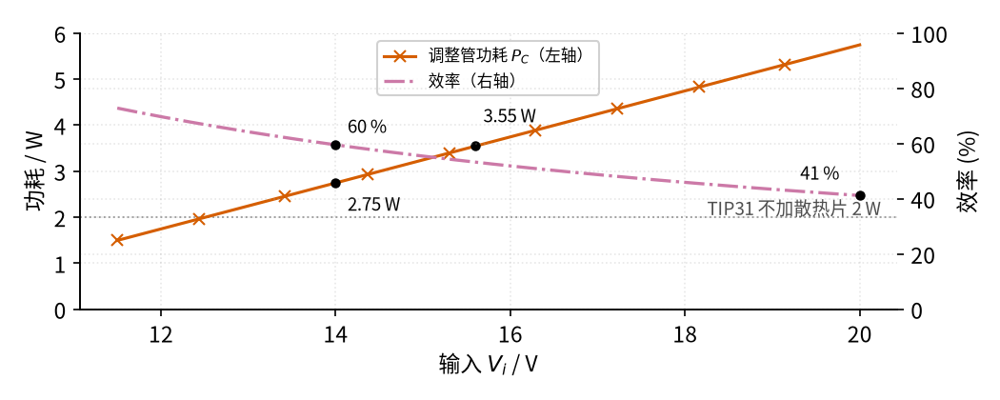
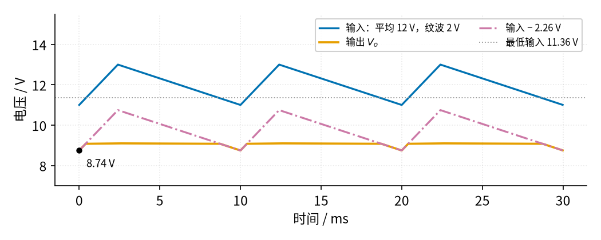

# 08 线性稳压 · 参数与调试篇

[上一页：原理与实现篇](page2.md) · [直觉篇](page1.md) · [原理与实现篇](page2.md) · 本页：参数与调试篇 · [下一页：11 过载保护 · 直觉篇](../11-overload-protection/page1.md) · 前置节点：[02 同相放大 · 直觉篇](../02-noninverting-amp/page1.md)、[07 射极跟随器 · 直觉篇](../07-emitter-follower/page1.md)、[10 稳压管稳压 · 直觉篇](../10-zener-regulator/page1.md)

> [!NOTE]
> 本页的实验全部用**可调直流电源**（带限流功能的实验室电源）供电，电压不超过 20 V。不要直接接 06 的变压器整流电源做调试；如果最终要接，变压器初级接着 220 V 市电，[06 桥式整流 · 直觉篇](../06-bridge-rectifier/page1.md) 开头的安全提示全部适用。调整管和散热片工作时可能烫到七八十摄氏度，断电后也要等它凉下来再摸。

## 这一页要解决什么

原理篇的电路在纸面上很完美，真做出来却常见三种毛病：**调整管烫手甚至烧掉、输出纹波忽然变大、输出在振荡**。它们分别对应散热、压差和输出电容。本页逐一讲怎么估算、怎么查。

## 一、参数速查

| 参数 | 本例取值 | 决定什么 | 怎么选 |
|---|---|---|---|
| 基准 $V_{ref}$ | 4.82 V（1N4733A， $R_Z$ 1 kΩ） | 输出精度和纹波 | 基准越干净，输出纹波越小 |
| $R_f$ 、 $R_1$ | 3.9 kΩ、5.1 kΩ | 输出电压 8.51 V | $R_f = R_1(V_o/V_{ref} - 1)$ ，取几千欧 |
| 压差 | 2.26 V（0.5 A） | 最低输入 10.76 V | 输入纹波的**谷底**也要高于它 |
| 调整管功耗 | $(V_i - V_o) I$ ，本例 2.75 W | 要不要散热片 | 按最高输入算 |
| 调整管 | TIP31（见 [07 射极跟随器 · 参数与调试篇](../07-emitter-follower/page3.md)） | 电流和功耗上限 | 不加散热片 2 W，加散热片到 40 W（管壳 25 °C） |
| 输出电容 $C_o$ | 10 µF（示意值） | 稳定性和负载突变 | 必须用负载跳变实验确认 |

## 二、散热：按最高输入电压算

调整管的功耗 $(V_i - V_o) I$ 随输入升高而线性增加，效率则一路下降，见图 08-p3-1：

*图 08-p3-1　调整管功耗与效率随输入电压的变化（负载 0.5 A）*

图 08-p3-1 告诉我们：设计时不能只看平均输入 14 V。市电电压会波动，ESP 的稳压电路文章建议按 +10% / −15% 考虑。电网偏高 10% 时，整流后的输入升到约 15.6 V。这个数比 14 × 1.1 ≈ 15.4 V 稍大，因为整流桥两只二极管的约 1.4 V 压降不跟着市电涨：输入峰值原来是 14 + 1 = 15 V（平均 14 V、纹波 2 V），变压器次级峰值就是 15 + 1.4 = 16.4 V；它涨 10% 变成约 18.0 V，再减去 1.4 V，峰值约 16.6 V，纹波仍按 2 V 算，平均约 15.6 V（ `code/08_sim.py` 会打印这一步）。功耗就从 2.75 W 涨到 3.55 W。两者都在灰色点线 2 W 之上，所以 TIP31 必须加散热片。

估算散热片分三步（取结温上限 150 °C、机箱内环境 40 °C）：

1. 允许的总热阻 = (150 − 40) ÷ 功耗。按 3.55 W 算，约 31.0 °C/W；按 2.75 W 算是 40.1 °C/W。
2. 不加散热片时 TIP31 的结到环境热阻是 62.5 °C/W（见 [07 射极跟随器 · 参数与调试篇](../07-emitter-follower/page3.md)），3.55 W 会升温约 222 °C，远远超标。
3. 减去管子自身的结到管壳热阻（onsemi 手册最大 3.125 °C/W，约 3.1 °C/W），散热片（含导热垫）要不大于约 27.9 °C/W。再留一点余量，选标称 20 °C/W 左右的散热片。

如果输入高到 20 V，功耗变成 5.75 W，效率只剩 41%：一半以上的电变成热。这时与其加大散热片，不如先降低输入（换低一档的变压器），或者改用 09 开关电源。

## 三、压差不够：看纹波的谷底

输入的**平均值**够高，不等于**每一刻**都够高。把输入平均值降到 11.5 V、纹波仍是 2 V，看图 08-p3-2：

*图 08-p3-2　输入谷底低于最低输入时输出出现缺口*

图 08-p3-2 里，输入的谷底 10.5 V 低于灰色点线标出的最低输入 10.76 V。每当输入落到这条线以下，运放顶到头，橙色输出就沿着红紫色点划线（输入减 2.26 V）往下走，最低到 8.24 V。输出纹波一下从 24.5 mV 变成 245 mV，变大了 10 倍。

用示波器看，就是输出每个周期都"缺一口"。解决办法：加大滤波电容让纹波变小，提高变压器电压，或者换压差更小的调整电路（例如 LDO，本页第四节会讲它的代价）。

## 四、输出电容与振荡

运放、调整管、输出电容和负载构成一个环。回到直觉篇那个盯着水位计拧阀门的人：如果他反应总慢半拍，看到水位低了才去开阀，等水真涨上来时他还在开，水位就冲过了线；他再慌忙去关，又关过了头。本来是"纠错"，因为慢半拍变成了"推波助澜"，水位就上下来回晃个不停。电路也一样，环里每多一个"延迟"，反馈就可能从纠错变成放大误差，输出就会自己振荡起来。这里要分两种情况：

- **NPN 调整管（78xx、LM317、本页的射极跟随器结构）**：调整管接成射极跟随器，输出阻抗本来就低（输出阻抗就是把稳压器看成"电池串内阻"时那只内阻，见 [P1 元件速成 · 原理与实现篇](../P1-components-basics/page2.md) 第七节；它越小，负载电流变化时输出电压越不容易被拉动）。TI 的 uA78xx 和 LM317 手册都写明输出电容**不是稳定所必需的**，它只改善负载突变时的响应。
- **低压差稳压器（LDO，调整管是 PNP 管或 P 沟道 MOSFET）**：P 沟道 MOSFET 是栅极电压比源极低时导通的那种 MOS 管（见 [P2 半导体入门 · 原理与实现篇](../P2-semiconductor-basics/page2.md)）。这类调整管接在输入和输出之间，不用像射极跟随器那样少掉一个 $V_{BE}$ ，压差可以低到零点几伏；但它的输出端阻抗高，环里多出一个由输出电容和负载造成的"延迟"。TI 应用笔记 SLVA115 说明，这类稳压器**必须**接一只等效串联电阻（ESR，电容内部相当于串着的一个小电阻，通常零点几欧到几欧）合适的输出电容才能稳定，电容太小或 ESR 不对就会振荡。

本页的分立电路用的是 LM358 这种通用运放，它本身没有为驱动电容负载专门补偿（补偿就是在环里加电容、电阻，让它反应"慢而稳"，不再慢半拍地来回过冲；怎么设计本教程不展开），图中 10 µF 只是示意值。**到底要多大、会不会振荡，只能用本页第五节的负载跳变实验来确认**。

## 五、动手实验：低压验证

> [!NOTE]
> 全程用可调直流电源，限流先设 0.6 A。负载电阻会发热，要用 10 W 以上的功率电阻，放在不易碰到的地方。

1. 断电状态下按图搭电路，TIP31 装好散热片。负载先接 180 Ω（约 0.05 A）。
2. 电源调到 14 V，测 $V_{ref}$ （应约 4.82 V）、 $V_o$ （约 8.51 V）、运放输出（约 9.2 V）。
3. 先断电，再把负载换成 18 Ω（约 0.47 A），重新上电，输出应几乎不变；运放输出升高几十毫伏。
4. 把电源从 14 V 慢慢往下调，记下输出开始下降时的输入，应在 10.7–10.8 V 附近。
5. **负载跳变**：用开关让负载在 180 Ω 和 18 Ω 之间来回切换，示波器看输出。正常情况是一个很快衰减的小台阶；如果出现持续的正弦波或长时间振铃（台阶后面跟着一串慢慢变小的来回摆动，像敲钟后的余音），就是不稳定，断电后调整输出电容或给运放加补偿，然后再测一遍。
6. 散热片温度**不要用手摸**，用测温枪或热电偶测。估算：调整管 2.75 W，按 20 °C/W 的散热片，散热片比室温高约 2.75 × 20 ≈ 55 °C，室温 25 °C 时约 80 °C，足以烫伤。实测明显超过 90 °C，说明散热片太小或输入太高。

## 六、故障排查表

| 现象 | 可能原因 | 怎么查 | 怎么改 |
|---|---|---|---|
| 输出等于输入减 2 V 多，不稳 | 输入低于最低输入 | 量输入谷底 | 提高输入或减小纹波 |
| 输出纹波周期性"缺口" | 纹波谷底跌破压差 | 示波器同时看输入和输出 | 加大滤波电容 |
| 输出接近 0 V（零点几伏以下） | 调整管损坏开路或基极没驱动：没有电流从集电极流到负载，输出只剩漏电 | 量运放输出和 $V_{BE}$ | 断电后换管，查运放供电 |
| 输出接近输入 | 调整管击穿短路，或反馈断开 | 量反相端电压是否等于 $V_{ref}$ | 断电后换管，检查 $R_f$ 、 $R_1$ 焊点 |
| 输出电压不对 | $R_f$ 、 $R_1$ 接反或阻值错 | 按 $V_{ref}(1 + R_f/R_1)$ 核算 | 断电后换电阻 |
| 调整管烫手、过一会儿输出变低 | 散热不足 | 估算 $(V_i - V_o) I$ | 加大散热片或降低输入 |
| 7805 输出时有时无 | 过热保护动作 | 用测温枪测芯片、算功耗 | 断电后加散热片 |
| 输出叠加高频波形 | 环路振荡 | 示波器看输出 | 按第四节处理 |
| 7812 等高压输出版本断电时损坏 | 输出电容反灌：输入先掉到 0，输出电容上还存着 12 V，电流倒着从输出流回输入，冲坏芯片 | 看是否有保护二极管 | 手册建议输出高于约 7 V 时，在输出和输入之间反接一只二极管（阴极接输入），让电容的电绕过芯片放掉 |
| LM317 轻载时输出偏高 | 低于最小负载电流（芯片内部电路要求输出至少流出几毫安，否则调节失常） | 去掉负载量输出 | 按手册减小 $R_1$ （让分压电阻本身流过足够电流），或加假负载（一只一直接在输出上的电阻） |

## 七、练习

**练习 1（易）** 本页电路，输入 16 V、负载 0.5 A，调整管功耗多少？不加散热片时温升多少？

答案

(16 − 8.51) × 0.5 ≈ 3.75 W。温升 3.75 × 62.5 ≈ 234 °C，远超允许值，必须加散热片。

**练习 2（易）** 输入平均 12 V、纹波 2 V，负载 0.5 A，会不会出现输出缺口？

答案

谷底 11 V，高于最低输入 10.76 V，不会出现缺口。只是余量只有 0.24 V，纹波再大一点（或者市电偏低）就会出问题。

**练习 3（中）** 想让输出纹波再小一些，有人把 $R_Z$ 从 1 kΩ 换成 2 kΩ，其余不变（输入平均 14 V、纹波 2 V）。输出纹波变成多少？稳压管电流变成多少，有什么隐患？

答案

基准纹波 2 V × 7 ÷ (2000 + 7) ≈ 6.98 mV，输出纹波 ≈ 6.98 × 1.765 ≈ 12.3 mV，比 24.5 mV 减半。代价是稳压管电流降到 (14 − 4.757) ÷ 2007 ≈ 4.6 mA，基准降到约 4.79 V，输出变成约 8.45 V。4.6 mA 只有测试电流 49 mA 的十分之一，已经靠近拐点（手册在 1 mA 时动态电阻是 550 Ω），实际动态电阻比 7 Ω 大，纹波改善不会有算的那么多；输入谷底再低一些时基准还会更"软"。所以 $R_Z$ 不能无限加大，见 [10 稳压管稳压 · 参数与调试篇](../10-zener-regulator/page3.md) 的参数表。

**练习 4（中）** 7805 从 9 V 得到 5 V，负载 0.5 A，环境 40 °C。不加散热片（热阻 19 °C/W）可以吗？

答案

功耗 (9 − 5) × 0.5 = 2 W，温升 38 °C，结温约 78 °C，低于 150 °C，可以。不过 9 V 只比最低输入 7 V 高 2 V，要确认纹波谷底也不低于 7 V。

**练习 5（难，变体迁移）** 有人说"输出电容越大越稳，随便加"。对 LDO 和 7805 分别对吗？

答案

都不完全对。7805 的输出电容不是稳定所必需的，加大一般无害，主要改善负载突变响应。LDO 要求输出电容的容量和 ESR 都在手册规定范围内，ESR 太小或太大都可能振荡，不能随便换。

## 小结与下一步

线性稳压调试的三件事：散热按**最高输入**算，压差按**纹波谷底**算，稳定性靠**负载跳变实验**确认。本页的分立电路还缺一样东西：输出一短路，0.5 A 以上的大电流会让调整管瞬间烧掉，而 7805 内部有短路保护。下一节 [11 过载保护 · 直觉篇](../11-overload-protection/page1.md) 就来讲怎么检测电流、及时切断。效率问题则留给后面的 09 开关电源。

## 参考资料

- TI，uA78xx 系列数据手册 SLVS056P（热阻、结温上限、保护二极管、输出电容）：https://www.ti.com/lit/ds/symlink/ua78.pdf
- TI，LM317 数据手册 SLVS044Z（输出电容非稳定所必需、最小负载电流）：https://www.ti.com/lit/ds/symlink/lm317.pdf
- onsemi，TIP31 系列数据手册 TIP31A/D（结到管壳热阻 3.125 °C/W、结到环境 62.5 °C/W、结温上限 150 °C）：https://www.onsemi.com/download/data-sheet/pdf/tip31a-d.pdf
- Rod Elliott（ESP），Voltage And Current Regulators（市电波动按 +10% / −15% 考虑）：https://sound-au.com/articles/vi-regulators.html
- TI，SLVA115A《ESR, Stability, and the LDO Regulator》（LDO 需要合适 ESR 的输出电容）：https://www.ti.com/lit/an/slva115/slva115.pdf
