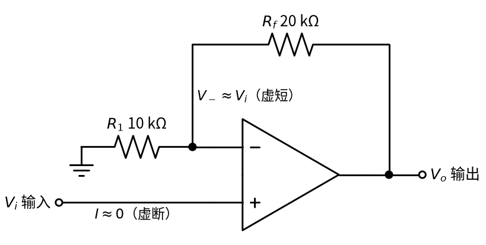
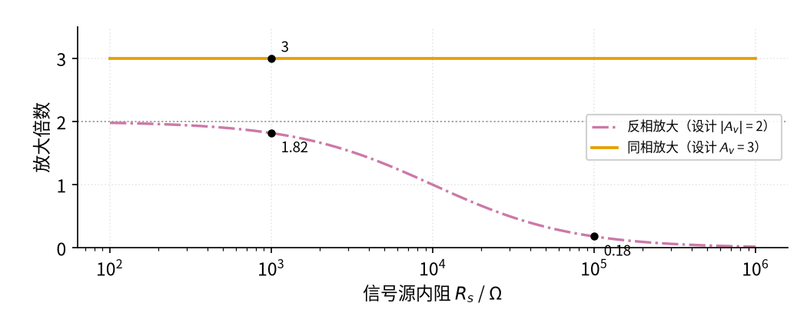
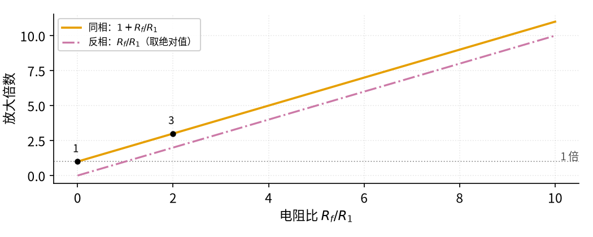
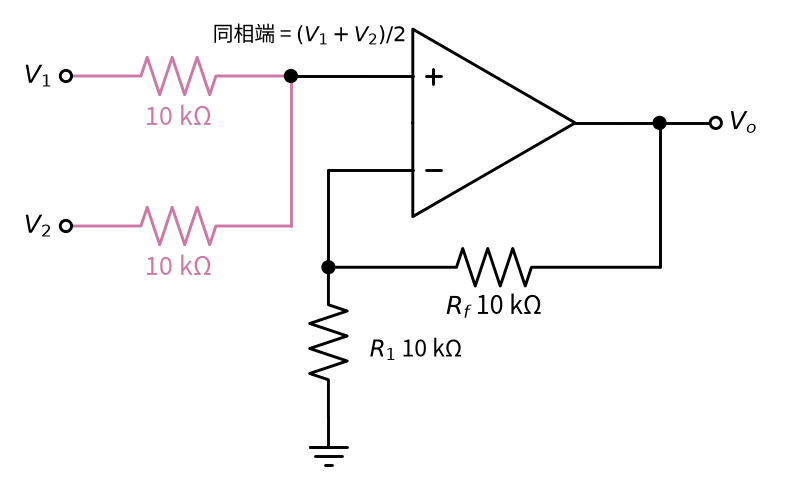

# 08 同相放大 · 原理与实现篇

[上一页：直觉篇](page1.md) · [直觉篇](page1.md) · 本页：原理与实现篇 · [参数与调试篇](page3.md) · [下一页：参数与调试篇](page3.md) · 前置节点：[05 反相放大 · 直觉篇](../05-inverting-amp/page1.md)

## 这一页要解决的问题

[08 同相放大 · 直觉篇](page1.md) 用"撬棍"说明了同相放大的倍数是 1 + $R_f/R_1$ 。这一页要回答三个更具体的问题：这个公式怎么用虚短、虚断一步步推出来？"输入端几乎不取电流"到底能带来多大好处？倍数能不能做到 1 以下？最后用三道例题练习设计，其中第三道把"分压"和"同相放大"组合起来。

## 一、用虚短和虚断推导

先看 图 08-p2-1，图上标出了推导要用的两条口诀。



*图 08-p2-1　推导用的同相放大电路：反相端电压等于输入，输入端不取电流*

图 08-p2-1 中，反相端旁边写着"等于输入电压（虚短）"，输入线下方写着"电流约为 0（虚断）"。推导分三步。

**第一步：虚短，反相端电压等于输入**。有负反馈且输出没有饱和时，两个输入端电压几乎相等。同相端就是 $V_i$ ，所以反相端电压 $V_-$ （反相输入端对地的电压）

$$V_- \approx V_i$$

**第二步：虚断，接地电阻和反馈电阻里是同一个电流**。反相端不取电流，所以 $R_f$ 和 $R_1$ 串联，组成从输出到地的分压器。按 01 的分压公式，分压点电压等于输出乘以"下臂电阻占总电阻的比例"：

$$V_- = \frac{R_1}{R_1 + R_f}\thinspace V_o$$

代数： $R_1$ =10 kΩ、 $R_f$ =20 kΩ，比例是 10/30 = 1/3，反相端电压是输出的三分之一。

**第三步：两式联立**。反相端既等于 $V_i$ ，又等于输出的三分之一，所以输出就是输入的 3 倍。一般地

$$V_o = \frac{R_1 + R_f}{R_1}\thinspace V_i = \left(1 + \frac{R_f}{R_1}\right) V_i$$

代数：输入 0.5 V，输出 3 × 0.5 = 1.5 V，与 [08 同相放大 · 直觉篇](page1.md) 一致。所以放大倍数

$$A_v = 1 + \frac{R_f}{R_1}$$

这个式子告诉我们：**运放调整输出，直到分压回来的电压正好等于输入**。这就是负反馈的意思。

**输入电阻**。信号直接接在同相端，而同相端几乎不取电流，所以从信号源看进去的电阻极大，理想情况下可以看成无穷大。LM358B 数据手册给出的差分输入阻抗是 10 MΩ（"阻抗"可以先当成对交流信号的电阻来理解；"差分输入阻抗"就是两个输入端之间的电阻），接成负反馈以后，信号源实际看到的电阻比这个值还要大。

## 二、仿真：信号源内阻大时谁更靠谱

"输入电阻极大"有什么用？下面的仿真让信号源内阻 $R_s$ （信号源内部串联的等效电阻）从 100 Ω 增大到 1 MΩ，用同一对电阻（10 kΩ、20 kΩ）分别搭反相和同相放大，看实际倍数。反相放大的倍数会变成 $R_f/(R_s + R_1)$ （[05 反相放大 · 参数与调试篇](../05-inverting-amp/page3.md) 推过）；同相放大的输入端不取电流，内阻上没有压降，倍数不变。代码与仓库里的 code/08_sim.py 内容一致，存成文件后**在仓库根目录运行**（开头两行会找到 code/figs 里的画图样式，中文标签也靠它显示）。

```python
import sys, pathlib
sys.path.insert(0, str(pathlib.Path("code/figs").resolve()))  # 在仓库根目录运行
# 08 同相放大最小仿真：信号源内阻 R_s 从 100 Ω 增大到 1 MΩ 时，比较反相放大和同相放大的实际倍数。
import numpy as np                                 # 数组运算
import matplotlib.pyplot as plt                    # 画图
import figstyle as fs                              # 全书统一的颜色、轴标签、保存函数

R1, Rf = 10e3, 20e3                                # 两种电路都用 R1 = 10 kΩ、Rf = 20 kΩ
G_inv = Rf / R1                                    # 反相放大：|A_v| = Rf/R1 = 2
G_non = 1 + Rf / R1                                # 同相放大：A_v = 1 + Rf/R1 = 3
Rs = np.logspace(2, 6, 300)                        # 信号源内阻从 100 Ω 扫到 1 MΩ

inv = Rf / (Rs + R1)                               # 反相：内阻和 R1 串联，倍数变成 Rf/(Rs+R1)
non = np.full_like(Rs, G_non)                      # 同相：输入端几乎不取电流，内阻上没有压降，倍数不变

fig, ax = plt.subplots(figsize=fs.SIZE["single"])  # 一张图
ax.axhline(G_inv, **fs.LS["ref"])                  # 灰色点线：反相放大的设计值 2
ax.semilogx(Rs, inv, **fs.LS["third"], label="反相放大（设计 $|A_v|$ = 2）")   # 红紫色点划线
ax.semilogx(Rs, non, **fs.LS["vout"], label="同相放大（设计 $A_v$ = 3）")      # 橙色实线
for r in (1e3, 100e3):                             # 在内阻 1 kΩ 和 100 kΩ 处标数
    g = Rf / (r + R1)                              # 这一点反相放大的实际倍数
    print(f"内阻 {r/1e3:g} kΩ：反相放大实际 |A_v| = {g:.2f}，同相放大仍为 {G_non:.0f}")
    fs.mark(ax, r, g, fmt="{:.2f}", dx=6, dy=-12)  # 黑点 + 数值
fs.mark(ax, 1e3, G_non, fmt="{:.0f}", dx=6, dy=4)  # 同相放大的倍数 3
assert abs(Rf / (100e3 + R1) - 0.18) < 0.01        # 内阻 100 kΩ 时反相只剩约 0.18 倍
assert np.all(non == 3)                            # 同相放大不受内阻影响
fs.axlabels(ax, "信号源内阻 $R_s$", "Ω", "放大倍数", None)                    # 轴标签
ax.set_ylim(0, 3.5); ax.legend(loc="center right", fontsize=8)             # 纵轴范围和图例
fs.save(fig, "08", "08_p2_2_source_compare.png")   # 保存到 08-noninverting-amp/img/
```

运行后会打印：

```text
内阻 1 kΩ：反相放大实际 |A_v| = 1.82，同相放大仍为 3
内阻 100 kΩ：反相放大实际 |A_v| = 0.18，同相放大仍为 3
```

（另有几行以 [数值]、[图] 开头的提示），并生成 图 08-p2-2。



*图 08-p2-2　信号源内阻增大时，反相放大和同相放大的实际倍数*

图 08-p2-2 中，橙色实线（同相放大）是一条水平线，内阻从 100 Ω 到 1 MΩ，倍数始终是 3。红紫色点划线（反相放大）在内阻很小时贴着灰色点线 2，内阻 1 kΩ 时已经降到 1.82，内阻 100 kΩ 时只剩 0.18，信号不但没被放大，反而被衰减了。所以**信号源内阻大（例如几十千欧的传感器、高阻探头）时，首选同相放大**。

## 三、倍数为什么不能小于 1

图 08-p2-3 把两种接法的倍数放在一起，横轴是电阻比。



*图 08-p2-3　同相与反相的倍数随电阻比的变化*

图 08-p2-3 中，橙色是同相倍数，红紫色点划线是反相倍数的绝对值，两条线平行，始终相差 1。电阻比为 2 时同相是 3 倍、反相是 2 倍。电阻比为 0（ $R_f$ 短路，或者 $R_1$ 开路）时，同相倍数正好是 1，橙色线落在灰色点线上：输出完全跟着输入走。这就是下一节 [12 电压跟随器 · 直觉篇](../12-voltage-follower/page1.md) 。反相放大可以做出 0.5 倍这样的衰减，同相放大做不到，想衰减就得在同相端前面先加一个分压器（同相端不取电流，分压器不会被"拖累"）。

## 四、例题

### 例 1（完整示例）：把 0～0.5 V 的传感器信号放大到 0～5 V

**题目**：某传感器输出 0～0.5 V，内阻 20 kΩ，要放大到 0～5 V，±15 V 供电。选电路、选电阻。

**解**：

1. 内阻 20 kΩ 不小，用同相放大，倍数不受内阻影响。
2. 需要 $A_v$ = 5 ÷ 0.5 = 10，即 1 + $R_f/R_1$ = 10，电阻比 9。
3. 取 $R_1$ =10 kΩ，则 $R_f$ =90 kΩ（可用 91 kΩ，倍数 10.1）。
4. 检查：输出最大 5 V，远小于 ±15 V 下约 13.5 V 的上限；带宽约 1.2 MHz ÷ 10 = 120 kHz（同相放大的带宽是 GBW ÷ 倍数，和 05 的 GBW ÷ (1+倍数) 写法不同，原因见 [08 同相放大 · 参数与调试篇](page3.md)），对缓慢变化的传感器绰绰有余。

### 例 2（关键步骤留空）：倍数为 4

**题目**：取 $R_1$ =10 kΩ，要得到 4 倍同相放大， $R_f$ 取多少？输入 0.3 V 时输出多少？

```python
# 不运行
R1 = 10e3
Rf = ____ * R1       # 1 + Rf/R1 = 4，所以 Rf/R1 = ____
V_o = (1 + Rf / R1) * 0.3   # = ____ V
```

<details><summary>答案</summary>

电阻比 = 4 − 1 = 3，Rf = 30 kΩ；输出 $V_o$ = 4 × 0.3 V = 1.2 V。

</details>

### 例 3（变体迁移）：同相加法器

**题目**：要输出 $V_1 + V_2$ （不带负号）。思路：两路信号各经一个 10 kΩ 电阻接到同相端，后面接一个 $R_1$ = $R_f$ =10 kΩ 的 2 倍同相放大。电路如图 08-p2-4 所示，输出是多少？



*图 08-p2-4　同相加法器：两路各经 10 kΩ 接同相端，后接 2 倍同相放大*

**解**：

1. 同相端不取电流，所以图 08-p2-4 里两个 10 kΩ 电阻流的是同一个电流，从 $V_1$ 流向 $V_2$ （或反过来）。同相端在两个相等电阻的正中间，电压就是两路的平均值：同相端电压 = ( $V_1$ + $V_2$ ) ÷ 2。
2. 后面 2 倍同相放大：输出 = 2 × ( $V_1$ + $V_2$ ) ÷ 2 = $V_1$ + $V_2$ 。
3. 代数： $V_1$ =0.5 V、 $V_2$ =0.2 V，同相端 0.35 V，输出 0.7 V，和 [05 反相放大 · 原理与实现篇](../05-inverting-amp/page2.md) 的反相加法器结果大小相同、符号相反。

和反相加法器比，它的缺点是：每一路的权重都受其他路电阻的影响（三路输入时同相端是三路的平均值，倍数就要改成 3），各路之间也会通过这几个电阻互相"串扰"。所以多路混音一般用反相加法器；只有两三路、又不想要负号时才用同相加法器。

## 本页小结

**推导：虚短让反相端等于输入，虚断让两个电阻成为分压器，联立得 $A_v = 1 + R_f/R_1$ 。同相放大的输入电阻极大，信号源内阻再大倍数也不变；倍数最小为 1，电阻比为 0 时就是电压跟随器**。
