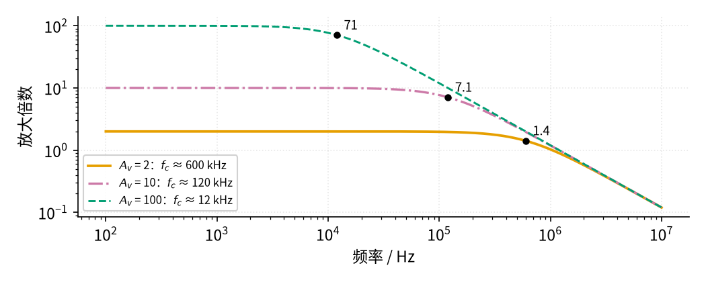
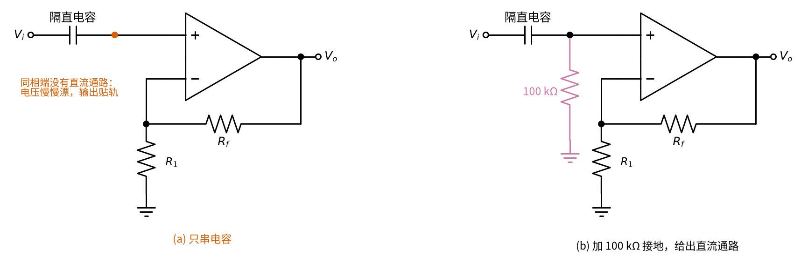
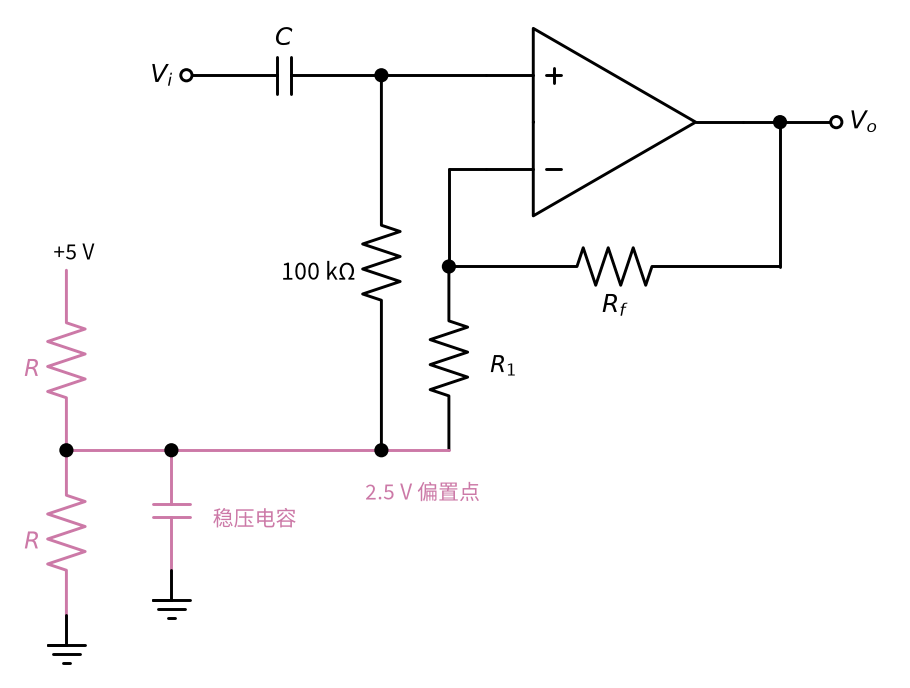

# 08 同相放大 · 参数与调试篇

[上一页：原理与实现篇](page2.md) · [直觉篇](page1.md) · [原理与实现篇](page2.md) · 本页：参数与调试篇 · [下一页：动手实验篇](page4.md) · 前置节点：[05 反相放大 · 直觉篇](../05-inverting-amp/page1.md) · 后续：[12 电压跟随器 · 直觉篇](../12-voltage-follower/page1.md)、[16 差分放大 · 直觉篇](../16-differential-amp/page1.md)

## 痛点：单电源一接，输出就"顶不上去"

同相放大最常见的用法，是把传感器信号放大后送给单片机。单片机常常只有一个 5 V 或 3.3 V 电源，于是运放也用单电源。这时会遇到 ±15 V 时不曾见过的问题：输出到不了电源电压，输入稍大就削顶；电容耦合的交流信号一放大，输出却慢慢漂到电源轨上不下来。这一页先讲参数怎么选，再给排查表和练习。

## 一、参数怎么选

| 参数 | 作用 | 常用取值 | 选取要点 |
|---|---|---|---|
| $R_1$ | 和 $R_f$ 组成反馈分压器 | 1 kΩ～100 kΩ | 不影响输入电阻；太小会让运放输出电流变大 |
| $R_f$ | 决定倍数 | ( $A_v$ − 1) × $R_1$ | 一般不超过 1 MΩ |
| 电源电压 | 决定输出摆幅和输入允许范围 | 单 5 V 或 ±15 V | 输出、输入都要离正电源至少约 1.5 V（LM358B） |
| GBW | 决定带宽 | LM358B 为 1.2 MHz | 带宽约 GBW ÷ $A_v$ |

### 1. 单电源下的输出摆幅

LM358B 的输出最高只能到正电源减约 1.5 V。5 V 单电源时，输出上限约 3.5 V。要求输出不削顶，输入最大值就是上限除以倍数：

$$V_{i,\max} = \frac{V_{o,\max}}{A_v}$$

代数：2 倍放大、上限 3.5 V，输入不能超过 1.75 V。图 08-p3-1 画出了输入从 0 增大到 2.5 V 时的输出。

*图 08-p3-1　5 V 单电源、2 倍同相放大：输入超过 1.75 V 就削顶*

图 08-p3-1 中，黑色虚线是理想的"输出 = 2 倍输入"，橙色是实际输出。在输入 1.75 V（灰色竖直点线）之前两者重合；之后橙色线被灰色水平点线 3.5 V 挡住，再也上不去。要让 0～5 V 的单片机输入用满量程，就应该选输出能接近电源轨的**轨到轨**运放（输出几乎能摆到电源电压，"轨"就是电源线），或者把倍数降下来。

同相放大还有一个反相放大没有的限制：两个输入端都跟着输入电压走（共模电压等于 $V_i$ ），而 LM358B 允许的输入共模电压上限也是正电源减约 1.5 V。所以 5 V 供电时，即使倍数为 1，输入也不能超过约 3.5 V。

### 2. 带宽：同相放大是 GBW ÷ 倍数

同相放大的带宽（倍数降到低频值 0.707 倍时的频率 $f_c$ ；0.707 ≈ 1/√2，是功率减半点，定义见 [05 反相放大 · 参数与调试篇](../05-inverting-amp/page3.md)）约为增益带宽积除以倍数：

$$f_c \approx \frac{\mathrm{GBW}}{A_v}$$

频率更高时，倍数按幅值公式下降：

$$\lvert A_v(f)\rvert = \frac{A_v}{\sqrt{1 + (f/f_c)^2}}$$

为什么 05 反相放大写成 GBW ÷ (1 + 倍数)，这里却是 GBW ÷ 倍数？其实是同一个规律：从运放的输出端看回去，两种接法的反馈都是由 $R_1$ 、 $R_f$ 分压送回反相端，分压比都是 $R_1/(R_1+R_f)$ ，电路带宽都约等于 GBW 乘以这个分压比，即 GBW ÷ (1 + $R_f/R_1$ )。同相放大的倍数正好是 1 + $R_f/R_1$ ，所以写成 GBW ÷ 倍数；反相放大的倍数是 $R_f/R_1$ ，所以写成 GBW ÷ (1 + 倍数)。

代数：GBW = 1.2 MHz、倍数 10，带宽约 120 kHz。图 08-p3-2 画出三种倍数。

*图 08-p3-2　增益带宽积 1.2 MHz 时，同相放大的频率响应*

图 08-p3-2 中，橙色（2 倍）在 600 kHz 处降到 1.4，红紫色点划线（10 倍）在 120 kHz 处降到 7.1，蓝绿色虚线（100 倍）在 12 kHz 处降到 71，三处黑点都是 0.707 倍的位置。这几个数是按手册 GBW 典型值 1.2 MHz 估算的，可以当作「至少有这么宽」：倍数越小，实际带宽比估算宽得越多，用 TI 官方 LM358B 模型做 SPICE 仿真，2 倍时约 1.61 MHz，10 倍约 166 kHz，100 倍约 14.6 kHz。和 [05 反相放大 · 参数与调试篇](../05-inverting-amp/page3.md) 比较：同样 10 倍，反相放大带宽约 109 kHz（分母是 1 + 10），同相放大是 120 kHz（分母是 10），差别不大；规律相同：**倍数大 10 倍，带宽小 10 倍**。

### 3. 交流耦合时别忘了直流通路

先说"隔直"。01 讲过，电容两端的电压要靠电流慢慢"攒"，不能突变（见 [01 元件速成 · 原理与实现篇](../01-components-basics/page2.md)）。对快速变化的交流信号，电容来不及改变自己两端的电压，于是一端怎么变、另一端就跟着怎么变，交流被"推"了过去；而直流长期不变，电容充满以后就不再有电流，等于断开。所以串在信号路上的电容能挡住直流、放过交流，这叫**隔直**，这种接法叫**交流耦合**（"耦合"就是把信号从一处传到另一处）。

如果信号经过一个隔直电容接到同相端，电容挡住了直流，同相端就"悬空"了。运放输入端那一点点微小的电流无处可去，会给电容慢慢充电，同相端电压一路漂移，输出最终贴到电源轨上。解决办法是在同相端到地（单电源时接到电源一半的偏置点）之间接一个电阻，例如 100 kΩ，给它一条直流通路。此时信号源看到的输入电阻就约等于这个电阻。两种接法的对比见图 08-p3-3。

*图 08-p3-3　交流耦合：只串电容 (a) 与加 100 kΩ 接地 (b)*

## 二、故障排查表

| 现象 | 原因 | 怎么查 | 怎么改 |
|---|---|---|---|
| 输出是反的 | 输入和接地电阻接反，接成了反相放大 | 对照电路图看输入接的是"+"还是"−" | 输入接同相端，接地电阻接反相端 |
| 倍数比设计值大 1 倍左右 | 按反相公式选了电阻，忘了"加 1" | 用 1 + $R_f/R_1$ 重新算 | 把 $R_f$ 改成 ( $A_v$ − 1) × $R_1$ |
| 单电源下输出最高只有约 3.5 V | 输出摆幅限制（LM358B 约 V+ − 1.5 V） | 增大输入，看输出在哪里停止上升 | 降低倍数，或改用轨到轨运放 |
| 输入接近电源时输出异常 | 输入共模电压超出允许范围 | 测同相端电压，和电源减 1.5 V 比较 | 先分压降低输入，或提高电源电压 |
| 输出慢慢漂到电源轨 | 隔直电容后同相端没有直流通路 | 断开信号源，测同相端电压是否在漂 | 同相端加电阻接地或接偏置电压 |
| 输出等于输入，不放大 | $R_1$ 开路（相当于跟随器） | 断电测 $R_1$ 和接地点 | 重新焊接 $R_1$ |
| 输出贴在电源轨 | $R_f$ 开路，没有负反馈 | 断电测 $R_f$ 阻值 | 重新焊接 $R_f$ |

## 三、练习

**练习 1（基础）**： $R_1$ =2 kΩ、 $R_f$ =18 kΩ，输入 0.25 V，输出多少？

答案

倍数 1 + 18/2 = 10，输出 $V_o$ = 10 × 0.25 V = 2.5 V。

**练习 2（基础：对比）**：一个由热敏电阻组成的分压器，空载输出 1 V，它的输出内阻是 50 kΩ。用同一对电阻 $R_1$ =10 kΩ、 $R_f$ =20 kΩ，分别搭反相放大和同相放大接在它后面（±15 V 供电），输出各是多少？哪个更可靠？

答案

反相放大：内阻和 $R_1$ 串联，倍数变成 $R_f/(R_s + R_1)$ = 20 ÷ 60 ≈ 0.33，输出约 −0.33 V，只有理想值 −2 V 的 17%，信号反而被衰减了。

同相放大：同相端几乎不取电流，50 kΩ 内阻上没有压降，输出 = (1 + 20/10) × 1 V = 3 V，和理想值一样。

所以信号源内阻大时选同相放大，这正是本节的核心卖点：**输入电阻极大**。

**练习 3（提高）**：5 V 单电源 LM358B，热敏电阻电路输出 0～0.8 V，要放大后送给参考电压 3.3 V 的模数转换器（ADC，把电压变成数字的电路，单片机里一般都有；参考电压就是它能测的满量程电压），希望 0.8 V 时输出约 3.2 V。(1) 倍数和电阻怎么选？(2) 会不会削顶？(3) 若信号变化最快约 1 kHz，带宽够吗？

答案

(1) 倍数 3.2 ÷ 0.8 = 4，取 $R_1$ =10 kΩ、 $R_f$ =30 kΩ。

(2) 最高输出 3.2 V，小于 5 V − 1.5 V = 3.5 V 的上限，不会削顶，但余量只有 0.3 V；输入 0.8 V 也远低于共模上限 3.5 V。

(3) 带宽至少约 1.2 MHz ÷ 4 = 300 kHz（TI 官方模型 SPICE 仿真约 611 kHz），远大于 1 kHz，够用。

**练习 4（变体迁移）**：要把一个 −1～+1 V 的信号同相放大 2 倍，但只有 5 V 单电源。提示：先用两个相等电阻把一个 2.5 V 偏置"垫"在信号下面。思路是：同相端经电容接信号、经 100 kΩ 接 2.5 V 偏置点；接地电阻 $R_1$ 的下端也不接地，而是接到 2.5 V 偏置点（再用一个电容对地稳住：它让 2.5 V 偏置点在信号变化时保持不动，对交流来说就像接了地）。问：输出的中心电压和摆动范围是多少？能否不削顶？电路如图 08-p3-4 所示（倍数 2 倍，所以 $R_f$ = $R_1$ ）。

*图 08-p3-4　练习 4：用 2.5 V 偏置点代替地的单电源同相放大*

答案

把 2.5 V 偏置点当成新的"地"：同相端电压 = 2.5 V + $V_i$ ，接地电阻也接 2.5 V，所以输出 = 2.5 V + 2 $V_i$ 。中心 2.5 V，摆动范围 2.5 ± 2 V，即 0.5～4.5 V。上限 4.5 V 超过了 LM358B 约 3.5 V 的输出上限（同相端最高 3.5 V 也碰到了共模上限），所以**会削顶**。改法：把倍数降到 1（输出 1.5～3.5 V，同相端最高 3.5 V，正好贴着上限，余量为 0），或者偏置点降到约 2 V 并换轨到轨运放。

## 本页小结

**同相放大的倍数 1 + $R_f/R_1$ ，带宽约 GBW ÷ 倍数；单电源时输出和输入都要离正电源约 1.5 V（LM358B）；交流耦合时同相端一定要有直流通路**。
