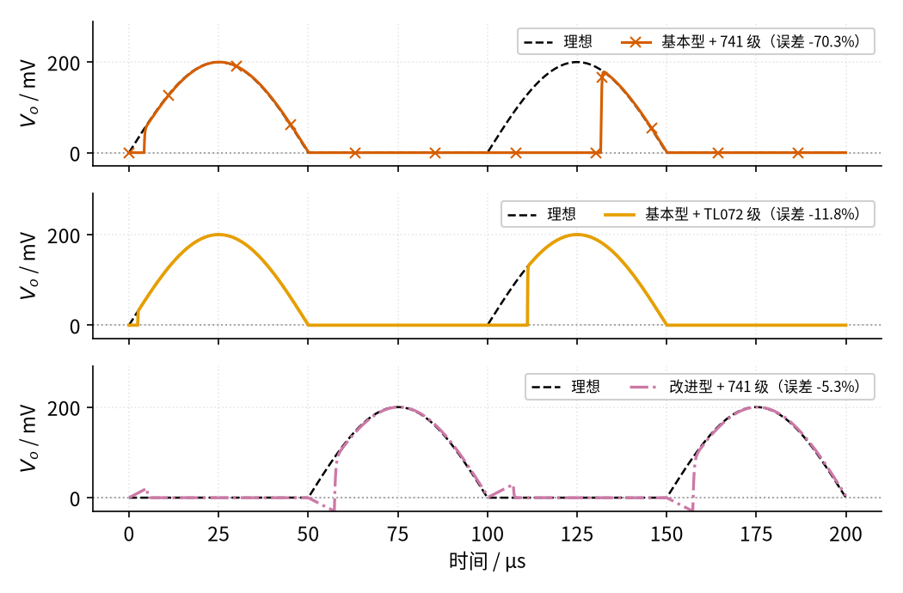
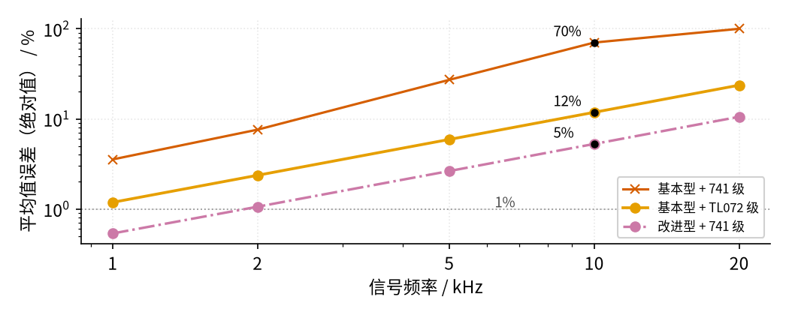
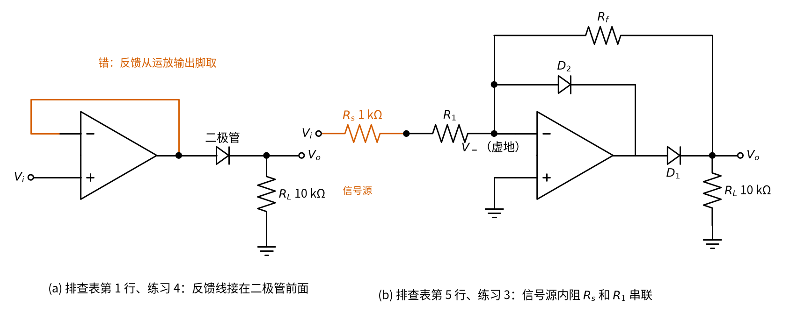
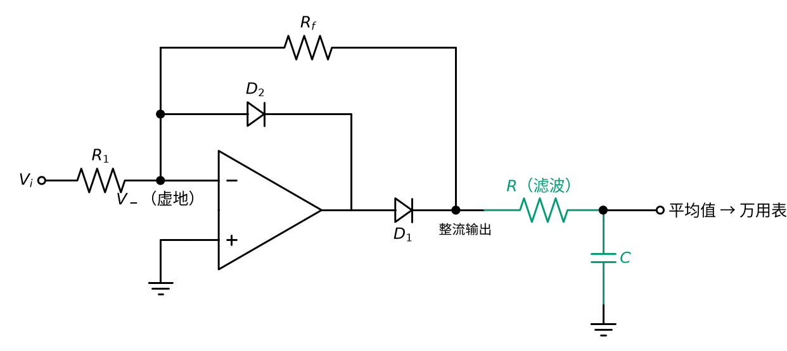

# 09 精密整流 · 参数与调试篇

[上一页：原理与实现篇](page2.md) · [直觉篇](page1.md) · [原理与实现篇](page2.md) · 本页：参数与调试篇 · [动手实验篇](page4.md) · [下一页：动手实验篇](page4.md) · 前置节点：[03 半导体入门 · 直觉篇](../03-semiconductor-basics/page1.md)、[05 反相放大 · 直觉篇](../05-inverting-amp/page1.md) · 后续：[13 桥式整流 · 直觉篇](../13-bridge-rectifier/page1.md)

## 本页要解决的问题

原理与实现篇里的仿真都用 1 kHz 的信号，误差只有百分之几甚至更小。可是信号频率一高，精密整流就会变得「不精密」。这一页回答三个实际问题：**挑运放看哪几个参数**；频率升到多少时误差变得不可接受；电路搭好后输出不对，按什么顺序查。

## 1. 数据手册里最该看的参数

| 参数 | 对精密整流的影响 | 怎么选（典型值） |
|---|---|---|
| 压摆率 SR | 基本型每个周期都要从负饱和爬回来，恢复时间至少是「饱和电压 + 0.7 V」除以 SR；改进型每次过零也要跳过约 1.4 V | LM741 典型 0.5 V/μs；TL072 最小 8 V/μs、典型 20 V/μs；TI 的设计例子要求不低于 5 V/μs |
| 增益带宽积 GBW | 刚过零时输入只有几毫伏，运放的「推力」与 GBW 成正比，小信号的过零恢复主要由它决定 | TL072 为 3 MHz（部分封装）到 5.25 MHz；TI 的 50 kHz 设计例子要求不低于 10 MHz |
| 输出摆幅 | 基本型负半周会撞到电源附近；改进型里它决定了能处理多大的信号 | LM741 在 ±15 V、负载 2 kΩ 以上时典型 ±13 V |
| 输入失调电压 | 相当于在输入端串了一个小电池，直接加到被整流的信号上，毫伏级小信号受影响最大 | TL072 典型约 1 mV；要测更小的信号就选低失调运放 |
| 二极管 | 开关速度影响过零毛刺；反向漏电在负半周会「漏」一点信号出去 | 小信号开关二极管（如 03 用过的 1N4148）；肖特基二极管（金属和半导体接触做成，压降约 0.3 V、开关快，见 [03 半导体入门 · 原理与实现篇](../03-semiconductor-basics/page2.md)）更快，但漏电更大 |
| 电阻公差 | 改进型的增益是 $R_f / R_1$ ，两只 1% 电阻最坏会有约 2% 的增益误差 | 改进型和全波整流都用 1% 或更好的电阻 |
| 信号源内阻 | 改进型的输入电阻只有 $R_1$ ，信号源内阻 $R_s$ 会串进 $R_1$ ，增益变小（见 [05 反相放大 · 参数与调试篇](../05-inverting-amp/page3.md)；内阻的含义见 [01 元件速成 · 原理与实现篇](../01-components-basics/page2.md) 第七节（戴维南等效）） | 按 [05 反相放大 · 参数与调试篇](../05-inverting-amp/page3.md) 的经验， $R_1$ 至少取 $R_s$ 的 100 倍，否则在前面加一级跟随器 |

数据来源：[LM741 数据手册](https://www.ti.com/lit/ds/symlink/lm741.pdf)、[TL072 数据手册](https://www.ti.com/lit/ds/symlink/tl072.pdf)、[TI SBOA227B](https://www.ti.com/lit/an/sboa227b/sboa227b.pdf)、[ESP AN001](https://sound-au.com/appnotes/an001.htm)。和 03 一样，**按最坏值设计**：仿真里的 TL072 级运放取的是手册里的最小压摆率 8 V/μs。

## 2. 扫描一：10 kHz 时三种组合的波形

把输入频率提高到 10 kHz（周期 100 μs），峰值仍是 0.2 V，比较三种组合：基本型配 741 级运放、基本型配 TL072 级运放（GBW 3 MHz、SR 8 V/μs）、改进型配 741 级运放。看图 09-p3-1，每个子图里黑色虚线都是理想整流。

*图 09-p3-1　10 kHz、峰值 0.2 V 时三种组合的输出，图例里是平均值误差*

第一行朱红色带 × 的是基本型配 741 级：第一个正半周从 0 V 起步，看起来还行；第二个正半周开头，运放还在从 −13.5 V 往上爬，输出到 130 μs 左右才跳上来，差不多丢了一大半，平均值误差 −70.3%。换成 TI 官方的 741 模型做 SPICE 仿真，10 kHz 时第二个正半周已经完全没有输出（误差 −100%），简化模型的 −70% 还是乐观的。第二行橙色是换成 TL072 级以后：缺口缩短到十几微秒，误差 −11.8%。第三行红紫色点划线是改进型，用的还是那颗慢吞吞的 741 级，误差却只有 −5.3%：运放不再饱和，每次过零只需要跳 1.4 V。

注意第三行在每次过零点附近有一个几十毫伏的小尖刺和小缺口，这就是直觉篇里说的「过零毛刺」：运放输出脚在 −0.7 V 和 +0.7 V 之间切换的那两三微秒里，两只二极管都不通，反馈暂时断开。运放越快，毛刺越窄。

## 3. 扫描二：误差随频率怎么变

从 1 kHz 扫到 20 kHz，把三种组合的平均值误差（取绝对值）画在对数坐标上，见图 09-p3-2。

*图 09-p3-2　平均值误差随信号频率的变化（峰值 0.2 V）*

三条线差不多都是斜向上的直线：**频率翻一倍，误差也大约翻一倍**。原因很直观：每次过零丢掉的时间差不多是固定的几微秒到几十微秒，周期越短，丢掉的比例越大。朱红色带 × 的基本型配 741 级最差，到 20 kHz 已经完全没有输出（误差 −100%）；橙色的基本型配 TL072 级在 10 kHz 是 12%；红紫色的改进型配 741 级最好，在 10 kHz 约 5%。

拿灰色点线 1% 当及格线，可以读出一个粗略的规律：输入峰值 0.2 V 时，基本型配 741 级在 1 kHz 就已经超过 3%，基本型配 TL072 级在 1 kHz 刚好碰线，改进型配 741 级大约到 2 kHz 才碰线（按厂家 741 模型，改进型的速度损失比这里小：10 kHz 约 1%，20 kHz 约 3%；在这个频段，失调反而是更大的误差来源）。要在几十千赫保持 1% 以内，就得选 GBW 10 MHz 以上、压摆率几十 V/μs 的快运放，再配改进型电路，这正是 TI 设计例子的选择。信号越小，过零附近运放的「推力」越弱，这些频率还要往下打折扣。

再提醒一次：这里的运放模型只考虑了「增益随频率下降」（增益带宽积）和压摆率两种限制，真实运放从饱和中恢复时还有额外的延迟，实际误差往往更大。仿真用来比较方案、看趋势，具体指标以数据手册和示波器实测为准。

## 4. 故障排查表

| 现象 | 可能原因 | 怎么查 | 怎么改 |
|---|---|---|---|
| 输出一直是 0 | 反馈线接在二极管前面（运放输出脚上），二极管不在环内 | 看反馈线从哪里取；测运放输出脚，正半周如果只等于输入、没有高出 0.7 V，就是接错了 | 反馈线改从二极管后面（电路输出端）取 |
| 输出变成了负半周 | 二极管接反 | 看二极管色环方向；测输出的极性 | 二极管调头；改进型要两只一起调头 |
| 正半周开头缺一块，频率越高输出越小 | 基本型里运放从负饱和爬回来太慢 | 用示波器看运放输出脚，负半周是否贴在负电源附近 | 换高压摆率、高 GBW 的运放，或改用改进型 |
| 过零点有尖刺或小台阶 | 运放切换两个二极管压降需要时间；二极管恢复慢 | 示波器放大过零点附近，看尖刺宽度随频率是否不变 | 选更快的运放；用 1N4148 这类开关二极管，或换肖特基二极管 |
| 改进型的输出幅度比计算值小一个固定比例 | 信号源内阻串进了 $R_1$ | 断开信号源测它的空载电压，再接上电路测一次，看是否变小 | 降低信号源内阻，或在前面加一级跟随器 |
| 没有输入时输出也有几毫伏直流 | 运放输入失调电压被整流后留在输出 | 输入端对地短接，测输出 | 选低失调运放，或减小增益 |
| 改进型增益和 $R_f / R_1$ 不符 | 电阻公差大，或电阻焊错阻值 | 断电后分别测 $R_1$ 、 $R_f$ | 用 1% 电阻；全波整流里要求更严 |
| 负半周输出不是 0，而是有一点同形状的小信号 | 二极管反向漏电（肖特基二极管、温度高时更明显） | 换一只普通硅二极管对比 | 改用漏电小的硅二极管，或降低电阻阻值 |
| 大信号时输出顶部被削平 | 输入乘以增益后超过运放输出摆幅 | 测运放输出脚是否贴近电源 | 降低增益或输入幅度，或提高电源电压 |

表中第 1 行（反馈线接在二极管前面）和第 5 行（信号源内阻串进 $R_1$ ）是两种具体的接法，画在图 09-p3-3 里，下面的练习 3 用到右图，练习 4 的答案就是左图。

*图 09-p3-3　(a) 反馈线接在二极管前面（错误接法）；(b) 改进型前面串着信号源内阻 Rs*

## 5. 练习

**练习 1（易）**：基本型精密整流用 741 级运放，±15 V 供电，负饱和约 −13.5 V，压摆率 0.5 V/μs。只按压摆率估算，运放输出脚从负饱和爬到 +0.7 V 要多久？一个宽 20 μs 的正脉冲能不能被整流出来？

答案

要爬 13.5 + 0.7 = 14.2 V，时间 14.2 V ÷ 0.5 V/μs = 28.4 μs。脉冲只有 20 μs，运放还没爬到二极管导通，脉冲就结束了，输出一直是 0。Fiore 的教材里用同样的例子算出约 26 μs（他按爬到 0 V 计算）。实际刚过零时输入很小，运放爬得更慢，[09 精密整流 · 原理与实现篇](page2.md) 的仿真里是 60 μs。

**练习 2（易）**：同一颗 741 级运放改用改进型电路，每次过零运放输出脚大约要跳多少伏、花多少时间？在 10 kHz 时，这段时间占半个周期的百分之几？

答案

运放输出脚在 −0.7 V 和 +0.7 V 左右之间切换，约 1.4 V，按压摆率要 1.4 ÷ 0.5 = 2.8 μs。10 kHz 的半个周期是 50 μs，2.8 μs 约占 5.6%，和扫描图里改进型在 10 kHz 的约 5% 误差是同一个量级。

**练习 3（中）**：用改进型电路（见图 09-p3-3 右图）做一个「整流并放大 5 倍」的电路，要求输入电阻不小于 10 kΩ。 $R_1$ 、 $R_f$ 怎么选？如果信号源内阻是 1 kΩ，实际增益是多少？

答案

输入电阻等于 $R_1$ ，取 $R_1$ = 10 kΩ；增益 $R_f / R_1$ = 5，取 $R_f$ = 50 kΩ（买不到时可用 51 kΩ，增益 5.1）。信号源内阻 1 kΩ 串进 $R_1$ 后，实际增益 = 50 ÷ (10 + 1) ≈ 4.55，比 5 小约 9%。补救时不能把 $R_1$ 减小来「抵掉」内阻，那样输入电阻就低于 10 kΩ，违反了题目要求。两种做法：保持 $R_1$ = 10 kΩ，把 $R_f$ 提高到 55 kΩ（标准值用 56 kΩ，增益 56 ÷ 11 ≈ 5.09）；或者在前面加一级跟随器，让信号源内阻不再串进 $R_1$ 。

**练习 4（中）**：小李照着直觉篇搭了基本型精密整流，输入 0.2 V 直流时输出却是 0。用万用表测运放输出脚，正半周它正好等于 $V_i$ ，并没有比输出高出 0.7 V。问哪里接错了？如果把输入加到 2 V，输出大约是多少？

答案

反馈线接在了二极管前面（运放输出脚上），接法就是图 09-p3-3 左图，二极管不在反馈环里。这时运放只是一个跟随器：虚短让运放输出脚等于 $V_i$ = 0.2 V，二极管两端只有 0.2 V，推不开 0.7 V 的门槛，所以输出为 0。输入 2 V 时运放输出脚是 2 V，过了二极管剩约 1.3～1.5 V（电流只有一百多微安，压降不到 0.7 V；SPICE 用 1N4148 模型得到 1.49 V），和不用运放的普通二极管整流一模一样，运放什么也没替你交。改法：反馈线改从二极管后面（电路输出端 $V_o$ ）取，见排查表第 1 行。

**练习 5（难，变体迁移）**：用精密整流做一个「交流电压表」：把整流后的电压求平均（比如用一个 RC 低通滤波：信号经电阻给一只接地的电容充电，电容电压跟不上快速的起伏，只留下平均值），平均值就和信号大小成正比。峰值 0.1 V 的正弦波经过理想的半波整流，平均值是多少？如果换成全波整流（输出是输入的绝对值），平均值又是多少？哪种更好用？电路接法见图 09-p3-4。

*图 09-p3-4　练习 5：精密整流后面接 RC 低通，电容电压就是整流输出的平均值*

答案

正弦波一个正半周的平均值是峰值的 2/π ≈ 0.637 倍（ESP AN001 里给出的系数）。这个系数要用积分推，这里直接用结论，推导超出本教程；不会积分也可以用 Python 验证：「平均值」就是曲线下面那块面积除以时间，在一个周期里均匀取很多点求 $\lvert \sin t \rvert$ 的平均，`numpy.abs(numpy.sin(numpy.linspace(0, 2*numpy.pi, 100001))).mean()` 输出约 0.6366。半波整流只留一半的正半周，另一半时间是 0，所以平均值是峰值的 1/π ≈ 0.318 倍：0.1 V × 0.318 ≈ 31.8 mV。全波整流两个半周都留下，平均值 0.1 V × 0.637 ≈ 63.7 mV。

全波整流的平均值是半波的 2 倍，整流后剩下的起伏（叫纹波，13 会详细讲）的频率也是 2 倍，后面的滤波更容易做平；而且正负半周不对称的信号也能被如实测量。所以测量电路里通常用全波。[09 精密整流 · 原理与实现篇](page2.md) 例 3 已经给出了用反相加法器把半波变成全波的思路，13 会把它完整地实现出来。

## 小结与下一步

精密整流在低频时把二极管的 0.7 V 门槛消掉了，剩下的误差主要来自运放的输入失调（毫伏级）；在高频时由运放的速度决定：基本型要从负饱和爬回来，压摆率和 GBW 都会限制它，改进型不饱和，所以快得多。挑运放先看压摆率和 GBW，调试时先用示波器看运放输出脚，它会告诉你运放是否饱和、反馈是否接对。下一个节点 [10 电压比较器 · 直觉篇](../10-voltage-comparator/page1.md) 专门研究本节里「运放开环、冲到电源」的那种状态，把它从毛病变成功能；[13 桥式整流 · 直觉篇](../13-bridge-rectifier/page1.md) 则会把本节的半波整流和 05 的加法器组合成全波整流。
