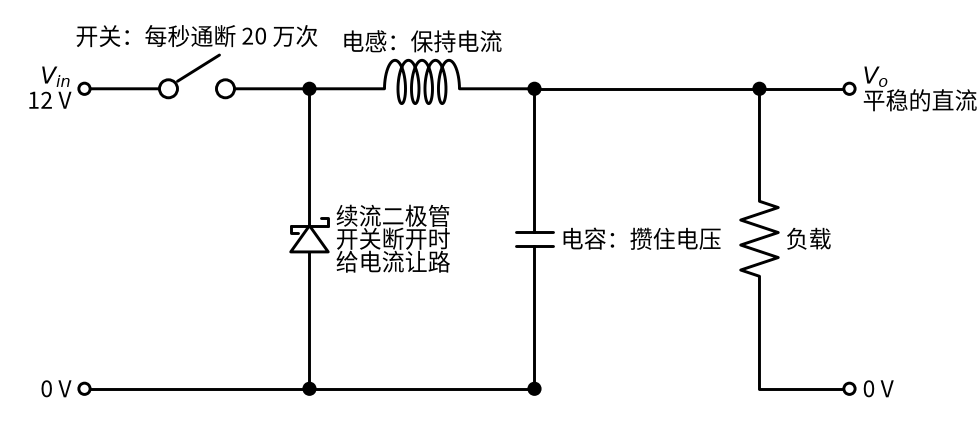
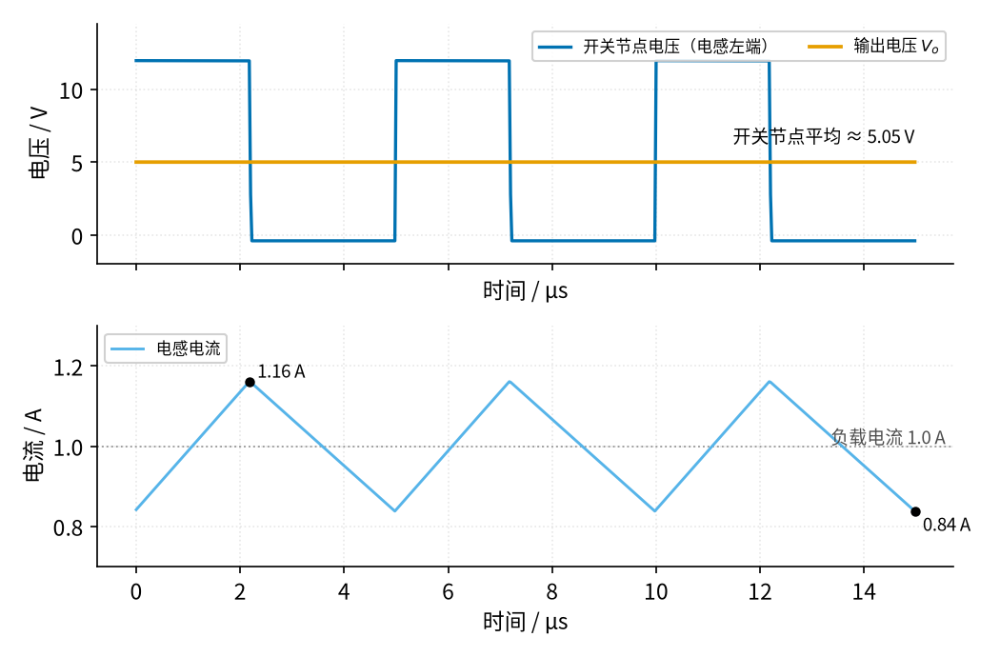
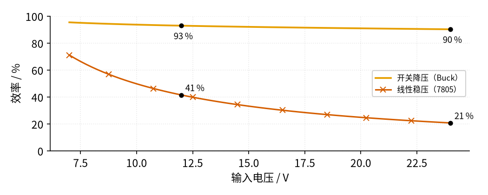

# 09 开关电源 · 直觉篇

[上一页：16 振荡器 · 动手实验篇](../16-oscillator/page4.md) · 本页：直觉篇 · [原理与实现篇](page2.md) · [参数与调试篇](page3.md) · [下一页：原理与实现篇](page2.md) · 前置节点：[P1 元件速成 · 直觉篇](../P1-components-basics/page1.md)、[P2 半导体入门 · 直觉篇](../P2-semiconductor-basics/page1.md)、[06 桥式整流 · 直觉篇](../06-bridge-rectifier/page1.md)、[08 线性稳压 · 直觉篇](../08-linear-regulator/page1.md)

> [!WARNING]
> **市电危险**：本电路的实际版本接 220V/380V 市电，触电可能致命。本页的仿真和动手实验只在 12V 以下的低压电源上进行；任何接线、改线都必须在断电并验电后操作，由持证电工完成。
>
> 本节特有的危险：
> - 手机充电器、电脑适配器这类「离线式」开关电源，插头进来的市电先被整流成约 311 V 的直流，存在一只大电解电容里。**拔掉插头以后这只电容仍然可能带着几百伏电**，不要拆开成品电源去摸里面的元件。
> - 离线式电源的初级（变压器原线圈）一侧和市电之间**没有隔离**，初级的「地」不是安全的地，而是带着市电电位。
> - 示波器的地夹通常和插座的地线连在一起，夹到初级电路上会造成短路，甚至让示波器外壳带电。
> - 本页讨论的降压电路只接 12 V 实验电源，但开关管、二极管和电感在大电流下会发烫，通电时不要用手摸。

## 为什么需要开关电源

[08 线性稳压 · 直觉篇](../08-linear-regulator/page1.md) 做出了一个很稳的电源，代价是发热。它的调整管就像一个"自动拧的水龙头"：多出来的电压全部压在管子上，变成热量。用 08 的思路从 12 V 得到 5 V、负载 1 A，例如用 [08 线性稳压 · 原理与实现篇](../08-linear-regulator/page2.md) 例 3 里的三端稳压器 7805，管子要扛 (12 − 5) × 1 = 7 W 的热量。效率最多是 5 ÷ 12 ≈ 41.7%，再算上 7805 自己约 4.2 mA 的耗电（TI 手册典型值），约 41.5%。输入如果是 24 V，效率更是掉到 5 ÷ (24 × 1.0042) ≈ 21%，大半的电都用来烤散热片了。

手机充电器体积很小，却要连续输出好几瓦；电脑主板要给处理器提供低电压、大电流。这些地方都放不下大散热片，靠的就是本节的**开关电源**。

## 一、换个思路：不去"挡"，而是快速"开关"

线性稳压的办法是"挡"：把水龙头拧到一半，让水流变小。开关电源的办法不一样：**水龙头只有全开和全关两种状态，但开关得非常快**，再在后面接一个"飞轮"和一个"水箱"，把一股一股的水流抹平。

- 全开时，水龙头上没有阻力，不会发热；
- 全关时，没有水流过，也不会发热；
- 发热只发生在"开到关、关到开"那一瞬间，而这一瞬间很短。

飞轮就是电感。在 [P1 元件速成 · 直觉篇](../P1-components-basics/page1.md) 里我们说过，电感像水管里一个很重的飞轮，**它不允许电流突然变化**。水箱就是电容，它不允许电压突然变化。两样东西配合起来，开关送来的"一阵一阵"就被抹成平稳的直流。

整体结构见图 09-p1-1：

*图 09-p1-1　开关电源的直觉结构：开关、续流二极管、电感、电容*

图 09-p1-1 里只有四个关键元件：

1. **开关**：真实电路里是一只 MOSFET（见 [P2 半导体入门 · 原理与实现篇](../P2-semiconductor-basics/page2.md)），每秒通断约 20 万次；
2. **电感**：开关闭合时被"推着转起来"，开关断开时靠惯性继续推电流；
3. **续流二极管**：开关断开时，电感的电流需要一条路，二极管就是这条路。没有它，电感会在开关上顶出很高的尖峰电压，和 P1 里继电器线圈断电的情况一样（见 [P1 元件速成 · 原理与实现篇](../P1-components-basics/page2.md)）；
4. **电容**：把剩下的小波动吸收掉，让负载看到平稳的电压。

## 二、开关一开一关，电流在干什么

把一个周期分成两段来看：

- **开关闭合**：12 V 直接加在电感左端。电感右端是 5 V 左右的输出，电感两端有约 7 V 的电压差，电流**慢慢增大**。
- **开关断开**：输入被切断，可是电感"飞轮"还在转，电流不能突然停。它从地出发，经过续流二极管、电感流到输出。这时电感左端被二极管拉到约 −0.4 V：电流是从地出发、经二极管往上流的，二极管上要压掉约 0.4 V，所以它上端（电感左端）比地还低 0.4 V。电感两端的电压反过来了，电流**慢慢减小**。

下面是仿真得到的波形，条件是 12 V 输入、5 V 输出、负载 1 A、每秒开关 20 万次（每个周期 5 µs），见图 09-p1-2：

*图 09-p1-2　开关节点电压、输出电压与电感电流（12 V 降到 5 V，负载 1 A）*

图 09-p1-2 里能看出三件事：

- 上排**蓝色**是开关节点（电感左端）的电压，它是一个方波：要么约 12 V，要么约 −0.4 V，中间几乎没有过渡；
- 上排**橙色**是输出电压，几乎是一条水平线，平均 5.00 V，抖动只有约 4 mV；
- 下排**天蓝色**是电感电流，开关闭合时往上爬、断开时往下滑，形成三角波，平均正好是负载电流 1 A，最高约 1.16 A、最低约 0.84 A。

电感电流从不中断，这正是"飞轮"的效果。电容只需要吸收三角波里那一点点上下波动，所以输出很平。

## 三、为什么这样就省电

管子上的功率等于管子两端电压乘以流过的电流：

- 闭合时电流约 1 A，但管子两端电压只有零点零几伏；
- 断开时管子两端电压是 12 V，但电流为 0。

两种状态下乘积都很小。线性稳压的调整管却是"电压也大、电流也大"，乘积就是那 7 W。

开关电源当然也有损耗：二极管有压降，电感线圈有电阻，开关切换的瞬间有一小段"电压和电流都不为零"的时间，控制芯片自己也要用电。把这些按典型值估一下，12 V 降到 5 V、1 A 时总损耗约 0.38 W，效率约 93%。和线性稳压的对比见图 09-p1-3：

*图 09-p1-3　开关降压与线性稳压的效率随输入电压变化（输出 5 V、负载 1 A）*

图 09-p1-3 里**橙色**是开关降压，**朱红色带×标记**的是线性稳压。输入越高，线性稳压浪费得越多：12 V 时 41%，24 V 时只剩 21%。开关降压却几乎是一条平线，12 V 时 93%，24 V 时仍有 90%。这里开关电源的各项损耗用的是示意值，真实芯片要看它的数据手册，但"90% 左右"是很常见的水平。

## 四、开关"开多久"决定输出多高

输出电压由什么决定？直觉上很简单：**电感后面的电容看到的是开关节点电压的平均值**。

开关节点一会儿 12 V、一会儿 0 V（先忽略二极管那 0.4 V）。如果一个周期里有 40% 的时间是 12 V，平均就是 12 × 0.4 = 4.8 V；有 50% 的时间是 12 V，平均就是 6 V。这个"开着的时间占整个周期的比例"就是 [21 MOS 管开关 · 原理与实现篇](../21-mosfet-switch/page2.md) 讲过的**占空比**，用字母 $D$ 表示，于是

$$V_o \approx D \cdot V_{in}$$

要从 12 V 得到 5 V，理想情况下 $D = 5/12 \approx 0.417$ ，即 41.7%。实际电路里二极管和导线都要"吃掉"一点电压，仿真里需要约 44% 才能得到 5 V。不用担心算不准：真实的开关电源芯片会**一直测量输出，自动调整占空比**，这和 08 里运放不停比较输出和基准是同一个思路。

## 五、两种常见的拓扑

拓扑就是电路的连接结构。本节后面会讲两种：

- **同步降压**：把续流二极管也换成一只 MOSFET（称为"下管"），和上管轮流导通。二极管那 0.4 V 的压降没了，效率更高。电脑主板、手机内部大量使用。
- **隔离（反激）电源的次级**：手机充电器要从 220 V 市电得到 5 V，还要保证人摸到 USB 口是安全的，于是在开关和输出之间插了一个变压器。变压器次级（副线圈）那一侧的电路就是"脉冲 → 二极管整流 → 电容滤波"，和 [06 桥式整流 · 直觉篇](../06-bridge-rectifier/page1.md) 的思路一样。

原理篇会先用最好懂的"异步降压"（续流元件是二极管）推出公式，再讲这两种变体。

## 小结

- 线性稳压"挡住"多余的电压，压差越大越热；开关电源让开关只处于全开或全关，几乎不发热。
- 电感像飞轮一样维持电流，续流二极管给它在开关断开时留一条路，电容把剩下的波动抹平。
- 输出电压约等于占空比乘以输入电压，真实芯片靠反馈自动调占空比。
- 12 V 降到 5 V、1 A 时，开关降压效率约 93%，线性稳压只有约 41.5%。

## 参考资料

- Wikipedia，Buck converter（工作原理、 $D = V_o/V_{in}$ 、效率常超过 90%）：https://en.wikipedia.org/wiki/Buck_converter
- Wikipedia，Flyback converter（反激电源的结构与隔离）：https://en.wikipedia.org/wiki/Flyback_converter
