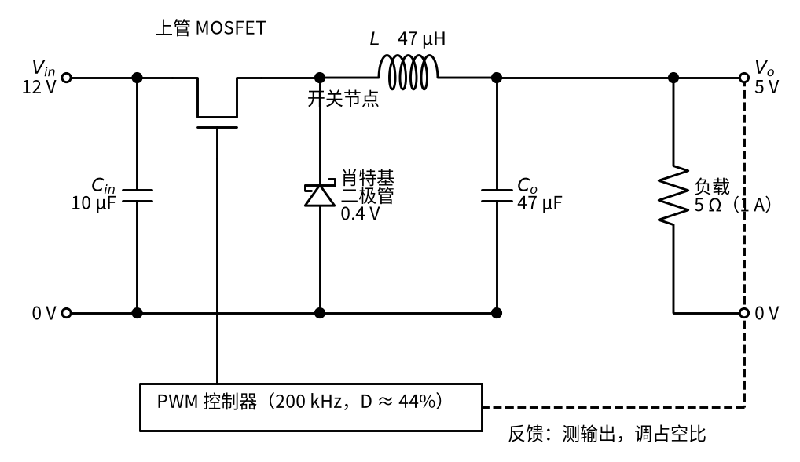
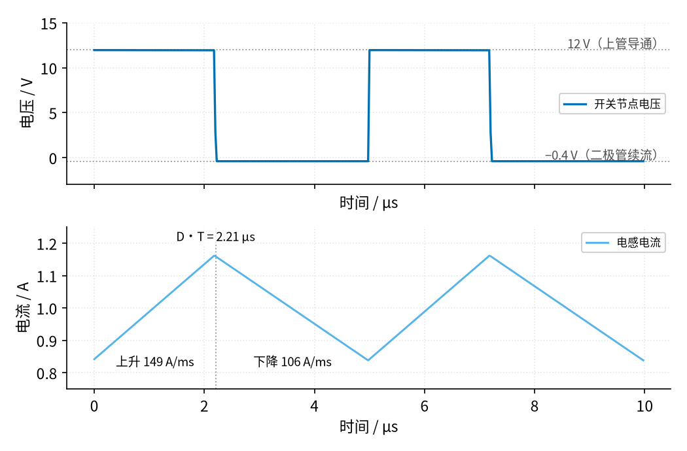
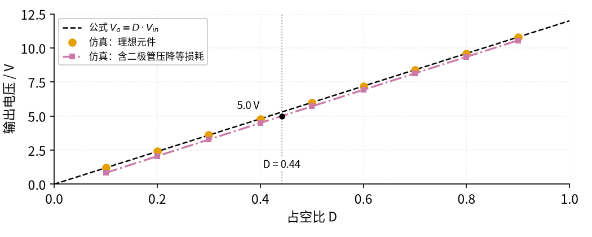
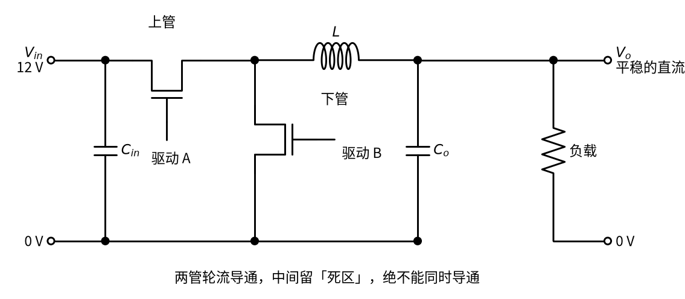
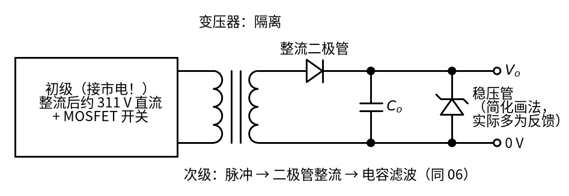

# 09 开关电源 · 原理与实现篇

[上一页：直觉篇](page1.md) · [直觉篇](page1.md) · 本页：原理与实现篇 · [参数与调试篇](page3.md) · [下一页：参数与调试篇](page3.md) · 前置节点：[P1 元件速成 · 直觉篇](../P1-components-basics/page1.md)、[P2 半导体入门 · 直觉篇](../P2-semiconductor-basics/page1.md)、[06 桥式整流 · 直觉篇](../06-bridge-rectifier/page1.md)、[08 线性稳压 · 直觉篇](../08-linear-regulator/page1.md)

> [!WARNING]
> **市电危险**：本电路的实际版本接 220V/380V 市电，触电可能致命。本页的仿真和动手实验只在 12V 以下的低压电源上进行；任何接线、改线都必须在断电并验电后操作，由持证电工完成。
>
> 本节特有的危险：本页的降压电路只接 12 V 实验电源。第八部分讲的反激电源，初级（变压器原线圈一侧）接市电整流后约 311 V 的直流，大电解电容在拔掉插头后仍可能带着几百伏电；初级与市电没有隔离，示波器地夹不能夹到初级电路上。不要拆开或改装成品充电器、适配器。

## 这一页要回答什么

直觉篇说"输出约等于占空比乘以输入"。这一页要把它推出来，并回答三个设计时一定会遇到的问题：

1. 电感电流的三角波有多大？
2. 输出电压的纹波有多大？
3. 续流二极管换成 MOSFET（同步降压）、加上变压器（反激）以后，电路怎么变？

## 一、用到的旧知识

- **电感**：电压决定电流变化的快慢， $V_L = L \cdot \frac{\Delta I}{\Delta t}$ （见 P1 page2）。反过来写就是 $\Delta I = \frac{V_L \cdot \Delta t}{L}$ ：电感两端电压是正的，电流就往上爬；是负的，电流就往下滑。
- **电容**：流进的净电流决定电压变化的快慢（见 P1 page2）。
- **MOSFET**：栅极电压高于门限后，漏源之间像一只阻值为 $R_{DS(on)}$ 的小电阻（见 P2 page2）。
- **占空比**：开关导通时间占整个周期的比例，记作 $D$ （见 [21 MOS 管开关 · 原理与实现篇](../21-mosfet-switch/page2.md)）。
- **反馈**：08 的运放一直比较输出和基准，自动调整（见 08 page1）。开关电源的控制芯片做的是同样的事，只不过它调的是占空比。

## 二、实际电路

把直觉篇里的开关换成 N 沟道 MOSFET，就是一个完整的**异步降压**电路，见图 09-p2-1：



*图 09-p2-1　异步降压电路：上管 MOSFET、肖特基续流二极管、电感和电容*

图 09-p2-1 中各元件的作用：

| 元件 | 本例取值 | 作用 |
|---|---|---|
| 输入电容 $C_{in}$ | 10 µF | 上管导通时电流突然很大，就近从它取电，避免输入线上出现大的电流跳变 |
| 上管 MOSFET | $R_{DS(on)}$ 0.05 Ω（示意值） | 开关，由 PWM 控制器驱动 |
| 肖特基二极管 | 正向压降 0.4 V | 上管断开时给电感电流让路；选肖特基是因为它压降小、关断快 |
| 电感 $L$ | 47 µH | 储能、维持电流 |
| 输出电容 $C_o$ | 47 µF | 吸收电感电流里的三角波部分 |
| PWM 控制器 | 200 kHz | 测量输出，自动调整占空比 |

"异步"的意思是续流元件是二极管，它自己导通、自己截止，不需要控制器去管。

## 三、伏秒平衡：推出占空比公式

设开关周期为 $T$ （200 kHz 时 $T = 5\ \mu\text{s}$ ），上管导通的时间是 $D \cdot T$ ，断开的时间是 $(1 - D) \cdot T$ 。先把二极管压降和各种电阻都当成 0。

**第 1 步，导通阶段**。电感左端是 $V_{in}$ ，右端是 $V_o$ ，电感两端电压是 $V_{in} - V_o$ 。电流上升了

$$\Delta I_{上} = \frac{(V_{in} - V_o) \cdot D T}{L}$$

**第 2 步，断开阶段**。二极管导通，电感左端约为 0，右端仍是 $V_o$ ，电感两端电压是 $-V_o$ 。电流下降了

$$\Delta I_{下} = \frac{V_o \cdot (1 - D) T}{L}$$

**第 3 步，稳定的条件**。电路稳定以后，每个周期结束时电流要回到起点，否则电流会一个周期比一个周期大（或小）。所以上升量等于下降量：

$$(V_{in} - V_o) \cdot D = V_o \cdot (1 - D)$$

展开整理，得到

$$V_o = D \cdot V_{in}$$

这个推导叫**伏秒平衡**：电感两端"电压乘以时间"在一个周期里正负抵消。它和直觉篇"输出等于开关节点电压的平均值"是同一件事。

两个阶段的电流斜率见图 09-p2-2：



*图 09-p2-2　一个周期里的两个阶段：电流上升和下降的斜率*

图 09-p2-2 的下排里，上升段的斜率是 $(12 - 5)/47\ \mu\text{H} \approx 149$ A/ms，下降段是 $5/47\ \mu\text{H} \approx 106$ A/ms（这两个数是按理想公式算的）。图里的时间却是按含损耗的占空比 0.441 画的：上升段 2.21 µs，下降段 2.79 µs。理想斜率配上这两个时间，一升一降并不相等（149 × 2.21 ≈ 0.33 A，106 × 2.79 ≈ 0.30 A），这是因为真实电路里还有损耗。把损耗算进去，导通时电感两端是 $12 - 0.05 - 5 - 0.05 = 6.9$ V（减去上管和电感线圈电阻上各 0.05 V），上升斜率约 6.9 / 47 µH ≈ 147 A/ms；断开时是 $-(5 + 0.4 + 0.05) = -5.45$ V，下降斜率约 5.45 / 47 µH ≈ 116 A/ms。这样上升 147 × 2.21 ≈ 0.32 A，下降 116 × 2.79 ≈ 0.32 A，一上一下正好抵消（下面程序会打印这两个斜率）。上排里断开阶段的电压是 −0.4 V 而不是 0：电流从地出发往上流过肖特基二极管，二极管压掉 0.4 V，它的上端就比地低 0.4 V。

## 四、电感纹波和输出纹波

把 $D = V_o / V_{in}$ 代回第 1 步，电感电流的峰峰值是

$$\Delta I_L = \frac{(V_{in} - V_o) \cdot D}{f \cdot L}$$

本例 $D = 5/12 \approx 0.417$ ， $\Delta I_L = 7 \times 0.417 / (200\ \text{kHz} \times 47\ \mu\text{H}) \approx 0.310$ A，约为负载电流的 31%。TI 的降压设计应用笔记建议把它选在输出电流的 20%～40%，本例在这个范围里。

电感电流 = 负载电流（直流）+ 三角波。三角波部分流进电容，电容电压于是小幅起伏。电容攒下的电荷可以按三角形面积算：三角波高出平均值的那一段持续半个周期 $T/2$ ，最高比平均值多 $\Delta I_L / 2$ ，这块三角形的面积就是电容多攒的电荷

$$\Delta Q = \frac{1}{2} \cdot \frac{T}{2} \cdot \frac{\Delta I_L}{2} = \frac{\Delta I_L \cdot T}{8} = \frac{\Delta I_L}{8 f}$$

再用电容的 $\Delta V = \Delta Q / C$ ，就得到输出纹波

$$\Delta V_o = \frac{\Delta I_L}{8 f C}$$

公式里的 8 就是这样来的：两个 1/2 来自三角形面积和"高出一半"，再一个 1/2 来自"半个周期"。本例 $\Delta V_o = 0.310 / (8 \times 200\ \text{kHz} \times 47\ \mu\text{F}) \approx 4.1$ mV。真实电容内部还相当于串着一只很小的电阻，叫等效串联电阻（ESR），它会再加一份纹波，在参数篇讨论。

从两个式子看出：**频率 $f$ 越高，电感和电容都可以越小**。这正是开关电源能做得很小的原因；代价是每秒开关次数多了，切换损耗也跟着变大。

## 五、占空比和输出的关系

把占空比从 0.1 扫到 0.9，每个点都仿真到稳定，结果见图 09-p2-3：



*图 09-p2-3　占空比与输出电压：公式、理想仿真、含损耗仿真*

图 09-p2-3 里，**黑色虚线**是公式 $V_o = D \cdot V_{in}$ ，**橙色**圆点是元件全部理想时的仿真，正好落在线上：D = 0.5 时 6.00 V，D = 0.9 时 10.80 V。**红紫色点划线**是加上二极管压降和电阻以后的仿真，整体低了约 0.3 V：D = 0.5 时只有 5.71 V。所以要得到 5 V，占空比要从 41.7% 提到约 44%（图中的竖线）。

考虑损耗以后的占空比，还是用伏秒平衡推。记 $R_{DCR}$ 为电感线圈的电阻（DCR，直流电阻，注意不是负载电阻）， $V_F$ 为二极管压降，电感电流近似为 $I_o$ 。导通阶段电感两端是 $V_{in} - I_o R_{DS(on)} - V_o - I_o R_{DCR}$ ，断开阶段是 $-(V_o + V_F + I_o R_{DCR})$ 。让两段的"电压乘以时间"相等：

$$(V_{in} - I_o R_{DS(on)} - V_o - I_o R_{DCR}) \cdot D = (V_o + V_F + I_o R_{DCR}) \cdot (1 - D)$$

把含 $D$ 的项移到一边，整理得

$$D \approx \frac{V_o + V_F + I_o \cdot R_{DCR}}{V_{in} + V_F - I_o \cdot R_{DS(on)}}$$

本例 $D \approx (5 + 0.4 + 0.05) / (12 + 0.4 - 0.05) = 5.45 / 12.35 \approx 0.441$ 。实际芯片不需要你算准，反馈会自动找到这个值。

## 六、用程序验证

下面的程序只用 Python 标准库，按 P1 page2 的办法一小段一小段地算：

```python
# 在仓库根目录运行（只用标准库，不需要 figstyle）
VIN, VO_SET, R = 12.0, 5.0, 5.0        # 输入 12 V，目标 5 V，负载 5 Ω（1 A）
F, L, C = 200e3, 47e-6, 47e-6          # 开关频率 200 kHz，电感 47 µH，电容 47 µF
VF, RDS, DCR = 0.4, 0.05, 0.05         # 肖特基压降、上管导通电阻、电感线圈电阻（示意值）
N = 1000                               # 每个周期切成 1000 小段（同 P1 page2 的「一小段一小段地算」）
T = 1 / F
dt = T / N

def run(D, periods=300):
    """异步降压的逐段仿真：返回最后一个周期的 V_o 平均值、V_o 峰峰值、i_L 最小值和最大值。"""
    il, vc = VO_SET / R, D * VIN       # 从「差不多」的状态出发，省点时间
    vs, ils = [], []
    for k in range(periods * N):
        on = (k % N) < D * N
        v_sw = VIN - il * RDS if on else -VF   # 开关节点电压：上管导通 or 二极管续流
        il += (v_sw - vc - il * DCR) / L * dt  # 电感：ΔI = V_L·Δt / L
        il = max(il, 0.0)                      # 二极管不让电流反向
        vc += (il - vc / R) / C * dt           # 电容：ΔV = I·Δt / C
        if k >= (periods - 1) * N:
            vs.append(vc); ils.append(il)
    return sum(vs) / N, max(vs) - min(vs), min(ils), max(ils)

D_ideal = VO_SET / VIN
D_real = (VO_SET + 1 * DCR + VF) / (VIN - 1 * RDS + VF)
dI = (VIN - VO_SET) * D_ideal / (F * L)
print(f"理想占空比 {D_ideal:.3f}，考虑损耗 {D_real:.3f}")
print(f"公式：ΔI_L = {dI:.3f} A，ΔV_o = {dI / (8 * F * C) * 1e3:.1f} mV")
up, dn = (VIN - RDS - VO_SET - DCR) / L, (VO_SET + VF + DCR) / L   # 含损耗的斜率（按 1 A 估）
print(f"含损耗斜率：上升 {up / 1e3:.0f} A/ms，下降 {dn / 1e3:.0f} A/ms；"
      f"升 {up * D_real * T:.3f} A，降 {dn * (1 - D_real) * T:.3f} A")
vo, vpp, imin, imax = run(D_real)
print(f"仿真：V_o = {vo:.2f} V，纹波 {vpp * 1e3:.1f} mV，i_L 在 {imin:.2f}～{imax:.2f} A 之间")
vo_i, *_ = run(D_ideal)
print(f"如果用理想占空比：V_o = {vo_i:.2f} V")
assert abs(vo - VO_SET) < 0.05 and vpp < 0.01
```

运行结果应为：理想占空比 0.417，考虑损耗 0.441；公式算出 ΔI_L 为 0.310 A、输出纹波 4.1 mV；含损耗斜率上升 147 A/ms、下降 116 A/ms，升降都是 0.324 A；仿真得到输出 5.01 V，纹波 4.3 mV，电感电流在 0.84～1.16 A 之间；如果直接用理想占空比 0.417，输出只有 4.71 V。仿真的纹波比公式略大，是因为仿真用的占空比是 0.441，三角波也略大一些。

## 七、变体一：同步降压

异步降压里，断开阶段 1 A 的电流全部流过肖特基二极管，二极管上的功率是 $V_F \cdot I_o \cdot (1 - D) = 0.4 \times 1 \times 0.559 \approx 0.22$ W，是整个电路里最大的一项损耗。输出电压越低，断开阶段越长，这一项越突出。

办法是把二极管换成一只 MOSFET，称为**下管**，见图 09-p2-4：



*图 09-p2-4　同步降压：用下管 MOSFET 代替续流二极管*

图 09-p2-4 里，上管导通时下管关断；上管关断后，控制器让下管导通，电感电流从地经下管流向电感。下管导通时只相当于一只 0.05 Ω 的电阻，1 A 时压降只有 0.05 V，损耗约 $0.05 \times 1^2 \times 0.559 \approx 0.03$ W，比二极管小了七八倍。Wikipedia 举过一个更夸张的例子：5 V 降到 3.3 V、10 A 时，硅二极管续流损耗 2.38 W，换成 MOSFET 只有 0.51 W。

同步降压多了一个危险：**两只管子绝不能同时导通**。如果上管还没完全关断，下管就打开了，输入电源会经两只管子直接短路到地，叫**直通**。所以控制器在两管切换之间都会留一小段两管都关的时间，叫**死区**。死区里电感电流靠下管的**体二极管**续流：它是功率 MOSFET 制造时在漏极和源极之间天然形成的一只二极管，N 沟道管里方向是从源极指向漏极，正好让电感电流从地往上流（见 [21 MOS 管开关 · 直觉篇](../21-mosfet-switch/page1.md)）。很多电路还会在下管旁边再并一只肖特基二极管帮忙（见 Wikipedia Buck converter）。

## 八、变体二：隔离（反激）电源的次级

手机充电器里常见的是**隔离型开关电源（反激电源）**。变压器接市电的一侧叫**初级**（原线圈一侧），接输出的一侧叫**次级**（副线圈一侧）。很多资料把次级的输出级画成"脉冲 → 串联二极管 → 稳压管 → 电容"的简化形式，下面把它画完整，见图 09-p2-5：



*图 09-p2-5　反激电源的次级输出级（补全后的画法）*

图 09-p2-5 可以从刚学的异步降压过渡过来理解：

- 异步降压里，上管导通时电感"吸能"，断开时电感经续流二极管把能量放给电容和负载。
- 反激电源把电感换成一个**带两组线圈的变压器**。初级的 MOSFET 导通时，能量存进变压器，次级的二极管反向截止，负载靠电容供电；MOSFET 断开时，次级二极管导通，存住的能量送到电容和负载（见 Wikipedia Flyback converter）。
- 所以次级那一串"二极管 + 电容"的作用，和 06 里"整流 + 滤波"是同一回事（见 06 page2），只是进来的是高频脉冲而不是 50 Hz 正弦，电容可以小得多。

为什么要绕这一圈？因为初级接的是市电整流后约 311 V 的直流，变压器两组线圈之间没有导线相连，人摸到次级的 USB 口才是安全的。

关于简化画法里那只稳压管：真实产品一般不靠它稳压。输出电压是在次级测量，再通过光耦送回初级控制器调占空比（见 Wikipedia Flyback converter）；稳压管至多当作过压保护。光耦已经在 [23 光耦隔离 · 直觉篇](../23-optocoupler/page1.md) 讲过；把它用在电源反馈，以及更快的数字隔离器，留到 [24 隔离电源与数字隔离器 · 直觉篇](../24-isolated-power/page1.md) 再讲。

## 九、渐进例题

**例 1（完整示范）** 12 V 降到 5 V，负载 1 A，200 kHz，L = 47 µH，C = 47 µF。求理想占空比、电感纹波和输出纹波。

- 占空比： $D = 5/12 \approx 0.417$ 。
- 电感纹波： $\Delta I_L = (12 - 5) \times 0.417 / (200\ \text{kHz} \times 47\ \mu\text{H}) \approx 0.310$ A，电感电流在约 0.85 A 到 1.15 A 之间。
- 输出纹波： $\Delta V_o = 0.310 / (8 \times 200\ \text{kHz} \times 47\ \mu\text{F}) \approx 4.1$ mV。

**例 2（填空）** 输入改成 24 V，其余不变。

- 占空比： $D = 5/24 \approx$ ____。
- 电感纹波： $\Delta I_L = (24 - 5) \times$ ____ $/ (200\ \text{kHz} \times 47\ \mu\text{H}) \approx$ ____ A。
- 这个纹波占负载电流的 ____%，是否还在 20%～40% 里？

<details>
<summary>答案</summary>

D ≈ 0.208；ΔI_L ≈ 19 × 0.208 / 9.4 ≈ 0.42 A；占 42%，略超出 40%，可以把电感加大到约 50 µH 以上，或者把频率提高一些。

</details>

**例 3（变体迁移）** 同步降压，12 V 降到 3.3 V，负载 2 A。上管、下管的 $R_{DS(on)}$ 都是 0.05 Ω。如果改用压降 0.4 V 的肖特基二极管续流，续流元件的损耗分别是多少？

<details>
<summary>答案</summary>

理想占空比 D = 3.3/12 = 0.275，断开时间占 1 − D = 0.725。二极管：0.4 × 2 × 0.725 = 0.58 W；下管：0.05 × 2² × 0.725 = 0.145 W。同步方案在这一项上省了约 0.44 W。

</details>

## 小结

- 伏秒平衡：稳定时电感电流一周期内升降相等，推出 $V_o = D \cdot V_{in}$ 。
- 电感纹波 $\Delta I_L = (V_{in} - V_o) D / (fL)$ ，一般取输出电流的 20%～40%；输出纹波 $\Delta V_o = \Delta I_L / (8fC)$ 。
- 损耗让实际占空比比理想值略大，反馈会自动补偿。
- 同步降压用下管代替二极管，效率更高，但必须留死区防直通。
- 反激电源的次级是"二极管整流 + 电容滤波"，简化画法中的稳压管不是真正的稳压手段，真实产品靠光耦反馈稳压。

## 参考资料

- Wikipedia，Buck converter（伏秒平衡、 $D = V_o/V_{in}$ 、输出纹波 $\Delta I_L/(8fC)$ 、同步整流的损耗对比与死区）：https://en.wikipedia.org/wiki/Buck_converter
- TI，SLVA477B《Basic Calculation of a Buck Converter's Power Stage》（电感纹波公式、纹波取输出电流的 20%～40%、肖特基二极管损耗）：https://www.ti.com/lit/an/slva477b/slva477b.pdf
- Wikipedia，Flyback converter（反激电源两个阶段的能量传递、光耦反馈）：https://en.wikipedia.org/wiki/Flyback_converter
