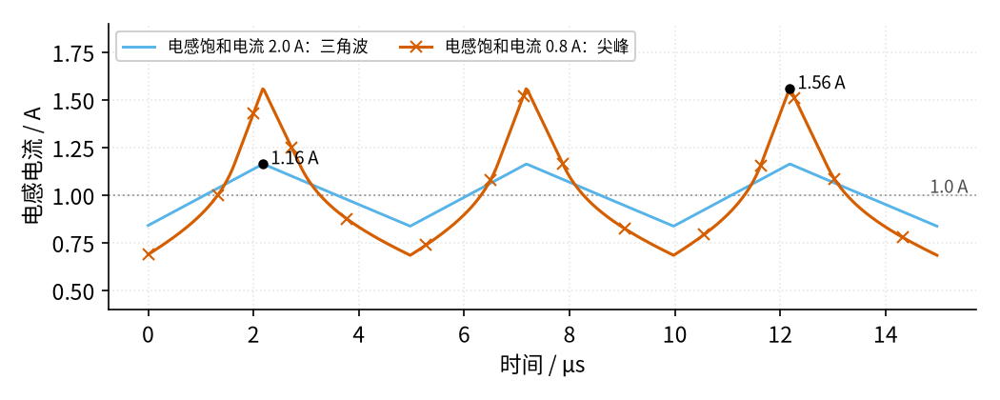
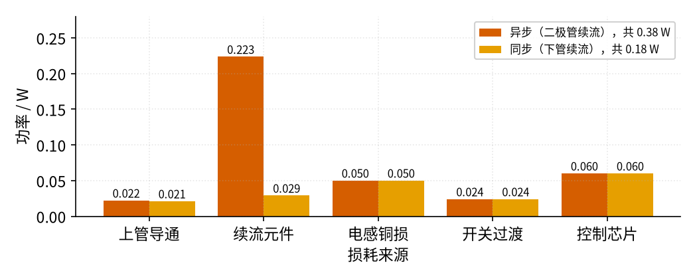

# 09 开关电源 · 参数与调试篇

[上一页：原理与实现篇](page2.md) · [直觉篇](page1.md) · [原理与实现篇](page2.md) · 本页：参数与调试篇 · [动手实验篇](page4.md) · [下一页：动手实验篇](page4.md) · 前置节点：[P1 元件速成 · 直觉篇](../P1-components-basics/page1.md)、[P2 半导体入门 · 直觉篇](../P2-semiconductor-basics/page1.md)、[06 桥式整流 · 直觉篇](../06-bridge-rectifier/page1.md)、[08 线性稳压 · 直觉篇](../08-linear-regulator/page1.md)

> [!WARNING]
> **市电危险**：本电路的实际版本接 220V/380V 市电，触电可能致命。本页的仿真和动手实验只在 12V 以下的低压电源上进行；任何接线、改线都必须在断电并验电后操作，由持证电工完成。
>
> 本节特有的危险：离线式开关电源（充电器、适配器）的初级是市电整流后约 311 V 的直流，大电解电容断电后仍可能带着几百伏电；初级和市电没有隔离；示波器地夹接到初级会造成短路。本页所有调试方法**只用于 12 V 实验电源供电的降压电路**，不要拿去拆修成品充电器。

## 这一页要解决什么

降压电路按原理篇的公式搭起来，常见三种毛病：**电感发烫甚至啸叫、二极管烫手效率很低、周围的收音机和传感器被干扰**。它们分别对应开关电源最常见的三个错误：电感饱和、续流二极管太慢、PCB 走线回路太大。本页先给参数速查，再逐一分析，最后给出低压动手实验和故障排查表。

## 一、参数速查

以 12 V 降到 5 V、1 A、200 kHz 为例：

| 参数 | 怎么估 | 本例 | 选型时注意 |
|---|---|---|---|
| 占空比 $D$ | $V_o / V_{in}$ ，含损耗时略大 | 0.417～0.441 | 输入最高时 D 最小，最低时 D 最大，两头都要能做到 |
| 电感 $L$ | 让 $\Delta I_L$ 为输出电流的 20%～40% | 47 µH，纹波 0.31 A | 输入最高时纹波最大，按最高输入算 |
| 电感电流峰值 | $I_o + \Delta I_L / 2$ | 约 1.16 A | 电感的**饱和电流**必须高于它，并留余量 |
| 电感有效值电流 | 约等于 $I_o$ | 1 A | 电感的**温升电流**（让线圈自身发热、升温到手册规定值时的电流，按有效值计）必须高于它 |
| 输出电容 $C_o$ | $\Delta V_o = \Delta I_L / (8fC)$ | 47 µF，4.1 mV | 电容内部相当于串着一只小电阻，叫等效串联电阻（ESR），它还会加一份纹波 $ESR \cdot \Delta I_L$ |
| 续流二极管 | 平均电流 $I_o (1 - D)$ ，功耗乘以 $V_F$ | 0.56 A，0.22 W | 用**肖特基**；反向耐压高于最高输入 |
| 上管 MOSFET | 导通损耗 $I_o^2 R_{DS(on)} D$ | 约 0.02 W | 漏源耐压高于最高输入并留余量 |

前两行的电感公式和"20%～40%"的取法、二极管功耗的算法都来自 TI 的 SLVA477B。

## 二、电感饱和：电流出现尖峰

电感里的磁芯能存的磁能有上限。电流超过某个值以后，磁芯"装满了"，电感量迅速下降。TI 的 SSZTAV7 指出，数据手册上的**饱和电流**通常定义为"电感量下降 30% 时的直流电流"，这个定义本身带点随意，各家可能不同；Coilcraft 的选型笔记也说 10%～20% 的定义很常见。

电感量一小，按 $\Delta I = V_L \cdot \Delta t / L$ ，同样的电压和时间下电流涨得更快，于是越涨越快。仿真比较了两只标称都是 47 µH 的电感，见图 09-p3-1：

*图 09-p3-1　电感饱和：合适的电感与饱和电流偏小的电感*

图 09-p3-1 里，**天蓝色**是饱和电流 2.0 A 的电感，峰值只有 1.16 A，离饱和很远，电流是规则的三角波。**朱红色带×标记**的是饱和电流只有 0.8 A 的电感：平均 1 A 已经超过它的饱和电流，电流越往上，电感量越小，曲线越陡，顶上变成尖峰，峰值 1.56 A，峰峰值从 0.33 A 涨到 0.87 A。仿真里的饱和模型是示意的（在饱和电流处电感量降到 70%，最低降到标称的 20%）。

尖峰的害处：上管和二极管要扛更大的峰值电流，损耗变大；输出纹波变大；严重时控制芯片的过流保护被触发，电源反复重启。SSZTAV7 还提醒，饱和电流会随温度升高而下降，电感越热越容易饱和。

**选型口诀**：看两个电流，**饱和电流**管峰值，**温升电流**管发热（Coilcraft 笔记里分别叫 Isat 和 Irms；rms 就是高中学过的"有效值"，所以 Irms 指按有效值计的发热上限电流），两个都要比电路里的实际值大。

## 三、续流二极管太慢

上管导通的一瞬间，续流二极管要从"正向导通"立刻变成"反向截止"。普通硅整流二极管做不到"立刻"：它内部还存着电荷，要先倒流一小段电流把电荷抽走，才真正截止，这叫**反向恢复**。这一小段时间里，输入电源经上管和二极管几乎被短路，每个周期都要损失一份能量。Wikipedia 给出的估算是：反向恢复损耗约等于反向恢复电荷 × 反向电压 × 开关频率，所以**频率越高，问题越严重**。

06 里整流 50 Hz 交流的普通整流二极管，在 200 kHz 下就会出这个毛病：每秒 20 万次的反向恢复损耗累加起来，二极管和上管都会发烫。

解决办法：

- 用**肖特基二极管**：它几乎没有反向恢复问题，压降也只有约 0.4 V（硅管约 0.7 V）；
- 或者改成**同步降压**，用下管代替二极管（见原理篇）。

## 四、PCB 回路太大

开关电源里有些电流每个周期都在几十纳秒内从 0 跳到 1 A 又跳回来。这样的电流流过一个环形回路，回路就像一根小天线，向外辐射干扰。TI 的应用笔记 AN-2155 给出的估算式里，辐射场强和**频率的平方**、**回路面积**、**电流**成正比。

哪一段回路最要紧？AN-2155 的分析是：

- 上管导通时，电流从输入电容出发，经上管、电感、输出电容回到输入电容（回路 1）；
- 上管断开时，电感电流经输出电容、地和续流元件循环（回路 2）；
- 两个回路**不重合的那一部分**，电流每个周期都在突变，是真正的"热点"。对降压电路来说，它就是**输入电容 → 上管 → 续流二极管（或下管）→ 地 → 输入电容**这一圈。

另一个热点是**开关节点**：它的电压在 12 V 和 0 V 之间跳变，会通过走线之间看不见的小电容（分布电容）把跳变"传"到旁边的走线上，这种传递叫**耦合**；它自身也会辐射。

这里的"频率"不是 200 kHz，而是开关边沿里含的高频成分。AN-2155 用"带宽 ≈ 0.35 / 上升时间"估算：上升时间 10 ns 对应 35 MHz。本节仿真里开关过渡取 20 ns，对应约 17.5 MHz，远高于 200 kHz。

布线要点（来自 AN-2155）：

1. 输入电容紧贴上管和续流元件放，热点回路越小越好；
2. 大电流、快变化的走线又短又宽；
3. 开关节点的铜皮够用就行，不要拉得很长；
4. 用完整的地平面，让回流电流就在走线正下方走，回路面积最小。

## 五、损耗都去哪了

把原理篇的电路按示意值拆开算，结果见图 09-p3-2：

*图 09-p3-2　异步与同步降压的损耗拆分（12 V 降到 5 V，负载 1 A）*

图 09-p3-2 里**朱红色**柱子是异步方案，总损耗 0.38 W，效率 92.9%；**橙色**柱子是同步方案，总损耗 0.18 W，效率 96.5%。差别几乎全在"续流元件"一项：二极管 0.223 W，下管只有 0.029 W。其余几项（上管 0.022 W、电感线圈 0.050 W、开关过渡 0.024 W、控制芯片 0.060 W）两种方案一样。这些数都是示意值，真实芯片的效率曲线要看它的数据手册。

## 六、动手实验：测效率和纹波

> [!WARNING]
> 本实验只用**带限流功能的实验室直流电源**（12 V，限流 1.5 A）供电，绝不接市电，也不要拆成品充电器当电源。接线、改线前先关掉电源。电感、二极管、MOSFET 在 1 A 下会发烫，通电时不要用手摸。电解电容注意极性，耐压选 25 V 以上。

**器材**：实验室直流电源，一块输入能到 24 V 的现成降压模块（或按原理篇的异步降压电路用降压芯片搭的板子），5 Ω / 10 W 功率电阻作负载，两只万用表，示波器。

**步骤**：

1. 断电接线。模块输入接电源，输出接 5 Ω 负载；一只万用表串在输入端测电流，另一只测输出电压。
2. 上电，把输出调到 5 V。记下输入电压、输入电流、输出电压。效率 = 输出功率 ÷ 输入功率 = $(V_o^2 / R) \div (V_{in} \cdot I_{in})$ 。
3. 示波器测输出纹波：**拔掉探头的长地线夹，换成探头附带的接地弹簧**，直接顶在输出电容两端。长地线本身就是一个大回路，会把开关噪声"测"进来，看到的尖刺比实际大得多。
4. 把输入从 8 V 慢慢调到 12 V，记录效率。和 08 的线性稳压对比，再回去看直觉篇里的效率对比曲线。
5. 断电，等元件冷却，再换负载或改线。

本实验的电源是浮地的实验室电源，示波器地夹接到降压电路的 0 V 没有问题；**同样的操作放到离线式电源的初级上就是短路**，千万不要混用。

## 七、故障排查表

下表只针对 12 V 实验电源供电的降压电路。凡是要换元件、改线、串电阻、换探头附件的步骤，都**先断电**再动手；成品充电器、适配器等接市电的电源出了故障，请交给持证电工或送修，不要自己拆。

| 现象 | 可能原因 | 怎么查 | 怎么改 |
|---|---|---|---|
| 电感烫手，电流波形顶部变尖 | 电感饱和电流太小 | 断电后在电感回路串一只小电阻（或夹电流探头），再上电用示波器看三角波是否变形 | 断电，换饱和电流高于峰值并留余量的电感 |
| 电感不尖但很热 | 温升电流不够，或线圈电阻大 | 对比电感手册的温升电流与实际电流 | 断电，换线径更粗、温升电流更大的电感 |
| 二极管很烫，效率明显偏低 | 用了普通整流二极管，反向恢复慢 | 断电后看二极管型号，对照手册是不是快恢复或肖特基 | 断电，换肖特基，或改同步降压 |
| 输出纹波很大，尖刺很多 | 测量地线太长；输出电容 ESR 大 | 断电后换上接地弹簧，再上电重测；看电容类型 | 断电，换低 ESR 电容或并一只陶瓷电容 |
| 附近收音机、传感器受干扰 | 热点回路面积大，开关节点铜皮太大 | 断电后检查输入电容离上管、二极管有多远 | 断电改板：输入电容贴近放，缩小回路，加地平面 |
| 输出比设定低，负载越大越低 | 输入电源限流或线太细，占空比到头 | 通电时用万用表表笔测模块输入端电压（不改线） | 断电后加粗输入线，再提高电源限流值 |
| 同步降压上电后 MOS 管瞬间烧毁 | 两管直通 | 断电接好探头，再上电用示波器看两路驱动是否重叠 | 断电，加大死区时间，检查驱动电路 |

## 八、练习

**练习 1（易）** 例题电路里，有人把肖特基二极管换成了 0.7 V 的硅二极管（假设它关断足够快）。续流元件的损耗变成多少？

答案

0.7 × 1 × (1 − 0.441) ≈ 0.39 W，比肖特基的 0.22 W 多约 0.17 W。这是假设硅管"关断足够快"的结果。实际的普通整流管（比如 1N4007）在 200 kHz 下根本来不及关断：它的反向恢复时间以微秒计，和 5 µs 的开关周期差不多长。用 Diodes 公司的 1N4007 模型仿真，上管每次导通都要先经二极管"短路"一段时间，输入功率从 5.3 W 涨到约 9.9 W，多出的约 5 W 全部变成上管和二极管的热，输出也从 5.0 V 掉到 4.7 V。这个仿真里二极管的电荷存储参数是简化的，具体瓦数只能看量级，但"多出好几瓦、远不止 0.17 W"是可靠的。所以工频整流用的这类整流管千万不能拿来续流。

**练习 2（中）** 开关节点上升时间从 20 ns 缩短到 5 ns，按 AN-2155 的估算，干扰的"带宽"和辐射强度大致怎样变化？

答案

带宽 0.35 / 5 ns = 70 MHz，是原来 17.5 MHz 的 4 倍。辐射场强和频率的平方成正比，同样回路面积和电流下约变为 16 倍。开关越快，切换损耗越小，但干扰越大，布线越要讲究。

**练习 3（难，变体迁移）** 24 V 降到 5 V、负载 2 A、200 kHz，希望电感纹波为输出电流的 30%。电感至少多大？电感电流峰值多少？如果要求输出纹波不超过 10 mV，输出电容至少多大（先不算 ESR）？

答案

D = 5/24 ≈ 0.208，ΔI_L = 2 × 30% = 0.6 A。L = (24 − 5) × 0.208 / (200 kHz × 0.6 A) ≈ 33 µH。峰值 = 2 + 0.6/2 = 2.3 A，电感饱和电流应选 2.3 A 以上并留余量，例如 3 A。输出电容由 ΔV_o = ΔI_L/(8fC) 反过来求：C ≥ 0.6 / (8 × 200 kHz × 0.01 V) ≈ 37.5 µF，取常见值 47 µF。

## 小结

- 电感看两个电流：饱和电流高于峰值，温升电流高于有效值。
- 续流二极管用肖特基，或者改同步降压。
- 最要紧的布线是输入电容、上管、续流元件组成的热点回路，越小越好。
- 测纹波要用接地弹簧，不然测到的是自己探头引入的噪声。

## 参考资料

- TI，SLVA477B《Basic Calculation of a Buck Converter's Power Stage》（电感、电容、二极管的估算）：https://www.ti.com/lit/an/slva477b/slva477b.pdf
- TI，SSZTAV7《Waveform audit: is your inductor saturated?》（饱和电流的 30% 定义、硬饱和与软饱和、饱和后电流变陡、温度影响）：https://www.ti.com/lit/ta/ssztav7/ssztav7.pdf
- Coilcraft，Selecting the Best Inductor for Your DC-DC Converter（饱和电流与温升电流两种额定值）：https://www.coilcraft.com/en-us/resources/application-notes/selecting-the-best-inductor-for-your-dc-dc-convert/
- TI，AN-2155 SNVA638A《Layout Tips for EMI Reduction in DC/DC Converters》（辐射与回路面积、热点回路、开关节点、带宽 ≈ 0.35 / 上升时间、地平面）：https://www.ti.com/lit/an/snva638a/snva638a.pdf
- Wikipedia，Buck converter（反向恢复损耗、肖特基二极管、同步整流）：https://en.wikipedia.org/wiki/Buck_converter
