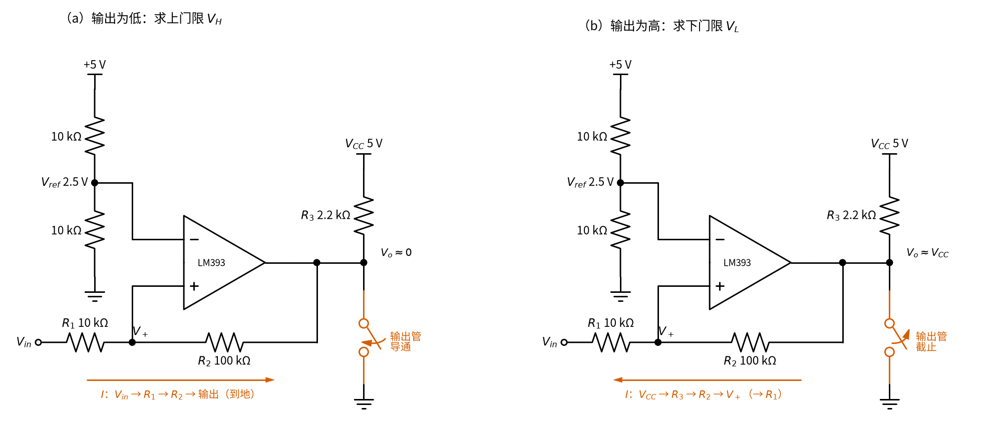
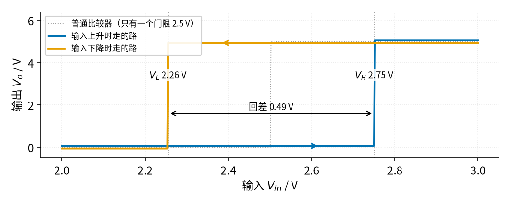
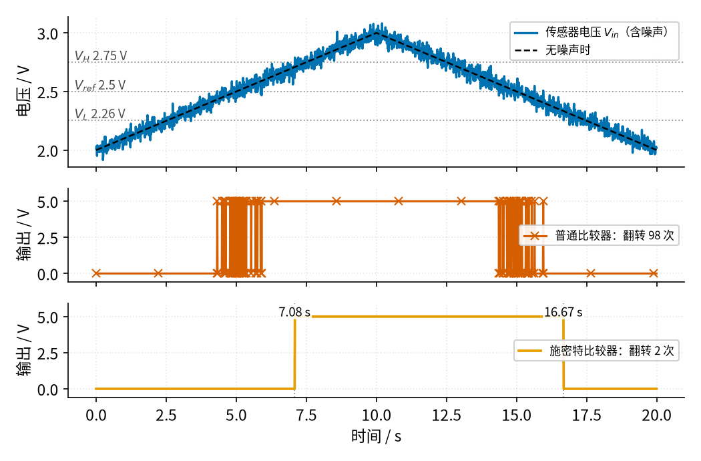

# 10 电压比较器 · 原理与实现篇

[上一页：直觉篇](page1.md) · [直觉篇](page1.md) · 本页：原理与实现篇 · [参数与调试篇](page3.md) · [下一页：参数与调试篇](page3.md) · 前置节点：[02 运放入门 · 直觉篇](../02-opamp-basics/page1.md)

## 先补一点最小知识

这一页只用到三样东西：

1. **欧姆定律**：电阻上的电流 = 两端电压差 ÷ 电阻。
2. **虚断**：比较器（和运放一样）的输入端几乎不取电流。LM393 的输入偏置电流只有纳安级，相对于本节几十微安的电阻电流可以忽略。
3. **开环会饱和**：[02 运放入门 · 直觉篇](../02-opamp-basics/page1.md) 讲过，两输入端稍有差别，输出就顶到头。

注意第 2 条和第 3 条：**虚断照样成立，虚短不成立**。虚短要靠负反馈把两输入端「拉平」，比较器没有负反馈，两输入端可以差好几伏。这是本节最容易犯的错误，后面会用数字说明。

## 1. 基本比较器：只看谁大

直觉篇的基本比较器电路里，反相端接 $V_{ref}$ = 2.5 V，同相端接 $V_{in}$ 。规则只有一条：

$$V_{in} \gt V_{ref} \quad\Rightarrow\quad V_o \text{ 为高（约 5 V）}$$

$$V_{in} \lt V_{ref} \quad\Rightarrow\quad V_o \text{ 为低（约 0 V）}$$

中文意思：同相端电压比反相端高，输出就为高；反之为低。如果想反过来（温度低于设定值时输出高），把两个输入端对调即可。

为什么输出高电平需要上拉电阻？[LM393 的手册](https://www.ti.com/lit/ds/symlink/lm393.pdf) 写明它是**开集电极输出**：内部输出级是一只三极管，导通时把输出拉到地（输出低），截止时输出端「悬空」（高阻）。手册的应用说明里写道，输出为高阻时靠上拉电阻得到逻辑高电平，而且多个开集电极输出可以直接并在一起，实现「与」的功能（第三页的窗口比较器就用到这一点）。因此必须外接上拉电阻 $R_3$ ，并且它接到哪个电压，高电平就是多少。比如接到 3.3 V，就能直接给 3.3 V 的单片机用，这就是手册说的「电平转换」。

## 2. 施密特比较器：推出两个门限

直觉篇的施密特比较器电路里，输入经 $R_1$ 接同相端， $R_2$ 从输出接回同相端。反相端仍是 $V_{ref}$ 。

推门限时要分两种状态看 $R_2$ 的右端接到了哪里，见图 10-p2-3。



*图 10-p2-3　推门限的两个状态：输出管导通（左）与截止（右）*

LM393 的输出级在图 10-p2-3 里画成一只开关（朱红色）。（a）开关闭合，输出点被拉到地， $R_2$ 右端相当于接地，下面的「上门限」就在这个状态下算；（b）开关断开，输出点只经 $R_3$ 连到 $V_{CC}$ ，于是 $R_2$ 和 $R_3$ 串起来通到 5 V，下面的「下门限」就在这个状态下算。

### 同相端电压是多少

同相端连着两只电阻：一边经 $R_1$ 通到 $V_{in}$ ，一边经 $R_2$ 通到 $V_o$ 。由虚断，流进同相端的电流为 0，所以流过 $R_1$ 的电流全部流过 $R_2$ ：

$$\frac{V_{in} - V_+}{R_1} = \frac{V_+ - V_o}{R_2}$$

中文意思：从输入流过来的电流，等于再流向输出的电流。解出 $V_+$ ：

$$V_+ = \frac{V_{in} R_2 + V_o R_1}{R_1 + R_2}$$

中文意思： $V_+$ 是 $V_{in}$ 和 $V_o$ 的「加权平均」，离谁的电阻小，就更靠近谁。 $R_1$ 远小于 $R_2$ ，所以 $V_+$ 主要跟着 $V_{in}$ 走，只被 $V_o$ 「拽」了一点点。

### 上门限：输出为低时

输出为低，取 $V_o \approx 0$ 。输入慢慢升高，当 $V_+$ 刚好升到 $V_{ref}$ 时输出翻高：

$$V_{ref} = \frac{V_H R_2}{R_1 + R_2} \quad\Rightarrow\quad V_H = V_{ref} \cdot \frac{R_1 + R_2}{R_2}$$

中文意思：因为同相端被分走了一点，输入要比 $V_{ref}$ 高出 $R_1/R_2$ 这个比例才能翻转。

### 下门限：输出为高时

输出为高，开集电极输出截止，同相端经 $R_2$ 、再经上拉电阻 $R_3$ 接到 $V_{CC}$ 。 $R_3$ 远小于 $R_2$ 时可以先忽略它，取 $V_o \approx V_{CC}$ 。输入慢慢降低，当 $V_+$ 降到 $V_{ref}$ 时输出翻低：

$$V_{ref} = \frac{V_L R_2 + V_{CC} R_1}{R_1 + R_2} \quad\Rightarrow\quad V_L = \frac{V_{ref}(R_1 + R_2) - V_{CC} R_1}{R_2}$$

两式相减就是回差：

$$\Delta V = V_H - V_L = V_{CC} \cdot \frac{R_1}{R_2}$$

中文意思：回差只由 $R_1/R_2$ 和输出摆幅决定， $R_2$ 越大，正反馈越弱，回差越小。TI 的设计笔记 [SBOA313A《Non-Inverting Comparator with Hysteresis Circuit》](https://www.ti.com/lit/an/sboa313a/sboa313a.pdf)正是用这两步「输出低时求上门限；输出高时把 $V_o$ 当作 $V_{CC}$ ，同样列方程求下门限」来设计电阻的，它的例子用 3 V 电源、 $R_1$ = 273 kΩ、 $R_2$ = 2 MΩ 得到约 400 mV 回差，代进上式 3 × 273 / 2000 ≈ 0.41 V，对得上。

### 代数：把数字代进去

取 $V_{CC}$ = 5 V， $V_{ref}$ = 2.5 V， $R_1$ = 10 kΩ， $R_2$ = 100 kΩ：

- $V_H$ = 2.5 × 110 / 100 = 2.75 V，对应 27.5 °C。
- $V_L$ = (2.5 × 110 − 5 × 10) / 100 = 2.25 V，对应 22.5 °C。
- 回差 = 5 × 10 / 100 = 0.5 V，即 5 °C。

如果把 $R_3$ = 2.2 kΩ 也算进去（输出高时 $R_2$ 那一路变成 102.2 kΩ），下门限是 2.255 V，回差 0.495 V，差别不到 1%，所以初算时忽略 $R_3$ 没问题。

### 为什么这里不能用虚短

假设有人照搬放大电路的套路，令 $V_+ = V_-$ = 2.5 V。可实际上，当 $V_{in}$ = 2.0 V、输出为低时， $V_+$ = 2.0 × 100 / 110 ≈ 1.82 V，和 $V_-$ 差了 0.68 V，根本不「短」。原因是 $R_2$ 接在同相端，是**正反馈**：输出一变高， $V_+$ 被托得更高，输出就更确定地保持为高，越推越远，直到饱和。负反馈是「偏了往回拉」，正反馈是「偏了再推一把」。所以比较器只能用「谁大谁小」来分析，不能用虚短。

正反馈还有一个好处：一旦开始翻转，它会自己加速完成，输出边沿更陡，不会在中间停留。

## 3. 回差曲线：上去和下来走的不是一条路

把输入从 2.0 V 慢慢升到 3.0 V 再降回来，记录输出，就得到 图 10-p2-1。



*图 10-p2-1　施密特比较器的回差曲线（含 2.2 kΩ 上拉的影响）*

图 10-p2-1 里，蓝线（上升）一直贴着 0 V，到 2.75 V 才跳上去；橙线（下降）一直贴着 5 V，到 2.26 V 才跳下来。两条竖线之间的 0.49 V 就是回差。在这段区间里，输出是高还是低，取决于它「之前」是什么状态，所以施密特比较器带有一点「记忆」。灰色点线是普通比较器，上下都在 2.5 V，没有缓冲带。

## 4. 仿真：同一段噪声，两种比较器

下面的程序请在仓库根目录运行（开头两行让 Python 找到 `code/figs/figstyle.py`，它负责全书统一的配色和中文字体）。程序生成一段 20 秒的传感器电压：从 2.0 V 线性升到 3.0 V 再降回 2.0 V（模拟升温再降温），每 10 ms 一个点，叠加标准差 40 mV 的随机噪声（固定随机种子，每次结果相同）。同一段电压分别送进普通比较器和施密特比较器，数输出翻转次数。

```python
# 10 电压比较器：普通比较器与施密特比较器的抗噪声对比
import sys, pathlib
sys.path.insert(0, str(pathlib.Path("code/figs").resolve()))  # 在仓库根目录运行
import numpy as np                      # 数值计算
import matplotlib                       # 画图库
matplotlib.use("Agg")                   # 不弹窗口，直接存图
import matplotlib.pyplot as plt
import figstyle as fs                   # 全书统一的配色、线型和中文字体

VCC, VREF = 5.0, 2.5                    # 电源 5 V，基准 2.5 V
R1, R2, R3 = 10e3, 100e3, 2.2e3         # 输入电阻、正反馈电阻、上拉电阻（Ω）

V_H = VREF * (R1 + R2) / R2             # 上门限：输出为低（0 V）时
R2H = R2 + R3                           # 输出为高时，R2 经上拉电阻接到 5 V
V_L = (VREF * (R1 + R2H) - VCC * R1) / R2H   # 下门限：输出为高时
print(f"上门限 {V_H:.3f} V，下门限 {V_L:.3f} V，回差 {V_H - V_L:.3f} V")

t = np.arange(0, 20, 0.01)              # 0~20 s，每 10 ms 一个点
clean = 2.0 + 1.0 * (1 - np.abs(t - 10) / 10)   # 三角形：2.0 V → 3.0 V → 2.0 V
rng = np.random.default_rng(1)          # 固定随机种子，结果可重复
vin = clean + 0.04 * rng.standard_normal(len(t))  # 加 40 mV 噪声

plain = np.where(vin > VREF, VCC, 0.0)  # 普通比较器：只看是否高于 2.5 V

schmitt = np.zeros(len(t))              # 施密特比较器，从输出低开始
high = False                            # 当前输出状态
for k, v in enumerate(vin):
    if not high and v > V_H:            # 低 → 高：必须超过上门限
        high = True
    elif high and v < V_L:              # 高 → 低：必须低于下门限
        high = False
    schmitt[k] = VCC if high else 0.0

n1 = int(np.count_nonzero(np.diff(plain)))    # 数跳变次数
n2 = int(np.count_nonzero(np.diff(schmitt)))
print(f"普通比较器翻转 {n1} 次，施密特比较器翻转 {n2} 次")
assert n2 == 2                          # 一升一降，只翻两次

fig, ax = plt.subplots(3, 1, figsize=(7, 5), sharex=True)
ax[0].plot(t, vin, **fs.LS["vin"])      # 输入：蓝色实线
for y in (V_H, VREF, V_L):
    fs.ref_h(ax[0], y)                  # 三条门限：灰色点线
ax[0].set_ylabel(fs.qlabel("输入", "V"))
ax[1].plot(t, plain, **fs.LS["bad"])    # 普通比较器：朱红色（反面例子）
ax[1].set_ylabel(fs.qlabel("普通", "V"))
ax[2].plot(t, schmitt, **fs.LS["vout"]) # 施密特输出：橙色实线
ax[2].set_ylabel(fs.qlabel("施密特", "V"))
ax[2].set_xlabel(fs.qlabel("时间", "s"))
fig.savefig("comparator_noise.png", dpi=100)  # 存到当前目录
print("已保存 comparator_noise.png")
```

运行后会打印上门限 2.750 V、下门限 2.255 V、回差 0.495 V，普通比较器翻转 98 次，施密特比较器翻转 2 次。代码里的线型都取自全书共用的 `figstyle`：输入用蓝色，门限用灰色点线，普通比较器作为「反面例子」用朱红色（带 × 标记），施密特输出用橙色。图 10-p2-2 是同一仿真由 `code/10_sim.py` 画出的版本，配色与这段代码一致。



*图 10-p2-2　同一段噪声输入：普通比较器翻转 98 次，施密特比较器只翻转 2 次*

## 5. 读懂仿真图

看 图 10-p2-2 的中间一行：输入在 5 秒左右和 15 秒左右两次经过 2.5 V，每次都伴随一大串来回翻转，共 98 次。真实温度只过线两次（一升一降），多出来的 96 次全是噪声造成的。

再看最下面一行：施密特比较器只在 7.08 秒翻高、16.67 秒翻低。无噪声时输入在 7.5 秒才到 2.75 V，这里提前了一点，是因为噪声的尖峰先碰到了上门限。一旦翻高，下门限立刻退到 2.26 V，后面几十毫伏的噪声再怎么抖也碰不到它。

这张图还说明了回差的代价：输出不再精确地在 2.5 V 翻转，而是升温时晚一些（2.75 V）、降温时也晚一些（2.26 V）。对风扇这种「开、关不必太准，但不能乱跳」的场合，这个代价完全值得。

## 6. 能不能拿普通运放当比较器

能用，但有两个毛病：

1. **输出到不了电源**。02 讲过，LM358 输出高电平大约比正电源低 1.5 V，5 V 供电时只有约 3.5 V，未必能被 5 V 逻辑可靠地认作高电平。
2. **翻转慢，而且从饱和里「醒」多久说不准**。TI 的应用笔记 [SLOA067《Op Amp and Comparators – Don't Confuse Them!》](https://e2e.ti.com/cfs-file/__key/communityserver-discussions-components-files/14/op-amp-vs-comparators.pdf) 指出：比较器的输出级专为饱和工作优化，运放的输出管却是为输出模拟波形设计的线性管，开环使用时会在线性区停留很久，上升、下降沿都拖得很长；饱和后的恢复时间不可预测，不同批次可能从几微秒到几十毫秒，厂家也不保证运放开环工作的结果。作为对比，[LM393 手册](https://www.ti.com/lit/ds/symlink/lm393.pdf) 给出的典型响应时间约 1.3 μs（B 版约 1 μs）。

所以只是偶尔判断一下慢信号，用一个闲置的运放凑合可以；正式设计建议用专用比较器。

## 7. 例题：从照着做到自己做

**例题一（完整解答）**：在施密特比较器电路中， $V_{CC}$ = 5 V， $V_{ref}$ = 2.5 V， $R_1$ = 10 kΩ， $R_2$ = 100 kΩ，忽略上拉电阻，求两个门限对应的温度（0.1 V/°C）。

解：第一步，输出低时 $V_H$ = 2.5 × 110 / 100 = 2.75 V。第二步，输出高时 $V_L$ = (275 − 50) / 100 = 2.25 V。第三步，换算温度：2.75 V 对应 27.5 °C，2.25 V 对应 22.5 °C，风扇在 27.5 °C 开、22.5 °C 关。

**例题二（留空练习）**：其他不变，把 $R_2$ 换成 200 kΩ。

$V_H$ = 2.5 × ____ / 200 = ____ V； $V_L$ = (2.5 × 210 − 5 × ____) / 200 = ____ V；回差 = ____ V，比原来变____了。

<details><summary>答案</summary>

210，2.625；10，2.375；0.25，小（ $R_2$ 加倍，回差减半）。

</details>

**例题三（变体迁移）**：要求上门限 2.6 V、回差 0.2 V，电源仍为 5 V， $R_1$ 取 10 kΩ，求 $R_2$ 和 $V_{ref}$ 。

提示：先用回差公式求 $R_2$ ，再用上门限公式反求 $V_{ref}$ 。

<details><summary>答案</summary>

由 0.2 = 5 × 10 kΩ / $R_2$ 得 $R_2$ = 250 kΩ（可用 240 kΩ 加 10 kΩ 串联，或取最接近的标准值后重算）。再由 2.6 = $V_{ref}$ × 260 / 250 得 $V_{ref}$ = 2.5 V，仍然可以用两只 10 kΩ 分压得到。验算下门限：(2.5 × 260 − 50) / 250 = 2.4 V，回差 0.2 V。

</details>

下一页我们把回差宽度和噪声大小放在一起扫一遍，看看回差至少要多宽；再给出排查表，并介绍能判断「在不在范围内」的窗口比较器。
