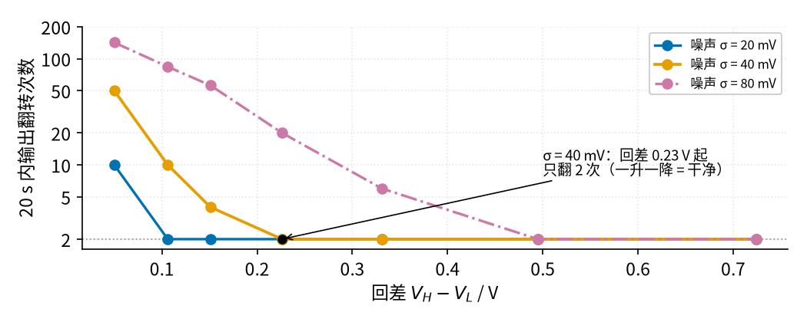
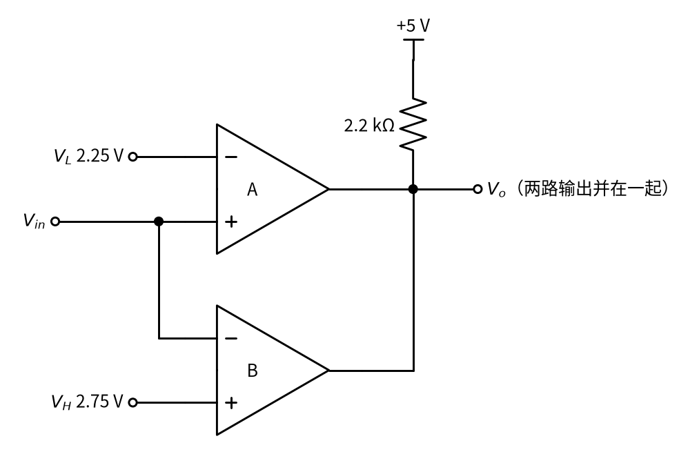
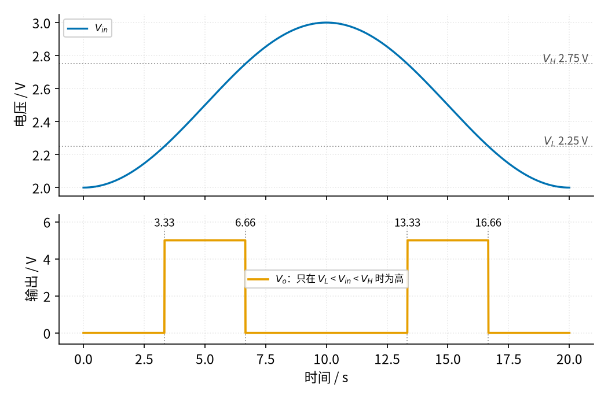
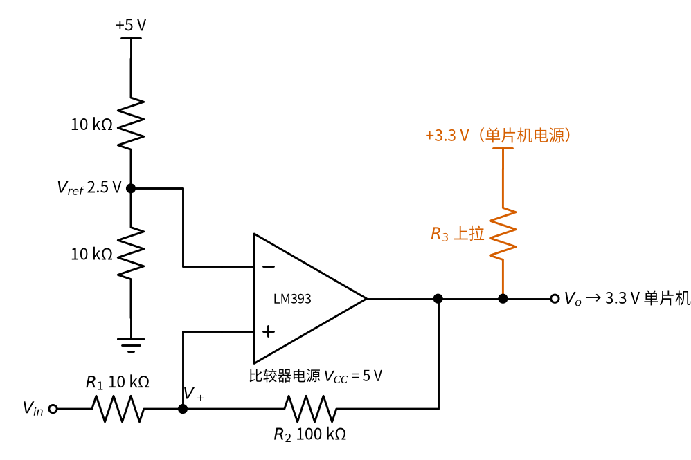
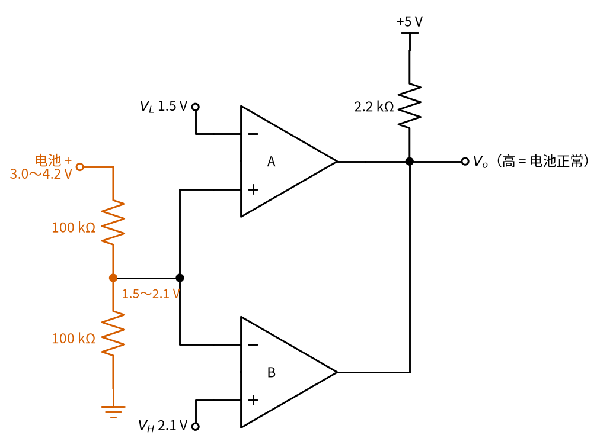

# 10 电压比较器 · 参数与调试篇

[上一页：原理与实现篇](page2.md) · [直觉篇](page1.md) · [原理与实现篇](page2.md) · 本页：参数与调试篇 · [下一页：10 电压比较器 · 动手实验篇](page4.md) · 前置节点：[02 运放入门 · 直觉篇](../02-opamp-basics/page1.md)

## 本页要解决的问题

上一页算出了施密特比较器的两个门限。真正动手时还会遇到这些问题：回差到底留多宽才够？上拉电阻取多大？比较器的输入电压有没有范围限制？电路不正常时先查哪里？最后介绍一个常用变体：判断「在不在某个范围内」的窗口比较器。

## 1. 参数含义与常见取值

| 参数 | 含义 | 本节取值 | 选取要点 |
|---|---|---|---|
| $V_{CC}$ | 比较器电源 | 5 V | LM393 手册：单电源 2～36 V 均可 |
| $V_{ref}$ | 基准（横杆高度） | 2.5 V | 两只等值电阻分压；要求高时改用基准芯片 |
| $R_1$ | 输入电阻 | 10 kΩ | 与 $R_2$ 的比值决定回差 |
| $R_2$ | 正反馈电阻 | 100 kΩ | 回差 $\approx V_{CC} R_1 / R_2$ ；越大回差越小 |
| $R_3$ | 上拉电阻 | 2.2 kΩ | 输出低时电流 $V_{CC}/R_3$ ≈ 2.3 mA；要远小于 $R_2$ |
| 共模输入范围 | 输入允许的电压范围（「共模」指两个输入端共同所处的电压高低，而不是两者之差） | 0～3.0 V | LM393 手册：25 °C 时上限 $V_{CC}$ − 1.5 V，全温度范围 $V_{CC}$ − 2 V |
| 输出低电平 | 输出低时的电压 | ≤ 0.4 V | LM393 手册：灌电流（从外部流进输出脚、经输出管流到地的电流）≤ 4 mA 时最大 400 mV |
| 响应时间 | 输入越线到输出翻转 | 约 1.3 μs | 对温度这类慢信号完全够用 |

几点说明：

- **上拉电阻不能太小**。 $R_3$ 越小，输出低时三极管要「吞」的电流越大。LM393 手册给出的输出低电平是在灌电流不超过 4 mA 时测的，5 V 下 $R_3$ 不宜小于约 1.25 kΩ。
- **上拉电阻也不能太大**。手册指出输出上升时间约为 $R_3 \times C_L$ （ $C_L$ 是输出端的负载电容）。2.2 kΩ 配 15 pF 只有约 33 ns；若换成 1 MΩ，就会变成 15 μs，而且 $R_3$ 和 $R_2$ 可比时会明显改变下门限。
- **共模输入范围**：输入电压太接近正电源时，比较结果可能出错。手册的注释说明，只要两个输入端中有一个在范围内，输出就正确。本节反相端固定在 2.5 V，始终在范围内；而真正决定翻转的时刻，两个输入端电压几乎相等，所以门限本身必须落在范围内（5 V 供电、全温度范围时低于 3 V）。

## 2. 参数扫描：回差至少要多宽

保持 $R_1$ = 10 kΩ，把 $R_2$ 从 1 MΩ 逐步减小到 68 kΩ，回差从 0.05 V 增大到 0.72 V（这里计入了 2.2 kΩ 上拉电阻，和 `code/figs/10_figs.py` 打印的值一致；只用公式 $V_{CC} R_1/R_2$ 估算是 0.735 V）；输入仍是上一页那段 20 秒的升温降温信号，噪声标准差分别取 20、40、80 mV。每种组合数一次输出翻转次数，结果见 图 10-p3-1。

*图 10-p3-1　回差宽度扫描：噪声越大，需要的回差越宽*

从 图 10-p3-1 读出三个转折点：噪声 20 mV 时，回差 0.11 V 就够了；40 mV 时要 0.23 V；80 mV 时要 0.49 V。三者都大约是噪声标准差的 6 倍。可以记一个粗略的经验：**回差至少取噪声标准差的 6 倍左右**，大致相当于用示波器看到的噪声「峰峰值」（最高点到最低点的距离）。这只是本例这种噪声下的估计，噪声里有偶尔的大尖峰时还要再加宽。

回差也不是越宽越好。TI 的 [SLOA067](https://e2e.ti.com/cfs-file/__key/communityserver-discussions-components-files/14/op-amp-vs-comparators.pdf) 认为一般场合回差取 1%～2% 就够，更大并无必要；本例取 0.5 V（约为电源的 10%），是因为传感器噪声较大，而且风扇本来就不希望频繁启停。另一个降噪办法是在输入端加一个 RC 低通（见 [20 有源滤波 · 直觉篇](../20-active-filter/page1.md)），先把噪声削小，回差就可以窄一些。

## 3. 故障排查表

| 现象 | 原因 | 怎么查 | 怎么改 |
|---|---|---|---|
| 输出始终为低，或高电平只有零点几伏 | 开集电极输出没接上拉电阻 | 断电查输出端到 $V_{CC}$ 之间有没有电阻 | 加 2.2～10 kΩ 上拉，接到后级需要的逻辑电压 |
| 温度在设定值附近时继电器连响 | 没有回差，或回差小于噪声 | 示波器看输入噪声峰峰值，和回差比较 | 减小 $R_2$ 加宽回差，或输入端先加 RC 滤波 |
| 实测门限和计算值差很多 | 按「虚短」算了门限；或 $R_3$ 与 $R_2$ 可比 | 用上一页的加权平均公式重算；看 $R_3$ 是否远小于 $R_2$ | 用两步法重算；让 $R_2$ 至少是 $R_3$ 的几十倍 |
| 温度越高输出越低，逻辑反了 | 两个输入端接反 | 对照电路图看 $V_{in}$ 是否接同相端 | 对调输入端（同时把回差电阻改接到新的同相端） |
| 用运放代替后，高电平只有 3.5 V 左右，翻转慢 | 运放输出到不了正电源，从饱和恢复慢 | 量输出高电平；看翻转边沿 | 换成专用比较器（如 LM393） |
| 门限设得接近电源电压时判断出错 | 超出共模输入范围 | 看门限电压是否高于 $V_{CC}$ − 2 V | 先用电阻分压把输入降下来，门限同比例缩小 |
| 越线瞬间输出出现一串高频振荡 | 输出边沿经布线耦合回反相端（通过相邻导线之间的微小电容窜回去）；电源没去耦（芯片电源脚旁边没有就近接一只小电容，滤掉电源上的高频波动） | 示波器看翻转时刻和电源纹波 | 输出线远离反相输入线；电源脚就近接旁路电容（LM393 手册的布线建议；常用 0.1 μF） |

## 4. 变体：窗口比较器

有时问题不是「超没超」，而是「在不在范围内」：比如电池电压在正常范围内亮绿灯，过高、过低都熄灭。这时用两只比较器，见 图 10-p3-2。

*图 10-p3-2　窗口比较器：两路开集电极输出并联，只有都不往下拉时输出才为高*

图 10-p3-2 的工作方式：比较器 A 判断「是否高于下限 $V_L$ 」，比较器 B 判断「是否低于上限 $V_H$ 」。两个输出都是开集电极，并在一起共用一只上拉电阻。只要有一个比较器输出低（把线拉到地），总输出就是低；只有两个都输出高阻，上拉电阻才能把输出拉高。这正是上一页提到的「多个开集电极输出并联实现与功能」。LM393 一个封装里正好有两只比较器，做窗口比较器很方便。

给它一个按正弦形状缓慢地从 2.0 V 升到 3.0 V 再降回来的输入（ $V_{in} = 2.5 - 0.5\cos(2\pi t/20\ \text{s})$ ，周期 20 s），结果见 图 10-p3-3。

*图 10-p3-3　窗口比较器的输入和输出：只在两条门限之间输出为高*

图 10-p3-3 中，输出在 3.33～6.66 秒和 13.33～16.66 秒为高，正是输入处在 2.25～2.75 V 之间的两段时间。验算一下：输入到 2.25 V 时 $\cos(2\pi t/20) = 0.5$ ，即 $2\pi t/20$ = 60°， $t$ = 20 × 60/360 ≈ 3.33 s；到 2.75 V 时是 120°， $t$ ≈ 6.67 s（图中写 6.66 s 是舍去了尾数）。如果按直线升降去算，会得到 2.5 s、7.5 s，对不上。为了看清原理，这里没有加回差；实际电路中两只比较器各自都可以按上一页的方法加回差。

## 5. 练习

**练习 1（基础）**：施密特比较器的门限为 2.75 V 和 2.26 V。输入现在是 2.5 V。如果输出之前是低，现在是什么？如果之前是高呢？

答案

之前是低：2.5 V 没有超过上门限 2.75 V，输出仍为低。之前是高：2.5 V 没有低于下门限 2.26 V，输出仍为高。这就是回差的「记忆」：在两门限之间，输出保持原状态。

**练习 2（计算）**：示波器测得传感器噪声的标准差约 30 mV。 $V_{CC}$ = 5 V， $R_1$ = 10 kΩ，按「回差约取噪声标准差的 6 倍」选 $R_2$ ，并从 100 kΩ、150 kΩ、220 kΩ、330 kΩ 中挑一个。

答案

需要回差 ≥ 6 × 30 mV = 0.18 V。由 5 × 10 kΩ / $R_2$ ≥ 0.18 V 得 $R_2$ ≤ 278 kΩ。选 220 kΩ，回差约 0.23 V，满足要求；330 kΩ 的回差只有约 0.15 V，不够。若想让风扇启停的温差更大，也可以选 150 kΩ 或 100 kΩ。

**练习 3（分析）**：后级单片机用 3.3 V 供电，于是把上拉电阻 $R_3$ 改接到 3.3 V，比较器仍用 5 V 供电。 $V_{ref}$ = 2.5 V， $R_1$ = 10 kΩ， $R_2$ = 100 kΩ，忽略 $R_3$ 本身的阻值。两个门限分别变成多少？

电路如图 10-p3-4 所示。

*图 10-p3-4　练习 3：上拉电阻改接到单片机的 3.3 V*

图 10-p3-4 与[直觉篇](page1.md)的施密特比较器只差朱红色的一处：上拉电阻 $R_3$ 的上端接到 3.3 V，而不是比较器自己的 5 V 电源。

答案

上门限只和输出低（0 V）有关，不变，仍是 2.75 V。输出高时同相端经 $R_2$ 接到 3.3 V，所以下门限 = (2.5 × 110 − 3.3 × 10) / 100 = 2.42 V，回差 = 3.3 × 10 / 100 = 0.33 V。回差公式里的 $V_{CC}$ 实际是「输出高电平」，上拉接到哪里就代哪个电压。

**练习 4（变体迁移）**：用 5 V 供电的 LM393 做一个锂电池电压监视器：电池电压在 3.0～4.2 V 之间时输出高（亮绿灯），否则输出低。电池电压不能直接接比较器，为什么？请给出改法和两个门限电压。

答案

上限门限 4.2 V 超过了 5 V 供电时的共模输入范围（全温度范围约 5 − 2 = 3 V）。电池电压接近 4.2 V、正要判断是否越线时，比较器 B 的两个输入端都在 4.2 V 左右，都超出范围，比较结果可能出错。先用两只等值电阻（如各 100 kΩ）把电池电压分成一半，变成 1.5～2.1 V，门限都落在 3 V 以内，再接到窗口比较器的输入。下限 $V_L$ = 1.5 V，上限 $V_H$ = 2.1 V，都可以由 5 V 经电阻分压得到。其余接法与本页的窗口比较器电路相同；电池电压在边界附近慢慢变化，最好再给两只比较器各加一点回差。

改好的电路见图 10-p3-5。

*图 10-p3-5　练习 4：电池先经两只 100 kΩ 分压，再送进窗口比较器*

图 10-p3-5 中朱红色的分压器是新加的部分；分压后的中点同时接到 A 的同相端和 B 的反相端，接法与图 10-p3-2 相同，只是两条门限换成了 1.5 V 和 2.1 V。

## 小结与下一步

比较器的设计可以归结为四步：确定基准 $V_{ref}$ 和比较方向；按噪声大小定回差，用 $\Delta V = V_{CC} R_1 / R_2$ 选电阻，再用两步法算出上、下门限；开集电极输出别忘了上拉电阻，上拉接到后级的逻辑电压；检查输入是否在共模范围内。比较器的「门限判断」后面还会多次出现：[22 过载保护 · 直觉篇](../22-overload-protection/page1.md) 用它判断电流是否超限，[24 振荡器 · 直觉篇](../24-oscillator/page1.md) 把施密特比较器和 RC 充放电组合成方波振荡器，[29 上拉/下拉电阻与电平转换 · 直觉篇](../29-pullup-level-shift/page1.md) 会用施密特门限消除按键抖动。下一页是本节的 [10 电压比较器 · 动手实验篇](page4.md)，做完实验再进入下一个节点 [11 互锁 · 直觉篇](../11-interlock/page1.md)。
