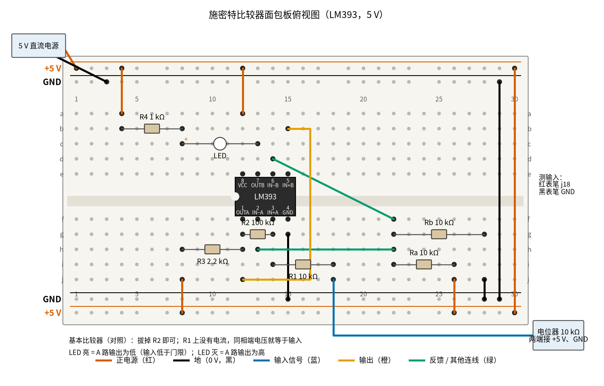

# 10 电压比较器 · 动手实验篇

[上一页：参数与调试篇](page3.md) · [直觉篇](page1.md) · [原理与实现篇](page2.md) · [参数与调试篇](page3.md) · 本页：动手实验篇 · [下一页：11 互锁 · 直觉篇](../11-interlock/page1.md) · 前置节点：[02 运放入门 · 直觉篇](../02-opamp-basics/page1.md)

## 这次实验要验证什么

用 LM393 搭出施密特比较器，用一个电位器慢慢拧输入、用一只 LED 看输出，亲手量出 [10 电压比较器 · 原理与实现篇](page2.md) 第 2 节推出的两个门限：**往上拧时约 2.75 V 才翻转，往下拧时约 2.26 V 才翻回来**；再拔掉 $R_2$ 变回基本比较器，确认它只有一个 2.5 V 的门限，并且在门限附近会「抽风」。

## ⚠️ 安全须知

- **只用 12 V 及以下的直流电**。本实验只要 5 V：USB 面包板电源模块、四节 1.2 V 镍氢充电电池，或者标明 5 V 输出的直流电源都可以。LM393 的电源脚耐不住接反，通电前先核对第 8 脚接正、第 4 脚接地。
- **本实验没有电解电容**；如果你想在电源轨上加一只滤波用的电解电容，记住它分正负极，白带一侧接地。
- **电阻、芯片可能发烫，不要用手摸**。正常情况下所有元件都只是常温；某个元件烫手，说明有短路，马上断电。
- **接线、改线之前先断电**。拔 $R_2$ 、换电阻之前，先拔掉电源，改好、核对一遍再通电。
- 量上拉电流时要把万用表串进电路，表笔插孔要换到电流挡（mA 孔）；量完立刻换回电压挡，否则下一次去量电压时会把电源短路。

## 器材清单

| 元件 | 型号或数值 | 数量 | 说明 |
|---|---|---|---|
| 比较器 | LM393（DIP-8 直插） | 1 | A 路做施密特比较器，B 路做 LED 驱动 |
| 电阻 $R_1$ | 10 kΩ，1/4 W | 1 | 输入电阻 |
| 电阻 $R_2$ | 100 kΩ，1/4 W | 1 | 正反馈电阻，决定回差 |
| 电阻 $R_3$ | 2.2 kΩ，1/4 W | 1 | A 路开集电极输出的上拉电阻 |
| 电阻 $R_a$ 、 $R_b$ | 10 kΩ，1/4 W，最好 1% | 2 | 把 5 V 分成 2.5 V 基准 |
| 电阻 $R_4$ | 1 kΩ，1/4 W | 1 | LED 限流 |
| LED | 5 mm 红色 | 1 | 长脚是正极（阳极） |
| 电位器 | 10 kΩ 线性（B10K） | 1 | 代替温度传感器，造出可调的输入电压 |
| 电源 | 5 V 直流 | 1 | 见安全须知 |
| 万用表 | 带直流 2 V / 20 V、直流 20 mA | 1 | 有第二只表更方便：一只看输入，一只看输出 |
| 面包板、杜邦线 | 830 孔 | 1 套 | 导线颜色尽量按下图 |

## 搭建步骤

电路是 [10 电压比较器 · 直觉篇](page1.md) 里的施密特比较器（输入经 $R_1$ 接同相端， $R_2$ 从输出接回同相端，反相端接 2.5 V 基准，输出经 2.2 kΩ 上拉），推导在 [10 电压比较器 · 原理与实现篇](page2.md) 第 2 节。本页在它旁边多加了一个「LED 指示」：用同一颗芯片里闲着的 B 路比较器去点 LED，这样 LED 的电流不会从 A 路的输出上走，A 路的读数和书上一致。

1. **断电插芯片**。LM393 缺口朝左跨在凹槽上：第 1–4 脚插 f12、f13、f14、f15，第 8–5 脚插 e12、e13、e14、e15。第 1 脚 A 路输出、第 2 脚 A 路反相端、第 3 脚 A 路同相端、第 4 脚地；第 8 脚电源、第 7 脚 B 路输出、第 6 脚 B 路反相端、第 5 脚 B 路同相端。
2. **接电源**。电源正极接上边外侧的轨，负极接上边内侧的轨。第 30 列用红线把上下两条 +5 V 轨连起来，第 29 列用黑线把上下两条地轨连起来。红线 a12 → 上边 +5 V 轨（第 8 脚）；黑线 g15 → 下边地轨（第 4 脚）。
3. **插基准分压**。 $R_a$ 插 i22–i26，红线 j26 → 下边 +5 V 轨； $R_b$ 插 g22–g28，黑线 j28 → 下边地轨。第 22 列就是 2.5 V 基准。绿色线 h13 → h22，把基准送到第 2 脚。
4. **插施密特比较器的三只电阻**。 $R_3$ 插 h8–h12，红线 j8 → 下边 +5 V 轨（上拉）； $R_2$ 插 g12–g14（输出到同相端）； $R_1$ 插 i14–i18（同相端到输入，第 18 列是输入）。
5. **接电位器**。电位器两个固定端分别接 +5 V 和地，中间的滑动端（蓝线）接 j18。
6. **接 LED 指示**。绿色线 f22 → d14，把基准也送到第 6 脚；橙色线 j12 → b15，把 A 路输出送到第 5 脚。红线 a4 → 上边 +5 V 轨， $R_4$ 插 b4–b8，LED 长脚插 c8、短脚插 c13（第 7 脚）。A 路输出为低（约 0.08 V）时，B 路同相端低于 2.5 V，B 路输出拉低，LED 亮；A 路输出为高时 LED 灭。
7. **通电前核对**：第 8 脚、第 4 脚有没有接反；基准分压的两头是不是一头 +5 V、一头地；LED 长脚是否朝 $R_4$ 。

下面的 图 10-p4-1 是按上面步骤画的面包板俯视图。



*图 10-p4-1　施密特比较器加 LED 指示的面包板接线（LM393，5 V）*

面包板上 LM393 的两组比较器、三只施密特电阻和基准分压挤在一起，先对照 图 10-p4-2 的电路原理图认清每一列是哪个节点，再核对接线。


*图 10-p4-2　图 10-p4-1 对应的电路原理图（灰色小字是面包板孔位，蓝、橙、绿色与面包板图导线一致，天蓝色箭头是 LED 电流）*

**对照看**：面包板的连通规则见 [01 元件速成 · 动手实验篇](../01-components-basics/page4.md)：同一列的 a–e、f–j 各自连通，凹槽两边不通。LM393 跨在凹槽上，所以第 12 列下半区是 1 脚输出，上半区却是 8 脚电源；R2 的两脚插在第 12 列和第 14 列，就把输出接回了同相端，R3 插 h8–h12 再由 j8 接 +5 V，才给开集电极输出提供了上拉。基准分压的中点在第 22 列，它本身不和芯片同列，要靠绿线 h13 → h22 送到 2 脚、f22 → d14 送到上半区的 6 脚。A 组输出要从下半区的第 12 列跨到上半区的第 15 列（5 脚），所以橙线绕过了芯片；LED 的短脚插 c13，正是上半区的 7 脚。原理图里 R1、R2 和同相端的接法就是 [10 电压比较器 · 原理与实现篇](page2.md) 「2. 施密特比较器：推出两个门限」里推门限用的电路，拔掉 R2 就回到同一页「1. 基本比较器：只看谁大」。

图里红色线接 +5 V，黑色线接地，蓝色线是电位器送来的输入，橙色线是 A 路的输出，绿色线是基准和其他连线。最长的那根橙色线绕过芯片右侧，从下半区跨到上半区，这在面包板上是很常见的跳线方式。图下方第一行小字说明了基本比较器的对照做法：只要拔掉 $R_2$ 。

## 测量表

下表「应该读到」取自 [review/spice/10.md](../review/spice/10.md) 的面包板读数表（5 V 供电、LM393 厂家模型）；LED 电流那一行由 code/figs/10_figs.py 按欧姆定律估算。

| 步骤 | 测什么 | 红表笔 | 黑表笔 | 挡位 | 应该读到 | 读不到时先查 |
|---|---|---|---|---|---|---|
| ① 通电 | 电源 | a12（第 8 脚） | 地轨 | 直流 20 V | 5.00 V | 电源输出、两条 +5 V 轨是否连通 |
| ① 通电 | 基准 | h13（第 2 脚） | 地轨 | 直流 20 V | 2.50 V（两只 10 kΩ 都是 1% 时 2.48–2.52 V） | 偏离很多：查 $R_a$ 、 $R_b$ 是否插错阻值 |
| ② 静态 | 输出高（电位器拧到最高端） | h12（第 1 脚） | 地轨 | 直流 20 V | 约 4.95 V，LED 灭 | 读到 0 V：上拉 $R_3$ 那根红线没接 |
| ② 静态 | 输出低（电位器拧到最低端） | h12 | 地轨 | 直流 2 V | 约 0.08 V（手册上限 0.4 V），LED 亮 | 读到 2 V 以上：第 4 脚没接地 |
| ② 静态 | 输出低、输入调到 2.0 V 时的同相端 | g14（第 3 脚） | 地轨 | 直流 20 V | 约 1.82 V，和第 2 脚差约 0.68 V（虚短不成立） | 读到 2.0 V：说明 $R_2$ 没插上 |
| ③ 门限 | 上门限：从低往高慢慢拧，LED 刚熄灭时的输入 | j18 | 地轨 | 直流 20 V | 约 2.73–2.75 V | 拧太快会冲过头，靠近 2.7 V 时一点点拧 |
| ③ 门限 | 下门限：从高往低慢慢拧，LED 刚亮时的输入 | j18 | 地轨 | 直流 20 V | 约 2.25–2.26 V | 两次读数一样：比较器没有正反馈，查 $R_2$ |
| ③ 门限 | 回差 = 上门限 − 下门限 | — | — | 计算 | 约 0.49 V | 由上两行相减 |
| ④ 电流 | 上拉电流（输出低时） | 拔下 $R_3$ 在 h12 的那只脚，红表笔接它 | h12 | 直流 20 mA（表笔换 mA 孔） | 约 2.2 mA（(5 − 0.08) V ÷ 2.2 kΩ） | 读数为 0：表笔孔没换、保险丝断 |
| ④ 电流 | LED 电流（估算） | 量 $R_4$ 两端电压再除以 1 kΩ：b4 | b8 | 直流 20 V | 约 3.0 V，即 3 mA（按 LED 压降 1.9 V 估算） | LED 不亮：长短脚插反 |
| ⑤ 对照 | 拔掉 $R_2$ 后的门限（往上、往下拧都一样） | j18 | 地轨 | 直流 20 V | 约 2.50 V，和第 2 脚读数相同 | 仍有回差： $R_2$ 没拔干净 |

共 11 个测量点（回差一行是两次读数相减）。注意：输入端用 j18 测，读的是电位器滑动端；同相端第 3 脚的电压比它低一点，因为 $R_1$ 、 $R_2$ 分走了一部分。

## 没有示波器怎么办

**LED 就是你的示波器通道 2**。门限、回差这些本页最重要的结论，都可以只靠 LED 亮灭加一只万用表读出来：表接在输入上，眼睛盯着 LED，慢慢拧，记下 LED 变化那一瞬间的读数。往上拧和往下拧各做三次，取平均，就能把 2.75 V 和 2.26 V 这两条线清清楚楚地量出来。这其实就是 [10 电压比较器 · 原理与实现篇](page2.md) 第 3 节回差曲线的「手工描点」版：那张图上两条竖线的位置，就是你记下的两组读数。

**抖动：只能看到「有」，看不到「多少次」**。拔掉 $R_2$ 后，把电位器慢慢拧到 2.5 V 附近停住，再用手指捏住输入导线的金属部分（人体会耦合进 50 Hz 的干扰）。LED 可能会变暗、发虚或者闪烁，用万用表直流挡测第 1 脚，会读到一个介于 0 和 5 V 之间、不断跳动的数——直流挡读的是平均值，输出在高低之间快速乱跳，平均下来就成了「半高」。插回 $R_2$ 再做一遍，LED 要么全亮要么全灭，读数稳稳地停在 0.08 V 或 4.95 V。不过一秒钟到底翻了多少次、每次翻转的边沿是什么形状，万用表和眼睛都分辨不出来，这部分只能看 [10 电压比较器 · 直觉篇](page1.md) 里那张「门限附近反复翻转 53 次」的抖动图，以及 [10 电压比较器 · 原理与实现篇](page2.md) 第 4 节的三行仿真图。

**上升沿慢、下降沿快**：这是 [10 电压比较器 · 直觉篇](page1.md) 示波器第 4 步的现象，属于微秒级的事情，没有示波器看不到，本页不做。

## 用 Python 核对你的读数

把你量到的电源电压、各个电阻的实际阻值、输出低电平和两个门限填进去，代码按 [10 电压比较器 · 原理与实现篇](page2.md) 的公式算出这次应该读到的门限，偏差超过 10% 就提示。

```python
import sys, pathlib
sys.path.insert(0, str(pathlib.Path("code/figs").resolve()))  # 在仓库根目录运行

# ===== 把下面换成你自己的实测值（这里是一组示例） =====
VCC = 4.98            # 第 8 脚对地，V
RA, RB = 9.97e3, 10.04e3   # 基准分压：RA 接 +5 V，RB 接地，Ω
R1 = 9.92e3           # 输入电阻，Ω
R2 = 99.1e3           # 正反馈电阻，Ω
R3 = 2.18e3           # 上拉电阻，Ω
VOL = 0.08            # 输出低时第 1 脚读数，V
VH_MEAS = 2.76        # 往上拧、LED 熄灭时的输入读数，V
VL_MEAS = 2.25        # 往下拧、LED 亮起时的输入读数，V
VREF_MEAS = 2.49      # 第 2 脚读数，V


def check(name, measured, expected):
    dev = (measured - expected) / expected * 100
    flag = "  <-- 偏差超过 10%，先按测量表最后一列排查" if abs(dev) > 10 else ""
    print(f"{name}: 实测 {measured:.3f} V，计算 {expected:.3f} V，偏差 {dev:+.1f}%{flag}")


vref = VCC * RB / (RA + RB)                        # 分压公式
# 上门限：输出为低（VOL），输入要把同相端抬到 vref
v_h = (vref * (R1 + R2) - VOL * R1) / R2
# 下门限：输出为高，R2 再串 R3 接到 VCC
r2h = R2 + R3
v_l = (vref * (R1 + r2h) - VCC * R1) / r2h
check("基准", VREF_MEAS, vref)
check("上门限", VH_MEAS, v_h)
check("下门限", VL_MEAS, v_l)
check("回差", VH_MEAS - VL_MEAS, v_h - v_l)
print(f"上拉电流应约 {(VCC - VOL) / R3 * 1e3:.2f} mA")
```

示例数据里，基准和两个门限的偏差都在 1% 以内，回差偏差约 +5%。回差是两个相近读数之差，任何一次读数偏 10 mV，回差就偏 2%，所以它最容易「超标」。

## 实验记录表

| 项目 | 实测值 | 计算值 | 偏差 |
|---|---|---|---|
| 电源（第 8 脚） |  | — | — |
| 基准（第 2 脚） |  |  |  |
| 输出高 |  | 约 4.95 V |  |
| 输出低 |  | 约 0.08 V |  |
| 输入 2.0 V 时同相端 |  |  |  |
| 上门限（三次平均） |  |  |  |
| 下门限（三次平均） |  |  |  |
| 回差 |  |  |  |
| 上拉电流 |  |  |  |
| 拔掉 $R_2$ 后的门限 |  | 等于基准 |  |

**思考题 1**：你量到的上门限是 2.68 V，比书上的 2.75 V 小了 2.5%。电阻都是 5% 的普通电阻，可能是哪只电阻在作怪？

<details><summary>答案</summary>

上门限 = 基准 × (R1 + R2) ÷ R2，和基准成正比。两只 10 kΩ 分压电阻只要一只偏大 2.5%、另一只偏小 2.5%（都还在 5% 的误差范围里），基准就会从 2.50 V 变成约 2.44 V，上门限跟着降到约 2.68 V。先量第 2 脚：如果它也低了 2.5% 左右，问题就在分压电阻上，不是比较器的错。

</details>

**思考题 2**：把 $R_2$ 从 100 kΩ 换成 47 kΩ，回差会变成多少？LED 亮灭的位置会怎么变？

<details><summary>答案</summary>

回差约等于 VCC × R1 ÷ R2 = 5 × 10 ÷ 47 ≈ 1.06 V，比原来宽了一倍多。上门限升到约 2.5 × 57 ÷ 47 ≈ 3.03 V，下门限降到约 1.97 V（输出高时把 R3 算进去会略高一点）。拧电位器时，LED 要拧得更远才熄灭、往回也要拧得更远才亮。可以把 R2 改成 47e3 用上面的代码算一算。

</details>

**思考题 3**：如果直接把 LED 和 1 kΩ 串起来接在 A 路输出和 +5 V 之间，不用 B 路，会对读数有什么影响？

<details><summary>答案</summary>

输出低时，A 路要同时吸收上拉电阻的 2.2 mA 和 LED 的约 3 mA，输出低电平会比 0.08 V 高一些，上门限随之略降；更麻烦的是，输出高时 LED 和 1 kΩ 也挂在输出上，会改变 R2 那一路看到的「输出高电压」，下门限也跟着变。用 B 路单独驱动 LED，A 路输出只连着高阻的 B 路输入，书上的数才能对得上。

</details>

## 自测清单

- 我能说出 LM393 八只脚各是什么，并按图在面包板上插好、通电前核对电源极性。
- 我能只用一只万用表和一只 LED，量出施密特比较器的上门限、下门限和回差。
- 我能用实测的电阻值算出门限，并解释读数偏差主要来自哪只电阻。
- 我能演示拔掉 $R_2$ 前后的区别，并说清楚哪些现象万用表看得到、哪些只能用示波器看。
