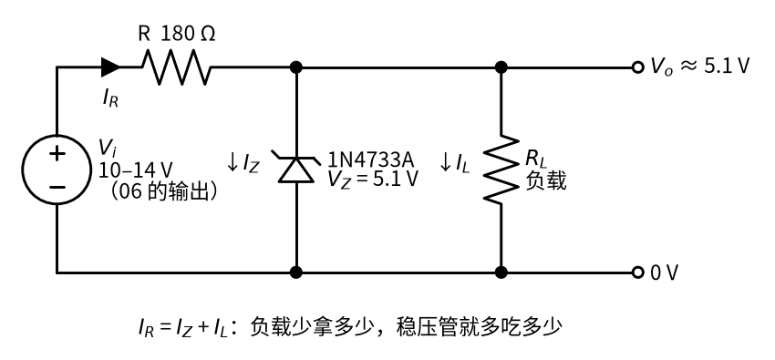
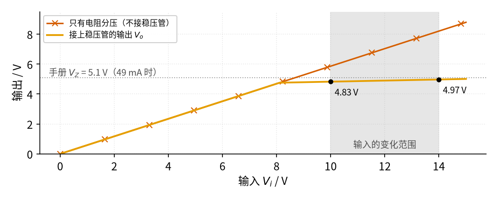
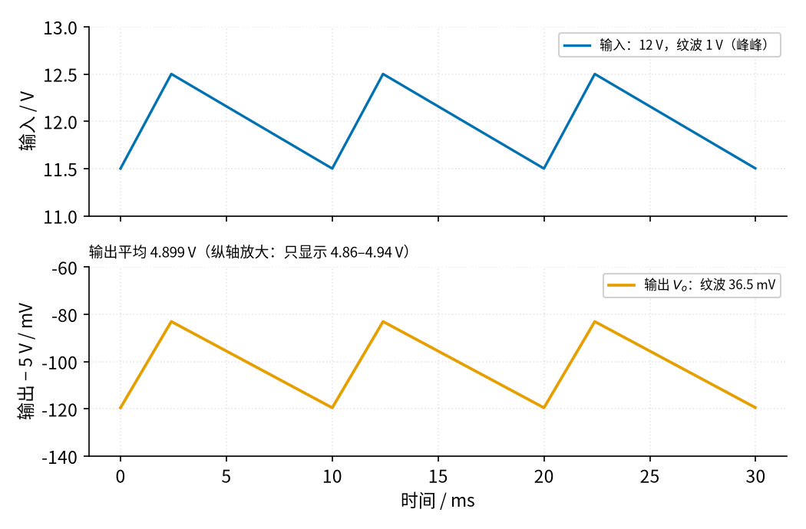

# 10 稳压管稳压 · 直觉篇

[上一页：04 差分放大 · 动手实验篇](../04-differential-amp/page4.md) · 本页：直觉篇 · [原理与实现篇](page2.md) · [参数与调试篇](page3.md) · [下一页：原理与实现篇](page2.md) · 前置节点：[P2 半导体入门 · 直觉篇](../P2-semiconductor-basics/page1.md)、[06 桥式整流 · 直觉篇](../06-bridge-rectifier/page1.md)

> [!NOTE]
> 本节电路本身只工作在几伏到十几伏的低压上。它的输入如果来自 06 的变压器整流电源，那么变压器初级仍然接着 220 V 市电，[06 桥式整流 · 直觉篇](../06-bridge-rectifier/page1.md) 开头的安全提示全部适用。本节的动手实验一律用**可调直流电源**（实验室稳压电源）代替整流电源。

## 为什么需要稳压管稳压

06 做出来的直流电源有两个毛病。第一，它带着纹波：桥式整流加电容滤波，输出每 10 ms 起伏一次，起伏约 1 V 很常见（见 [06 桥式整流 · 原理与实现篇](../06-bridge-rectifier/page2.md) 的纹波公式）。第二，它跟着市电和负载走：市电高 10%，输出也高约 10%；负载变重，电容放电更快，平均电压就往下掉。

可是很多电路只要一个**小电流、但很稳**的电压：给单片机一个 5 V 的参考，给传感器供几毫安的电，给比较器一个固定的门限。为了这几毫安专门用一颗稳压芯片，有时显得又贵又占地方。最省事的办法是：**一只电阻加一只稳压管**。P2 已经介绍过稳压管：它反向击穿以后，两端电压几乎不随电流变化（见 [P2 半导体入门 · 原理与实现篇](../P2-semiconductor-basics/page2.md)）。这一节就把它用起来，并且回答一个关键问题：那只电阻到底取多大？

## 一、电路：一只电阻 + 一只稳压管

下面的图 10-p1-1 是本节的主电路。输入接 06 那样的整流滤波输出，电压在 10 V 到 14 V 之间变化；输出要一个 5 V 左右的电压（用标称 5.1 V 的稳压管），负载最多取 20 mA。

*图 10-p1-1　并联稳压电路：限流电阻 R 降掉多余的电压，稳压管吃掉多余的电流*

图 10-p1-1 里要注意稳压管的方向：阴极（画短横的那一端）接正，阳极接地，它工作在**反向击穿**状态。图上三个电流的关系就是一条节点电流定律： $I_R = I_Z + I_L$ 。

可以把它想成一个带**溢流口**的水箱。水龙头（输入）开大开小，水箱的水位（输出电压）都停在溢流口的高度 $V_Z$ ，多出来的水从溢流口流走（稳压管电流 $I_Z$ ）。限流电阻 R 相当于进水管上的细管：它限制总进水量，这样溢流口不会被冲坏。下游用水（负载电流 $I_L$ ）多了，溢流就少了；用水少了，溢流就多了。只要溢流口一直有一点水在流，水位就不变。

这个比喻里藏着本节最重要的两件事：

- 进水量要**够**：下游用水最多、龙头又开得最小的时候，溢流口也不能断流，否则水位就掉下来了。这就要求 R 不能太大。
- 进水量又**不能太多**：下游一点水都不用、龙头开到最大的时候，全部的水都从溢流口走，溢流口（稳压管）要扛得住。这就要求 R 不能太小。

## 二、输入在变，输出几乎不动

先看输入从 0 慢慢升到 15 V 时输出怎么变，结果画在图 10-p1-2 里。负载用一只 255 Ω 的电阻，5.1 V 时正好取 20 mA。

*图 10-p1-2　输入从 0 涨到 15 V：接上稳压管后，输出被「钉」在 5 V 左右*

从图 10-p1-2 可以看出，输入较低时，电阻和负载分压得到的电压还不到稳压管的击穿起点（约 4.76 V），稳压管没有击穿，相当于不存在，橙色线和朱红色带叉的线重合。输入超过约 8.1 V 以后，稳压管开始导通，橙色线一下子变平。在灰色阴影标出的 10–14 V 范围里，输入变了 4 V，输出只从 4.83 V 变到 4.97 V，只变了 146 mV。对照朱红色带叉的线：如果不接稳压管，同样的输入变化会让输出从 5.86 V 变到 8.21 V。

这里的 146 mV 是按手册给的动态电阻 7 Ω 算的，而手册上这个数是**最大值**，所以算出的是最坏情况。用 Diodes 公司的 1N4733A 模型仿真，同样从 10 V 调到 14 V，输出只变约 70 mV；1 V 的纹波到输出约 16 mV（下面图 10-p1-3 按 7 Ω 算是 36.5 mV）。实测落在这两组数之间都算正常，关键是数量级：几伏的变化被压到几十毫伏。

你可能注意到：输出比稳压管标的 5.1 V 低了一两百毫伏。这不是算错了。手册上的 5.1 V 是在 49 mA 的**测试电流**下量出来的（见 [P2 半导体入门 · 原理与实现篇](../P2-semiconductor-basics/page2.md)），而这个电路里稳压管只分到约 10–30 mA，电流比测试电流小，电压就略低一点。

输出并不是绝对不变。[P2 半导体入门 · 原理与实现篇](../P2-semiconductor-basics/page2.md) 讲过，稳压管击穿以后还有一点**动态电阻** $r_Z$ （1N4733A 约 7 Ω）：电流多 10 mA，电压就多约 70 mV。输入升高时稳压管电流变大，输出就跟着略涨一点。

## 三、纹波被压小了二十多倍

06 的输出不是一条直线，而是带锯齿状纹波的。把一个平均 12 V、纹波 1 V（峰峰）的输入加到同一个电路上，得到图 10-p1-3：

*图 10-p1-3　带 1 V 纹波的输入（上）和输出（下，纵轴放大）*

图 10-p1-3 里，输出的波形形状和输入完全一样，但幅度只剩 36.5 mV，约为输入纹波的二十七分之一。注意下图的纵轴是放大过的，只显示 4.86–4.94 V 这一小段；如果和上图用同样的刻度，橙色线看起来就是一条平线。为什么正好是这个比例？原因在于 R 和稳压管的动态电阻组成了一个分压器，原理与实现篇会推出这个比例。

## 四、它的代价

这么简单的电路，代价也很明显：

1. **费电**。输入 12 V、负载 20 mA 时，电路从电源取约 39.5 mA，也就是 0.47 W，负载只得到约 0.10 W，效率约 21%。其余的电都在 R 和稳压管上变成了热。
2. **负载电流有上限**。进水量是 R 限定的，下游用水超过进水量，溢流口就断流。原理与实现篇会算出：输入最低 10 V 时，这个电路的负载一超过约 29 mA，输出就掉下来。
3. **空载时稳压管最累**。负载断开时，全部电流都流过稳压管，它的发热最大。

所以稳压管稳压适合**小电流**场合，几毫安到几十毫安。要更大的电流，就在稳压管后面加一只三极管，这正是原理与实现篇的变体，也是后续节点 08 线性稳压的起点。

## 五、记住三句话

- 电阻降压，稳压管分流： $I_R = I_Z + I_L$ ，负载少拿多少，稳压管就多吃多少。
- R 不能太大：输入最低、负载最大时，稳压管里还要留几毫安。
- R 不能太小：输入最高、空载时，稳压管的功耗要留一半余量。

## 小结

一只限流电阻加一只反向击穿的稳压管，就能把 10–14 V、带纹波的电压变成约 5 V（4.8–5.0 V）的稳定电压：输入变 4 V，输出只变 146 mV；1 V 的纹波被压到 36.5 mV。代价是费电，而且只能带小负载。下一页 [原理与实现篇](page2.md) 会用节点电流定律和 P2 的稳压管模型，把这些数字一一算出来，并给出限流电阻的取值公式。
