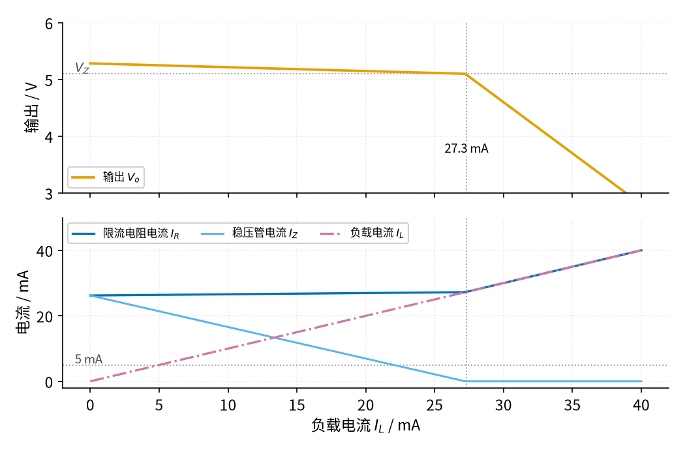
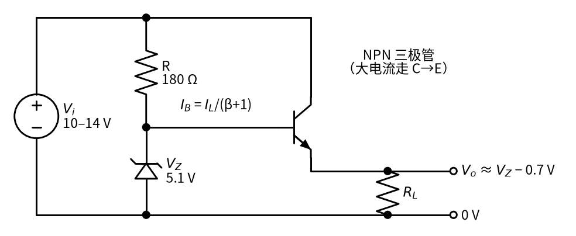
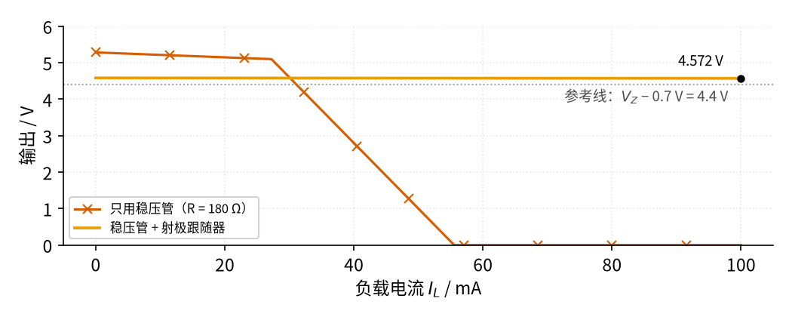

# 10 稳压管稳压 · 原理与实现篇

[上一页：直觉篇](page1.md) · [直觉篇](page1.md) · 本页：原理与实现篇 · [参数与调试篇](page3.md) · [下一页：参数与调试篇](page3.md) · 前置节点：[P2 半导体入门](../P2-semiconductor-basics/page1.md)、[06 桥式整流](../06-bridge-rectifier/page1.md)

> [!NOTE]
> 本页电路只接低压直流。实际产品里它的输入往往来自 06 的变压器整流电源，变压器初级接 220 V 市电，相关危险见 06 page1 开头；本页的实验都用可调直流电源代替。

## 本页要解决的问题

直觉篇给出了几个结果：输入变 4 V、输出只变 146 mV；1 V 纹波变成 36.5 mV；负载超过约 27 mA 就失去稳压。这一页要回答：这些数字怎么算出来？限流电阻 R 的取值范围怎么定？负载要上百毫安时怎么办？

## 1. 两个工具：节点电流定律 + 稳压管模型

稳压管沿用 P2 page2 的折线模型：反向电压还没到 $V_Z$ 时不导电；击穿以后

$$V_o = V_Z + r_Z I_Z$$

1N4733A 取 $V_Z$ = 5.1 V、 $r_Z$ = 7 Ω。输出节点上的电流满足

$$I_R = \frac{V_i - V_o}{R} = I_Z + I_L$$

两个式子联立，就能算出任何输入、任何负载下的输出。这个折线模型没有画出拐点附近「变软」的那一段（P2 page2 讲过，电流很小时电压会明显低于 $V_Z$ ），所以 $I_Z$ 只有一两毫安时，算出来的结果偏乐观。设计时让 $I_Z$ 至少留 5 mA，就是为了离开这一段。

## 2. 输入变化：R 和 r_Z 组成的分压器

先把负载当作一只电阻 $R_L$ 。稳压管击穿以后，可以看成「一只 $V_Z$ 的电池串一只 $r_Z$ 」。输入变化了 $\Delta V_i$ ，电池那部分不变，变化量只在 R、 $r_Z$ 、 $R_L$ 组成的网络里分配：

$$\frac{\Delta V_o}{\Delta V_i} = \frac{r_Z \parallel R_L}{R + r_Z \parallel R_L}$$

这里 $r_Z \parallel R_L$ 表示两只电阻并联。代入 $r_Z$ = 7 Ω、 $R_L$ = 255 Ω、R = 180 Ω：并联值约 6.81 Ω，比值约 6.81 ÷ 186.8 ≈ 0.0365。1 V 的纹波到输出只剩约 36.5 mV，和直觉篇纹波图的仿真一致。

要点是：**R 越大、 $r_Z$ 越小，抑制纹波的能力越强**。可是 R 又不能随便加大，下一节就会看到原因。顺带一提，ESP 的稳压电路文章里有一个类似的仿真：19.4 V 输入、300 mVpp 纹波，经稳压管后输出 15.1 V、纹波 16 mVpp。

## 3. 负载变化：电流在稳压管和负载之间「搬家」

再看负载变化。固定输入为最低的 10 V，把负载换成一个从 0 扫到 40 mA 的电流源，结果见图 10-p2-1：



*图 10-p2-1　输入 10 V 时负载从 0 扫到 40 mA：输出（上）和三路电流（下）*

图 10-p2-1 的下图里，蓝色的 $I_R$ 几乎是一条水平线：因为输出电压基本不变，R 两端的电压也基本不变，所以 $I_R$ ≈ (10 − 5.1) ÷ 180 ≈ 27 mA 是个定值。负载拿走的电流（红紫色点划线）越多，留给稳压管的（天蓝色线）就越少，两者之和始终是 $I_R$ 。负载 20 mA 时稳压管还有 7.0 mA，输出 5.149 V；负载到 27.3 mA，稳压管电流降到 0，它退出了工作，输出就沿着 $V_o = V_i - I_L R$ 直线下降，40 mA 时只剩 2.80 V。

负载从 0 加到 20 mA，稳压管电流从 26.2 mA 降到 7.0 mA，少了约 19 mA，输出也跟着降了 7 Ω × 19 mA ≈ 0.13 V。这就是 ESP 文章说「负载变化大时不推荐单用稳压管」的原因：负载的变化全部由稳压管来补偿，补偿量越大，输出动得越多。

## 4. 限流电阻怎么取：两个最坏情况

从上面的分析可以直接写出取值规则。设输入在 $V_{i,\min}$ 到 $V_{i,\max}$ 之间变化，负载在 0 到 $I_{L,\max}$ 之间变化。

**上限（保证稳压）**：最坏情况是输入最低、负载最大，这时稳压管里也要至少留 $I_{Z,\min}$ ：

$$R \le \frac{V_{i,\min} - V_Z}{I_{Z,\min} + I_{L,\max}}$$

**下限（保护稳压管）**：最坏情况是输入最高、负载断开，全部电流流过稳压管，功耗 $V_o I_Z$ 不能超过额定功率的一半（P2 page3 的「留一半余量」）：

$$I_Z \approx \frac{V_{i,\max} - V_Z}{R + r_Z}, \qquad V_o I_Z \le \frac{P_Z}{2}$$

把主例代入：10–14 V 输入、负载 0–20 mA、 $I_{Z,\min}$ = 5 mA、 $P_Z$ = 1.3 W。上限 (10 − 5.1) ÷ 0.025 ≈ 196 Ω（考虑 $r_Z$ 后仿真得 194 Ω）；下限由仿真得约 74 Ω。取常用值 180 Ω，靠近上限，这样稳压管平时不太热，纹波也压得更狠。最后还要核对 R 本身的功耗：输入 14 V、空载时 R 上约 8.6 V，功耗约 8.6² ÷ 180 ≈ 0.41 W，按两倍余量选 1 W 的电阻。

经验上，ESP 建议稳压管的工作电流取最大电流（额定功率除以 $V_Z$ ）的 10%–50%；维基百科的稳压管词条也写了同样的两个条件：R 要小到让稳压管在最大负载时仍击穿，又要大到让稳压管的功耗不超标。

## 5. 仿真：自己动手算一遍

下面的程序只用 Python 标准库，按上面的模型算出主例的关键数字。完整的绘图版本在 `code/10_sim.py`。

```python
VZ, RZ, R = 5.1, 7.0, 180.0     # 1N4733A 模型（见 P2 page2）和限流电阻

def node(vin, r, il):
    """输入 vin 经电阻 r 供电，负载取恒定电流 il。返回 (输出电压, 稳压管电流)。"""
    v_off = vin - il * r                      # 假设稳压管不导通
    if v_off <= VZ:
        return max(v_off, 0.0), 0.0
    v = (vin / r + VZ / RZ - il) / (1 / r + 1 / RZ)
    return v, (v - VZ) / RZ

# 1) 两个最坏情况
v, iz = node(10.0, R, 0.020)
print(f"输入 10 V、负载 20 mA：V_o = {v:.3f} V，I_Z = {iz*1e3:.1f} mA")
v, iz = node(14.0, R, 0.0)
print(f"输入 14 V、空载：I_Z = {iz*1e3:.1f} mA，稳压管功耗 {v*iz:.2f} W（额定 1.3 W）")
print(f"R 的功耗 {(14.0 - v)**2 / R:.2f} W")

# 2) R 的上限：从 100 Ω 往上找，直到最坏 I_Z 小于 5 mA
r = 100
while node(10.0, r, 0.020)[1] >= 0.005:
    r += 1
print(f"R 最大约 {r - 1} Ω")

# 3) 负载加到多少失去稳压
il = 0.0
while node(10.0, R, il)[1] > 0:
    il += 0.0001
print(f"输入 10 V 时，负载超过约 {il*1e3:.1f} mA 就失去稳压")
```

运行结果应为：最坏 $I_Z$ 7.0 mA、输出 5.149 V；空载最坏功耗 0.26 W（ $I_Z$ 47.6 mA）；R 功耗 0.41 W；R 最大约 194 Ω；负载超过约 27.3 mA 失去稳压。这些数字和 `code/10_sim.py` 打印的一致。

## 6. 变体：加一只三极管扩大电流

单用稳压管，负载电流的上限就是 $I_R$ 。负载要 100 mA 怎么办？如果把 R 减小到能供 100 mA，空载时这 100 mA 全部压到稳压管上，又热又浪费。办法是让稳压管只管「定电压」，大电流交给一只三极管，电路如图 10-p2-2：



*图 10-p2-2　稳压管 + 射极跟随器：稳压管定基极电压，三极管供负载电流*

分析图 10-p2-2 要用到 P2 讲过的三极管估算规则：导通时 $V_{BE}$ ≈ 0.7 V，集电极电流是基极电流的 β 倍。基极被稳压管钉在约 5.1 V，发射极就比它低约 0.7 V，输出约 4.4 V。负载电流 $I_L$ 从发射极流出，其中只有 $I_L/(\beta+1)$ 来自基极，其余都从集电极直接由电源提供。按 2N3904 的最小 β = 60 估算（见 P2 page3），负载 100 mA 时基极只要 1.64 mA。对稳压管来说，负载变化被缩小了约 61 倍。这种「发射极跟着基极走」的接法叫**射极跟随器**，阅读顺序后面的 [07 射极跟随器](../07-emitter-follower/page1.md) 会专门讲它。两种接法带负载的能力对比见图 10-p2-3。



*图 10-p2-3　同一个 180 Ω、同样的 10 V 输入：加三极管后能带 100 mA*

图 10-p2-3 中，橙色线从空载的 4.583 V 到 100 mA 时的 4.572 V，只降了 11 mV；稳压管电流从 26.2 mA 只降到 24.6 mA。对照朱红色带叉的线，单用稳压管时同样的电阻撑不过 27 mA。输出比灰色点线的 4.4 V 略高，是因为稳压管带着 26 mA 电流，实际电压比 5.1 V 高约 0.18 V。这里把 $V_{BE}$ 当作固定的 0.7 V，真实的三极管电流大时 $V_{BE}$ 会略增，输出会再低一点。

代价转移到了三极管身上：输入 12 V、负载 100 mA 时，三极管两端约 7.4 V，功耗约 0.74 W，小信号三极管扛不住，要换功率三极管并加散热片。怎样再加一个放大器把输出调得更准、怎样处理发热，就是后续节点 [08 线性稳压](../08-linear-regulator/page1.md) 的内容。

## 7. 例题：从照着做到自己做

**例 1（完整示例）** 输入 10–14 V，要 5.1 V、负载 0–20 mA，用 1N4733A。选 R。

解：上限 R ≤ (10 − 5.1) ÷ (5 mA + 20 mA) = 196 Ω。取 180 Ω。下限核对：输入 14 V、空载时 $I_Z$ ≈ (14 − 5.1) ÷ (180 + 7) ≈ 47.6 mA，功耗约 5.43 × 0.0476 ≈ 0.26 W，远小于 0.65 W，也远小于 $I_{ZM}$ = 178 mA。R 功耗约 0.41 W，选 1 W。

**例 2（关键步骤留空）** 输入 18–24 V，要 12 V、负载 0–10 mA，用 1N4742A（12 V、1.3 W、 $r_Z$ 约 9 Ω、 $I_{ZM}$ 76 mA）， $I_{Z,\min}$ 取 5 mA。

解：上限 R ≤ (18 − 12) ÷ ( ____ ) = ____ Ω，取常用值 390 Ω。空载、24 V 时 $I_Z$ ≈ ____ mA，功耗约 ____ W，和 0.65 W 比较。R 的功耗约 ____ W。

<details><summary>答案</summary>

上限 R ≤ 6 ÷ (0.005 + 0.010) = 400 Ω，取 390 Ω。空载、24 V 时 $I_Z$ ≈ (24 − 12) ÷ (390 + 9) ≈ 30 mA，功耗约 12.3 × 0.030 ≈ 0.37 W，小于 0.65 W，也小于 $I_{ZM}$ 76 mA。R 上约 11.7 V，功耗约 11.7² ÷ 390 ≈ 0.35 W，选 1 W。

</details>

**例 3（变体迁移）** 还是 10–14 V 输入、1N4733A，但负载要 0–200 mA，于是加一只 NPN 三极管做射极跟随器，β 按 60 估算。R 取多大？三极管最大功耗多少？

<details><summary>答案</summary>

最大基极电流 0.2 ÷ 61 ≈ 3.3 mA。稳压管至少留 5 mA，所以 R ≤ (10 − 5.1) ÷ (5 + 3.3) mA ≈ 590 Ω，取 560 Ω。空载、14 V 时 $I_Z$ ≈ 8.9 ÷ 567 ≈ 15.7 mA，功耗约 0.08 W，稳压管几乎不热。三极管在输入 14 V、输出约 4.4 V、电流 200 mA 时，功耗约 (14 − 4.4) × 0.2 ≈ 1.9 W，必须用功率三极管加散热片。对比：单用稳压管带 200 mA，R 要小到约 24 Ω，空载时稳压管要吃 200 多毫安，早已超过 $I_{ZM}$ 。

</details>

## 小结

稳压管稳压的全部计算只靠两条式子：节点电流 $I_R = I_Z + I_L$ 和稳压管模型 $V_o = V_Z + r_Z I_Z$ 。由此得到 R 的取值窗口：上限保证输入最低、负载最大时稳压管仍有电流，下限保证输入最高、空载时稳压管不过热。纹波按 R 与 $r_Z$ 的分压比缩小。负载大时加一只三极管，稳压管只负责定电压。下一页 [参数与调试篇](page3.md) 会读数据手册、扫描 R 的取值窗口，并看看 R 选错时电路会出什么毛病。
