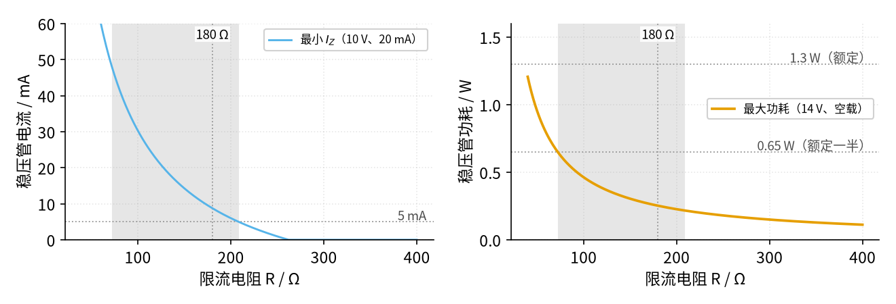
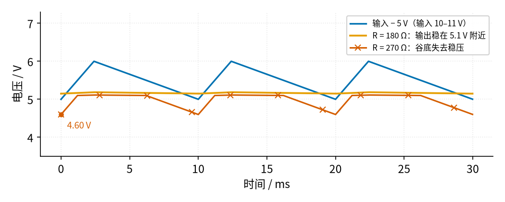

# 10 稳压管稳压 · 参数与调试篇

[上一页：原理与实现篇](page2.md) · [直觉篇](page1.md) · [原理与实现篇](page2.md) · 本页：参数与调试篇 · [下一页：13 微分电路 · 直觉篇](../13-differentiator/page1.md) · 前置节点：[P2 半导体入门 · 直觉篇](../P2-semiconductor-basics/page1.md)、[06 桥式整流 · 直觉篇](../06-bridge-rectifier/page1.md) · 后续：[08 线性稳压 · 直觉篇](../08-linear-regulator/page1.md)

> [!NOTE]
> 本页的实验全部用可调直流电源（不超过 15 V）完成，不要直接接 06 那样由市电变压器供电的整流电源去做「故障实验」。如果实际电路的输入来自市电变压器，06 page1 开头的安全提示全部适用。

## 本页要解决的问题

原理与实现篇推出了 R 的取值公式。真正动手时还会遇到这些问题：数据手册上的哪些数字要用？R 偏离窗口会怎样？稳压管发烫、输出偏低、输出跟着输入跑，各是什么原因？

## 1. 数据手册里最该看的参数

下表摘自 Vishay 的 1N4728A–1N4761A 系列数据手册，以本节用的 1N4733A 为例：

| 参数 | 1N4733A 的值 | 怎么用 |
|---|---|---|
| 稳压值 $V_Z$ | 5.1 V，容差 ±5%（在测试电流 49 mA 下测得） | 同一型号实际在 4.85–5.36 V 之间；要更准就要挑管或改用基准芯片 |
| 动态电阻 $Z_{ZT}$ | 7 Ω（49 mA 时） | 就是 $r_Z$ ，决定纹波抑制和负载调整 |
| 拐点动态电阻 $Z_{ZK}$ | 550 Ω（1 mA 时） | 电流很小时电压「软」得多，所以 $I_Z$ 要留几毫安以上 |
| 最大稳压电流 $I_{ZM}$ | 178 mA | 空载最坏情况的 $I_Z$ 要远小于它 |
| 额定功率 $P_{tot}$ | 1.3 W | 实际功耗留一半余量（见 P2 page3） |
| 热阻 $R_{thJA}$ | 110 K/W | 功耗乘热阻就是管芯比环境高出的温度 |

两点提醒。第一， $V_Z$ 是在 49 mA 测出来的，本节主例平时只有 7–48 mA，实际电压会比 5.1 V 低一些，拐点附近更低。第二，热阻 110 K/W 意味着主例空载最坏情况的 0.26 W 会让管芯升温约 0.26 × 110 ≈ 29 °C；如果 R 取到下限 74 Ω，功耗 0.65 W，升温约 72 °C，摸上去已经烫手。

**温度系数**也值得知道（维基百科稳压管词条）：大约 5.6 V 以下的稳压管，温度升高电压略降；5.6 V 以上的，温度升高电压略升；5.6 V 附近两者接近抵消。4.7 V 的稳压管约 −2 mV/°C，和三极管的 $V_{BE}$ 差不多，所以「4.7 V 稳压管 + 射极跟随器」的输出温漂会互相抵消一部分。

## 2. 扫描：R 的取值窗口

把 R 从 40 Ω 扫到 400 Ω，分别看两个最坏情况，结果见图 10-p3-1：

*图 10-p3-1　限流电阻的取值窗口：左图定上限，右图定下限*

图 10-p3-1 的灰色阴影就是可用的窗口，74–194 Ω。窗口左边，稳压管在空载、高输入时功耗超过 0.65 W，R = 40 Ω 时已达 1.22 W，接近额定的 1.3 W；窗口右边，输入低、负载重时稳压管电流不足 5 mA，到 245 Ω 左右完全断流。180 Ω 靠近右边界：平时稳压管凉快，纹波抑制也好；但如果市电比设计假设的还低，它会最先失去稳压。

窗口的宽窄取决于输入范围和负载范围。输入变化越大、负载变化越大，窗口越窄；窗口消失（上限比下限还小）时，说明单用稳压管已经不合适了，要换成原理与实现篇的三极管扩流电路或 08 的线性稳压。

## 3. R 太大：市电一低，纹波就漏出来

把 R 从 180 Ω 换成 270 Ω，输入降到市电偏低时的 10–11 V（带 1 V 纹波），负载 20 mA，结果见图 10-p3-2：

*图 10-p3-2　R = 180 Ω（橙色）和 R = 270 Ω（朱红色）在输入偏低时的输出*

图 10-p3-2 中，R = 180 Ω 时输出纹波仍只有 37 mV。R = 270 Ω 时，输入 10 V 时 R 最多只能供 (10 − 5.1) ÷ 270 ≈ 18.1 mA，比负载要的 20 mA 还少。于是在每个纹波谷底，稳压管断流，输出跟着输入往下掉，最低到 4.60 V，纹波变成 513 mV。示波器上看到的现象是：**平时好好的，市电一低（或负载一重）输出就带上了 100 Hz 的锯齿**。

## 4. 动手实验：用可调电源验证窗口

> [!NOTE]
> 只用可调直流电源，电压不超过 15 V，电源限流设到 100 mA。接线、改线前先关掉电源输出。稳压管和电阻工作时可能发烫，不要用手指直接按住测温。

准备：1N4733A、180 Ω 1 W 电阻、一只 270 Ω 电阻、几只负载电阻（1 kΩ、510 Ω、255 Ω 可以用 240 Ω 加 15 Ω 串联代替）、万用表两只。

1. 按直觉篇的主电路接好 180 Ω 和稳压管，先不接负载。电源从 8 V 慢慢调到 14 V，记录输出。空载时输入一过 5.1 V 稳压管就击穿，应能看到输出从这里开始基本不动，只随电流略涨。
2. 电源调到 10 V，依次接 1 kΩ、510 Ω、255 Ω 负载，一只表测输出，另一只表串在稳压管支路上测 $I_Z$ 。负载电流加大时 $I_Z$ 应等量减小。
3. 把 R 换成 270 Ω，重复第 2 步。接 255 Ω 时输出应明显低于 5 V。
4. 电源调到 14 V，断开负载，用万用表测稳压管电流，算功耗 $V_o I_Z$ ，和 0.65 W 比较。

实测数字会和仿真有出入：稳压管的实际 $V_Z$ 有 ±5% 的容差，电流小时拐点更软，温度升高后电压也会漂。

## 5. 故障排查表

| 现象 | 可能原因 | 检查方法 | 解决 |
|---|---|---|---|
| 输出约 0.7 V | 稳压管接反，工作在正向导通 | 看阴极色环是否朝向正电源 | 调转稳压管 |
| 稳压管冒烟或很快烧坏 | 没有串限流电阻，稳压管直接接在电源上 | 看电路，量 R 是否被短路 | 一定要串 R；12 V 直接加在 1N4733A 上，电流只受 $r_Z$ 和电源内阻限制，可达约 1 A，远超 $I_{ZM}$ |
| 空载时稳压管烫手 | R 太小，或者输入比设计值高 | 测空载时的 $I_Z$ ，算 $V_o I_Z$ | 按窗口下限加大 R；或换功率更大的稳压管 |
| 输出偏低，且随负载加重明显下降 | R 太大，或负载电流超出设计值 | 测输入最低时的 $I_Z$ 是否还有几毫安 | 减小 R（在窗口内）；负载太大就加三极管扩流 |
| 输出带明显的 100 Hz 锯齿 | 纹波谷底失去稳压（见图 10-p3-2），或前级滤波电容太小 | 示波器看谷底处输出是否跟着输入掉 | 加大前级电容（见 06 page3）或减小 R |
| 输出比 5.1 V 低零点几伏 | 稳压管工作电流太小，处于拐点附近；或容差 | 测 $I_Z$ | 把 $I_Z$ 提到几毫安以上；需要精确值时换基准芯片 |
| 输出随温度慢慢漂 | 稳压管发热，温度系数造成 | 冷机和热机各测一次 | 降低功耗；选 5.6 V 左右的稳压管 |
| 输出上有高频噪声 | 稳压管击穿本身会产生噪声，输出端没有电容 | 示波器交流耦合看输出 | 输出端并一只电容（ESP 文章认为必不可少） |

## 6. 练习

**练习 1** 主例（10–14 V、0–20 mA、R = 180 Ω）的负载最大值改成 30 mA，R 的上限变成多少？180 Ω 还能用吗？

答案

上限 R ≤ (10 − 5.1) ÷ (0.005 + 0.030) = 140 Ω，180 Ω 超出上限，不能用。由原理与实现篇的负载扫描图也能看出，180 Ω 在输入 10 V 时只能撑到约 27.3 mA。改用 120 Ω：空载、14 V 时 $I_Z$ ≈ 8.9 ÷ 127 ≈ 70 mA，功耗约 5.59 × 0.070 ≈ 0.39 W，仍小于 0.65 W，可以用。

**练习 2** 一个同学用 1N4733A 和 47 Ω 电阻接在 14 V 上，没接负载。估算稳压管的电流和功耗，会出什么问题？

答案

$I_Z$ ≈ (14 − 5.1) ÷ (47 + 7) ≈ 165 mA，输出约 5.1 + 7 × 0.165 ≈ 6.25 V，功耗约 6.25 × 0.165 ≈ 1.03 W。电流没超过 $I_{ZM}$ 178 mA，功耗也没超过 1.3 W，但远超一半余量 0.65 W；按热阻 110 K/W 估算，管芯升温约 113 °C，长期这样用寿命会很短。R 至少要取到窗口下限约 74 Ω。

**练习 3** 用 5.6 V 和 4.7 V 两种稳压管各做一个「稳压管 + 射极跟随器」，哪一种输出的温漂更小？为什么？

答案

4.7 V 那一种。射极跟随器的输出是 $V_Z - V_{BE}$ 。 $V_{BE}$ 约 −2 mV/°C，温度升高时它变小，输出就上升；4.7 V 稳压管也约 −2 mV/°C，温度升高时 $V_Z$ 变小，输出下降。两者互相抵消。5.6 V 稳压管自身温漂接近 0，但 $V_{BE}$ 的漂移就没有东西去抵消了。

## 小结与下一步

稳压管稳压是最便宜的稳压方法：读手册时抓住 $V_Z$ 及其容差、动态电阻、拐点、最大电流和功率；设计时先画出 R 的取值窗口，再在窗口内取值；调试时记住三种典型故障：接反输出 0.7 V，R 太小稳压管过热，R 太大输入一低就失去稳压。这个电路给出的「稳定电压」常常被当作更精密电路的**基准**：后续节点 [08 线性稳压 · 直觉篇](../08-linear-regulator/page1.md) 会把稳压管、三极管和运放组合起来，做成能带大电流、输出可调的稳压电源。按阅读顺序，下一个节点是 [13 微分电路 · 直觉篇](../13-differentiator/page1.md)。
