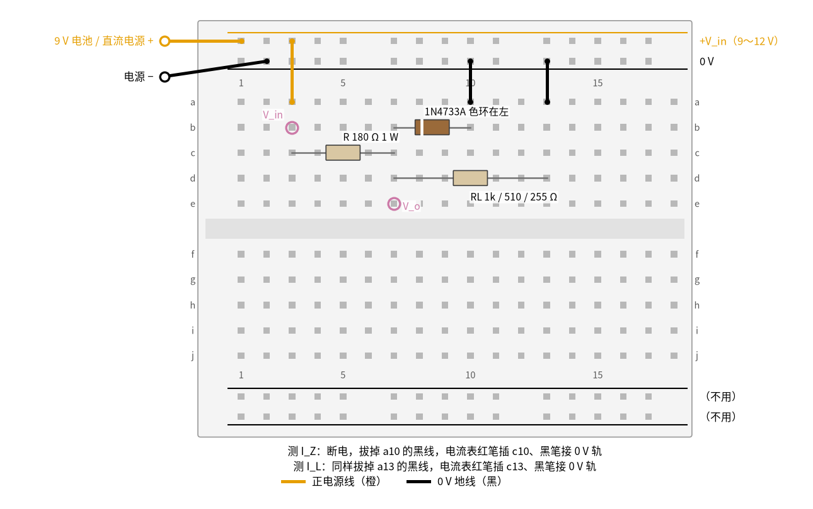

# 10 稳压管稳压 · 动手实验篇

[上一页：参数与调试篇](page3.md) · [直觉篇](page1.md) · [原理与实现篇](page2.md) · [参数与调试篇](page3.md) · 本页：动手实验篇 · [下一页：13 微分电路 · 直觉篇](../13-differentiator/page1.md) · 前置节点：[P2 半导体入门 · 直觉篇](../P2-semiconductor-basics/page1.md)、[06 桥式整流 · 直觉篇](../06-bridge-rectifier/page1.md)

## 这次实验要验证什么

用一只电阻和一只 1N4733A 搭出并联稳压电路，用万用表亲手验证三件事：

1. 输入电压变了好几伏，输出只变几十毫伏（[10 稳压管稳压 · 直觉篇](page1.md) 第二节「输入在变，输出几乎不动」）。
2. 负载电流加大多少，稳压管电流就减小多少，总电流 $I_R = I_Z + I_L$ 基本不变（[10 稳压管稳压 · 原理与实现篇](page2.md) 第 3 节「电流在稳压管和负载之间搬家」）。
3. 限流电阻 R 有一个取值窗口：R 太大，负载一重稳压管就「断流」，输出掉下来（[10 稳压管稳压 · 原理与实现篇](page2.md) 第 4 节的两个最坏情况）。

[10 稳压管稳压 · 参数与调试篇](page3.md) 第 4 节的实验用到 14 V；本页把电压限制在 12 V 以内，用 9 V 电池就能做大部分步骤，所有「应该读到」的数都按 12 V 以内的条件重新仿真过。

## ⚠️ 安全须知

- **只用 12 V 及以下的直流电。** 9 V 叠层电池，或者可调直流电源（输出不超过 12 V，限流设到 100 mA）。本页不需要任何市电设备。
- **稳压管一定要串电阻。** 不串 R 直接把 9 V 加在稳压管上，电流可达几百毫安到 1 A，管子会冒烟。通电前再看一眼 R 是否真的串在电源和稳压管之间。
- **稳压管分方向。** 有色环的一端是阴极，要朝向正电源（接到第 7 列的输出节点）；接反了它是正向导通，输出只有 0.7 V 左右。
- **元件会发烫，不要用手摸。** 本页最坏情况（12 V、空载）稳压管功耗约 0.2 W、R 约 0.27 W，会温热；电阻用 1 W 的。量温度用测温枪，不要用手指按住。
- **接线、改线之前先断电。** 断电就是取下电池扣或关掉电源输出。换负载、换 R、串电流表都先断电。
- 本电路没有电解电容；如果你另外在输出端并电解电容，长脚接输出、短脚接 0 V。

## 器材清单

| 元件 | 型号或数值 | 数量 | 说明 |
|---|---|---|---|
| 稳压管 | 1N4733A（5.1 V，1.3 W） | 1 | 色环端是阴极 |
| 限流电阻 R | 180 Ω，1 W | 1 | 主例的值 |
| 限流电阻（对照） | 270 Ω，1/2 W 以上 | 1 | 第 8、9 步换上，演示「R 太大」 |
| 负载电阻 RL | 1 kΩ、510 Ω、255 Ω（可用 240 Ω + 15 Ω 串联） | 各 1 | 1/4 W 即可 |
| 电源 | 9 V 叠层电池加电池扣，或 ≤12 V 可调直流电源 | 1 | 第 10、11 步扫描电压必须用可调电源 |
| 万用表 | 直流电压挡 20 V，直流电流挡 200 mA | 1～2 | 两只最方便：一只测输出电压，一只测电流 |
| 面包板、跳线 | 400 孔以上 | 若干 | 橙色接正，黑色接 0 V |

先用电阻挡把 R 和每只 RL 的实际阻值量出来记下，后面 Python 核对时要用。

## 搭建步骤

电路就是 [10 稳压管稳压 · 直觉篇](page1.md) 第一节的主电路：电源经 R 到输出节点，节点下面并联稳压管（阴极朝上）和负载。图 10-p4-1 是它在面包板上的样子。



*图 10-p4-1　并联稳压电路的面包板接线（第 3 列 = 输入，第 7 列 = 输出，第 10 列 = 稳压管阳极，第 13 列 = 负载下端）*

1. **铺电源轨。** 电源正极接上方最外侧轨，负极接上方第二条轨（0 V）。先不要接电池（或先关掉电源输出）。
2. **接输入。** 橙线 a3 → 正电源轨。
3. **插 R。** 180 Ω 电阻一脚插 c3，另一脚插 c7。第 7 列就是输出节点。
4. **插稳压管。** 色环（阴极）一端插 b7，另一端（阳极）插 b10。插之前再确认一次色环方向。
5. **稳压管阳极接地。** 黑线 a10 → 0 V 轨。测 $I_Z$ 时就把这根线换成电流表。
6. **插负载。** 先不插 RL（空载）。需要负载时，RL 一脚插 d7、另一脚插 d13，黑线 a13 → 0 V 轨。测 $I_L$ 时把这根黑线换成电流表。
7. **检查后通电。** 对照 [10 稳压管稳压 · 直觉篇](page1.md) 第一节的电路图逐根检查：R 在电源和第 7 列之间，稳压管和 RL 都在第 7 列和 0 V 之间。接上电池，先量 V_o，在 4.8～5.4 V 之间就说明接对了。

画图脚本断言 R 的一端在正电源上、稳压管阴极和 RL 上端都在输出节点上、稳压管阳极和 RL 下端都接 0 V；接错一处图就画不出来。

## 测量表

「应该读到」的数来自 ngspice 仿真：用 Diodes 公司的 1N4733A 模型，把 [review/spice/10.md](../review/spice/10.md) 面包板读数表用的同一个主电路，在 5～12 V 输入、四种负载、R 180 / 270 Ω 下重新扫描了一遍。下表默认输入 9.00 V（可调电源）。电池的实际电压一般在 9.2～9.6 V，读数会略高几毫伏到十几毫伏，用 Python 按你的实际输入重算即可。稳压管的 $V_Z$ 有 ±5% 容差，输出落在 4.8～5.3 V 都正常，后面各步的输出都跟你的空载读数比。

| 步骤 | 测什么 | 红表笔 | 黑表笔 | 挡位 | 应该读到 | 读不到时先查 |
|---|---|---|---|---|---|---|
| 1 | 输入电压 | b3 | 0 V 轨 | 直流 20 V | 9.00 V | 电池扣是否接触好 |
| 2 | 输出电压，空载 | e7 | 0 V 轨 | 直流 20 V | 5.05 V | 约 0.7 V：稳压管接反；接近 9 V：稳压管没插进去 |
| 3 | R 两端电压，空载 | b3 | e7 | 直流 20 V | 3.95 V（除以 180 Ω 得 $I_R$ 约 21.9 mA） | — |
| 4 | 稳压管电流，空载 | c10 | 0 V 轨（拔掉 a10 黑线） | 直流 200 mA | 22.0 mA | 读 0：表笔插在电压孔，或保险丝断了 |
| 5 | RL = 1 kΩ：输出 / $I_Z$ / $I_L$ | e7 / c10 / c13 | 0 V 轨 | 20 V / 200 mA | 5.03 V / 17.0 mA / 5.0 mA | $I_Z + I_L$ 应约等于第 4 步的 22 mA |
| 6 | RL = 510 Ω：同上 | e7 / c10 / c13 | 0 V 轨 | 20 V / 200 mA | 5.02 V / 12.3 mA / 9.8 mA | 同上 |
| 7 | RL = 255 Ω：同上 | e7 / c10 / c13 | 0 V 轨 | 20 V / 200 mA | 4.95 V / 3.1 mA / 19.4 mA | $I_Z$ 只剩 3 mA，已经接近拐点 |
| 8 | R 换 270 Ω，RL = 255 Ω：输出 / $I_Z$ | e7 / c10 | 0 V 轨 | 20 V / 200 mA | 4.37 V / 约 0 mA | 输出掉了约 0.6 V，**稳压失效**，这就是 R 太大 |
| 9 | R 270 Ω，RL = 510 Ω：输出 / $I_Z$ | e7 / c10 | 0 V 轨 | 20 V / 200 mA | 4.97 V / 5.2 mA | 负载减轻一半就又能稳住 |
| 10 | R 180 Ω，空载，输入从 5 V 调到 12 V（可调电源） | e7 | 0 V 轨 | 直流 20 V | 5 V → 4.88；6 V → 4.98；7 V → 5.01；9 V → 5.05；12 V → 5.08 | 输入约 5.1 V 时稳压管电流到 1 mA，之后输出几乎不动 |
| 11 | R 180 Ω，RL = 255 Ω，输入 8 → 12 V | e7 | 0 V 轨 | 直流 20 V | 8 V → 4.69；9 V → 4.95；10 V → 5.00；11 V → 5.02；12 V → 5.04 | 8 V 时还没进稳压区，所以低了 |
| 12 | 最坏情况：12 V、空载的 $I_Z$ | c10 | 0 V 轨 | 直流 200 mA | 38.5 mA（功耗约 5.08 × 0.0385 ≈ 0.20 W） | 远小于 0.65 W，管子只会温热 |

第 5～7 步最值得看：负载电流从 5 mA 涨到 19 mA，稳压管电流从 17 mA 降到 3 mA，两者之和一直约 22 mA，输出只降了 0.08 V。第 8 步换成 270 Ω 后，R 能供的电流只有约 (9 − 5) ÷ 270 ≈ 15 mA，而 255 Ω 负载要 19 mA，供不上，稳压管就停止击穿，电路退化成一个电阻分压器：9 × 255 ÷ (270 + 255) ≈ 4.37 V。

串电流表测 $I_Z$ 时，表本身有几欧的内阻，相当于在稳压管下面多串了一点电阻，读数会比不接表时小一点点（零点几毫安以内），不影响结论。也可以不串表：量第 3 步那样的 R 两端电压，算出 $I_R$ ，再减去 $V_o / R_L$ 得到 $I_Z$ 。

## 没有示波器怎么办

本页全部用直流电源，万用表就能做完。真正只有示波器才能看到的是**纹波**：输入是 06 那样带 100 Hz 锯齿的整流输出时，输出上的小锯齿，以及 R 太大时纹波谷底「漏」到输出上的样子。它们分别画在 [10 稳压管稳压 · 直觉篇](page1.md) 第三节的输入、输出纹波对比图，和 [10 稳压管稳压 · 参数与调试篇](page3.md) 第 3 节「R 太大：市电一低，纹波就漏出来」的波形图里。

用万用表可以做一个「慢动作的纹波实验」：第 10、11 步手动把输入调高或调低 1 V，看输出变了多少。按第 11 步的仿真，输入从 10 V 调到 12 V，输出只变约 44 mV，相当于每伏 22 mV。纹波也是输入电压在变，只是变得快，所以 1 V 的纹波到输出上也只剩几十毫伏，和直觉篇那张纹波图是同一个道理。

## 用 Python 核对你的读数

稳压管的电压随电流变化，代码里用一条拟合曲线描述它： $V_Z = a + 0.0484 \ln I_Z + 0.296 I_Z$ （这条曲线和 ngspice 里的 1N4733A 模型在 0.5～40 mA 范围内的误差小于 0.1 mV）。你的管子 $V_Z$ 可能偏高或偏低几个百分点，所以代码先用你的空载读数把 a 校准，再预测带负载时的输出和 $I_Z$ ，偏差超过 10% 就提示。

```python
import sys, pathlib
sys.path.insert(0, str(pathlib.Path("code/figs").resolve()))  # 在仓库根目录运行
# 10 稳压管稳压 · 动手实验核对：用空载读数校准稳压管曲线，再预测带负载时的读数
import math

B, RZ = 0.04837, 0.2961          # 拟合自 ngspice 的 1N4733A 模型（I 用安培）
def vz(i, a):
    return a + B * math.log(i) + RZ * i

def solve(vin, r, rl, a):
    """返回 (V_o, I_Z)。先看稳压管是否击穿，没击穿就是电阻分压。"""
    v_div = vin * rl / (r + rl) if rl else vin
    if v_div <= vz(1e-6, a):
        return v_div, 0.0
    lo, hi = 1e-6, vin / r       # 二分 I_Z
    for _ in range(60):
        iz = (lo + hi) / 2
        v = vz(iz, a)
        f = (vin - v) / r - (v / rl if rl else 0) - iz
        lo, hi = (iz, hi) if f > 0 else (lo, iz)
    return vz(iz, a), iz

# ---- 1. 你量到的值（示例值，换成你自己的）----
VIN, R = 9.00, 180.0              # 实测输入电压、R 的实测阻值
VO_NOLOAD = 5.05                  # 第 2 步：空载输出
runs = [  # (说明, R, RL（None = 空载）, 实测 V_o, 实测 I_Z（mA，没测就填 None）)
    ("RL 1k", 180.0, 1000.0, 5.03, 17.1),
    ("RL 510", 180.0, 510.0, 5.02, 12.2),
    ("RL 255", 180.0, 255.0, 4.95, 3.0),
    ("R 270, RL 255", 270.0, 255.0, 4.38, 0.0),
    ("R 270, RL 510", 270.0, 510.0, 4.97, 5.1),
]

# ---- 2. 用空载读数校准 a ----
lo, hi = 4.5, 6.0
for _ in range(60):
    a = (lo + hi) / 2
    lo, hi = (a, hi) if solve(VIN, R, None, a)[0] < VO_NOLOAD else (lo, a)
vo0, iz0 = solve(VIN, R, None, a)
print(f"校准：a = {a:.4f} V，空载 I_Z 应为 {iz0 * 1000:.1f} mA（仿真模型 a = 5.2259 V）")

# ---- 3. 逐项比较 ----
warn = 0
for name, r, rl, vo_m, iz_m in runs:
    vo, iz = solve(VIN, r, rl, a)
    il = vo / rl
    msg = f"{name:<14} V_o 预测 {vo:.3f} V / 实测 {vo_m:.3f} V；I_Z 预测 {iz * 1000:5.1f} mA"
    if abs(vo_m - vo) / vo > 0.10:
        msg += "  ← V_o 偏差超过 10%"
        warn += 1
    if iz_m is not None:
        msg += f" / 实测 {iz_m:5.1f} mA"
        if abs(iz_m - iz * 1000) > max(0.10 * iz * 1000, 0.5):   # 小电流时允许 0.5 mA
            msg += "  ← I_Z 偏差超过 10%"
            warn += 1
    msg += f"；I_L {il * 1000:.1f} mA，I_Z + I_L = {(iz + il) * 1000:.1f} mA"
    if iz < 1e-3:
        msg += "（稳压管基本断流，稳压失效）"
    print(msg)

# ---- 4. 输入变 1 V，输出变多少（第 11 步）----
d = (solve(12.0, 180.0, 255.0, a)[0] - solve(10.0, 180.0, 255.0, a)[0]) / 2
print(f"RL 255 Ω、输入 10→12 V：输出每伏变化约 {d * 1000:.0f} mV")
print("全部在范围内" if warn == 0 else f"有 {warn} 项需要检查")
```

示例数据是按仿真值加了一点出入编的练习值，不是实测结果。如果 $I_Z$ 的实测值普遍比预测小零点几毫安，多半是电流表内阻的影响；如果某一步的 V_o 偏差很大，先查这一步的 R 和 RL 是不是插错了阻值。

## 实验记录表

| 项目 | 实测值 | 计算值 | 偏差 |
|---|---|---|---|
| 输入电压 |  |  |  |
| 空载 V_o / $I_Z$ |  |  |  |
| RL 1 kΩ：V_o / $I_Z$ / $I_L$ |  |  |  |
| RL 510 Ω：V_o / $I_Z$ / $I_L$ |  |  |  |
| RL 255 Ω：V_o / $I_Z$ / $I_L$ |  |  |  |
| R 270 Ω、RL 255 Ω：V_o / $I_Z$ |  |  |  |
| R 270 Ω、RL 510 Ω：V_o / $I_Z$ |  |  |  |
| 12 V 空载 $I_Z$ 和功耗 |  |  |  |

### 思考题

**1. 第 5～7 步里，为什么 $I_Z$ 和 $I_L$ 的和几乎不变？**

<details><summary>答案</summary>

输出电压几乎不变，R 两端的电压（输入减输出）也就几乎不变，所以流过 R 的总电流 $I_R$ 几乎不变。根据节点电流定律 $I_R = I_Z + I_L$ ，负载多拿一点，稳压管就少分一点。这正是「溢流口」的比喻：进水量固定，下游用得多，溢流就少。

</details>

**2. 第 8 步把 R 换成 270 Ω 后输出掉到约 4.37 V。不换 R，还有什么办法让它重新稳住？**

<details><summary>答案</summary>

让 R 能供的电流重新大于负载电流加上几毫安的 $I_Z$ 。办法有三个：提高输入电压（按仿真，输入 11 V 时 $I_Z$ 回到约 3 mA，输出约 4.95 V）；减轻负载（第 9 步换 510 Ω 就稳住了）；或者在稳压管后面加一只三极管扩流，让负载电流不再全部经过 R，见 [10 稳压管稳压 · 原理与实现篇](page2.md) 第 6 节。

</details>

**3. 为什么输出比稳压管标的 5.1 V 低，而且负载越重越低？**

<details><summary>答案</summary>

手册上的 5.1 V 是在 49 mA 测试电流下的值，本实验里稳压管只有 3～22 mA，电流小，电压就低一些；稳压管电压随电流变化的斜率就是动态电阻。负载越重， $I_Z$ 越小，越靠近拐点，电压掉得越快。所以设计时要给稳压管留至少几毫安的电流。

</details>

## 自测清单

- 我能认出稳压管的阴极，并把它正确地接在输出节点和 0 V 之间。
- 我能把电流表串进稳压管支路，量出 $I_Z$ ，并用 $I_R = I_Z + I_L$ 检查读数。
- 我能用第 8 步的现象解释「R 太大」为什么会让稳压失效。
- 我能算出空载最坏情况下稳压管和电阻的功耗，判断它们会不会过热。
- 我能说出哪些现象（纹波）只有示波器才看得到，以及如何用手动调电压的办法近似观察它。
