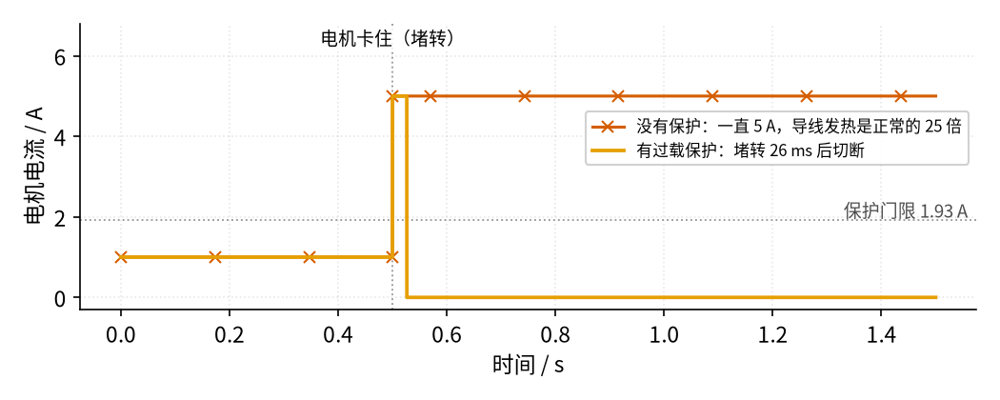
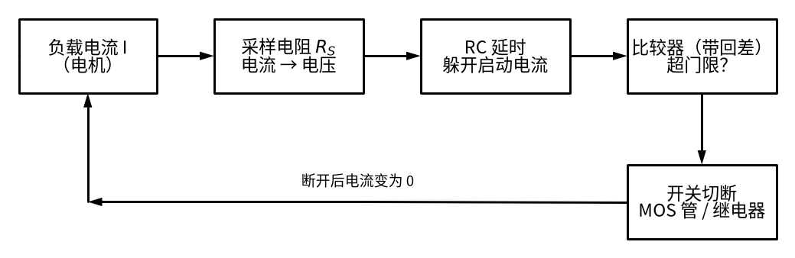

# 11 过载保护 · 直觉篇

[上一页：08 线性稳压 · 参数与调试篇](../08-linear-regulator/page3.md) · 本页：直觉篇 · [原理与实现篇](page2.md) · [参数与调试篇](page3.md) · [下一页：原理与实现篇](page2.md) · 前置节点：[P1 元件速成 · 直觉篇](../P1-components-basics/page1.md) · [P2 半导体入门 · 直觉篇](../P2-semiconductor-basics/page1.md) · [14 电压比较器 · 直觉篇](../14-voltage-comparator/page1.md)

## 痛点：电机卡住的那一刻，电流会猛涨

做过小车或者小风扇的同学大概都遇到过：轮子被卡住，或者扇叶被手指挡住，电机不转了，可是电源还在给它供电。这时候电机就像一根很粗的电阻丝，电流一下子涨到正常值的好几倍。我们这一节用的例子是一台 12 V、正常电流 1 A 的直流电机，卡住（专业叫法是**堵转**）时电流约 5 A。

电流涨 5 倍，发热涨多少？导线和电机线圈的发热功率是 $P = I^2 R$ （见 [P1 元件速成 · 直觉篇](../P1-components-basics/page1.md)），电流变成 5 倍，发热就变成 25 倍。几秒钟之内，细导线的绝缘皮会变软、冒烟；电机线圈的漆包线绝缘也可能被烤坏；最坏的情况是引起火灾。电源被短路时更严重，电流可以达到几十安。

所以，凡是带电机、带大电流负载的电路，都需要一个「看门人」：电流正常时什么也不做，电流超标时立刻把电路断开。这就是**过载保护**。断开的动作，电工里常叫**跳闸**。

先看看有没有保护的区别。下图是仿真结果，横轴是时间，纵轴是电机电流，0.5 s 时电机被卡住：

*图 11-p1-1　电机在 0.5 s 堵转：没有保护时一直流过 5 A，有保护时 26 ms 后被切断*

在图 11-p1-1 里，朱红色带 × 的线是没有保护的情况，电流跳到 5 A 后一直保持，导线一直在以 25 倍的功率发热。橙色线是加了过载保护的情况：电流同样跳到 5 A，但只持续了 26 ms 就被切到 0。灰色点线是保护门限 1.93 A，电流超过它一段时间后，保护电路就动手了。26 ms 的大电流只会让导线稍微热一点，完全安全。

## 类比：家里的「电表箱空气开关」和「门卫」

家里的电表箱里有一排空气开关。你同时开电暖器、电热水壶、空调，电流太大，「啪」的一声跳闸，全屋断电。它做的事情分三步：

1. **量**：时时刻刻知道电流有多大。
2. **判**：拿电流和一个「最大允许值」比，看有没有超。
3. **断**：超了就断开开关。

我们要做的电子式过载保护，也是这三步，只是每一步都换成了你学过的元件：

- **量**：在电流的路上串一个很小的电阻，叫**采样电阻**。电流流过它，两端就有电压 $V = I \cdot R_S$ （欧姆定律）。电流越大，电压越大，电流就被「翻译」成了电压。
- **判**：电压可以交给 [14 电压比较器 · 直觉篇](../14-voltage-comparator/page1.md) 去判断，超过门限就翻转输出。
- **断**：比较器的输出去控制一个开关，比如 [21 MOS 管开关 · 直觉篇](../21-mosfet-switch/page1.md) 里的 N 沟道 MOS 管，或者一个继电器（见 [P2 半导体入门 · 直觉篇](../P2-semiconductor-basics/page1.md) 里三极管、MOS 管当开关的用法）。

还有两个细节，像门卫的「经验」：

- **别被吓一跳**：电机刚启动时，电流本来就会冲得很高，过几十毫秒才回落。好门卫不会一看到人跑就拦，而是观察一小会儿。电路里用一个 RC 电路「延时」来做到这一点。
- **别反复开关门**：电流在门限附近抖来抖去时，比较器会一会儿开一会儿关。14 节学过的**回差**（施密特比较器）就是治这个病的。

## 看图：一条「量 → 判 → 断」的链

把上面的步骤画成方框，就是下面这张图：

*图 11-p1-2　过载保护的信号链：量（采样电阻）→ 滤（RC 延时）→ 判（比较器）→ 断（开关）*

沿着图 11-p1-2 从左往右看：负载电流流过采样电阻，变成一个很小的电压（1 A 对应 0.1 V）；这个电压先经过 RC 延时，把启动时短暂的冲击「抹平」；再送进带回差的比较器，跟门限比较；超了，比较器就让开关断开。

注意最下面那条往回走的箭头：开关一断，电流立刻变成 0，于是采样电压也变成 0，比较器会觉得「电流正常了」，又把开关合上……这样就会一断一合地「打嗝」。是让它打嗝重试，还是断开以后就锁住、等人检查后再复位，是设计保护电路时必须做的选择。这个问题在原理与实现篇和参数与调试篇里会用仿真讲清楚，它和 [17 自锁 · 直觉篇](../17-self-locking/page1.md) 里「按一下就保持」的思想是相通的。

## 还有哪些过载保护？

电子式保护不是唯一的办法，生活里还有两种常见的：

- **保险丝**：一段特意做得很细的金属丝，电流太大时自己熔断。便宜、可靠，但断了要换新的。它熔断靠的是发热，而发热和电流的平方成正比，所以电流大一倍，熔丝升温就快大约四倍；短时间的小冲击它扛得住，持续的大电流才会把它烧断。
- **热继电器**：里面有一片双金属片，电机电流让它发热弯曲，弯到一定程度就顶开触点。工厂里的大电机（多用三相交流电供电，什么是三相见 [17 自锁控制电路 · 直觉篇](../17-self-locking/page1.md) 的小知识框）几乎都配它，17 节控制回路里的 FR 就是它。

这三种保护有一个共同点：电流超得越多，断得越快；只超一点点，就多等一会儿。参数与调试篇会把它们放在一起比较。

## 一句话

**过载保护 = 采样电阻把电流变成电压 + RC 延时躲开启动冲击 + 带回差的比较器判断 + 开关切断负载；还要决定切断后是锁住还是重试**。
