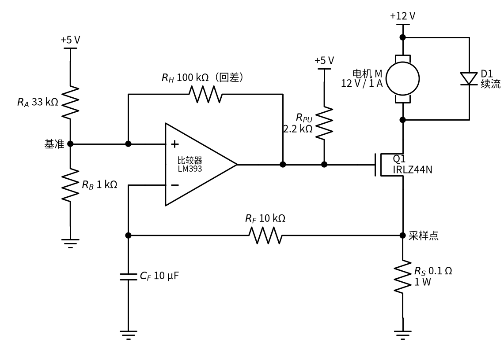
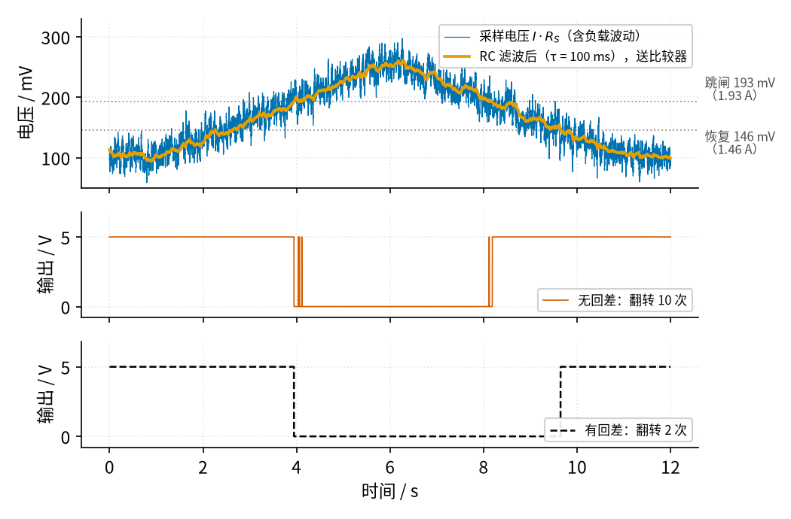

# 11 过载保护 · 原理与实现篇

[上一页：直觉篇](page1.md) · [直觉篇](page1.md) · 本页：原理与实现篇 · [参数与调试篇](page3.md) · [下一页：参数与调试篇](page3.md) · 前置节点：[P1 元件速成](../P1-components-basics/page1.md) · [P2 半导体入门](../P2-semiconductor-basics/page1.md) · [14 电压比较器](../14-voltage-comparator/page1.md)

## 最小知识

读这一页只需要四样东西，前三样前面的节点都讲过：

- **欧姆定律和功率**： $V = IR$ ， $P = I^2 R$ 。
- **比较器和回差**：比较器只比较两个输入谁大，输出非高即低；施密特比较器用一个正反馈电阻造出两条门限，输入在两条门限之间时输出保持原状（见 [14 电压比较器](../14-voltage-comparator/page2.md)）。LM393 是开集电极输出，输出端必须接上拉电阻。
- **MOS 管当开关**：栅极接 5 V，N 沟道 MOS 管导通；栅极接 0 V，MOS 管断开（见 [21 MOS 管开关](../21-mosfet-switch/page1.md)）。本例沿用 21 节的 IRLZ44N，它在栅极 5 V 时导通电阻最大 25 mΩ（[数据手册](https://www.infineon.com/assets/row/public/documents/24/49/infineon-irlz44n-datasheet-en.pdf)）。
- **RC 充电**：电容通过电阻充电时，电压按 $e^{-t/\tau}$ 的规律逼近终点，时间常数 $\tau = RC$ 。一个 τ 走完约 63% 的路程，三个 τ 走完约 95%（见 [P1 元件速成](../P1-components-basics/page2.md)）。

## 电路总览

下面是本节用到的完整电路，元件值都已经标好：



*图 11-p2-1　电子式过载保护的完整电路（采样电阻放在低边，即负载和地之间）*

按「量 → 滤 → 判 → 断」的顺序读图 11-p2-1：

1. **量**：采样电阻 $R_S$ = 0.1 Ω 串在 MOS 管源极和地之间。电机电流 1 A 时，采样点电压 0.1 V；5 A 时 0.5 V。电阻放在负载和地之间，叫**低边采样**。它的好处是采样电压以地为参考，比较器的输入电压很低，LM393 的输入共模范围包含地，可以直接接（[LM393 数据手册](https://www.ti.com/lit/ds/symlink/lm393.pdf)）。TI 的应用笔记 [SBOA169B](https://www.ti.com/lit/an/sboa169b/sboa169b.pdf) 也指出低边采样的共模电压接近地、电路简单；代价是采样电阻上的压降会把负载的「地」抬高一点，所以 $R_S$ 要尽量小。
2. **滤**： $R_F$ = 10 kΩ 和 $C_F$ = 10 μF 组成 RC 低通，τ = 0.1 s。它让比较器看到的是「电流在最近一小段时间里的平均水平」，电机启动时几十毫秒的冲击会被抹平。
3. **判**：滤波后的电压进 LM393 的**反相端**（−）。同相端（+）接一个由 $R_A$ = 33 kΩ、 $R_B$ = 1 kΩ 组成的基准分压，再通过 $R_H$ = 100 kΩ 从输出取一点正反馈，形成回差。
4. **断**：LM393 的输出经 $R_{PU}$ = 2.2 kΩ 上拉到 5 V，直接接 MOS 管栅极。电流正常时，反相端低于门限，输出为高（5 V），MOS 管导通，电机转；过载时输出被拉到接近 0 V，MOS 管断开，电机停。电机两端并联的续流二极管 D1 与 21 节相同，用来吸收电机线圈断电时的反向电压。

为什么把采样电压接到反相端，而 14 节的温控例子接在同相端？因为我们希望「正常 = 输出高 = MOS 管导通」，过载时输出变低。输入越大、输出越低，正是反相接法。这样还有一个好处：比较器断电或损坏导致输出为低时，MOS 管默认断开，电机停下来，偏向安全。

## 推导一：两条门限

先把基准分压用一个等效电源代替（不接 $R_H$ 时同相端的电压和分压器的内阻）：

$$V_T = V_{CC} \cdot \frac{R_B}{R_A + R_B} = 5 \times \frac{1}{34} \approx 0.147\text{ V}, \quad R_T = R_A \parallel R_B \approx 0.971\text{ kΩ}$$

中文意思：33 kΩ 和 1 kΩ 把 5 V 分成约 0.147 V；从同相端往分压器看进去，就像一个 0.147 V 的电源串了 0.971 kΩ 的电阻。

**正常运行时**，输出为高，它经过 $R_{PU}$ 和 $R_H$ 把同相端往上拉一点点：

$$V_H = V_T + (V_{CC} - V_T) \cdot \frac{R_T}{R_T + R_H + R_{PU}} \approx 0.147 + 4.853 \times \frac{0.971}{103.2} \approx 0.193\text{ V}$$

中文意思：正常时门限是 193 mV，滤波后的采样电压超过它就跳闸。它对应的电流是 $0.193 / 0.1 = 1.93\text{ A}$ ，也就是正常电流的约 1.9 倍。

**跳闸以后**，输出接近 0 V，它通过 $R_H$ 把同相端往下拉一点点：

$$V_L = V_T \cdot \frac{R_H}{R_T + R_H} \approx 0.147 \times \frac{100}{100.97} \approx 0.146\text{ V}$$

中文意思：跳闸后，采样电压要降到 146 mV 以下（电流低于 1.46 A），比较器才会认为「恢复正常」。两条门限相差 47 mV，这就是回差。门限的推法和 14 节完全一样，只是输入换到了反相端。

## 推导二：RC 延时和「反时限」

假设电机原来稳定在 $I_0$ = 1 A，电容上的电压是 $I_0 R_S$ 。某一刻电流突然变成 I，电容电压开始向新的终点 $I R_S$ 爬：

$$V_C(t) = I R_S + (I_0 R_S - I R_S) e^{-t/\tau}$$

中文意思：电容电压从旧值出发，按指数曲线逼近新值，τ 越大爬得越慢。

令 $V_C = V_H = I_{trip} R_S$ （ $I_{trip}$ = 1.93 A 是跳闸电流），解出跳闸所需的时间：

$$t_{trip} = \tau \ln \frac{I - I_0}{I - I_{trip}}$$

中文意思：过载电流 I 越大，分母越接近分子，对数越小，跳得越快；I 只比 $I_{trip}$ 大一点点时，分母接近 0，要等很久；I 不超过 $I_{trip}$ 时永远不跳。这种「超得越多、断得越快」的特性叫**反时限**，保险丝和热继电器也是这样。

代入堵转电流 5 A：

$$t_{trip} = 0.1 \times \ln \frac{5 - 1}{5 - 1.93} \approx 0.1 \times \ln 1.30 \approx 26\text{ ms}$$

中文意思：电机卡住 26 ms 后被切断，这正是直觉篇第一张仿真图里看到的数字。

## 代数小结：设计的三步

1. **选采样电阻**：门限电压希望在 0.1～0.3 V 左右。太小，比较器的失调电压（LM393 最大 5 mV）占比太大；太大，采样电阻发热多、负载少分到电压。本例 $R_S$ = 0.1 Ω，跳闸时功耗 $1.93^2 \times 0.1 \approx 0.37\text{ W}$ ，选 1 W 的电阻留足余量。
2. **定门限和回差**：由 $V_H$ 、 $V_L$ 两个式子选 $R_A$ 、 $R_B$ 、 $R_H$ 。 $R_H$ 越小，回差越大。
3. **定延时**：τ 要长到能躲开启动电流，又要短到堵转、短路时能及时断开。参数与调试篇会用扫描图来选。

## 仿真：电流慢慢越过门限，回差有什么用

先只看「判」这一步：让负载慢慢加重（1 A 升到 2.6 A），再慢慢减轻回到 1 A，上面叠加机械负载的随机起伏。比较器的输出暂时不去切断电机，我们只数它翻转了几次。

```python
import numpy as np                      # 数值计算
import matplotlib                       # 画图库
matplotlib.use("Agg")                   # 不弹窗口，直接存图
import matplotlib.pyplot as plt

VCC, RS = 5.0, 0.1                      # 比较器电源 5 V，采样电阻 0.1 Ω
RA, RB, RH, RPU = 33e3, 1e3, 100e3, 2.2e3   # 基准分压、回差电阻、上拉电阻
TAU = 10e3 * 10e-6                      # R_F·C_F = 10 kΩ × 10 μF = 0.1 s

VT = VCC * RB / (RA + RB)               # 基准分压（不接 R_H 时同相端的电压）
RT = RA * RB / (RA + RB)                # 分压器的等效内阻 R_A∥R_B
VH = VT + (VCC - VT) * RT / (RT + RH + RPU)   # 输出高（正常）时的门限：跳闸门限
VL = VT * RH / (RT + RH)                # 输出低（已跳闸）时的门限：恢复门限
print(f"跳闸 {VH*1e3:.0f} mV = {VH/RS:.2f} A，恢复 {VL*1e3:.0f} mV = {VL/RS:.2f} A")

def lowpass(x, dt, tau, y0):            # 一阶 RC 低通：每一步 y 向 x 靠近一点
    y = np.empty_like(x)
    v = y0
    for k in range(len(x)):
        v += (x[k] - v) * dt / tau      # 电容电压变化 = (输入 − 电容电压)·dt/τ
        y[k] = v
    return y

def comparator(vs, vh, vl):             # 反相施密特比较器：True = 输出高 = MOS 管导通
    on = np.empty(len(vs), dtype=bool)
    s = True                            # 上电时电流正常，输出高
    for k, v in enumerate(vs):
        if s and v > vh:                # 导通时，超过跳闸门限 → 断开
            s = False
        elif (not s) and v < vl:        # 断开时，低于恢复门限 → 再导通
            s = True
        on[k] = s
    return on

dt = 1e-3                               # 每步 1 ms
t = np.arange(0, 12, dt)                # 仿真 12 s
base = np.interp(t, [0, 1, 6, 11, 12], [1.0, 1.0, 2.6, 1.0, 1.0])   # 负载慢慢加重再减轻
rng = np.random.default_rng(3)          # 固定随机种子，每次结果一样
w = lowpass(rng.normal(0, 1, len(t)), dt, 0.01, 0.0)   # 机械负载的随机起伏
i_load = base + w * 0.15 / w.std()      # 起伏的标准差调成 0.15 A
vs = lowpass(i_load * RS, dt, TAU, i_load[0] * RS)     # 采样电压经 RC 滤波后送比较器

on_plain = comparator(vs, VH, VH)       # 无回差：上下门限相同
on_hyst = comparator(vs, VH, VL)        # 有回差
flips = lambda on: int(np.count_nonzero(np.diff(on.astype(int))))   # 数翻转次数
print(f"无回差翻转 {flips(on_plain)} 次，有回差翻转 {flips(on_hyst)} 次")

fig, ax = plt.subplots(3, 1, figsize=(7, 6), sharex=True)
ax[0].plot(t, vs * 1e3)                 # 滤波后的采样电压
ax[0].axhline(VH * 1e3, ls=":")         # 跳闸门限
ax[0].axhline(VL * 1e3, ls=":")         # 恢复门限
ax[0].set_ylabel("Vs / mV")
ax[1].plot(t, on_plain * 5.0)           # 无回差的输出
ax[1].set_ylabel("no hyst / V")
ax[2].plot(t, on_hyst * 5.0)            # 有回差的输出
ax[2].set_ylabel("hyst / V")
ax[2].set_xlabel("t / s")
fig.savefig("overload_hysteresis.png", dpi=100)   # 存到当前目录
```

运行后会打印「跳闸 193 mV = 1.93 A，恢复 146 mV = 1.46 A」和「无回差翻转 10 次，有回差翻转 2 次」。教程配图由 `code/11_sim.py` 生成，用的是同一套模型和同一个随机种子：



*图 11-p2-2　电流缓慢越过门限：无回差比较器翻转 10 次，有回差比较器只翻转 2 次*

读图 11-p2-2。第一行里，蓝色细线是原始采样电压，起伏很大；橙色粗线是 RC 滤波后的电压，平滑得多，但仍有小起伏。第二行是无回差比较器（两条门限都取 193 mV）：橙色线在 4 s 前后多次在门限附近穿来穿去，输出就跟着抖了好几下；8 s 附近下降时又抖了一次，一共翻转 10 次。如果这个输出真的去控制电机，电机就会在几十毫秒内反复启停，每次启动又带来冲击电流。第三行是有回差的比较器：3.95 s 电压第一次超过 193 mV 时跳低，之后哪怕电压在 193 mV 附近起伏，只要不低于 146 mV 就不会恢复；直到 9.65 s 电压降到 146 mV 以下才恢复，一共只翻转 2 次。

回差解决的是「判」的抖动。但请注意，图 11-p2-2 里比较器跳低以后，电流并没有真的被切断。真实电路里电流一断，采样电压会降到 0，远低于 146 mV，比较器很快又会恢复——回差管不住这件事。参数与调试篇的闭环仿真会专门讨论它。

## 例题

**例题 1（完整示范）**：用图 11-p2-1 的电路，求：(1) 跳闸电流和恢复电流；(2) 电机从 1 A 突然变成 3 A 时，多久跳闸；(3) 3 A 时采样电阻的功耗。

- 第一步，由推导一， $V_H \approx 193\text{ mV}$ ， $V_L \approx 146\text{ mV}$ ，除以 $R_S$ = 0.1 Ω，得跳闸 1.93 A、恢复 1.46 A。
- 第二步，代入反时限公式： $t = 0.1 \times \ln \frac{3 - 1}{3 - 1.93} = 0.1 \times \ln 1.86 \approx 62\text{ ms}$ 。
- 第三步，功耗 $P = 3^2 \times 0.1 = 0.9\text{ W}$ 。只持续 62 ms，1 W 电阻完全承受得住。

**例题 2（留空练习）**：比较器部分不变，只把采样电阻换成 0.05 Ω。

- 跳闸电流 = 193 mV ÷ 0.05 Ω = ____ A；
- 恢复电流 = 146 mV ÷ 0.05 Ω = ____ A；
- 刚好跳闸时采样电阻功耗 = ____ W。

<details><summary>答案</summary>

跳闸电流约 3.85 A，恢复电流约 2.91 A，功耗 $3.85^2 \times 0.05 \approx 0.74\text{ W}$ 。可见同一个比较器配不同的采样电阻，就能保护不同大小的电机。

</details>

**例题 3（变体迁移）**：换一台小水泵，正常电流 0.5 A，堵转电流 3 A。比较器部分不变，想让它在约 1 A 时跳闸。采样电阻取多大？堵转后多久切断？

<details><summary>答案</summary>

- 采样电阻 $R_S = 0.193 / 1 \approx 0.193\text{ Ω}$ ，取标准值 0.2 Ω，跳闸电流 $0.193 / 0.2 \approx 0.96\text{ A}$ ，恢复电流 $0.146 / 0.2 \approx 0.73\text{ A}$ 。
- 反时限公式里的 $I_0$ 换成 0.5 A： $t = 0.1 \times \ln \frac{3 - 0.5}{3 - 0.96} \approx 0.1 \times \ln 1.23 \approx 20\text{ ms}$ 。
- 跳闸瞬间功耗 $0.96^2 \times 0.2 \approx 0.19\text{ W}$ ，0.5 W 的电阻就够。

</details>
