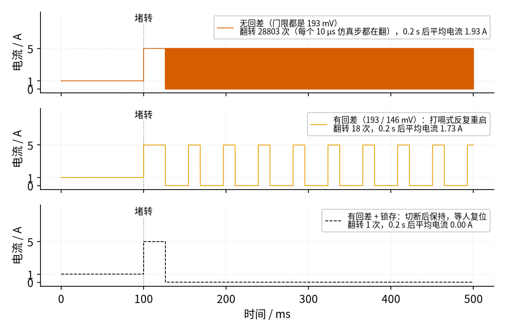
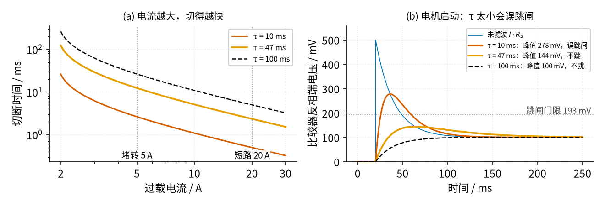

# 11 过载保护 · 参数与调试篇

[上一页：原理与实现篇](page2.md) · [直觉篇](page1.md) · [原理与实现篇](page2.md) · 本页：参数与调试篇 · [下一页：23 光耦隔离](../23-optocoupler/page1.md) · 前置节点：[P1 元件速成](../P1-components-basics/page1.md) · [P2 半导体入门](../P2-semiconductor-basics/page1.md) · [14 电压比较器](../14-voltage-comparator/page1.md)

## 参数总表

| 参数 | 本例取值 | 决定什么 | 取值依据 |
|---|---|---|---|
| 采样电阻 $R_S$ | 0.1 Ω，1 W | 电流 → 电压的比例、发热、负载少得的电压 | 跳闸时功耗 0.37 W，留约 2.5 倍余量 |
| 基准分压 $R_A$ / $R_B$ | 33 kΩ / 1 kΩ | 门限的「中心」约 147 mV | 门限要远大于 LM393 失调（最大 5 mV） |
| 回差电阻 $R_H$ | 100 kΩ | 回差 47 mV（约 0.47 A） | 要大于滤波后残留的起伏 |
| 上拉电阻 $R_{PU}$ | 2.2 kΩ | 输出高电平和 MOS 管栅极充电速度 | 与 14 节一致 |
| 滤波 $R_F$ / $C_F$ | 10 kΩ / 10 μF，τ = 0.1 s | 躲开启动电流的能力、切断速度 | 下面的扫描图 |
| 门限 $V_H$ / $V_L$ | 193 mV / 146 mV | 跳闸 1.93 A、恢复 1.46 A | 正常电流的约 1.9 倍 |

TI 的低边采样设计笔记 [SBOA285A](https://www.ti.com/lit/an/sboa285a/sboa285a.pdf) 用的是 1 A 满量程、250 mΩ 采样电阻，满量程压降 250 mV，和本例「零点几伏」的量级相同；它还提醒两件事：采样电阻的误差会直接变成测量误差，小电流时运放失调电压造成的相对误差最大。我们的门限 193 mV 比 LM393 的最大失调 5 mV 大约 39 倍，失调只带来约 2.6% 的门限误差。

## 采样电阻怎么选

保持跳闸电流 1.93 A 不变，换不同的采样电阻（比较器门限跟着按比例调），各项代价如下（数字由 `code/figs/11_figs.py` 打印）：

| $R_S$ | 门限电压 | 1 A 时功耗 | 跳闸时功耗 | 5 mV 失调占门限 | 电机少得的电压（1 A） |
|---|---|---|---|---|---|
| 0.01 Ω | 19.3 mV | 0.01 W | 0.04 W | 25.9% | 0.01 V |
| 0.05 Ω | 96.4 mV | 0.05 W | 0.19 W | 5.2% | 0.05 V |
| 0.1 Ω | 192.7 mV | 0.10 W | 0.37 W | 2.6% | 0.10 V |
| 0.5 Ω | 963.6 mV | 0.50 W | 1.86 W | 0.5% | 0.50 V |

读表：电阻越小越省电，但门限电压小到几十毫伏时，比较器自己的误差就占了大头；电阻越大越准，但发热和压降都变大，还会把低边采样的「地」抬得更高（[SBOA169B](https://www.ti.com/lit/an/sboa169b/sboa169b.pdf) 提到的缺点）。0.05～0.1 Ω 是本例的合理区间。另外，LM393 的输入偏置电流最大 250 nA，流过 $R_F$ = 10 kΩ 会产生 2.5 mV 的误差，所以 $R_F$ 不宜取得太大，需要更长的 τ 时宁可加大 $C_F$ 。

## 闭环：切断以后会发生什么

原理与实现篇只看了「判」。现在让比较器真的去控制 MOS 管：断开时电流为 0，滤波电容开始放电。电机在 100 ms 时堵转（5 A），比较三种做法：

*图 11-p3-1　电机在 100 ms 堵转后的实际电流：无回差 / 有回差（打嗝重启）/ 有回差加锁存*

图 11-p3-1 的三行分别是：

- **第一行（红色，无回差）**：堵转 26 ms 后第一次切断，电流一断，滤波电压立刻低于门限，马上又导通；一导通又超门限……每个仿真步长（10 μs）都在翻转，0.4 s 里翻转了 28803 次。平均电流被「钉」在门限 1.93 A，MOS 管在高速开关中发热，电机一直在受冲击。这是最糟糕的情况。
- **第二行（橙色，有回差）**：切断后，电容从 193 mV 放电到 146 mV 才恢复，用时 $\tau \ln (V_H / V_L) = 0.1 \times \ln (193/146) \approx 28\text{ ms}$ ；恢复后电流又是 5 A，再过约 14 ms 又跳闸。这叫**打嗝式保护**（hiccup），导通约占 34%，平均电流 1.73 A。很多集成驱动芯片就这么做，例如 [DRV8871 电机驱动](https://www.ti.com/lit/ds/symlink/drv8871.pdf)：电流超过过流门限 1.5 μs 后关闭所有管子，3 ms 后自动重试，故障还在就重复这个过程。打嗝能在故障排除后自己恢复，但堵转一直存在时，电机每 42 ms 就挨一次 5 A 的冲击。
- **第三行（黑色虚线，加锁存）**：跳闸后把状态「锁住」，直到断电或按复位按钮才恢复，平均电流 0 A。这和 [17 自锁](../17-self-locking/page1.md) 的思路一样，只是反过来：17 节是「按一下启动就保持运行」，这里是「跳一次闸就保持断开」。电路上可以用 LM393 的另一半、一个小单片机或一个自锁继电器来记住状态。

怎么选？堵转、短路这种「不会自己消失」的故障，适合锁存，让人来检查；偶尔的、短暂的过载（例如负载偶尔卡一下），适合打嗝自动恢复。

## τ 的取舍：反时限曲线和启动电流

τ 是本节最难选的参数。下图左边是不同 τ 下的切断时间，右边是电机从静止启动时（冲击电流 5 A，按 20 ms 时间常数回落到 1 A）滤波电容上的电压：

*图 11-p3-2　(a) 不同 τ 的反时限切断曲线；(b) 电机启动冲击经不同 τ 滤波后的电压（不切断时的开环结果）*

图 11-p3-2 (a)：三条线都是往右下降的，电流越大切得越快。τ = 10 ms（红）时，堵转 5 A 只需 2.6 ms、短路 20 A 只需 0.50 ms；τ = 100 ms（黑虚线）时分别是 26.4 ms 和 5.00 ms。τ = 47 ms（橙）介于两者之间：12.4 ms 和 2.35 ms。

图 11-p3-2 (b)：未滤波的采样电压（蓝色细线）在启动瞬间冲到 500 mV。τ = 10 ms 时，滤波后峰值仍有 278 mV，超过门限 193 mV，电机每次启动都会被误判为过载——这叫**误跳闸**。τ = 47 ms 时峰值 144 mV，τ = 100 ms 时峰值只有 100 mV，都不会误跳。

所以选 τ 的规则是：先保证启动不误跳（τ 至少是启动冲击持续时间的两倍以上，本例 47 ms 已够），再在此基础上尽量短，让短路时切得快。本例选 100 ms 是偏保守的，参数表里换成 47 ms（例如 $R_F$ 10 kΩ、 $C_F$ 4.7 μF）也合理。注意：对真正的短路（几十安），几毫秒仍然可能太慢，MOS 管自身也可能扛不住，所以实际产品通常还会再串一个保险丝作为最后一道防线。

## 三种保护方式的比较

| 方式 | 怎么工作 | 优点 | 缺点 |
|---|---|---|---|
| 保险丝 | 电流太大时熔丝自己熔断 | 便宜、可靠、能断短路 | 一次性；正常工作只能用到额定电流的 75% 左右 |
| 热继电器 | 电机电流让双金属片发热弯曲，顶开常闭触点 | 模拟电机发热，适合长时间过载 | 动作慢（秒级），不能做短路保护 |
| 电子式（本节） | 采样电阻 + 比较器 + 开关 | 门限、延时可调；可锁存或自动重试 | 需要电源和更多元件 |

表里的数字有出处：Littelfuse 的 [保险丝设计指南](https://nationalfuse.com/wp-content/uploads/2023/03/Fuseology-Design-Guide.pdf) 建议正常电流不超过保险丝额定值的 75%，而且启动冲击的 $I^2 t$ 不要超过保险丝熔化 $I^2 t$ 额定值的 20%；ABB 的 [热过载继电器手册](https://library.e.abb.com/public/a9cd1c3f07dc1870852573a300738595/1SXU106043B0201.pdf) 规定设定电流的 1.05 倍不脱扣、1.2 倍时 2 小时内脱扣，10 级（Class 10）在 7.2 倍电流下 4～10 s 脱扣。和本节电子保护的几十毫秒相比，热继电器是「慢性子」，这正好让电机启动时不误动作。热继电器不做短路保护这一点，17 节参数与调试篇也提到过。

## 故障排查表

| 现象 | 原因 | 怎么查 | 怎么改 |
|---|---|---|---|
| 电机一启动就停 | τ 太小，启动冲击被当成过载 | 示波器看比较器反相端，启动时是否超过 193 mV | 加大 $C_F$ ；或适当提高门限 |
| 堵转时电机「嗒嗒嗒」快速启停，MOS 管发烫 | 没有回差，或回差太小 | 看比较器输出是否是密集的脉冲 | 加 $R_H$ 或减小它，增大回差；需要时加锁存 |
| 堵转时电机每隔几十毫秒抖一下 | 有回差但没锁存，处于打嗝状态 | 输出是规律的方波 | 这是设计行为；不想要就加锁存 |
| 明显过载却不跳闸 | 门限太高；或 $R_S$ 阻值偏小 / 接触不良 | 测满载时采样点电压；量 $R_S$ 实际阻值 | 按 $I_{trip} = V_H / R_S$ 重新核算 |
| 采样电阻烫手甚至变色 | 功率不够 | 算 $I^2 R_S$ ，尤其是跳闸电流时 | 换更大功率或更小阻值的电阻 |
| 门限不准、不同板子差别大 | 采样线和电机大电流地线共用，导线压降叠进采样电压；或比较器失调 | 在 $R_S$ 两端直接测电压，对比比较器入口 | 采样点和地都从 $R_S$ 两端单独引线；门限不要低于约 50 mV |

## 练习

**练习 1**：把 τ 从 100 ms 改成 47 ms（ $C_F$ 换成 4.7 μF），堵转时打嗝的「断开」时间是多少？

答案

断开时间 $= \tau \ln (V_H / V_L) = 0.047 \times \ln (193 / 146) \approx 13\text{ ms}$ 。τ 越小，打嗝越快，电机挨冲击也越频繁。

**练习 2**：参考图 11-p3-2 (b)，如果电机启动冲击回落得更慢（时间常数从 20 ms 变成 50 ms），τ = 47 ms 还安全吗？应该往哪个方向调？

答案

不一定安全。冲击持续更久，电容有更多时间充上去，峰值会明显高于 144 mV，可能超过 193 mV。应该加大 τ（比如回到 100 ms），或者提高门限。可以把 `code/11_sim.py` 里的 `TAU_START` 改成 0.05 自己跑一下验证。

**练习 3**：一台 12 V、3 A 的电机，希望约 6 A 跳闸。小明直接用 0.1 Ω 采样电阻并把门限调到 0.6 V。指出问题并给出改进。

答案

跳闸时采样电阻功耗 $6^2 \times 0.1 = 3.6\text{ W}$ ，太大；正常运行时也要压掉 0.3 V。改进：比较器保持 193 mV 门限，把 $R_S$ 换成 0.033 Ω，跳闸电流 $0.193 / 0.033 \approx 5.84\text{ A}$ ，跳闸时功耗约 1.13 W，选 2 W 电阻即可。

**练习 4（变体迁移）**：如果不用电子保护，改用保险丝保护本节 1 A 的电机。启动冲击按 $1 + 4e^{-t/20\text{ ms}}$ A 估算，它比稳定 1 A 多出的 $I^2 t$ 约为 0.32 A²s。按设计指南的两条规则，保险丝至少要满足什么条件？它能代替电子保护的「堵转 26 ms 切断」吗？

答案

- 额定电流：正常 1 A 不超过额定值的 75%，所以额定电流至少 1 ÷ 0.75 ≈ 1.33 A，取 1.5 A 或 2 A 的慢断型。
- 熔化 $I^2 t$ ：启动冲击的 $I^2 t$ 不超过熔化额定值的 20%，所以熔化 $I^2 t$ 至少 0.32 ÷ 0.2 = 1.6 A²s（粗略估算，未计入 1 A 稳态部分）。
- 不能完全代替。这样的保险丝对 5 A 堵转（只有额定值的 2.5～3.3 倍）往往要很久才熔断，时间由它的时间—电流曲线决定；而且熔断后要换新的。所以保险丝适合当「短路的最后一道防线」，堵转这类中等过载仍然交给电子保护或热继电器。

