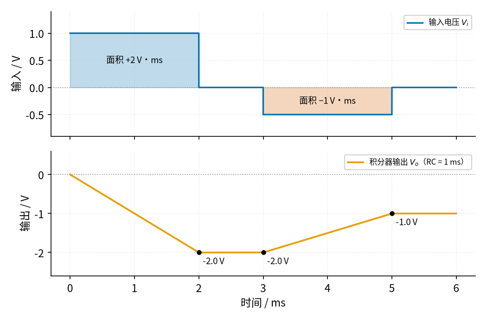
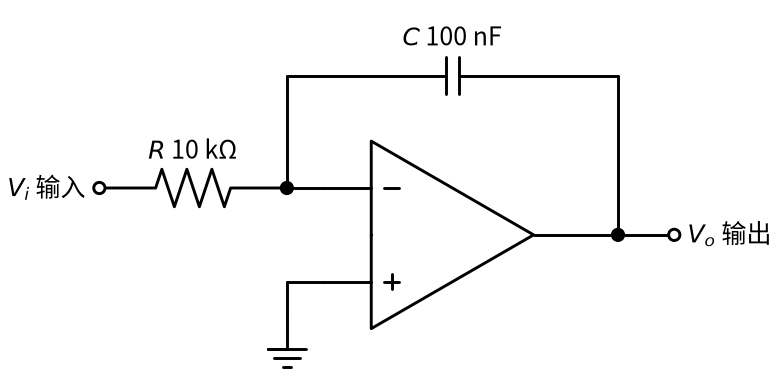
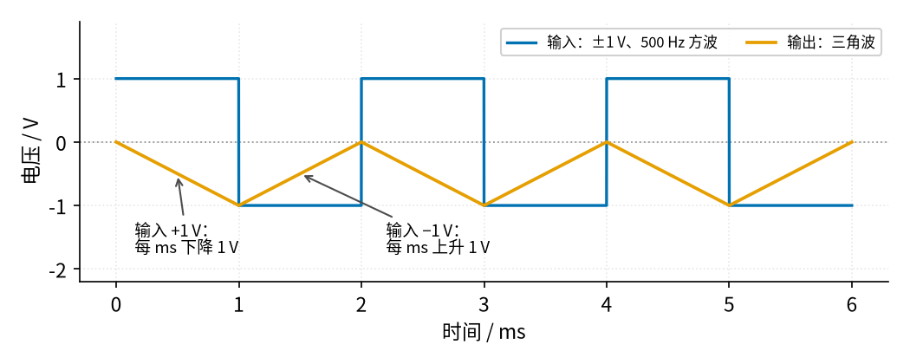

# 12 积分器 · 直觉篇

[上一页：06 参数与调试篇](../06-bridge-rectifier/page3.md) · 本页：直觉篇 · [原理与实现篇](page2.md) · [参数与调试篇](page3.md) · [下一页：原理与实现篇](page2.md) · 前置节点：[P1 元件速成](../P1-components-basics/page1.md) · [01 反相放大](../01-inverting-amp/page1.md)

## 痛点：电路要记住「一共攒了多少」

到目前为止，我们见过的放大电路都是「看现在」：输入此刻是多少，输出此刻就是它的若干倍，输入一停，输出马上归零。可是很多场合需要的是「看累计」：

- 想让电路产生一条**均匀上升的斜坡电压**（锯齿波、三角波发生器，扫描电路里都要用），手里却只有一个时正时负的**方波**；
- 想知道一块电池**一共放出了多少电荷**，传感器只能告诉你「此刻电流是多少」，你得把每一小段时间里的电流都加起来；
- 想让一个控制系统「记住」过去一段时间里误差一直偏向哪一边，好慢慢把它纠正过来。

这三件事说的都是同一个要求：**输出不取决于输入现在是多少，而取决于输入到目前为止「攒了多少」**。数学上把这个「攒」叫做**积分**，干这件事的电路就叫**积分器**。你不需要会微积分，只要会算「长方形的面积」就够了。

## 类比：往水桶里放水

想象一个水桶和一个水龙头：

- **水龙头开多大**，相当于**输入电压**：开得大，水流得快；
- **桶里的水位**，相当于**输出电压**：它不看龙头此刻开多大，而是记录「到现在一共流进来多少水」；
- 龙头一关（输入为 0），水位并不会掉回去，而是**停在原处**——这就是「记忆」；
- 如果龙头反着接，往外抽水（输入为负），水位就慢慢往下降。

桶的粗细决定了「流进同样多的水，水位涨多少」：桶越粗，水位涨得越慢。在电路里，这个「桶的粗细」就是电阻和电容的乘积 RC，叫**时间常数**。

在 [P1 元件速成](../P1-components-basics/page1.md) 里我们说过：电容就是这样一个「水桶」，**电容电压的变化 = 电流曲线下的面积 ÷ C**。积分器要做的，只是想办法让「流进电容的电流」正比于输入电压，再把电容上的电压原样送出来。

## 图：面积变成电压

下面这张图把「攒」画得最直白。上半部分是输入：先 +1 V 维持 2 ms，再 0 V 歇 1 ms，然后 −0.5 V 维持 2 ms。蓝色和橙色的阴影就是「输入曲线和 0 V 线围成的面积」，单位是「伏·毫秒」。

*图 12-p1-1　积分器输出就是输入曲线下面积的「累计账本」（RC = 1 ms，输出带一个负号）*

读图 12-p1-1 时盯住三件事：① 前 2 ms 输入是正的，面积一直在涨，输出就一直往下走（反相积分器带负号），到 2 ms 时面积是 +2 V·ms，输出是 −2.0 V；② 2～3 ms 输入为 0，面积不再增加，输出**停在 −2.0 V 不动**——这就是「记忆」；③ 3～5 ms 输入为负，面积减少了 1 V·ms，输出回升到 −1.0 V。规律就是：**输出 = −（累计面积）÷ RC**。

电路本身只比 [01 反相放大](../01-inverting-amp/page1.md) 改了一个地方：把反馈电阻 $R_f$ 换成了电容 $C$ 。

*图 12-p1-2　反相积分器：输入经 R 接到反相端，反馈支路是一只电容 C*

图 12-p1-2 里，输入电压经过 R 变成一股电流，这股电流没处可去（运放输入端不取电流），只能全部流进电容，给电容「灌水」。运放的输出则负责把电容另一端的电压「顶」出来给你看。

最经典的用法就是把方波变成三角波：方波在 +1 V 和 −1 V 之间来回切换，相当于水龙头一会儿正着放、一会儿反着抽，水位就一会儿均匀下降、一会儿均匀上升，画出来正好是三角形。

*图 12-p1-3　±1 V、500 Hz 方波输入，RC = 1 ms 的积分器输出峰峰值 1 V 的三角波*

从图 12-p1-3 可以看出，三角波的每条斜边都是直的——因为输入在每半个周期里是一个固定值，面积是匀速增加的。斜率 = 输入电压 ÷ RC = 1 V ÷ 1 ms，也就是每毫秒变化 1 V。

## 一句话总结

**积分器 = 把输入电压变成电流灌进电容，输出电压记录的是「输入曲线下的累计面积 ÷ RC」（带负号）；输入为零时它会停住不动，这既是它的本事，也是它的隐患——一点点直流误差也会被一直攒下去**。这个隐患以及怎么治，下一页细讲。
