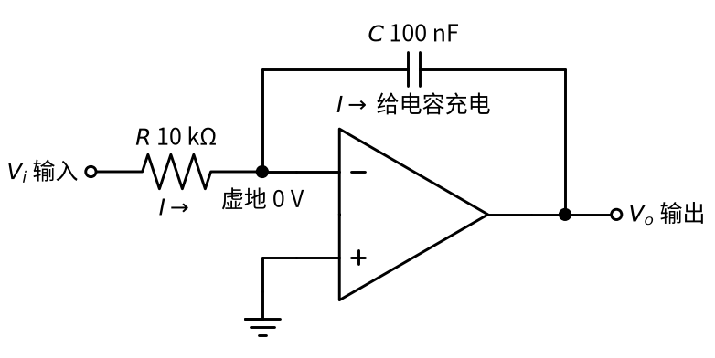
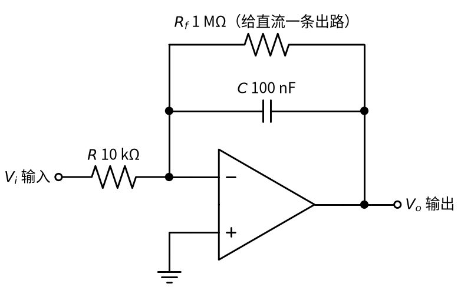
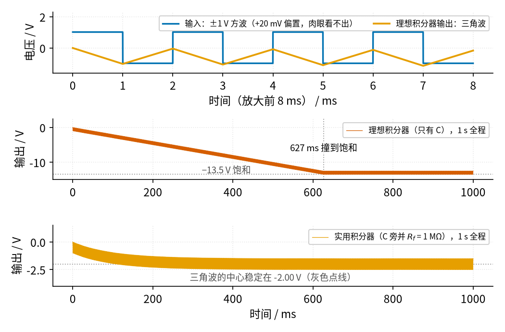

# 12 积分电路 · 原理与实现篇

[上一页：直觉篇](page1.md) · [直觉篇](page1.md) · 本页：原理与实现篇 · [参数与调试篇](page3.md) · [下一页：参数与调试篇](page3.md) · 前置节点：[P1 元件速成](../P1-components-basics/page1.md) · [01 反相放大](../01-inverting-amp/page1.md)

## 先补一点最小知识

这一页只用到三样东西：

1. **虚短、虚断和虚地**：[01 反相放大](../01-inverting-amp/page1.md) 讲过，运放加了负反馈以后，反相端电压被「拉」得和同相端一样；同相端接地，反相端就是「虚地」，电压约为 0 V；同时运放输入端几乎不取电流。
2. **电容的「面积规则」**：[P1 元件速成](../P1-components-basics/page1.md) 讲过，电容电压的变化量 = 流进电容的电流 × 时间 ÷ C。电流不恒定时，就把「电流 × 时间」换成「电流曲线下的面积」。
3. **面积的记号**：数学上用 $\int_0^t V_i dt$ 表示「从 0 时刻到 t 时刻， $V_i$ 曲线和横轴围成的面积」，横轴上方算正，下方算负。你只要把它读成「累计面积」就行，不需要会算积分。

## 推导：三步得到输出公式

请对照下面的推导图，它就是直觉篇的积分器电路，只是把电流方向和虚地标了出来。



*图 12-p2-1　积分器中的电流 I：从输入经 R 流到虚地，再全部流进电容 C*

**第一步：输入电阻上的电流**。在图 12-p2-1 中，R 左端是 $V_i$ ，右端是虚地 0 V，所以

$$I = \frac{V_i - 0}{R} = \frac{V_i}{R}$$

中文意思：**输入电压越大，灌进去的电流越大；电流和输入电压成正比**。这一步把「电压」翻译成了「水流」。

**第二步：电流全部流进电容**。运放的反相端不取电流（虚断），这股电流 I 无路可走，只能流进电容 C。按照面积规则，在一小段时间 $\Delta t$ 里，电容两端电压的变化是

$$\Delta V_C = \frac{I \Delta t}{C} = \frac{V_i \Delta t}{RC}$$

中文意思：**电容电压每一小段的增量 = 这一小段输入的「面积」（ $V_i \Delta t$ ）÷ RC**。

**第三步：读出输出**。电容左端是虚地 0 V，右端就是输出 $V_o$ 。电流从左往右流进电容，充电的结果是左端比右端高，也就是 $0 - V_o$ 在增加，即 $V_o$ 在减小。把所有小段加起来：

$$V_o(t) = V_o(0) - \frac{1}{RC}\int_0^t V_i dt$$

中文意思：**输出 = 初始值 − 累计面积 ÷ RC**。负号来自反相接法（输入接在反相端），和 01 节反相放大的负号是同一个来源；RC 就是直觉篇里「桶的粗细」，单位是秒（10 kΩ × 100 nF = 1 ms）。

## 代数：三个最常用的结论

**结论一：恒定输入产生斜坡**。如果 $V_i$ 在一段时间内恒定，面积就是「长方形」 $V_i \times \Delta t$ ，输出是一条直线，斜率为

$$\text{斜率} = -\frac{V_i}{RC}$$

例如 $V_i$ = +1 V、RC = 1 ms，输出每毫秒下降 1 V。

**结论二：方波变三角波，峰峰值好算**。幅度为 $V_m$ 、周期为 $T$ 的方波，每半个周期输入恒为 $+V_m$ 或 $-V_m$ ，输出就在这半个周期里直线变化：

$$V_{pp} = \frac{V_m \cdot T/2}{RC}$$

中文意思：**三角波峰峰值 = 半个周期的面积 ÷ RC**。±1 V、500 Hz（半周期 1 ms）、RC = 1 ms，得到 $V_{pp}$ = 1 V，和直觉篇的方波图完全吻合。

**结论三：一点点直流就会把输出「攒」到饱和**。假如输入里混入了一个很小的直流偏置 $V_{dc}$ （信号源不完全对称，或者运放自身的失调电压），方波的正负面积相互抵消，可这点直流的面积却在一直累加，输出以 $V_{dc}/RC$ 的速度单向漂移。20 mV 偏置、RC = 1 ms 时，漂移速度就是 20 V/s：不到一秒，输出就会撞到电源附近的饱和电压（本节按 ±15 V 供电、输出极限约 ±13.5 V 估算，见 [P3 运放入门](../P3-opamp-basics/page1.md)）。

TI 的积分器设计手册说得很直接：理想积分器会依输入失调电压的极性**饱和到电源轨**，需要加一个反馈电阻（我们记作 $R_f$ ）来提供稳定的直流工作点，代价是这个电阻会限制积分功能的最低工作频率（[TI SBOA275B](https://www.ti.com/lit/an/sboa275b/sboa275b.pdf)）。这就是**实用积分器**：



*图 12-p2-2　实用积分器：在电容 C 旁边并联一个大电阻 Rf*

图 12-p2-2 的道理是「快慢分工」：对来回变化很快的方波，电容充放电跟得上，电流主要走电容，电路照常积分；对一直不变的直流，电容充满后就相当于断开，电流只能走 $R_f$ ，电路退化成 01 节的反相放大，放大倍数是 $-R_f/R$ ，于是直流偏置只会产生一个**固定的**输出偏移，而不会无限累积：

$$V_{o,\text{直流}} = -\frac{R_f}{R} V_{dc} = -\frac{1\text{ MΩ}}{10\text{ kΩ}} \times 20\text{ mV} = -2\text{ V}$$

## 仿真：理想积分器 vs 实用积分器

下面的代码把电路切成每 2 μs 一小段，一段一段地用「电压变化 = 电流 × 时间 ÷ C」往前推，同时让输出不超过 ±13.5 V。输入是 ±1 V、500 Hz 方波再加 20 mV 直流偏置。

```python
import numpy as np                      # 数值计算
import matplotlib                       # 画图库
matplotlib.use("Agg")                   # 不弹窗口，直接存图
import matplotlib.pyplot as plt
import figstyle as fs                   # 全书统一的配色、线型和中文字体

R, C = 10e3, 100e-9                     # 输入电阻 10 kΩ，反馈电容 100 nF → RC = 1 ms
RF = 1e6                                # 实用积分器并联的电阻 1 MΩ
VSAT = 13.5                             # 输出上下限（±15 V 供电的示意值）
dt = 2e-6                               # 每一小段 2 μs
t = np.arange(0, 1.0, dt)               # 仿真 1 秒
vin = np.where((t * 500) % 1 < 0.5, 1.0, -1.0) + 0.02   # ±1 V 500 Hz 方波 + 20 mV 偏置

def integrate(vin, rf=None):
    """逐段推进积分器输出；rf=None 表示理想积分器（只有电容）"""
    vo = np.empty_like(vin)             # 存放每个时刻的输出
    v = 0.0                             # 初始输出 0 V（电容不带电）
    g = 0.0 if rf is None else 1 / rf  # 并联电阻的电导，理想积分器为 0
    for k in range(len(vin)):
        vo[k] = v                       # 记下当前输出
        i_c = -vin[k] / R - v * g       # 流进电容的电流 = 输入电流 − 走 R_f 分掉的电流
        v = v + i_c * dt / C            # 电压变化 = 电流 × 时间 ÷ 电容
        v = min(max(v, -VSAT), VSAT)    # 输出到了电源附近就不能再变
    return vo

vo_ideal = integrate(vin)               # 理想积分器
vo_prac = integrate(vin, RF)            # 实用积分器
k_sat = np.argmax(np.abs(vo_ideal) >= VSAT - 1e-9)   # 第一次撞到饱和的位置
print(f"理想积分器在 {t[k_sat]:.3f} s 撞到 −{VSAT} V")
print(f"实用积分器最后 0.1 s 的平均输出 {vo_prac[t > 0.9].mean():.2f} V")

fig, ax = plt.subplots(2, 1, figsize=(7, 5), sharex=True)   # 上下两张子图
ax[0].plot(t * 1e3, vo_ideal, **{**fs.LS["bad"], "lw": 0.6, "marker": None})  # 理想积分器：朱红色（反面例子）
fs.ref_h(ax[0], -VSAT, "−13.5 V 饱和")  # 饱和线：灰色点线
ax[0].set_ylabel(fs.qlabel("理想", "V"))
ax[1].plot(t * 1e3, vo_prac, **{**fs.LS["vout"], "lw": 0.6})  # 实用积分器：橙色
fs.ref_h(ax[1], -2.0, "−2 V")           # 理论中心 −2 V：灰色点线
ax[1].set_ylabel(fs.qlabel("实用", "V"))
ax[1].set_xlabel(fs.qlabel("时间", "ms"))
fig.savefig("integrator_drift.png", dpi=120)   # 存到当前目录
print("已保存 integrator_drift.png")
```

运行后终端打印「0.627 s 撞到 −13.5 V」和「平均输出 -2.00 V」，存出的 integrator_drift.png 上面是朱红色的理想积分器输出，下面是橙色的实用积分器输出，两条灰色点线分别是 −13.5 V 饱和线和 −2 V 理论中心。教程里的配图由 `code/12_sim.py` 用同样的模型和同样的配色画出，加了放大窗口和标注：



*图 12-p2-3　上：前 8 ms 放大，方波变三角波；中：理想积分器被 20 mV 偏置一路攒到 −13.5 V；下：并联 1 MΩ 后输出中心停在 −2 V*

读图 12-p2-3：第一行和直觉篇一样，蓝色方波变成峰峰值 1 V 的橙色三角波，20 mV 的偏置在这么短的时间里根本看不出来。第二行把时间拉长到 1 秒，三角波来回很快，挤成了一条朱红色粗带，但粗带整体在**稳定地往下走**，斜率约 20 V/s，在 627 ms 撞到 −13.5 V 后就贴在那里不动了——此时积分器已经「死机」，输入再怎么变，输出也只剩一条平线。为什么不是 13.5 ÷ 20 = 0.675 s？因为三角波本身会向下摆 1 V，粗带的下边沿比中心先碰到灰色点线表示的饱和线。第三行加了 $R_f$ ，橙色粗带在大约 0.2 s 内下沉到 −2.00 V 附近就停住了，三角波峰峰值仍是 1.00 V，和公式算的完全一致。下沉的快慢由 $R_f C$ = 1 MΩ × 100 nF = 0.1 s 决定。

## 例题

**例题 1（完整示范）**：R = 10 kΩ，C = 100 nF，输入 ±2 V、250 Hz 的方波，求三角波峰峰值；若输出极限为 ±13.5 V，会不会削顶？

- 第一步，RC = 10 kΩ × 100 nF = 1 ms；半个周期 T/2 = 1 ÷ 250 Hz ÷ 2 = 2 ms。
- 第二步，半周期面积 = 2 V × 2 ms = 4 V·ms， $V_{pp}$ = 4 V·ms ÷ 1 ms = 4 V。
- 第三步，4 V 远小于 27 V（−13.5 V 到 +13.5 V），不会削顶；但如果有直流偏置，必须加 $R_f$ ，否则迟早漂到饱和。

**例题 2（留空练习）**：R = 20 kΩ，C = 47 nF，输入 ±1 V、1 kHz 方波，求 $V_{pp}$ 。

RC = ____ ms；半周期 = ____ ms； $V_{pp}$ = ____ V。

<details><summary>答案</summary>

RC = 20 kΩ × 47 nF = 0.94 ms；半周期 = 0.5 ms； $V_{pp}$ = 1 V × 0.5 ms ÷ 0.94 ms ≈ 0.53 V。

</details>

**例题 3（变体迁移：斜坡发生器 / 计时器）**：同一个积分器（RC = 1 ms，输出从 0 V 开始），输入接一个恒定的 −0.5 V。输出会怎样变化？多久能到 +10 V？如果想用它做一个「输出电压代表经过了多少时间」的计时器，有什么要注意的？

<details><summary>答案</summary>

输入恒定，输出是一条斜坡：斜率 = −(−0.5 V) ÷ 1 ms = +0.5 V/ms，均匀上升。到 +10 V 需要 10 ÷ 0.5 = 20 ms。做计时器时要注意两点：① 输出最多升到约 +13.5 V，所以最长只能计 27 ms，想计更久就要加大 RC；② 每次计时前要把电容放电清零（常在电容两端并一个开关），否则上次的「水位」会带到下一次。这个「恒定输入 → 斜坡」的用法，就是三角波、锯齿波发生器的核心。

</details>
