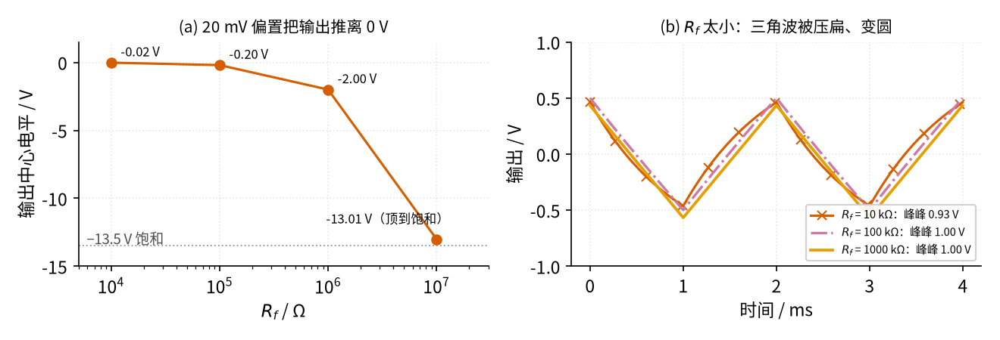
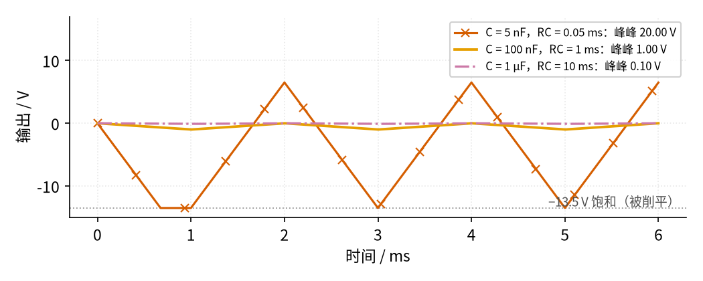

# 12 积分器 · 参数与调试篇

[上一页：原理与实现篇](page2.md) · [直觉篇](page1.md) · [原理与实现篇](page2.md) · 本页：参数与调试篇 · [下一页：19 星三角降压启动](../19-star-delta-start/page1.md) · 前置节点：[P1 元件速成](../P1-components-basics/page1.md) · [01 反相放大](../01-inverting-amp/page1.md)

## 一、参数表

积分器只有几个元件，但每个元件的取值都在「积得准」和「不漂走」之间做权衡。下表的建议来自 TI 积分器设计手册 [SBOA275B](https://www.ti.com/lit/an/sboa275b/sboa275b.pdf) 的设计说明，以及本节的仿真；运放参数沿用 [P3 运放入门](../P3-opamp-basics/page1.md) 里 LM358B 的数量级。

| 参数 | 物理含义 | 本节取值 | 怎么选 |
|---|---|---|---|
| R | 把输入电压变成电流 | 10 kΩ | 先取一个标准值，一般 1 kΩ～1 MΩ；太小运放要输出大电流，太大容易拾取干扰 |
| C | 「水桶」，存放累计的电荷 | 100 nF | 用薄膜电容或 C0G 陶瓷电容，容量稳定、漏电小 |
| RC | 时间常数，决定输出变化的快慢 | 1 ms | 让三角波峰峰值 $V_m \cdot (T/2) / RC$ 落在输出范围内且留有余量 |
| $R_f$ | 给直流一条出路，防止漂到饱和 | 1 MΩ | TI 建议在可行范围内尽量取大；同时让 $R_f C$ 决定的下限频率比最低工作频率再低十倍 |
| 运放失调电压 | 运放自带的「直流偏置」 | — | 会被 $-R_f/R$ 放大成输出偏移；TI 建议必要时在同相端接可调基准去抵消，或选低失调运放 |
| 运放输入偏置电流 | 输入端漏出的小电流，也会被电容「攒」起来 | — | TI 建议选 CMOS 输入的运放来减小这项误差 |
| 增益带宽积 GBW | 决定积分器能工作到多高频率 | LM358B 约 1.2 MHz | TI 的经验：GBW 至少取最高工作频率的 10 倍 |

TI 手册里的示例设计是 R1 = 100 kΩ、C1 = 1.59 nF、反馈电阻 R2 = 100 MΩ，选的是 CMOS 运放 TLV9002，仿真时还专门给运放设了 −740 μV 的失调电压来演示漂移问题；手册也提到，积分器常常放在一个更大的反馈环路（比如伺服控制）里，由外面的环路提供直流反馈，那时就可以不要这个电阻（[SBOA275B](https://www.ti.com/lit/an/sboa275b/sboa275b.pdf)）。

「 $R_f$ 下限频率比最低工作频率低十倍」写成公式是

$$f_c = \frac{1}{2\pi R_f C} \le \frac{f_{min}}{10}$$

中文意思：**$R_f$ 和 C 组成的「转角频率」要远低于你要积分的最低信号频率，积分器才像积分器**。本节 $R_f$ = 1 MΩ、C = 100 nF， $f_c$ ≈ 1.6 Hz，可以放心地积分 16 Hz 以上的信号。

## 二、参数扫描： $R_f$ 和 RC 怎么取

第一张扫描图固定 R = 10 kΩ、C = 100 nF，只改变 $R_f$ ，看两件事：左边是输入带 20 mV 直流偏置时，输出的中心被推到哪里；右边是没有偏置时，500 Hz 方波积出来的三角波还像不像三角波。

*图 12-p3-1　Rf 扫描：(a) 越大，直流偏置造成的输出偏移越大；(b) 越小，三角波越不像三角波*

图 12-p3-1 (a) 的四个点分别是 −0.02 V、−0.20 V、−2.00 V 和 −13.01 V，正好符合 $-R_f/R \times 20$ mV： $R_f$ 每大十倍，偏移就大十倍；到 10 MΩ 时理论偏移是 −20 V，已经超过输出能力，三角波的下半截被饱和电压削掉，中心才停在 −13.01 V。(b) 中 $R_f$ = 10 kΩ 时 $R_f C$ 只有 1 ms，和半个周期一样长，电容还没「攒」多少就被 $R_f$ 放掉一部分，斜边变成弯曲的弧线，峰峰值也降到 0.93 V；100 kΩ 和 1 MΩ 都已经是笔直的三角波（1.00 V）。结论：**$R_f$ 是两头为难的参数**——小了积不准，大了漂得远，按上面的「十倍规则」取能满足下限频率的、尽量小一点的值，再配合低失调运放。

第二张扫描图固定 R = 10 kΩ，改变 C，也就是改变 RC：

*图 12-p3-2　同样 ±1 V、500 Hz 方波输入，RC 取 0.05 ms、1 ms、10 ms 的输出*

图 12-p3-2 里，RC = 0.05 ms（C = 5 nF）时理论峰峰值是 1 V × 1 ms ÷ 0.05 ms = 20 V，输出在 −13.5 V 处被削平；RC = 10 ms（C = 1 μF）时峰峰值只有 0.10 V，小到容易淹没在噪声里；RC = 1 ms 时得到 1.00 V，大小合适。选 RC 的原则就是：**先按 $V_{pp} = V_m \cdot (T/2)/RC$ 算出想要的幅度，再留出足够余量，不让它碰到电源**。

## 三、排查表

| 现象 | 原因 | 怎么查 | 怎么改 |
|---|---|---|---|
| 上电后输出慢慢漂到正电源或负电源附近，然后不动了 | 没有 $R_f$ ，输入或运放的直流偏置被一直累积 | 把输入接地，看输出是否仍然单向漂移 | 在 C 旁并 $R_f$ ；或选低失调运放、在同相端接可调基准抵消失调 |
| 加了 $R_f$ ，输出中心仍偏离 0 V 好几伏 | $R_f/R$ 太大，偏置被放大得太多 | 量输入的直流平均值，乘以 $R_f/R$ 对比 | 在满足十倍规则的前提下减小 $R_f$ ；在输入端串电容隔掉直流 |
| 三角波斜边弯曲，像鱼鳍 | $R_f C$ 太小，和信号周期差不多 | 算 $f_c = 1/(2\pi R_f C)$ ，看是否远低于信号频率 | 增大 $R_f$ ，使 $f_c$ 低于最低频率的十分之一 |
| 三角波顶部或底部被削平 | RC 太小，峰峰值超出输出范围 | 按 $V_m \cdot (T/2)/RC$ 估算峰峰值 | 增大 R 或 C，或降低输入幅度 |
| 输出三角波很小，几乎是一条直线 | RC 太大 | 同上估算 | 减小 R 或 C |
| 波形相位或形状不对，像被「反过来」 | 忘了反相积分器带负号：输入为正时输出下降 | 对照输入看输出变化方向 | 这是正常现象；需要同相时后面再接一级反相放大（[01 反相放大](../01-inverting-amp/page1.md)） |
| 高频方波积出来的三角波变形、幅度不对 | 运放带宽或压摆率不够 | 降低频率看是否恢复 | 选 GBW 至少为最高工作频率 10 倍的运放 |
| 不用时把输入断开，输出缓缓变化 | 输入悬空，偏置电流给电容充电 | 把输入接地对比 | 输入不要悬空；选 CMOS 输入运放；需要时用开关给电容清零 |

## 四、练习

**练习 1**：积分器 C = 100 nF，需要处理的信号最低 50 Hz。按「下限频率低十倍」的规则， $R_f$ 至少多大？取 1 MΩ 合适吗？

答案

要求 $f_c \le$ 5 Hz，即 $R_f \ge 1/(2\pi \times 100\text{ nF} \times 5\text{ Hz})$ ≈ 318 kΩ。取 1 MΩ 时 $f_c$ ≈ 1.6 Hz，满足要求；但它的直流放大倍数是 1 MΩ ÷ R，如果 R = 10 kΩ 就是 100 倍，要确认输入直流偏置乘以 100 后仍在可接受范围内。

**练习 2**：理想积分器（没有 $R_f$ ）R = 10 kΩ、C = 1 μF，运放输入端等效有 5 mV 的直流偏置。从 0 V 开始，大约多久漂到 −13.5 V？如果并上 $R_f$ = 1 MΩ，输出最终偏移多少？

答案

RC = 10 ms，漂移速度 = 5 mV ÷ 10 ms = 0.5 V/s，13.5 V ÷ 0.5 V/s = 27 s。并上 1 MΩ 后直流放大倍数是 −1 MΩ/10 kΩ = −100，最终偏移 −100 × 5 mV = −0.5 V，不再继续漂移。

**练习 3**：输入 ±5 V、1 kHz 方波，R = 10 kΩ，希望三角波峰峰值约 4 V。C 应取多大？取标准值 68 nF 时实际峰峰值是多少？

答案

半周期 0.5 ms， $RC = V_m \cdot (T/2)/V_{pp}$ = 5 V × 0.5 ms ÷ 4 V = 0.625 ms，C = 0.625 ms ÷ 10 kΩ = 62.5 nF。取 68 nF 时 RC = 0.68 ms， $V_{pp}$ = 2.5 V·ms ÷ 0.68 ms ≈ 3.68 V。

**练习 4（变体迁移：电荷累计「库仑计」）**：一个电流传感器输出 0.1 V/A（电流越大电压越高）。想让积分器在「1 A 持续 10 s」时输出变化 5 V（输出为负也行）。RC 该取多少？用 R = 200 kΩ 时 C 取多大？如果运放有 1 mV 等效失调，连续工作 1 小时会发生什么？给出至少一个改进思路。

答案

1 A 时传感器输出 0.1 V，10 s 的面积 = 0.1 V × 10 s = 1 V·s，要求 1 V·s ÷ RC = 5 V，所以 RC = 0.2 s；R = 200 kΩ 时 C = 0.2 s ÷ 200 kΩ = 1 μF。1 mV 失调造成的漂移速度是 1 mV ÷ 0.2 s = 5 mV/s，1 小时（3600 s）累计 18 V，早已饱和，结果毫无意义。改进思路：① 只做短时间积分，并在每次测量前用开关把电容清零；② 选失调极低的运放，并在同相端接基准抵消失调；③ 长时间累计交给单片机：用 ADC 定时采样电流，在程序里把「电流 × 采样间隔」逐次相加，数字累加不会漂移。这和本节的核心结论一致：模拟积分器善于短时间、交流信号的积分，长时间的直流累计要特别小心。

